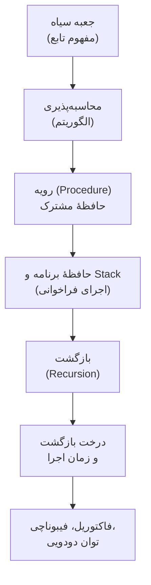
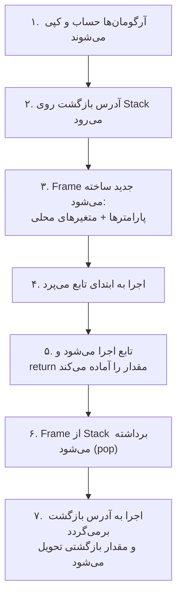
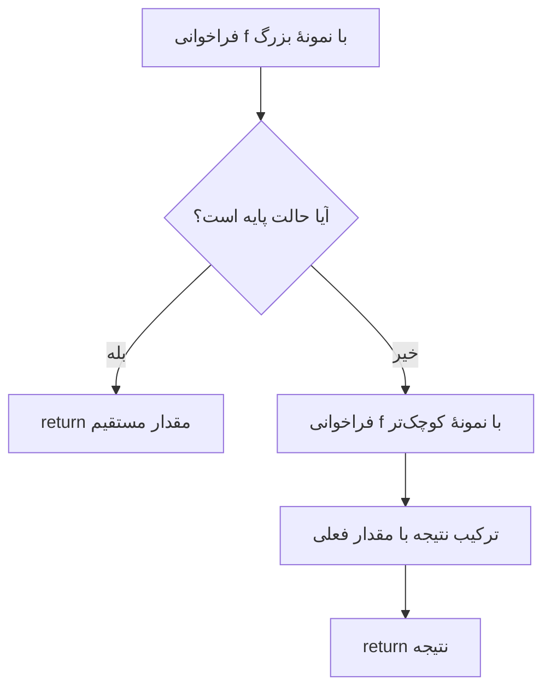
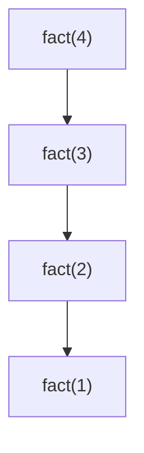
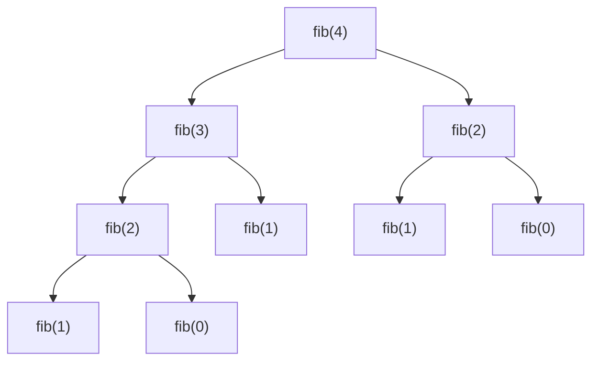
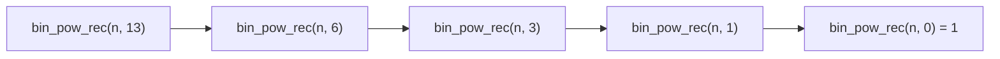

# بخش چهارم : توابع و بازگشت (درسنامه)

## مقدمه

تا اینجای درس، هر برنامه‌ای که نوشته‌ایم یک رشتهٔ بلند از دستورها بوده است که از ابتدای ‎`main`‎ شروع می‌شود و با کمک شرط و حلقه به انتها می‌رسد. این مدل برای مسائل کوچک کافی است، اما زود به سه مشکل برمی‌خورد: **تکرار** (یک محاسبهٔ مشابه را چند جا کپی می‌کنیم)، **پیچیدگی** (خواندن یک ‎`main`‎ چندصدخطی تقریباً ناممکن است) و **محدودیت بیان** (بعضی مسئله‌ها ذاتاً «خودمشابه» هستند و حلقه بیان طبیعی آن‌ها نیست).

راه‌حل علوم کامپیوتر برای هر سه مشکل یک ایده است: **انتزاع (Abstraction)**. یک قطعه از محاسبه را بسته‌بندی می‌کنیم، به آن نام می‌دهیم و از این به بعد فقط می‌پرسیم *چه کار می‌کند*، نه *چطور کار می‌کند*. نام این بسته‌بندی **تابع (Function)** است.

این بخش به سه فصل تقسیم شده و مسیر آن از سادهٔ مفهومی به سمت اجرای واقعی روی کامپیوتر است:

- **فصل ۸ :** تابع چیست؟ آیا هر تابعی را می‌توان محاسبه کرد؟ ساده‌ترین شکل اجرایی تابع (رویه) چه کم و کاستی‌ای دارد؟
- **فصل ۹ :** حافظهٔ برنامه چگونه سازمان‌دهی شده است و کامپیوتر یک فراخوانی تابع را چگونه اجرا می‌کند؟ (Stack)
- **فصل ۱۰ :** بازگشت، درخت بازگشت و زمان اجرا؛ با سه مثال اصلی: فاکتوریل، دنبالهٔ فیبوناچی و توان دودویی.



:::{admonition} راهنمای استفاده برای استاد
:class: tip
این فایل متن اصلی کلاس است و عمداً ساده نگه داشته شده است. هر جا ایدهٔ عمیق‌تری وجود دارد، با یک جعبهٔ «برای تعمیق» به بخش مربوط در فایل **مباحث تکمیلی** (supplementary.md) ارجاع داده شده است. بسته به فضای کلاس می‌توانید آن‌ها را باز کنید یا به تمرین‌ها و مطالعهٔ شخصی واگذار کنید. تمرین‌های هر قسمت در فایل **تمارین** (exercises.md) آمده‌اند.
:::

<a id="lec-church"></a>

## آشنایی با آلونزو چرچ (Alonzo Church)

پیش از شروع، با کسی آشنا شویم که چند ایدهٔ این بخش از کار او آمده است.


**آلونزو چرچ** (۱۹۰۳ تا ۱۹۹۵)، منطق‌دان و ریاضی‌دان آمریکایی، سال‌ها استاد دانشگاه پرینستون بود. او در دههٔ ۱۹۳۰ پرسشی را دنبال می‌کرد که امروز برای ما بدیهی به نظر می‌رسد: **«محاسبه» دقیقاً یعنی چه؟** کدام توابع را می‌شود با یک روش مکانیکی و گام‌به‌گام حساب کرد؟

برای پاسخ، او یک نمادگذاری بسیار ساده ابداع کرد: **حساب لامبدا (λ-calculus)**. در این نمادگذاری «تابع» تنها چیزی است که وجود دارد: توابعی که توابع دیگر را می‌گیرند و برمی‌گردانند. نکتهٔ شگفت‌انگیز این بود که همین ابزار حداقلی، برای بیان هر محاسبه‌ای کافی است.

نتیجه‌های مهم کار او:

- در سال ۱۹۳۶ نشان داد برای «مسئلهٔ تصمیم» هیلبرت (آیا الگوریتمی هست که درستی هر حکم منطقی را تشخیص دهد؟) **پاسخ منفی** است. چند ماه بعد، آلن تورینگ با روشی کاملاً متفاوت (ماشین تورینگ) به همین نتیجه رسید.
- مدل‌های چرچ و تورینگ **هم‌توان** از آب درآمدند. از این هم‌ارزی، **تز چرچ–تورینگ** به‌دست می‌آید که در همین فصل می‌بینیم.
- تورینگ دانشجوی دکتری او بود (۱۹۳۸). در میان دانشجویان دیگر او نام‌هایی مثل استیون کلینی و دانا اسکات دیده می‌شود.
- حساب لامبدا الهام‌بخش زبان‌های برنامه‌نویسی تابعی است؛ از LISP (۱۹۵۸) تا زبان‌های امروزی. بسیاری از زبان‌ها هم «تابع‌های بی‌نام» را با نام «lambda» دارند.

> **نکتهٔ جالب این است که چرچ برای فهمیدن «محاسبه» از ساده‌ترین مفهوم ممکن شروع کرد: تابع.** ما هم همین مسیر را می‌رویم: از تابع به‌عنوان یک جعبه شروع می‌کنیم و قدم‌به‌قدم می‌بینیم کامپیوتر آن را چگونه اجرا می‌کند.

---

## فصل ۸ : از جعبه سیاه تا رویه

<a id="lec-blackbox"></a>

### ۸.۱ تابع به‌عنوان جعبه سیاه

یک دستگاه فروش خودکار نوشیدنی را در نظر بگیرید. مبلغ را وارد می‌کنید، شمارهٔ نوشیدنی را می‌زنید و بعد از چند لحظه نوشیدنی بیرون می‌آید. لازم نیست بدانید داخل دستگاه چه می‌گذرد. تنها چیزی که می‌دانید **قرارداد** آن است: «با این ورودی، این خروجی».

این همان ایدهٔ **جعبهٔ سیاه (Black Box)** و ساده‌ترین تعریف تابع است:

> **تابع** جعبه‌ای است که ورودی می‌گیرد و خروجی می‌دهد، و تنها راه ارتباط ما با آن همین ورودی و خروجی است.


چند نتیجهٔ ساده از این تعریف:

1. **تعیین‌پذیری:** ورودی یکسان، همیشه خروجی یکسان.
2. **انتزاع:** استفاده‌کننده فقط قرارداد را می‌داند، نه درون جعبه را.
3. **قابلیت ترکیب:** خروجی یک جعبه می‌تواند ورودی جعبهٔ دیگری شود: <span dir="ltr">$g(f(x))$</span>. ابتدا درونی‌ترین جعبه اجرا می‌شود.
4. **تابع ≠ الگوریتم:** دو جعبهٔ کاملاً متفاوت از درون می‌توانند از بیرون یکسان رفتار کنند.

در ریاضیات می‌نویسیم <span dir="ltr">$f : A \to B$</span> یعنی <span dir="ltr">$f$</span> هر عضو <span dir="ltr">$A$</span> را به **دقیقاً یک** عضو <span dir="ltr">$B$</span> می‌برد. «دقیقاً یک» همان تعیین‌پذیری است.

**مثال: یک تابع، دو الگوریتم.** مجموع <span dir="ltr">$1 + 2 + \cdots + n$</span> را یک بار با حلقه (یکی‌یکی جمع می‌کنیم) و یک بار با فرمول گاوس <span dir="ltr">$\frac{n(n+1)}{2}$</span> حساب می‌کنیم.

```c
#include <stdio.h>

int main(void)
{
    for (int n = 1; n <= 10; n += 3) {

        /* box 1: loop */
        int by_loop = 0;
        for (int i = 1; i <= n; i++) {
            by_loop += i;
        }

        /* box 2: formula */
        int by_formula = n * (n + 1) / 2;

        printf("n = %2d | loop = %2d | formula = %2d | same? %s\n",
               n, by_loop, by_formula, by_loop == by_formula ? "yes" : "no");
    }
    return 0;
}
```

خروجی:

```text
n =  1 | loop =  1 | formula =  1 | same? yes
n =  4 | loop = 10 | formula = 10 | same? yes
n =  7 | loop = 28 | formula = 28 | same? yes
n = 10 | loop = 55 | formula = 55 | same? yes
```


از بیرون نمی‌توان فهمید کدام جعبه چه کار کرده است؛ **تابع یکی است و الگوریتم‌ها دو تا**. فقط زمان اجرا فرق می‌کند: حلقه <span dir="ltr">$n$</span> گام لازم دارد و فرمول فقط چند عمل.

:::{admonition} برای تعمیق
:class: tip
تعریف دقیق ریاضی تابع (مجموعهٔ زوج‌های مرتب، دامنه و همدامنه، یک‌به‌یک و پوشا، تابع جزئی) و نگاشت آن به نوع‌های زبان C در [مباحث تکمیلی: تعریف ریاضی تابع](supplementary.md#sup-function-def) آمده است.
:::

<a id="lec-computability"></a>

### ۸.۲ محاسبه‌پذیری

آیا برای **هر** تابعی که در ریاضیات تعریف می‌شود می‌توان یک روش مکانیکی و متناهی نوشت که خروجی را بسازد؟ پاسخ شگفت‌انگیز است: **خیر.**

چند واژه:

- **الگوریتم:** دنباله‌ای متناهی و دقیق از دستورهای مکانیکی. (واژهٔ Algorithm از نام «خوارزمی» آمده است.)
- تابع <span dir="ltr">$f$</span> را **محاسبه‌پذیر (Computable)** می‌گوییم اگر الگوریتمی داشته باشد که برای هر ورودی، پس از تعدادی **متناهی** گام تمام شود و خروجی را بدهد.

چند نکتهٔ تاریخی که به همین مفهوم می‌رسد:

| زمان | رویداد |
| --- | --- |
| حدود ۳۰۰ ق.م. | الگوریتم اقلیدس برای بزرگ‌ترین مقسوم‌علیه مشترک |
| قرن ۹ میلادی | خوارزمی روش‌های گام‌به‌گام حساب و جبر را مدون کرد |
| ۱۹۳۶ | چرچ (حساب لامبدا) و تورینگ (ماشین تورینگ) تعریف دقیق «محاسبه» را ارائه دادند |

تعریف‌های چرچ، تورینگ و دیگران **توابع یکسانی** را می‌سازند. از این‌رو می‌پذیریم:

> **تز چرچ–تورینگ:** هر تابعی که «شهوداً» محاسبه‌پذیر باشد، با یک برنامه در زبان C (با حافظهٔ نامحدود) هم محاسبه‌پذیر است.

یعنی زبان C از نظر **توان محاسباتی** چیزی کم ندارد: هر چه قابل محاسبه باشد، با C نوشتنی است. اما برعکس آن مهم‌تر است: **توابعی هستند که با هیچ برنامه‌ای نوشتنی نیستند.**

**آیا برنامه همیشه تمام می‌شود؟** یک الگوریتم ساده را در نظر بگیرید: عدد <span dir="ltr">$n$</span> را بگیر؛ تا وقتی <span dir="ltr">$n \neq 1$</span> است، اگر <span dir="ltr">$n$</span> زوج بود نصفش کن و اگر فرد بود <span dir="ltr">$3n+1$</span> بساز؛ تعداد گام‌ها را بشمار (دنبالهٔ **کولاتس**).

```c
#include <stdio.h>

int main(void)
{
    int tests[] = {1, 6, 7, 27};

    for (int t = 0; t < 4; t++) {
        unsigned long long n = tests[t];
        int steps = 0;

        while (n != 1) {                      /* repetition */
            if (n % 2 == 0) n = n / 2;        /* selection  */
            else            n = 3 * n + 1;
            steps++;                          /* sequence   */
        }
        printf("s(%2d) = %d steps\n", tests[t], steps);
    }
    return 0;
}
```

خروجی:

```text
s( 1) = 0 steps
s( 6) = 8 steps
s( 7) = 16 steps
s(27) = 111 steps
```


برای همهٔ ورودی‌هایی که آزمایش کرده‌ایم برنامه تمام شده است. اما **هیچ‌کس نمی‌داند** آیا برای هر <span dir="ltr">$n$</span> تمام می‌شود (حدس کولاتس، ۱۹۳۷). یک آزمایش، هرگز اثبات نیست.

:::{admonition} سؤال برای بحث در کلاس
:class: note
اگر برنامه‌ای را اجرا کنید و بعد از یک ساعت هنوز تمام نشده باشد، می‌توانید نتیجه بگیرید که هرگز تمام نمی‌شود؟ (راهنمایی: تفاوت «هنوز تمام نشده» با «هرگز تمام نمی‌شود».)
:::

:::{admonition} برای تعمیق
:class: tip
- چرا «بیشتر» توابع هیچ برنامه‌ای ندارند؟ (استدلال شمارشی کانتور)
- **مسئلهٔ توقف** و اثبات غیرمحاسبه‌پذیر بودن آن
- جدول تاریخی کامل‌تر (هیلبرت، گودل، کلینی، تورینگ، چرچ)

همه در [مباحث تکمیلی: محاسبه‌پذیری](supplementary.md#sup-computability).
:::

<a id="lec-procedure"></a>

### ۸.۳ رویه (Procedure)

ساده‌ترین راه برای استفادهٔ مجدد از یک قطعه کد این است که آن را **نام‌گذاری کنیم** و هر وقت لازم شد صدا بزنیم. به این قطعهٔ نام‌دار **رویه** می‌گوییم. معنای «فراخوانی» ساده است:

1. اجرا در محل فراخوانی متوقف می‌شود؛
2. دستورهای رویه یکی‌یکی اجرا می‌شوند؛
3. اجرا به دستور بعد از محل فراخوانی برمی‌گردد.

رویه ورودی و خروجی ندارد؛ برای رد و بدل کردن داده از **متغیرهای مشترک (Global)** استفاده می‌کند که بیرون از همهٔ توابع تعریف می‌شوند. در C رویه یک تابع ‎`void`‎ بدون پارامتر است:

```c
#include <stdio.h>

int a, b, result;            /* shared memory: inputs and outputs of the procedure */

void add_proc(void)          /* procedure: no parameters, no return value */
{
    result = a + b;
}

int main(void)
{
    a = 3; b = 4;
    add_proc();
    printf("3 + 4  = %d\n", result);

    a = 10; b = 25;
    add_proc();
    printf("10 + 25 = %d\n", result);

    return 0;
}
```

خروجی:

```text
3 + 4  = 7
10 + 25 = 35
```


این کار می‌کند. اما رویه‌ای می‌خواهیم که **خودش را صدا بزند**. فاکتوریل را به یاد بیاورید:

$$0! = 1, \qquad n! = n \cdot (n-1)! \quad (n \ge 1)$$

مقدار <span dir="ltr">$n!$</span> بر حسب یک نمونهٔ کوچک‌تر از همان مسئله بیان شده است. ورودی را در ‎`n`‎ می‌گذاریم و خروجی را از ‎`result`‎ می‌خوانیم:

```c
#include <stdio.h>

int  n;                      /* the procedure's "input" */
long result;                 /* the procedure's "output" */

void fact_proc(void)
{
    if (n <= 1) {
        result = 1;
        return;
    }
    n = n - 1;               /* we want to solve for n-1 ... */
    fact_proc();             /* ... so we call ourselves */
    result = result * n;     /* now we want to multiply by the ORIGINAL n */
}

int main(void)
{
    n = 5;
    fact_proc();
    printf("5! = %ld (expected 120)\n", result);
    return 0;
}
```

خروجی:

```text
5! = 1 (expected 120)
```


نتیجه **اشتباه** است! چون ‎`n`‎ فقط **یک نسخه** دارد. هنگام برگشت از فراخوانی داخلی، ‎`n`‎ دیگر مقدار اصلی (۵) را ندارد و تا ۱ کم شده است. برای <span dir="ltr">$n = 3$</span>:

```text
n=3 → n=2 → فراخوانی →
          n=2 → n=1 → فراخوانی →
                  n=1 → پایه: result = 1، بازگشت
          result = result * n  = 1 * 1 = 1      ← n دیگر 2 نیست
result = result * n  = 1 * 1 = 1                ← n دیگر 3 نیست
```

یک راه اصلاح: **دستی** مقدار قبلی را برگردانیم.

```c
#include <stdio.h>

int  n;
long result;

void fact_proc(void)
{
    if (n <= 1) {
        result = 1;
        return;
    }
    n = n - 1;
    fact_proc();
    n = n + 1;               /* restore the original n by hand */
    result = result * n;
}

int main(void)
{
    n = 5;
    fact_proc();
    printf("5! = %ld\n", result);
    return 0;
}
```

خروجی:

```text
5! = 120
```


درست شد، اما ما دستی کاری کرده‌ایم که باید خودکار انجام شود: «نگه داشتن مقدار قبلی و برگرداندن آن به ترتیب برعکس». هیچ برنامه‌نویسی نمی‌خواهد این کار را برای هر متغیر و هر فراخوانی دستی انجام دهد.

> **نتیجهٔ فصل:** رویه «اجرای یک قطعه کد نام‌دار» را حل می‌کند. برای یک **تابع واقعی** که ورودی خصوصی دارد، خروجی برمی‌گرداند و می‌تواند خودش را صدا بزند، چیزی کم داریم: **حافظه‌ای که برای هر فراخوانی یک نسخهٔ جدید و مستقل بسازد.** این حافظه **پشته (Stack)** نام دارد و موضوع فصل بعد است.

| ویژگی | رویه | تابع واقعی |
| --- | --- | --- |
| ورودی | ندارد؛ از متغیر مشترک می‌خواند | پارامتر |
| خروجی | ندارد؛ در متغیر مشترک می‌نویسد | مقدار بازگشتی (‎`return`‎) |
| حافظهٔ خصوصی هر فراخوانی | ندارد | دارد (متغیرهای محلی) |
| بازگشت | عملاً ممکن نیست | طبیعی است |

:::{admonition} برای تعمیق
:class: tip
رویه‌ها شباهت جالبی به **ماکروهای** ‎`#define`‎ دارند: ماکرو هم یک «متن نام‌دار» است، با این فرق که واقعاً کپی می‌شود. همین کپی کردن خطرهای مشهوری دارد. [مباحث تکمیلی: ماکروها](supplementary.md#sup-macros)
:::

---

## فصل ۹ : حافظه، پشته و اجرای تابع

<a id="lec-memory"></a>

### ۹.۱ ساختار کلی حافظهٔ برنامه

وقتی برنامه اجرا می‌شود، سیستم‌عامل یک فضای حافظه به آن می‌دهد که به چند **ناحیه** تقسیم شده است:

```text
آدرس‌های بالا
┌──────────────────────────┐
│  Stack                   │  ← متغیرهای محلی و فراخوانی‌ها
│          ↓               │
│                          │
│     (فضای آزاد)          │
│                          │
│          ↑               │
│  Heap                    │  ← حافظهٔ پویا
├──────────────────────────┤
│  Static / Global data    │  ← متغیرهای سراسری و static
├──────────────────────────┤
│  Code (Text)             │  ← خود دستورهای برنامه
└──────────────────────────┘
آدرس‌های پایین
```

- **Code:** دستورهای برنامه.
- **Static / Global:** متغیرهای سراسری. رویه‌های فصل قبل از همین ناحیه استفاده می‌کردند؛ برای همین فقط «یک نسخه» داشتند.
- **Stack:** با هر فراخوانی تابع بزرگ و با هر بازگشت کوچک می‌شود. خودکار مدیریت می‌شود.
- **Heap:** حافظه‌ای که برنامه‌نویس در زمان اجرا درخواست می‌کند و خودش باید آزاد کند. در بخش‌های بعد (اشاره‌گرها و حافظهٔ پویا) می‌آید.

برای دیدن این نواحی، آدرس چند متغیر را چاپ می‌کنیم (‎`&x`‎ یعنی آدرس ‎`x`‎ و ‎`%p`‎ قالب چاپ آدرس است؛ جزئیات بعداً می‌آید، فقط به **ترتیب** آدرس‌ها نگاه کنید):

```c
#include <stdio.h>
#include <stdlib.h>

int global_counter = 42;            /* Static / Global region */

void some_function(void) { }        /* Code region */

int main(void)
{
    static int static_var = 7;      /* Static region */
    int local_var = 1;              /* Stack */
    int *heap_var = malloc(sizeof(int));   /* Heap */

    printf("code  (function) : %p\n", (void *)some_function);
    printf("data  (global)   : %p\n", (void *)&global_counter);
    printf("data  (static)   : %p\n", (void *)&static_var);
    printf("heap  (malloc)   : %p\n", (void *)heap_var);
    printf("stack (local)    : %p\n", (void *)&local_var);

    free(heap_var);
    return 0;
}
```

خروجی:

```text
code  (function) : 0x55f3cc6981a9
data  (global)   : 0x55f3cc69b010
data  (static)   : 0x55f3cc69b014
heap  (malloc)   : 0x55f3fcb4e2a0
stack (local)    : 0x7ffcc04fb1dc
```


عددها در هر اجرا و هر ماشین فرق می‌کنند، اما معمولاً ترتیب همان است که در شکل دیدیم: کد در پایین‌ترین آدرس و Stack در بالاترین.


:::{admonition} برای تعمیق
:class: tip
مقایسهٔ دقیق Stack و Heap (مدیریت، طول عمر، سرعت، خطاهای رایج) در [مباحث تکمیلی: ساختار پشته و صف](supplementary.md#sup-stack-queue) آمده است.
:::

<a id="lec-stack"></a>

### ۹.۲ پشته و اجرای یک فراخوانی

**پشته (Stack)** یک ساختار **LIFO** است: آخرین چیزی که وارد می‌شود، اولین چیزی است که خارج می‌شود. مثل یک دسته بشقاب: بشقاب جدید را بالا می‌گذاریم (‎`push`‎) و از بالا برمی‌داریم (‎`pop`‎).

فراخوانی تابع دقیقاً همین الگو را دارد: آخرین تابعی که صدا زده شده، اولین تابعی است که تمام می‌شود. به همین دلیل کامپیوتر برای اجرای توابع از Stack استفاده می‌کند.

**هر فراخوانی** یک بستهٔ حافظه روی Stack می‌سازد به نام **Stack Frame** که شامل این‌هاست:

1. **پارامترها** (نسخه‌ای از مقدارهای ورودی)؛
2. **آدرس بازگشت** (بعد از پایان تابع باید به کجا برگردیم)؛
3. **متغیرهای محلی** (حافظهٔ خصوصی همین فراخوانی).

مراحل اجرای یک فراخوانی:



**یک مثال دستی.** برنامهٔ زیر را در نظر بگیرید:

```c
int g(int b) { return b * b; }
int f(int a) { return g(a + 1) * 2; }
int main(void) { printf("%d\n", f(3)); return 0; }
```

در لحظه‌ای که ‎`g`‎ در حال اجراست، Stack این شکل را دارد (پایین‌ترین فریم قدیمی‌ترین است):

```text
┌───────────────────────────────┐
│ g:    b = 4   بازگشت → f      │  ← فریم فعال
├───────────────────────────────┤
│ f:    a = 3   بازگشت → main   │
├───────────────────────────────┤
│ main                          │
└───────────────────────────────┘
```

بعد از پایان ‎`g`‎، فریم آن برداشته می‌شود، مقدار ۱۶ به ‎`f`‎ می‌رسد، ‎`f`‎ عدد ۳۲ را برمی‌گرداند و برنامه ۳۲ چاپ می‌کند.

حالا خودمان فریم‌ها را ببینیم. تابع زیر خودش را سه بار صدا می‌زند و در هر فراخوانی، متغیر محلی ‎`local`‎ و **فاصلهٔ آدرس آن را از متغیر محلی فریم اول** چاپ می‌کند.

```c
#include <stdio.h>

static char *first;

void level(int depth)
{
    int local = depth * 10;                       /* local variable of this frame */

    if (depth == 0) first = (char *)&local;
    printf("depth=%d  local=%2d  distance_from_first_frame=%ld bytes\n",
           depth, local, (long)(first - (char *)&local));

    if (depth < 3) level(depth + 1);

    printf("returning from depth=%d  (local is still %d)\n", depth, local);
}

int main(void)
{
    level(0);
    return 0;
}
```

خروجی:

```text
depth=0  local= 0  distance_from_first_frame=0 bytes
depth=1  local=10  distance_from_first_frame=48 bytes
depth=2  local=20  distance_from_first_frame=96 bytes
depth=3  local=30  distance_from_first_frame=144 bytes
returning from depth=3  (local is still 30)
returning from depth=2  (local is still 20)
returning from depth=1  (local is still 10)
returning from depth=0  (local is still 0)
```


سه نکته در خروجی:

1. هر فراخوانی ‎`local`‎ مخصوص خودش را دارد، و مقدارش بعد از برگشت از فراخوانی‌های عمیق‌تر **دست‌نخورده** است. دقیقاً همان چیزی که در رویهٔ فاکتوریل نداشتیم.
2. فریم‌های جدید در آدرس‌های **پایین‌تر** ساخته می‌شوند (Stack به سمت آدرس‌های کوچک‌تر رشد می‌کند).
3. فریم‌ها به **ترتیب عکس** از بین می‌روند: LIFO.

(اندازهٔ هر فریم بسته به کامپایلر روی ماشین شما ممکن است فرق کند.)

**فراخوانی با مقدار (Call by Value).** چون پارامترها **کپی** مقدارها هستند، تابع نمی‌تواند متغیر فراخواننده را عوض کند:

```c
#include <stdio.h>

void try_to_change(int x)
{
    x = 99;                                   /* only the local copy changes */
    printf("inside  : x = %d\n", x);
}

int main(void)
{
    int x = 5;
    try_to_change(x);
    printf("outside : x = %d\n", x);
    return 0;
}
```

خروجی:

```text
inside  : x = 99
outside : x = 5
```


هر دو متغیر نام ‎`x`‎ دارند اما در **دو فریم متفاوت** هستند.

با این ابزار می‌توانیم تعریف نهایی تابع را بگوییم:

> **تابع** = نگاشتی با ورودی و خروجی مشخص + الگوریتمی که تمام می‌شود + اجرا روی Stack، به‌طوری که هر فراخوانی **حافظهٔ خصوصی** دارد.

و نتیجهٔ مستقیم آن، که در رویه ممکن نبود: **یک تابع می‌تواند خودش را صدا بزند.**

:::{admonition} برای تعمیق
:class: tip
- تعریف دقیق Stack و Queue به‌عنوان «نوع داده انتزاعی»، پیاده‌سازی با آرایه، خطای overflow و underflow و صف حلقوی: [مباحث تکمیلی: ساختار پشته و صف](supplementary.md#sup-stack-queue)
- **صف (Queue)** مکمل Stack است: تفاوت آن‌ها فقط در سر خروج است، و همین تفاوت کوچک در [DFS و BFS](supplementary.md#sup-dfs-bfs) ترتیب پیمایش را کاملاً عوض می‌کند.
:::

---

## فصل ۱۰ : بازگشت و درخت بازگشت

<a id="lec-recursion"></a>

### ۱۰.۱ بازگشت (Recursion)

**بازگشت** یعنی تعریف یک چیز بر حسب نمونه‌های **کوچک‌تر** از خودش. هر تعریف بازگشتی درست دو بخش دارد:

1. **حالت پایه (Base Case):** کوچک‌ترین نمونه‌ها که مستقیماً جواب دارند و دیگر خودشان را صدا نمی‌زنند؛
2. **گام بازگشتی:** جواب نمونهٔ بزرگ را از جواب نمونه‌های کوچک‌تر می‌سازد.

این دقیقاً ساختار **استقرای ریاضی** است: پایهٔ استقرا و گام استقرا. و همان‌طور که استقرا فقط وقتی کار می‌کند که به پایه برسیم، **بازگشت فقط وقتی تمام می‌شود که هر فراخوانی مسئله را به پایه نزدیک‌تر کند** (مثلاً <span dir="ltr">$n$</span> هر بار کمتر شود).



#### مثال اول: فاکتوریل و درخت بازگشت

<span dir="ltr">$n! = n \cdot (n-1)!$</span> و <span dir="ltr">$0! = 1$</span>. برنامهٔ زیر علاوه بر محاسبه، **ورود** (‎`->`‎) و **خروج** (‎`<-`‎) از هر فراخوانی را با تورفتگی چاپ می‌کند تا Stack دیده شود. (عبارت ‎`%*s`‎ یعنی «رشتهٔ خالی را با عرض مشخص‌شده چاپ کن»؛ ما از آن برای تورفتگی استفاده می‌کنیم.)

```c
#include <stdio.h>

static int depth = 0;                 /* only used for indentation */

unsigned long long fact(unsigned n)   /* fact : N -> N */
{
    printf("%*s-> fact(%u)\n", depth * 3, "", n);
    depth++;

    unsigned long long r = (n <= 1) ? 1ULL : n * fact(n - 1);

    depth--;
    printf("%*s<- fact(%u) = %llu\n", depth * 3, "", n, r);
    return r;
}

int main(void)
{
    fact(4);
    return 0;
}
```

خروجی:

```text
-> fact(4)
   -> fact(3)
      -> fact(2)
         -> fact(1)
         <- fact(1) = 1
      <- fact(2) = 2
   <- fact(3) = 6
<- fact(4) = 24
```


اگر هر فراخوانی را یک دایره بکشیم و فراخوانی‌های داخلی را زیر آن، شکل **درخت بازگشت** به دست می‌آید. برای فاکتوریل هر فراخوانی فقط **یک** فرزند دارد، پس درخت یک **زنجیر** است:



**زمان اجرا.** هر گره یک فراخوانی است و در هر گره فقط یک ضرب و چند مقایسه انجام می‌شود. پس زمان کل متناسب با **تعداد گره‌ها** است:

$$T(n) = T(n-1) + 1 \quad\Longrightarrow\quad T(n) = n + 1$$

(یعنی <span dir="ltr">$n + 1$</span> فراخوانی.)

یعنی زمان اجرا **خطی** است، <span dir="ltr">$O(n)$</span>.

توجه کنید هیچ ضربی تا رسیدن به پایه انجام نمی‌شود؛ همهٔ ضرب‌ها **در مسیر برگشت** انجام می‌شوند و مقدارهای ‎`n`‎ در Stack منتظر می‌مانند.

#### هزینهٔ بازگشت: حافظه

تا وقتی یک فراخوانی تمام نشده، **فریم آن روی Stack می‌ماند.** پس اگر عمق بازگشت <span dir="ltr">$d$</span> باشد، حافظهٔ Stack متناسب با <span dir="ltr">$d$</span> است. Stack اندازهٔ محدودی دارد (معمولاً ۸ مگابایت در Linux). اگر عمق از حدی بیشتر شود، برنامه **Stack Overflow** می‌کند.

برنامهٔ زیر <span dir="ltr">$1 + 2 + \cdots + N$</span> را بازگشتی حساب می‌کند و <span dir="ltr">$N$</span> را هنگام کامپایل با گزینهٔ ‎`-DN=...`‎ تعیین می‌کنیم:

```c
#include <stdio.h>

#ifndef N
#define N 1000
#endif

unsigned long long sum_to(unsigned long long n)     /* sum_to(n) = 1 + 2 + ... + n */
{
    return (n == 0) ? 0 : n + sum_to(n - 1);
}

int main(void)
{
    printf("sum_to(%d) = %llu\n", N, sum_to(N));
    return 0;
}
```

خروجی:

```text
sum_to(1000) = 500500
```

با <span dir="ltr">$N = 100000$</span>:

```text
sum_to(100000) = 5000050000
```

و با <span dir="ltr">$N = 1000000$</span> برنامه نمی‌تواند ادامه دهد:

```text
exit code: 139
```

کد خروج ۱۳۹ یعنی ‎`128 + 11`‎ و عدد ۱۱ سیگنال ‎`SIGSEGV`‎ (دسترسی نامعتبر به حافظه) است؛ همان ‎`Segmentation fault`‎.


> **درست بودن با عملی بودن یکی نیست.** تعریف بازگشتی درست است، اما در عمل عمق زیاد آن را ناکام می‌کند.

**محدودیت نوع.** مقدار <span dir="ltr">$n!$</span> خیلی زود از ظرفیت نوع‌های C بیرون می‌زند. نوع ‎`unsigned long long`‎ حداکثر حدود <span dir="ltr">$1.8 \times 10^{19}$</span> را نگه می‌دارد و بعد از آن **بی‌صدا** دور می‌زند (حساب پیمانه‌ای):

```c
#include <stdio.h>

unsigned long long fact(unsigned n)
{
    return (n <= 1) ? 1ULL : n * fact(n - 1);
}

int main(void)
{
    for (unsigned n = 18; n <= 22; n++) {
        printf("%2u! = %llu\n", n, fact(n));
    }
    return 0;
}
```

خروجی:

```text
18! = 6402373705728000
19! = 121645100408832000
20! = 2432902008176640000
21! = 14197454024290336768
22! = 17196083355034583040
```

از <span dir="ltr">$21!$</span> به بعد اعداد نامربوط هستند: نه خطا، نه هشدار. تابع نوشته‌شده در C همان تابع ریاضی نیست؛ تابعی روی یک مجموعهٔ **متناهی** است.

<a id="lec-fib"></a>

### ۱۰.۲ دنبالهٔ فیبوناچی: وقتی بازگشت دو شاخه می‌شود

دنبالهٔ فیبوناچی (لئوناردو پیزایی، ۱۲۰۲) با تعریف زیر آشناست:

$$F(0) = 0, \qquad F(1) = 1, \qquad F(n) = F(n-1) + F(n-2) \quad (n \ge 2)$$

مقدارها: <span dir="ltr">$0, 1, 1, 2, 3, 5, 8, 13, 21, 34, \dots$</span> می‌خواهیم <span dir="ltr">$F(n)$</span> را حساب کنیم و گام‌به‌گام سرعت برنامه را بهتر کنیم. برای سنجش زمان، **تعداد فراخوانی‌ها** یا **تعداد گام‌ها** را می‌شماریم. از اینجا به بعد جواب‌ها را به پیمانهٔ <span dir="ltr">$10^9 + 7$</span> می‌گیریم تا برای <span dir="ltr">$n$</span> های بزرگ هم سرریز نکنند (تا <span dir="ltr">$n = 44$</span> مقدارها از این پیمانه کوچک‌ترند و تغییری نمی‌کنند).

#### گام ۱: مستقیم از تعریف

```c
ll fib_naive(ll n)
{
    return n < 2 ? n : (fib_naive(n - 1) + fib_naive(n - 2)) % MOD;
}
```

هر فراخوانی **دو** فرزند دارد، پس درخت بازگشت یک **درخت دودویی** است. درخت ‎`fib(4)`‎:




دقت کنید ‎`fib(2)`‎ **دو بار** محاسبه شده است! اگر <span dir="ltr">$T(n)$</span> تعداد فراخوانی‌ها باشد:

$$T(n) = T(n-1) + T(n-2) + 1$$

این رابطه شبیه خود فیبوناچی است، پس <span dir="ltr">$T(n)$</span> هم **نمایی** رشد می‌کند (حدود <span dir="ltr">$1.618^n$</span>). تعداد فراخوانی‌ها را اندازه می‌گیریم. (در برنامهٔ زیر یک متغیر سراسری ‎`calls`‎ عمداً توسط همهٔ فراخوانی‌ها دیده می‌شود.)

```c
#include <stdio.h>

static unsigned long calls = 0;       /* counter shared by all calls */

unsigned long fib(int n)
{
    calls++;
    return (n < 2) ? (unsigned long)n : fib(n - 1) + fib(n - 2);
}

int main(void)
{
    int tests[] = {10, 20, 30};

    for (int i = 0; i < 3; i++) {
        calls = 0;
        unsigned long value = fib(tests[i]);
        printf("fib(%2d) = %7lu   calls = %lu\n", tests[i], value, calls);
    }
    return 0;
}
```

خروجی:

```text
fib(10) =      55   calls = 177
fib(20) =    6765   calls = 21891
fib(30) =  832040   calls = 2692537
```


برای <span dir="ltr">$n = 30$</span> حدود **۲٫۷ میلیون** فراخوانی انجام شد؛ در حالی که با یک حلقه ۳۰ مرحله‌ای هم می‌شود عدد را ساخت! یک تعریف بازگشتی زیبا لزوماً یک الگوریتم کارآمد نیست.

#### گام ۲: یک حلقه

چرا اینقدر کار تکراری؟ چون هر بار از صفر شروع می‌کنیم. اگر از پایین به بالا برویم و فقط **دو مقدار آخر** را نگه داریم، هر <span dir="ltr">$F(i)$</span> دقیقاً یک بار ساخته می‌شود:

```c
ll fib_loop(ll n)
{
    ll a = 0, b = 1;                  /* F(0), F(1) */
    for (ll i = 0; i < n; i++) {
        ll c = (a + b) % MOD;
        a = b;
        b = c;
    }
    return a;
}
```

زمان اجرا <span dir="ltr">$n$</span> گام، یعنی **خطی**. از <span dir="ltr">$1.6^n$</span> به <span dir="ltr">$n$</span> رسیدیم. اما برای <span dir="ltr">$n = 10^{18}$</span> هنوز هم <span dir="ltr">$10^{18}$</span> گام لازم است. آیا بهتر هم می‌شود؟

#### گام ۳: یک اتحاد برای نصف کردن <span dir="ltr">$n$</span>

در جست‌وجوی دودویی هر بار فضا نصف می‌شود و از <span dir="ltr">$n$</span> گام به <span dir="ltr">$\log_2 n$</span> گام می‌رسیم. می‌خواهیم <span dir="ltr">$F(n)$</span> را بر حسب <span dir="ltr">$F$</span> در حدود <span dir="ltr">$n/2$</span> بنویسیم. ایده: تعریف <span dir="ltr">$F(n) = F(n-1) + F(n-2)$</span> را بارها **باز می‌کنیم** و هر بار الگو را نگاه می‌کنیم:

$$\begin{aligned}
F(n) &= F(n-1) + F(n-2) \\
     &= F(2)\,F(n-1) + F(1)\,F(n-2) \\
     &= F(2)\,\big(F(n-2) + F(n-3)\big) + F(1)\,F(n-2) \\
     &= F(3)\,F(n-2) + F(2)\,F(n-3) \\
     &= F(3)\,\big(F(n-3) + F(n-4)\big) + F(2)\,F(n-3) \\
     &= F(4)\,F(n-3) + F(3)\,F(n-4) \\
     &\;\;\vdots \\
     &= F(k+1)\,F(n-k) + F(k)\,F(n-k-1)
\end{aligned}$$

(در هر خط، دومین جملهٔ سمت راست را با تعریف باز کرده و جمله‌های هم‌شکل را جمع کرده‌ایم؛ ضریب‌ها خودشان فیبوناچی‌اند.) اتحاد نهایی برای هر <span dir="ltr">$k$</span> برقرار است، پس می‌توانیم <span dir="ltr">$k$</span> را **هرطور که بخواهیم** انتخاب کنیم. سه انتخاب مفید داریم:

| حالت | انتخاب | نتیجه |
| --- | --- | --- |
| <span dir="ltr">$n = 2k$</span> | همین <span dir="ltr">$k$</span> | <span dir="ltr">$F(2k) = F(k+1)\,F(k) + F(k)\,F(k-1)$</span> |
| <span dir="ltr">$n = 2k+1$</span> | همین <span dir="ltr">$k$</span> | <span dir="ltr">$F(2k+1) = F(k+1)^2 + F(k)^2$</span> |
| <span dir="ltr">$n = 2k+2$</span> | همین <span dir="ltr">$k$</span> | <span dir="ltr">$F(2k+2) = F(k+1)\,F(k+2) + F(k)\,F(k+1)$</span> |

به سمت راست هر سه ردیف نگاه کنید: فقط <span dir="ltr">$F(k-1)$</span> و <span dir="ltr">$F(k)$</span> لازم‌اند و بقیه (<span dir="ltr">$F(k+1)$</span> و <span dir="ltr">$F(k+2)$</span>) با دو جمع از آن‌ها ساخته می‌شوند! پس یک مسئلهٔ **تقریباً نصف‌شده** داریم. یک وارسی عددی: <span dir="ltr">$n = 6 = 2 \cdot 3$</span> و <span dir="ltr">$k = 3$</span>: <span dir="ltr">$F(4) F(3) + F(3) F(2) = 3 \cdot 2 + 2 \cdot 1 = 8 = F(6)$</span> ✓.

(اثبات دقیق‌تر این اتحاد با استقرا در [مباحث تکمیلی](supplementary.md#sup-fib-identity) و در تمارین آمده است.)

#### گام ۴: اولین تلاش، دو فراخوانی

برای ساختن <span dir="ltr">$F(n)$</span> به <span dir="ltr">$F(k-1)$</span> و <span dir="ltr">$F(k)$</span> با <span dir="ltr">$k = \lfloor n/2 \rfloor$</span> نیاز داریم. ساده‌ترین کار دو فراخوانی جدا است:

```c
ll k = n / 2;
ll f_k   = fib_two_calls(k);
ll f_km1 = fib_two_calls(k - 1);
```

ظاهراً مسئله نصف شد، اما اینجا <span dir="ltr">$T(n) \approx T(n/2) + T(n/2 - 1) + 1$</span> داریم: مسئله نصف شده ولی **دو** تا شده است. هر سطر درخت دو برابر می‌شود و بعد از <span dir="ltr">$\log_2 n$</span> سطر حدود <span dir="ltr">$n$</span> گره داریم: باز هم **خطی**. نصف کردن به‌تنهایی کافی نیست؛ باید **یک** فراخوانی بماند.

#### گام ۵: یک فراخوانی که دو مقدار برمی‌گرداند

نکته: وقتی <span dir="ltr">$F(k-1)$</span> را حساب می‌کنیم، <span dir="ltr">$F(k)$</span> هم تقریباً «مفت» به دست می‌آید. پس تابعی می‌خواهیم که **جفت** <span dir="ltr">$\big(F(n), F(n+1)\big)$</span> را بدهد. در C++ می‌شود یک ‎`pair`‎ برگرداند. در C فعلاً ابزار برگرداندن دو مقدار را نداریم (اشاره‌گر و ‎`struct`‎ در [فصل بعدی](../ch06-pointers-memory/lecture.md) و پس از آن می‌آیند). پس مقدار دوم را در یک **متغیر سراسری** (‎`fib_next`‎) می‌گذاریم و درست بعد از برگشت می‌خوانیم؛ تا آن موقع فراخوانی دیگری آن را خراب نکرده است.

رابطهٔ بازگشتی: برای <span dir="ltr">$n \ge 2$</span> و <span dir="ltr">$k = \lfloor n/2 \rfloor$</span> تابع <span dir="ltr">$\big(F(k-1), F(k)\big)$</span> را از یک فراخوانی بازگشتی می‌گیرد، سه مقدار <span dir="ltr">$F(2k)$</span>، <span dir="ltr">$F(2k+1)$</span> و <span dir="ltr">$F(2k+2)$</span> را با فرمول‌های جدول بالا می‌سازد و بسته به زوجیت <span dir="ltr">$n$</span> دو‌تای مناسب را برمی‌گرداند:

| <span dir="ltr">$n$</span> | <span dir="ltr">$F(n)$</span> | <span dir="ltr">$F(n+1)$</span> |
| --- | --- | --- |
| زوج، <span dir="ltr">$n = 2k$</span> | <span dir="ltr">$F(2k)$</span> | <span dir="ltr">$F(2k+1)$</span> |
| فرد، <span dir="ltr">$n = 2k+1$</span> | <span dir="ltr">$F(2k+1)$</span> | <span dir="ltr">$F(2k+2)$</span> |

حالت‌های پایه <span dir="ltr">$n = 0$</span> (جفت <span dir="ltr">$(0, 1)$</span>) و <span dir="ltr">$n = 1$</span> (جفت <span dir="ltr">$(1, 1)$</span>) هستند. (عبارت ‎`n >> 1`‎ همان <span dir="ltr">$n / 2$</span> و ‎`n & 1`‎ همان <span dir="ltr">$n \bmod 2$</span> است.) هر چهار نسخه را کنار هم اجرا می‌کنیم:

```c
#include <stdio.h>

typedef long long ll;
const ll MOD = 1000000007LL;          /* results are taken modulo 10^9 + 7 */

static unsigned long calls;           /* counts the calls of the recursive versions */

/* version 1: straight from the definition */
ll fib_naive(ll n)
{
    calls++;
    return n < 2 ? n : (fib_naive(n - 1) + fib_naive(n - 2)) % MOD;
}

/* version 2: a loop that keeps the last two values */
ll fib_loop(ll n)
{
    ll a = 0, b = 1;                  /* F(0), F(1) */
    for (ll i = 0; i < n; i++) {
        ll c = (a + b) % MOD;
        a = b;
        b = c;
    }
    return a;
}

/* version 3: halve n, but ask for F(k) and F(k-1) with two separate calls */
ll fib_two_calls(ll n)
{
    calls++;
    if (n < 2) return n;

    ll k = n / 2;
    ll f_k   = fib_two_calls(k);
    ll f_km1 = fib_two_calls(k - 1);
    ll f_kp1 = (f_k + f_km1) % MOD;

    if (n % 2 == 0)                                        /* n = 2k   */
        return ((f_kp1 * f_k) % MOD + (f_k * f_km1) % MOD) % MOD;
    return ((f_kp1 * f_kp1) % MOD + (f_k * f_k) % MOD) % MOD;  /* n = 2k+1 */
}

/* version 4: ONE call returns F(n); F(n+1) is left in the global fib_next */
static ll fib_next;

ll fib_fast(ll n)
{
    calls++;
    if (n == 0) { fib_next = 1; return 0; }      /* (F(0), F(1)) = (0, 1) */
    if (n == 1) { fib_next = 1; return 1; }      /* (F(1), F(2)) = (1, 1) */

    ll f_km1 = fib_fast((n >> 1) - 1);           /* n >> 1 is n / 2; k = n / 2 */
    ll f_k   = fib_next;                         /* F(k) comes with the call   */
    ll f_kp1 = (f_k + f_km1) % MOD;              /* F(k+1) */
    ll f_kp2 = (f_kp1 + f_k) % MOD;              /* F(k+2) */

    ll f_2k   = ((f_kp1 * f_k) % MOD + (f_k * f_km1) % MOD) % MOD;
    ll f_2kp1 = ((f_kp1 * f_kp1) % MOD + (f_k * f_k) % MOD) % MOD;
    ll f_2kp2 = ((f_kp1 * f_kp2) % MOD + (f_k * f_kp1) % MOD) % MOD;

    if (n & 1) {                                 /* n & 1 is n % 2: n = 2k+1 */
        fib_next = f_2kp2;                       /* F(n+1) = F(2k+2) */
        return f_2kp1;                           /* F(n)   = F(2k+1) */
    }
    fib_next = f_2kp1;                           /* n = 2k: F(n+1) = F(2k+1) */
    return f_2k;                                 /*         F(n)   = F(2k)   */
}

int main(void)
{
    int same = 1;
    for (ll n = 0; n <= 30; n++) {
        ll x = fib_loop(n);
        if (fib_naive(n) != x || fib_two_calls(n) != x || fib_fast(n) != x) same = 0;
    }
    printf("all four versions agree for n = 0..30 ? %s\n\n", same ? "yes" : "NO");

    printf("  n     naive calls   two-calls calls   fast calls\n");
    ll tests[] = {10, 20, 30};
    for (int i = 0; i < 3; i++) {
        ll n = tests[i];
        unsigned long c1, c2, c3;
        calls = 0; fib_naive(n);      c1 = calls;
        calls = 0; fib_two_calls(n);  c2 = calls;
        calls = 0; fib_fast(n);       c3 = calls;
        printf("%3lld  %12lu  %16lu  %11lu\n", n, c1, c2, c3);
    }

    ll big = 1000000;
    unsigned long c2, c3;
    calls = 0; ll r2 = fib_two_calls(big); c2 = calls;
    calls = 0; ll r3 = fib_fast(big);      c3 = calls;
    printf("\nn = %lld: loop = %lld, two-calls = %lld (%lu calls), fast = %lld (%lu calls)\n",
           big, fib_loop(big), r2, c2, r3, c3);

    big = 1000000000000000000LL;                 /* 10^18: a loop would need 10^18 steps */
    calls = 0;
    ll r = fib_fast(big);
    printf("n = 10^18: F(n) mod 1e9+7 = %lld (%lu calls)\n", r, calls);
    return 0;
}
```

خروجی:

```text
all four versions agree for n = 0..30 ? yes

  n     naive calls   two-calls calls   fast calls
 10           177                11            3
 20         21891                21            4
 30       2692537                31            5

n = 1000000: loop = 918091266, two-calls = 918091266 (1000001 calls), fast = 918091266 (19 calls)
n = 10^18: F(n) mod 1e9+7 = 209783453 (59 calls)
```

چند مشاهده:

- هر چهار نسخه برای <span dir="ltr">$n \le 30$</span> جواب یکسان می‌دهند.
- **گام ۴** (دو فراخوانی) حدود <span dir="ltr">$n$</span> فراخوانی دارد؛ برای <span dir="ltr">$n = 10^6$</span> دقیقاً ۱٬۰۰۰٬۰۰۱.
- **گام ۵** برای <span dir="ltr">$n = 30$</span> فقط ۵ فراخوانی و برای <span dir="ltr">$n = 10^6$</span> فقط ۱۹ فراخوانی دارد؛ چون هر بار مسئله **نصف** می‌شود و فقط **یک** زیرمسئله داریم.
- برای <span dir="ltr">$n = 10^{18}$</span> فقط ۵۹ فراخوانی لازم بود، در حالی که حلقه <span dir="ltr">$10^{18}$</span> گام می‌خواست.

برای نسخهٔ گام ۵ داریم:

$$T(n) = T(n/2) + 1 \quad\Longrightarrow\quad T(n) = O(\log n)$$

| روش | زمان اجرا | درخت بازگشت |
| --- | --- | --- |
| گام ۱: مستقیم | نمایی، <span dir="ltr">$O(1.618^n)$</span> | دودویی و بزرگ |
| گام ۲: حلقه | خطی، <span dir="ltr">$O(n)$</span> | (بدون بازگشت) |
| گام ۴: نصف کردن با دو فراخوانی | خطی، <span dir="ltr">$O(n)$</span> | دودویی، ارتفاع <span dir="ltr">$\log n$</span> |
| گام ۵: نصف کردن با یک فراخوانی | لگاریتمی، <span dir="ltr">$O(\log n)$</span> | **زنجیر** به طول <span dir="ltr">$\log n$</span> |

:::{admonition} برای تعمیق
:class: tip
- اثبات استقرایی اتحاد <span dir="ltr">$F(n) = F(k+1)F(n-k) + F(k)F(n-k-1)$</span>: [مباحث تکمیلی: اثبات اتحاد فیبوناچی](supplementary.md#sup-fib-identity)
- ایدهٔ دیگر برای حذف کار تکراری، **Memoization** است که بعد از آشنایی با آرایه‌ها در [فصل ۵](../ch05-basic-data-structures/lecture.md) ممکن می‌شود.
- مسئلهٔ مشابهی که همین تله را دارد، **ضریب دوجمله‌ای** <span dir="ltr">$C(n,k)$</span> است: [مباحث تکمیلی: ضریب دوجمله‌ای](supplementary.md#sup-binomial)
:::

<a id="lec-power"></a>

### ۱۰.۳ توان دودویی (Binary Power)

می‌خواهیم <span dir="ltr">$n^e$</span> را (به پیمانهٔ <span dir="ltr">$10^9 + 7$</span>) حساب کنیم. راه ساده از تعریف می‌آید: <span dir="ltr">$n^e = n \cdot n^{e-1}$</span> و <span dir="ltr">$n^0 = 1$</span>. این همان زنجیر فاکتوریل است و <span dir="ltr">$e$</span> ضرب لازم دارد. برای <span dir="ltr">$e = 10^{18}$</span> این غیرممکن است. این بار ایده را از **نمایش دودویی** <span dir="ltr">$e$</span> می‌گیریم.

#### نسخهٔ حلقه (‎`bin_pow`‎)

مثلاً <span dir="ltr">$e = 13 = 1101_2$</span>. پس:

$$n^{13} = n^{8} \cdot n^{4} \cdot n^{1}$$

یعنی فقط توان‌های <span dir="ltr">$n^1, n^2, n^4, n^8, \dots$</span> لازم‌اند (هر کدام مربع قبلی) و فقط آن‌هایی را در جواب ضرب می‌کنیم که **بیت متناظرشان ۱** است. برنامهٔ زیر بیت‌های <span dir="ltr">$e$</span> را از کم‌ارزش‌ترین شروع می‌کند:

- اگر بیت پایین <span dir="ltr">$e$</span> برابر ۱ بود (‎`e & 1`‎)، جواب را در ‎`n`‎ فعلی ضرب کن؛
- ‎`n`‎ را به <span dir="ltr">$n^2$</span> ببر (‎`n = n * n`‎)؛
- یک بیت از <span dir="ltr">$e$</span> را دور بریز (‎`e >>= 1`‎، یعنی <span dir="ltr">$e = \lfloor e/2 \rfloor$</span>).

```c
#include <stdio.h>

typedef long long ll;
const ll MOD = 1000000007LL;

/* n^e mod MOD: look at the bits of e from the lowest one */
ll bin_pow(ll n, ll e)
{
    ll res = 1;
    while (e) {
        printf("e = %2lld   n = %5lld   res = %lld\n", e, n, res);   /* trace */
        if (e & 1) res = (res * n) % MOD;     /* the lowest bit of e is 1: use n */
        n = (n * n) % MOD;                    /* n, n^2, n^4, n^8, ...           */
        e >>= 1;                              /* drop the lowest bit of e        */
    }
    return res;
}

int main(void)
{
    printf("3^13 = %lld\n", bin_pow(3, 13));  /* 13 = 1101 in binary */
    return 0;
}
```

خروجی:

```text
e = 13   n =     3   res = 1
e =  6   n =     9   res = 3
e =  3   n =    81   res = 3
e =  1   n =  6561   res = 243
3^13 = 1594323
```

اجرا را دنبال کنید: <span dir="ltr">$e = 1101_2$</span> و بیت‌ها از راست خوانده می‌شوند (<span dir="ltr">$1, 0, 1, 1$</span>). ‎`n`‎ به ترتیب <span dir="ltr">$3, 9, 81, 6561$</span> است (<span dir="ltr">$3^1, 3^2, 3^4, 3^8$</span>). در دور اول و سوم و چهارم ضرب انجام شد، پس <span dir="ltr">$res = 3 \cdot 3^4 \cdot 3^8 = 3^{13} = 1594323$</span> ✓. حلقه فقط به‌اندازهٔ **تعداد بیت‌های <span dir="ltr">$e$</span>** (یعنی <span dir="ltr">$\lfloor \log_2 e \rfloor + 1$</span>) تکرار می‌شود: **زمان لگاریتمی**.

#### نسخهٔ بازگشتی

همین ایده را بازگشتی هم می‌شود نوشت. اگر <span dir="ltr">$e$</span> را نصف کنیم:

- حالت پایه: <span dir="ltr">$n^0 = 1$</span>
- اگر <span dir="ltr">$e$</span> زوج باشد: <span dir="ltr">$n^e = \left(n^{e/2}\right)^2$</span>
- اگر <span dir="ltr">$e$</span> فرد باشد: <span dir="ltr">$n^e = n \cdot \left(n^{(e-1)/2}\right)^2$</span>

مثلاً <span dir="ltr">$n^{13} = n \cdot (n^6)^2$</span> و <span dir="ltr">$n^6 = (n^3)^2$</span> و <span dir="ltr">$n^3 = n \cdot (n^1)^2$</span>. با چهار فراخوانی (۱۳ ← ۶ ← ۳ ← ۱ ← ۰) به پایان می‌رسیم.



دوباره دو راه نوشتن داریم و دوباره **همان تله** فیبوناچی!

- ‎`pow_twice`‎: ‎`pow_twice(n, e/2) * pow_twice(n, e/2)`‎: دو فراخوانی. <span dir="ltr">$T(e) = 2T(e/2) + 1$</span> که **خطی** است.
- ‎`bin_pow_rec`‎: نتیجهٔ یک فراخوانی را در متغیر ‎`half`‎ نگه می‌داریم و از آن دو بار استفاده می‌کنیم. <span dir="ltr">$T(e) = T(e/2) + 1$</span> که **لگاریتمی** است.

```c
#include <stdio.h>

typedef long long ll;
const ll MOD = 1000000007LL;

static unsigned long calls;

/* version 1: n^e = n * n^(e-1) */
ll pow_slow(ll n, ll e)
{
    calls++;
    return e == 0 ? 1 : n * pow_slow(n, e - 1) % MOD;
}

/* version 2: halve e, but call the function twice -> no gain */
ll pow_twice(ll n, ll e)
{
    calls++;
    if (e == 0) return 1;
    ll r = pow_twice(n, e / 2) * pow_twice(n, e / 2) % MOD;
    return e % 2 == 1 ? r * n % MOD : r;
}

/* version 3: halve e and keep the result of the single call */
ll bin_pow_rec(ll n, ll e)
{
    calls++;
    if (e == 0) return 1;

    ll half = bin_pow_rec(n, e / 2);          /* n^(e/2) */
    ll r = half * half % MOD;
    return e % 2 == 1 ? r * n % MOD : r;
}

int main(void)
{
    printf("     e   slow calls   twice calls   rec calls   3^e mod 1e9+7\n");
    ll tests[] = {5, 10, 20, 40, 1000};
    for (int i = 0; i < 5; i++) {
        ll e = tests[i];
        unsigned long c1, c2, c3;
        calls = 0; ll v1 = pow_slow(3, e);     c1 = calls;
        calls = 0; ll v2 = pow_twice(3, e);    c2 = calls;
        calls = 0; ll v3 = bin_pow_rec(3, e);  c3 = calls;
        printf("%6lld  %11lu  %12lu  %10lu   %lld%s\n", e, c1, c2, c3, v3,
               (v1 == v3 && v2 == v3) ? "" : "  (MISMATCH!)");
    }

    calls = 0;
    ll r = bin_pow_rec(3, 1000000000000000000LL);
    printf("\n3^(10^18) mod 1e9+7 = %lld (%lu calls)\n", r, calls);
    return 0;
}
```

خروجی:

```text
     e   slow calls   twice calls   rec calls   3^e mod 1e9+7
     5            6            15           4   243
    10           11            31           5   59049
    20           21            63           6   486784380
    40           41           127           7   953271190
  1000         1001          2047          11   56888193

3^(10^18) mod 1e9+7 = 246336683 (61 calls)
```

برای <span dir="ltr">$e = 1000$</span> نسخهٔ کند ۱۰۰۱ فراخوانی و نسخهٔ دو‌فراخوانی ۲۰۴۷ فراخوانی لازم دارد، اما ‎`bin_pow_rec`‎ فقط ۱۱. توان <span dir="ltr">$3^{10^{18}}$</span> هم با ۶۱ فراخوانی به دست آمد. عمق بازگشت هم همین‌قدر است، پس Stack Overflow نمی‌کند.

> **درس مشترک فیبوناچی و توان دودویی:** «نصف کردن مسئله» فقط وقتی به زمان لگاریتمی می‌رسد که هر بار **یک** زیرمسئله داشته باشیم. اگر دو زیرمسئلهٔ هم‌اندازه داشته باشیم، زمان خطی می‌ماند.

نسخهٔ حلقه (‎`bin_pow`‎) و نسخهٔ بازگشتی (‎`bin_pow_rec`‎) یک تابع ریاضی را با دو الگوریتم محاسبه می‌کنند. حلقه از **بیت‌های پایین** <span dir="ltr">$e$</span> شروع می‌کند، و بازگشت از **بیت‌های بالا**. حلقه Stack ندارد و حافظهٔ ثابت می‌خواهد؛ بازگشت کوتاه‌تر و نزدیک‌تر به تعریف ریاضی است.

<a id="lec-tree"></a>

### ۱۰.۴ درخت بازگشت و زمان اجرا: جمع‌بندی

برای هر تابع بازگشتی، **درخت بازگشت** را می‌کشیم: هر فراخوانی یک گره، و اگر فراخوانی <span dir="ltr">$u$</span> در حین اجرا فراخوانی <span dir="ltr">$v$</span> را بسازد، یالی از <span dir="ltr">$u$</span> به <span dir="ltr">$v$</span>.

| مفهوم در درخت | معنای آن در اجرا |
| --- | --- |
| **تعداد گره‌ها** | **زمان اجرا** (تعداد فراخوانی‌ها) |
| **ارتفاع درخت** | **حافظهٔ Stack** (بیشینهٔ فریم‌های هم‌زمان) |
| ریشه | فراخوانی اولیه |
| برگ‌ها | حالت‌های پایه |

مقایسهٔ مثال‌های این فصل:

| تابع | شکل درخت | تعداد گره‌ها (زمان) | ارتفاع (حافظه) |
| --- | --- | --- | --- |
| فاکتوریل | زنجیر | <span dir="ltr">$n+1$</span> | <span dir="ltr">$n$</span> |
| فیبوناچی مستقیم | دودویی کامل‌نشده | <span dir="ltr">$2F(n+1) - 1$</span> (نمایی) | <span dir="ltr">$n$</span> |
| فیبوناچی با نصف کردن (یک فراخوانی) | زنجیر | <span dir="ltr">$\approx \log_2 n$</span> | <span dir="ltr">$\approx \log_2 n$</span> |
| توان دودویی | زنجیر | <span dir="ltr">$\approx \log_2 n$</span> | <span dir="ltr">$\approx \log_2 n$</span> |

نکتهٔ مهم: درخت ‎`fib(30)`‎ حدود ۲٫۷ میلیون گره دارد، اما ارتفاعش فقط ۳۰ است. پس برنامه **Stack Overflow** نمی‌کند، با این‌که خیلی کند است. ۲٫۷ میلیون فراخوانی **در طول زمان** انجام می‌شود، نه هم‌زمان. **زمان با تعداد گره‌ها و حافظه با ارتفاع سنجیده می‌شود.**

برنامهٔ زیر درخت ‎`fib(4)`‎ را به‌صورت یک ردیابی چاپ می‌کند: خطوط ‎`->`‎ ورود به گره و ‎`<-`‎ خروج از آن (با مقدار محاسبه‌شده) هستند.

```c
#include <stdio.h>

static int depth = 0;

int fib(int n)
{
    printf("%*s-> fib(%d)\n", depth * 3, "", n);          /* enter: pre-order */
    depth++;

    int r = (n < 2) ? n : fib(n - 1) + fib(n - 2);

    depth--;
    printf("%*s<- fib(%d) = %d\n", depth * 3, "", n, r);  /* leave: post-order */
    return r;
}

int main(void)
{
    fib(4);
    return 0;
}
```

خروجی:

```text
-> fib(4)
   -> fib(3)
      -> fib(2)
         -> fib(1)
         <- fib(1) = 1
         -> fib(0)
         <- fib(0) = 0
      <- fib(2) = 1
      -> fib(1)
      <- fib(1) = 1
   <- fib(3) = 2
   -> fib(2)
      -> fib(1)
      <- fib(1) = 1
      -> fib(0)
      <- fib(0) = 0
   <- fib(2) = 1
<- fib(4) = 3
```


ترتیب خطوط ‎`->`‎ را بخوانید: ۴، ۳، ۲، ۱، ۰، ۱، ۲، ۱، ۰. تا وقتی همهٔ زیردرخت چپ تمام نشده، سراغ فرزند راست نمی‌رویم. به این شیوهٔ پیمایش **DFS (جست‌وجوی عمق‌اول)** می‌گویند و اجرای هر تابع بازگشتی یک DFS روی درخت بازگشت آن است. مقدار هر گره نیز بعد از تمام شدن فرزندانش به دست می‌آید.

:::{admonition} برای تعمیق
:class: tip
- پیمایش درخت با Stack و Queue (**DFS** و **BFS**) و تبدیل تابع بازگشتی به حلقه: [مباحث تکمیلی: درخت بازگشت، DFS و BFS](supplementary.md#sup-dfs-bfs)
- بازگشت و حلقه از نظر توان محاسباتی هم‌ارزند: [مباحث تکمیلی: بازگشت در برابر حلقه](supplementary.md#sup-loop-vs-recursion)
- مثال‌های سخت‌تر: [حساب پئانو](supplementary.md#sup-peano) و [تابع آکرمان](supplementary.md#sup-ackermann)
:::

---

## جمع‌بندی بخش

```text
جعبه سیاه ──► محاسبه‌پذیری ──► رویه (حافظهٔ مشترک)
                                   │  + Stack
                                   ▼
                       تابع کامل (Stack Frame هر فراخوانی)
                                   │
                                   ▼
                    بازگشت ──► درخت بازگشت
                       │         ├─ گره‌ها  = زمان
                       │         └─ ارتفاع = حافظهٔ Stack
                       ▼
        فاکتوریل (زنجیر)   فیبوناچی (دودویی ← با نصف کردن: زنجیر)   توان دودویی
```

### جدول مرور سریع

| مفهوم | نکتهٔ کلیدی |
| --- | --- |
| جعبهٔ سیاه | فقط ورودی و خروجی مهم است؛ یک تابع می‌تواند چند الگوریتم داشته باشد |
| محاسبه‌پذیری | تابع محاسبه‌پذیر یعنی الگوریتمی که برای هر ورودی تمام شود؛ همهٔ توابع محاسبه‌پذیر نیستند |
| رویه | قطعهٔ نام‌دار روی حافظهٔ مشترک؛ برای بازگشت مناسب نیست |
| Stack Frame | پارامترها (کپی)، آدرس بازگشت، متغیرهای محلی |
| Call by Value | تابع فقط نسخهٔ خودش را عوض می‌کند |
| بازگشت | حالت پایه + گام بازگشتی (که به پایه نزدیک می‌شود) |
| هزینهٔ بازگشت | زمان = تعداد گره‌های درخت؛ حافظه = ارتفاع درخت |
| Stack Overflow | عمق بیش از حد بازگشت؛ مثلاً <span dir="ltr">$N = 10^6$</span> برای مجموع |
| فیبوناچی | مستقیم: نمایی؛ حلقه: خطی؛ نصف کردن با یک فراخوانی: لگاریتمی |
| توان دودویی | نصف کردن با **یک** فراخوانی: <span dir="ltr">$O(\log n)$</span> |

### اشتباه‌های رایج

| اشتباه | چه می‌شود؟ | راه درست |
| --- | --- | --- |
| فراموش کردن حالت پایه | فراخوانی بی‌پایان و Stack Overflow | همیشه اول حالت پایه را بنویسید |
| فراخوانی با نمونه‌ای که کوچک‌تر نمی‌شود | بازگشت بی‌پایان | یک «اندازهٔ کاهنده» مشخص کنید |
| نوشتن ‎`power(a, n/2) * power(a, n/2)`‎ | زمان <span dir="ltr">$O(n)$</span> به‌جای <span dir="ltr">$O(\log n)$</span> | نتیجه را در یک متغیر نگه دارید |
| استفاده از بازگشت مستقیم برای فیبوناچی با <span dir="ltr">$n$</span> بزرگ | زمان نمایی | حلقه یا نصف کردن |
| انتظار داشتن تابع که متغیر فراخواننده را عوض کند | تغییر روی کپی انجام می‌شود | خروجی را با ‎`return`‎ برگردانید |
| فرض کردن اینکه ‎`unsigned long long`‎ هر عددی را نگه می‌دارد | دور زدن خاموش | حد نوع را بدانید (مثلاً <span dir="ltr">$21!$</span>) |

### Retrieval Practice

- تفاوت **تابع** و **الگوریتم** چیست؟ مثالی از یک تابع با دو الگوریتم بزنید.
- چرا نمی‌توان از «هنوز تمام نشده» نتیجه گرفت که «هرگز تمام نمی‌شود»؟
- چرا یک رویهٔ ساده نمی‌تواند به‌طور مطمئن خودش را صدا بزند؟
- محتوای یک Stack Frame چیست؟ چرا هر فراخوانی ‎`n`‎ مخصوص خودش را دارد؟
- در درخت بازگشت، «زمان» و «حافظه» به چه چیزی ربط دارند؟
- چرا نصف کردن مسئله در فیبوناچی با دو فراخوانی به زمان لگاریتمی نمی‌رسد؟

### بخش بعد

در فایل **مباحث تکمیلی** (supplementary.md) سراغ مفاهیم عمیق‌تر می‌رویم، و در فایل **تمارین** (exercises.md) تمرین‌های هر قسمت با راهنمایی و پاسخ آمده‌اند. در [فصل بعد](../ch05-basic-data-structures/lecture.md) با آرایه‌ها آشنا می‌شویم و خواهید دید چگونه با ذخیرهٔ نتایج میانی از کار تکراری جلوگیری می‌کنیم. در [فصل اشاره‌گرها](../ch06-pointers-memory/lecture.md) و [فصل ساختارها](../ch07-structs-files/lecture.md) هم راه‌های برگرداندن چند مقدار از یک تابع (مثل جفت <span dir="ltr">$(F(n), F(n+1))$</span> در فیبوناچی) را می‌بینید.
