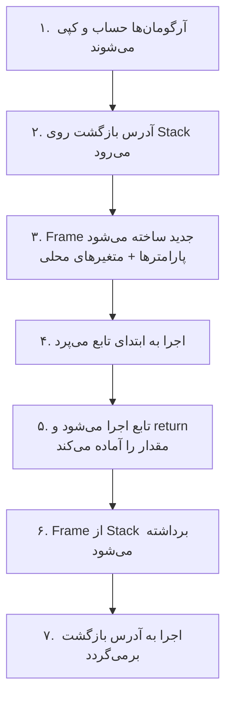
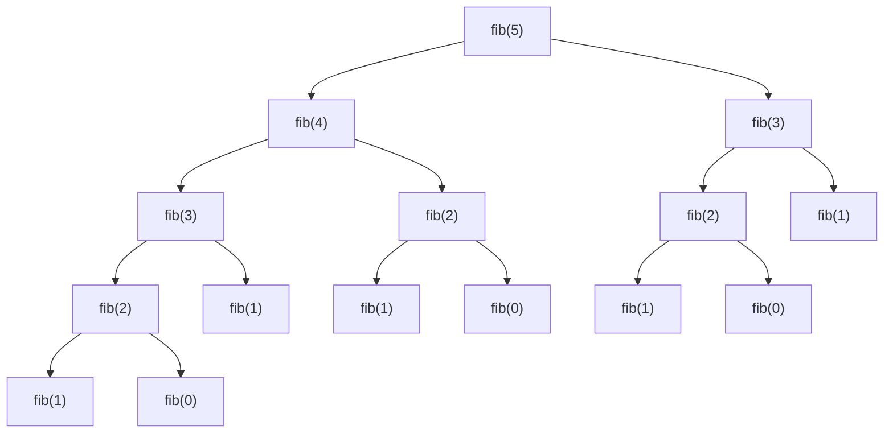

# بخش چهارم: توابع و بازگشت — درسنامه

:::{admonition} راهنمای مدرس
:class: tip
این فایل «متن ارائهٔ کلاس» است. مثال‌ها عمداً ساده نگه داشته شده‌اند تا دانشجو بتواند همراه شما قدم‌به‌قدم جلو برود؛ شاخ‌وبرگ دادن به آن‌ها بسته به فضای کلاس با شماست. هر جا نشانهٔ 🔗 می‌بینید، یک **مبحث تکمیلی** مرتبط در فایل ‎`part-four-supplementary`‎ هست که می‌توانید برای عمیق‌تر کردن بحث از آن کمک بگیرید. تمرین‌ها هم در فایل ‎`part-four-exercises`‎ آمده‌اند.

پیشنهاد زمان‌بندی (حدود چهار جلسهٔ ۹۰ دقیقه‌ای): جلسهٔ اول بخش‌های ۱ تا ۴؛ جلسهٔ دوم بخش‌های ۵ و ۶؛ جلسهٔ سوم بخش‌های ۷ و ۸؛ جلسهٔ چهارم بخش‌های ۹ تا ۱۱.
:::

## مقدمه: چرا تابع؟

تا اینجا هر برنامه‌ای که نوشته‌ایم یک رشتهٔ بلند از دستورها بوده است که از ابتدای ‎`main`‎ شروع می‌شود و با شرط و حلقه به انتها می‌رسد. این مدل برای مسئله‌های کوچک کافی است، اما زود به سه مشکل می‌خورد:

- **تکرار:** یک محاسبهٔ مشابه را چند جای برنامه کپی می‌کنیم.
- **پیچیدگی:** خواندن یک ‎`main`‎ چندصدخطی تقریباً ناممکن است.
- **محدودیت بیان:** بعضی مسئله‌ها ذاتاً «خودمشابه» هستند و یک حلقهٔ ساده بیان طبیعی آن‌ها نیست.

راه‌حل بنیادی علوم کامپیوتر برای هر سه مشکل یک ایده است: **انتزاع (Abstraction)**. یک تکه از محاسبه را بسته‌بندی می‌کنیم، به آن نام می‌دهیم و از این به بعد فقط می‌پرسیم *چه کار می‌کند*، نه *چطور کار می‌کند*. نام این بسته‌بندی **تابع (Function)** است.

مسیر این بخش:


## ۱. آشنایی با Alonzo Church

پیش از هر چیز، با کسی آشنا شویم که پرسش «تابع چیست و محاسبه یعنی چه؟» را برای اولین بار دقیق کرد.

**آلونزو چرچ (Alonzo Church)** ریاضی‌دان و منطق‌دان آمریکایی بود (۱۹۰۳ تا ۱۹۹۵). او سال‌های طولانی در دانشگاه پرینستون تدریس کرد و بعدها به دانشگاه کالیفرنیا در لس‌آنجلس رفت.

در دههٔ ۱۹۳۰ چرچ دو کار بزرگ کرد:

- **حساب λ (Lambda Calculus):** یک نمادگذاری بسیار ساده برای نوشتن تابع‌ها. مثلاً تابعی که عدد را مربع می‌کند، در این نمادگذاری $\lambda x.\, x \cdot x$ نوشته می‌شود؛ یعنی «تابعی که $x$ را می‌گیرد و $x \cdot x$ را برمی‌گرداند». امروز همان ایده را در ‎`lambda`‎ پایتون و تابع‌های بی‌نام (Anonymous) زبان‌های دیگر می‌بینید.
- **حل مسئلهٔ تصمیم (۱۹۳۶):** هیلبرت پرسیده بود آیا الگوریتمی هست که درستی هر حکم منطقی را تصمیم بدهد. چرچ نشان داد که **چنین الگوریتمی وجود ندارد**. تقریباً هم‌زمان و مستقل، دانشجوی دکترای او، **آلن تورینگ**، با «ماشین تورینگ» به همین نتیجه رسید.

چرچ نگاه خاصی به تابع داشت: تابع فقط یک جدول از ورودی‌ها و خروجی‌ها نیست، بلکه **یک قاعدهٔ محاسبه** است. همین دو نگاه (جدول در برابر قاعده) در ادامهٔ درس بارها ظاهر می‌شود.

از شاگردان او می‌توان به تورینگ، کلینی، راسر، مایکل رابین و دانا اسکات اشاره کرد. نتیجهٔ مشترک کار چرچ و تورینگ، **تز چرچ–تورینگ** است که در بخش ۳ می‌بینیم.

:::{admonition} 🔗 برای مدرس
در [مبحث تکمیلی ۲](part-four-supplementary.md#sup-computability) حساب λ کمی بیشتر باز شده و نشان داده‌ایم عددها را هم می‌توان با تابع ساخت (اعداد چرچ).
:::

## ۲. تابع، یک جعبهٔ سیاه

یک دستگاه فروش خودکار نوشیدنی را در نظر بگیرید. مبلغ را می‌دهید، شمارهٔ نوشیدنی را می‌زنید و نوشیدنی بیرون می‌آید. لازم نیست بدانید داخل دستگاه چه می‌گذرد؛ فقط **قرارداد** آن را می‌دانید: «با این ورودی، این خروجی».

این همان ایدهٔ **جعبهٔ سیاه (Black Box)** است:


از این تصویر ساده چهار نتیجه می‌گیریم:

1. **تعیین‌پذیری:** ورودی یکسان، خروجی یکسان.
2. **انتزاع:** استفاده‌کننده فقط قرارداد را می‌داند.
3. **جایگزینی:** دو جعبه‌ای که برای همهٔ ورودی‌ها خروجی یکسان بدهند، از بیرون قابل تشخیص نیستند، حتی اگر درونشان متفاوت باشد.
4. **ترکیب:** خروجی یک جعبه می‌تواند ورودی جعبهٔ دیگر شود: $g(f(x))$.

نتیجهٔ سوم مهم است: **تابع** (آنچه جعبه انجام می‌دهد) با **الگوریتم** (روشی که درون جعبه است) فرق دارد. برای مثال، مجموع $1 + 2 + \cdots + n$ را هم می‌شود با حلقه حساب کرد و هم با فرمول گاوس $\frac{n(n+1)}{2}$. این‌ها دو الگوریتم برای **یک** تابع‌اند:

```c
#include <stdio.h>

/* box 1: add the numbers one by one */
unsigned sum_loop(unsigned n)
{
    unsigned s = 0;
    for (unsigned i = 1; i <= n; i++)
        s += i;
    return s;
}

/* box 2: Gauss formula */
unsigned sum_formula(unsigned n)
{
    return n * (n + 1) / 2;
}

int main(void)
{
    for (unsigned n = 1; n <= 10; n += 3)
        printf("n = %2u | loop = %2u | formula = %2u\n", n, sum_loop(n), sum_formula(n));
    return 0;
}
```

خروجی:

```text
n =  1 | loop =  1 | formula =  1
n =  4 | loop = 10 | formula = 10
n =  7 | loop = 28 | formula = 28
n = 10 | loop = 55 | formula = 55
```


به شکل تعریف تابع در C دقت کنید؛ سه چیز دارد: **نوع خروجی** (‎`unsigned`‎)، **نام** (‎`sum_loop`‎) و **ورودی‌ها با نوعشان** (‎`unsigned n`‎). هر چیزی که با ‎`return`‎ برگردد، خروجی جعبه است.

:::{admonition} 🔗 برای مدرس
تعریف دقیق ریاضی تابع (ضرب دکارتی، تابع کامل و جزئی، یک‌به‌یک و پوشا) در [مبحث تکمیلی ۱](part-four-supplementary.md#sup-math-function) آمده است. اگر کلاس با درس مبانی علوم ریاضی آشناست، چند دقیقه روی آن مکث کنید.
:::

## ۳. محاسبه‌پذیری

سؤال طبیعی: آیا برای **هر** تابعی که ریاضیات تعریف می‌کند، می‌توان یک برنامه نوشت؟

پاسخ شگفت‌انگیز این است: **خیر**، و بیشتر تابع‌ها این‌گونه‌اند. استدلال شهودی:

- هر برنامه یک متن متناهی است؛ پس برنامه‌های ممکن را می‌شود یکی‌یکی شمرد (شمارا هستند).
- اما تابع‌های ممکن، حتی فقط از اعداد طبیعی به $\{0, 1\}$، آن‌قدر زیادند که نمی‌شود آن‌ها را شمرد (ناشمارا هستند).

پس تقریباً همهٔ تابع‌ها **هیچ برنامه‌ای ندارند**. به تابعی که برایش الگوریتمی وجود داشته باشد که برای هر ورودی پس از تعداد متناهی گام تمام شود، **محاسبه‌پذیر (Computable)** می‌گوییم.

نمونهٔ مشهور تابع غیرمحاسبه‌پذیر، **مسئلهٔ توقف** است: هیچ برنامه‌ای نمی‌تواند برای هر برنامه و ورودی بگوید «آیا این برنامه سرانجام تمام می‌شود؟». (این همان کاری است که چرچ و تورینگ در ۱۹۳۶ نشان دادند.)

اینجا **تز چرچ–تورینگ** مطرح می‌شود: هر چیزی که «به‌طور شهودی» قابل محاسبه باشد، با ماشین تورینگ (و در نتیجه با یک برنامهٔ C روی حافظهٔ نامحدود) هم قابل محاسبه است. همهٔ تعریف‌هایی که مستقل از هم پیشنهاد شد (حساب λ چرچ، ماشین تورینگ، توابع بازگشتی) دقیقاً یک دسته از تابع‌ها را ساختند. این «تز» است، نه قضیه، چون «محاسبهٔ شهودی» تعریف ریاضی ندارد.

پیام عملی: وقتی «تابع» می‌گوییم، منظورمان تابعی است که یک **الگوریتم** پشتش باشد؛ و الگوریتم باید بعد از تعداد متناهی گام تمام شود.

:::{admonition} 🔗 برای مدرس
اثبات مسئلهٔ توقف، حدس کولاتس (الگوریتمی که نمی‌دانیم همیشه تمام می‌شود) و جدول تاریخی در [مبحث تکمیلی ۲](part-four-supplementary.md#sup-computability) هست.
:::

## ۴. رویه (Procedure)

ساده‌ترین راه برای استفادهٔ دوباره از یک قطعه کد این است که آن را **نام‌گذاری** کنیم و هر وقت لازم شد صدایش بزنیم. به این قطعهٔ نام‌دار **رویه** می‌گوییم:

- **ورودی و خروجی ندارد:** تنها راه رد و بدل کردن داده، **متغیرهای سراسری (Global)** است.
- **حافظهٔ خصوصی ندارد:** هر متغیر فقط یک نسخه در کل برنامه دارد.

در C رویه یعنی تابعی از نوع ‎`void`‎ بدون پارامتر. ببینیم وقتی بخواهیم فاکتوریل را با رویه بنویسیم، چه می‌شود. تعریف ریاضی:

$$0! = 1, \qquad n! = n \cdot (n-1)! \quad (n \ge 1)$$

ورودی را در ‎`n`‎ می‌گذاریم و خروجی را از ‎`result`‎ می‌خوانیم:

```c
#include <stdio.h>

int  n;                      /* "input" of the procedure */
long result;                 /* "output" of the procedure */

void fact_proc(void)
{
    if (n <= 1) {
        result = 1;
        return;
    }
    n = n - 1;               /* solve the smaller problem ... */
    fact_proc();             /* ... by calling ourselves */
    result = result * n;     /* multiply by the ORIGINAL n (but is it?) */
}

int main(void)
{
    n = 5;
    fact_proc();
    printf("5! = %ld (expected 120)\n", result);
    return 0;
}
```

خروجی:

```text
5! = 1 (expected 120)
```


نتیجه **اشتباه** است. چرا؟ چون ‎`n`‎ فقط **یک نسخه** دارد و فراخوانی‌های داخلی آن را تا ۱ کم کرده‌اند. وقتی به ‎`result * n`‎ می‌رسیم، ‎`n`‎ دیگر ۵ نیست.

می‌توانیم با دست مقدار قبلی را برگردانیم (بعد از فراخوانی بنویسیم ‎`n = n + 1;`‎) و جواب درست شود، ولی این یعنی **خودمان دستی یک پشته ساخته‌ایم**: ذخیره و بازگرداندن مقدار قبلی، به ترتیب برعکس. هیچ برنامه‌نویسی نمی‌خواهد این کار را برای هر متغیر و هر فراخوانی دستی انجام دهد.

> **نتیجه:** برای ساختن یک تابع واقعی که ورودی خصوصی دارد، خروجی برمی‌گرداند و می‌تواند خودش را صدا بزند، به **حافظه‌ای نیاز داریم که به ازای هر فراخوانی یک نسخهٔ جدید و مستقل بسازد.** این حافظه **Stack** نام دارد.

| ویژگی | رویه | تابع کامل |
| --- | --- | --- |
| ورودی و خروجی | از طریق متغیرهای سراسری | پارامتر و مقدار بازگشتی |
| حافظهٔ خصوصی هر فراخوانی | ندارد | دارد (متغیرهای محلی) |
| بازگشت | عملاً ممکن نیست | طبیعی است |

## ۵. ساختار کلی حافظهٔ برنامه

وقتی برنامه اجرا می‌شود، سیستم‌عامل یک فضای آدرس‌پذیر به آن می‌دهد که به چند **ناحیه** تقسیم شده است:

```text
high addresses
+------------------------+
| Stack     (grows down) |
|           |            |
|           v            |
|      (free space)      |
|           ^            |
|           |            |
| Heap      (grows up)   |
+------------------------+
| Static / Global data   |
+------------------------+
| Code (Text)            |
+------------------------+
low addresses
```

| ناحیه | چه چیزی در آن است | مدیریت |
| --- | --- | --- |
| Code | خود دستورهای برنامه | — |
| Static / Global | متغیرهای سراسری و ‎`static`‎ (فقط یک نسخه؛ دلیل مشکل رویه!) | ثابت در کل اجرا |
| Heap | داده‌هایی که اندازه یا عمرشان به یک فراخوانی گره نخورده | **دستی** (‎`malloc`‎ و ‎`free`‎) |
| Stack | پارامترها، متغیرهای محلی و آدرس بازگشت هر فراخوانی | **خودکار** با ورود و خروج تابع |

آنچه برای این بخش مهم است، **Stack** است: با هر فراخوانی بزرگ می‌شود و با هر بازگشت کوچک. چون آخرین تابعی که صدا زده شده، اولین تابعی است که تمام می‌شود، این ناحیه به صورت **LIFO** (آخرین ورودی، اولین خروجی) کار می‌کند.

برای دیدن نواحی با چشم خودمان، آدرس چند چیز را چاپ می‌کنیم (‎`&x`‎ آدرس متغیر ‎`x`‎ را می‌دهد و ‎`%p`‎ آدرس را چاپ می‌کند؛ این ابزارها در بخش اشاره‌گرها کامل توضیح داده می‌شوند، فعلاً فقط به **ترتیب** آدرس‌ها نگاه کنید):

```c
#include <stdio.h>
#include <stdlib.h>

int global_counter = 42;            /* Static / Global region */

void some_function(void) { }        /* Code region */

int main(void)
{
    int local_var = 1;                       /* Stack */
    int *heap_var = malloc(sizeof(int));     /* Heap */

    printf("code  (function) : %p\n", (void *)some_function);
    printf("data  (global)   : %p\n", (void *)&global_counter);
    printf("heap  (malloc)   : %p\n", (void *)heap_var);
    printf("stack (local)    : %p\n", (void *)&local_var);

    free(heap_var);
    return 0;
}
```

خروجی:

```text
code  (function) : 0x562843d2d1a9
data  (global)   : 0x562843d30010
heap  (malloc)   : 0x562868e9b2a0
stack (local)    : 0x7fffb9d3fe8c
```


اعداد روی هر ماشین و هر بار اجرا فرق می‌کنند (سیستم‌عامل آدرس‌ها را عمداً تصادفی می‌کند)، اما معمولاً ترتیب همان است که در نمودار دیدیم: کد در پایین، سپس داده‌های ایستا، سپس Heap و در بالا Stack.

:::{admonition} 🔗 برای مدرس
مقایسهٔ کامل‌تر Stack و Heap و نحوهٔ پیاده‌سازی Stack با آرایه در [مبحث تکمیلی ۶](part-four-supplementary.md#sup-adt) آمده است.
:::

## ۶. کامپیوتر چگونه یک تابع را اجرا می‌کند؟

به ازای **هر فراخوانی**، یک بستهٔ حافظه روی Stack ساخته می‌شود به نام **Stack Frame**. این بسته شامل:

1. **پارامترها:** *کپی* مقدارهای ورودی؛
2. **آدرس بازگشت:** بعد از پایان تابع باید به کجای برنامه برگردیم؛
3. **متغیرهای محلی:** حافظهٔ خصوصی همین فراخوانی.

مراحل یک فراخوانی:



چون پارامترها **کپی** هستند، تابع نمی‌تواند متغیر فراخواننده را تغییر دهد. این روش **فراخوانی با مقدار (Call by Value)** نام دارد و همان «تعیین‌پذیری جعبهٔ سیاه» است: جعبه به دنیای بیرون دست‌درازی نمی‌کند.

```c
#include <stdio.h>

void try_to_change(int x)
{
    x = 99;                           /* only the local copy changes */
    printf("inside  : x = %d\n", x);
}

int main(void)
{
    int x = 5;
    try_to_change(x);
    printf("outside : x = %d\n", x);
    return 0;
}
```

خروجی:

```text
inside  : x = 99
outside : x = 5
```


هر دو متغیر اسمشان ‎`x`‎ است، اما در **دو Frame متفاوت** قرار دارند.

حالا با یک تابع که خودش را صدا می‌زند، Stack را «زنده» ببینیم. برنامهٔ زیر در هر فراخوانی آدرس متغیر محلی ‎`n`‎ را چاپ می‌کند:

```c
#include <stdio.h>

void countdown(int n)
{
    printf("enter n = %d   address of n = %p\n", n, (void *)&n);
    if (n > 0)
        countdown(n - 1);
    printf("leave n = %d\n", n);
}

int main(void)
{
    countdown(3);
    return 0;
}
```

خروجی:

```text
enter n = 3   address of n = 0x7ffdc49e108c
enter n = 2   address of n = 0x7ffdc49e106c
enter n = 1   address of n = 0x7ffdc49e104c
enter n = 0   address of n = 0x7ffdc49e102c
leave n = 0
leave n = 1
leave n = 2
leave n = 3
```


سه نکته در خروجی:

1. هر فراخوانی ‎`n`‎ مخصوص خودش را دارد (آدرس‌ها متفاوت‌اند).
2. هر Frame جدید در آدرس **پایین‌تر** ساخته می‌شود؛ یعنی Stack به سمت آدرس‌های کوچک‌تر رشد می‌کند.
3. Frame‌ها به **ترتیب عکس** از بین می‌روند (‎`leave`‎ از ۰ تا ۳): همان LIFO.

تصویر Stack در عمیق‌ترین نقطهٔ محاسبهٔ ‎`fact(3)`‎ که در بخش بعد می‌نویسیم:

```text
+------------------------------+
| main                         |
+------------------------------+
| fact(3): n=3, return -> main |
+------------------------------+
| fact(2): n=2, return -> fact(3) |
+------------------------------+
| fact(1): n=1, return -> fact(2) |   <- top of the Stack
+------------------------------+
```

## ۷. بازگشت (Recursion)

حالا همهٔ قطعه‌ها را داریم. **تابع** = یک نگاشت با ورودی و خروجی مشخص + یک الگوریتم محاسبه‌پذیر + اجرا روی Stack (پس هر فراخوانی حافظهٔ خصوصی دارد). نتیجهٔ مستقیم: **یک تابع می‌تواند خودش را صدا بزند.**

**بازگشت** یعنی تعریف یک چیز بر حسب نمونه‌های **کوچک‌تر** از خودش. هر تعریف بازگشتی درست، دو بخش دارد:

1. **حالت پایه (Base Case):** کوچک‌ترین نمونه‌ها که مستقیماً جواب دارند؛
2. **گام بازگشتی:** جواب نمونهٔ بزرگ را از جواب نمونهٔ کوچک‌تر می‌سازد.

این همان **استقرای ریاضی** است: حالت پایه همان پایهٔ استقرا و گام بازگشتی همان گام استقرا. و بازگشت فقط وقتی تمام می‌شود که هر فراخوانی، مسئله را به حالت پایه **نزدیک‌تر** کند.

### فاکتوریل

```c
#include <stdio.h>

static int depth = 0;                 /* only for indentation in the output */

unsigned long long fact(unsigned n)
{
    printf("%*s-> fact(%u)\n", depth * 3, "", n);
    depth++;

    unsigned long long r = (n <= 1) ? 1ULL : n * fact(n - 1);

    depth--;
    printf("%*s<- fact(%u) = %llu\n", depth * 3, "", n, r);
    return r;
}

int main(void)
{
    fact(4);
    return 0;
}
```

خروجی:

```text
-> fact(4)
   -> fact(3)
      -> fact(2)
         -> fact(1)
         <- fact(1) = 1
      <- fact(2) = 2
   <- fact(3) = 6
<- fact(4) = 24
```


خطوط ‎`->`‎ یعنی **push** شدن یک Frame و خطوط ‎`<-`‎ یعنی **pop**. هیچ ضربی تا رسیدن به پایه انجام نمی‌شود؛ ضرب‌ها همه **در مسیر برگشت** انجام می‌شوند و مقدارهای ‎`n`‎ در Stack منتظر مانده‌اند. دقیقاً همان کاری که در بخش ۴ دستی می‌کردیم.

**درخت بازگشت.** هر فراخوانی را یک **گره** بگیریم و اگر فراخوانی $u$ در حین اجرا فراخوانی $v$ را بسازد، یک یال از $u$ به $v$ بکشیم. برای فاکتوریل درخت یک **زنجیر** است:

```text
fact(4) -> fact(3) -> fact(2) -> fact(1)
```

- **زمان:** تعداد گره‌ها، یعنی $T(n) = T(n-1) + 1$ و در نتیجه $T(n) = n$؛ مرتبهٔ $O(n)$.
- **حافظهٔ Stack:** طول بلندترین مسیر، یعنی ارتفاع درخت: باز هم $O(n)$.

**دو خطای رایج:**

- فراموش کردن حالت پایه: فراخوانی‌ها تمام نمی‌شوند و Stack پر می‌شود (**Stack Overflow**).
- محدودیت نوع: $n!$ خیلی سریع از ظرفیت ‎`unsigned long long`‎ بیرون می‌زند.

```c
#include <stdio.h>

unsigned long long fact(unsigned n)
{
    return (n <= 1) ? 1ULL : n * fact(n - 1);
}

int main(void)
{
    for (unsigned n = 19; n <= 22; n++)
        printf("%2u! = %llu\n", n, fact(n));
    return 0;
}
```

خروجی:

```text
19! = 121645100408832000
20! = 2432902008176640000
21! = 14197454024290336768
22! = 17196083355034583040
```


از ۲۱! به بعد نتیجه **بی‌صدا** دور می‌زند (حساب پیمانه‌ای $2^{64}$) و عددی نامربوط چاپ می‌شود: نه خطا، نه هشدار. تابع کد ما با تابع ریاضی یکی نیست.

### توان دودویی (Binary Power)

می‌خواهیم $x^n$ را حساب کنیم. تعریف ساده:

$$x^0 = 1, \qquad x^n = x \cdot x^{n-1}$$

این دقیقاً فاکتوریل‌گونه است: زنجیری به طول $n$ و $n$ ضرب، یعنی $O(n)$. می‌شود بهتر عمل کرد؟ ایدهٔ کلیدی: نصف کردن توان.

$$x^n = \begin{cases} \left(x^{n/2}\right)^2 & n \bmod 2 = 0 \\ x \cdot \left(x^{(n-1)/2}\right)^2 & n \bmod 2 = 1 \end{cases}$$

مثلاً $x^{16} = (x^8)^2 = ((x^4)^2)^2 = \cdots$ فقط ۴ بار مربع‌کردن! هر گام توان را تقریباً **نصف** می‌کند، پس عمق بازگشت حدود $\log_2 n$ است.

اما اینجا یک تله هست. اگر بنویسیم ‎`power(x, n/2) * power(x, n/2)`‎، هر فراخوانی **دو** فراخوانی می‌سازد و درخت بازگشت دوشاخه می‌شود. سه نسخه را با شمارندهٔ تعداد ضرب‌ها مقایسه می‌کنیم:

```c
#include <stdio.h>

static unsigned long mults;           /* number of multiplications performed */

/* version 1: x^n = x * x^(n-1)   (a chain of length n) */
unsigned long long power_slow(unsigned long long x, unsigned n)
{
    if (n == 0) return 1;
    mults++;
    return x * power_slow(x, n - 1);
}

/* version 2: halving, but TWO recursive calls (a binary tree!) */
unsigned long long power_two_calls(unsigned long long x, unsigned n)
{
    if (n == 0) return 1;
    if (n % 2 == 0) {
        mults++;
        return power_two_calls(x, n / 2) * power_two_calls(x, n / 2);
    }
    mults++;
    return x * power_two_calls(x, n - 1);
}

/* version 3: halving, ONE recursive call (a chain of length ~log n) */
unsigned long long power_fast(unsigned long long x, unsigned n)
{
    if (n == 0) return 1;
    if (n % 2 == 0) {
        unsigned long long half = power_fast(x, n / 2);
        mults++;
        return half * half;
    }
    mults++;
    return x * power_fast(x, n - 1);
}

int main(void)
{
    unsigned tests[] = {10, 20, 39};

    printf("   n   slow  two_calls  fast   3^n\n");
    for (int i = 0; i < 3; i++) {
        unsigned n = tests[i];
        mults = 0; unsigned long long a = power_slow(3, n);       unsigned long m1 = mults;
        mults = 0; unsigned long long b = power_two_calls(3, n);  unsigned long m2 = mults;
        mults = 0; unsigned long long c = power_fast(3, n);       unsigned long m3 = mults;
        printf("%4u %6lu %9lu %5lu   %llu %s\n", n, m1, m2, m3, c,
               (a == b && b == c) ? "" : "(MISMATCH)");
    }
    return 0;
}
```

خروجی:

```text
   n   slow  two_calls  fast   3^n
  10     10        17     5   59049 
  20     20        35     6   3486784401 
  39     39        70     9   4052555153018976267 
```


نتیجه: ‎`power_slow`‎ دقیقاً $n$ ضرب می‌کند؛ ‎`power_two_calls`‎ با اینکه «نصف می‌کند» باز هم **هم‌مرتبهٔ $n$** ضرب دارد (اینجا حتی بیشتر از نسخهٔ ساده؛ چون درخت دوشاخه با عمق $\log n$ حدود $n$ برگ دارد)؛ اما ‎`power_fast`‎ فقط حدود $2\log_2 n$ ضرب. رابطهٔ زمان آن $T(n) = T(n/2) + O(1)$ است و جواب $O(\log n)$ دارد.

کاربرد واقعی: محاسبهٔ توان‌های **خیلی** بزرگ در حساب پیمانه‌ای، که پایهٔ رمزنگاری است. برای $2^{10^9} \bmod (10^9 + 7)$ روش ساده یک میلیارد ضرب می‌خواهد، ولی روش نصف‌کردن فقط ۴۳ ضرب:

```c
#include <stdio.h>

#define MOD 1000000007ULL

static unsigned long mults;

unsigned long long power_mod(unsigned long long x, unsigned long long n)
{
    if (n == 0) return 1;
    unsigned long long half = power_mod(x, n / 2);
    mults++;
    unsigned long long r = half * half % MOD;
    if (n % 2 == 1) {
        mults++;
        r = r * (x % MOD) % MOD;
    }
    return r;
}

int main(void)
{
    mults = 0;
    unsigned long long r = power_mod(2, 1000000000ULL);
    printf("2^(10^9) mod (10^9+7) = %llu   multiplications = %lu\n", r, mults);
    return 0;
}
```

خروجی:

```text
2^(10^9) mod (10^9+7) = 140625001   multiplications = 43
```


:::{admonition} 🔗 برای مدرس
ماکرو ‎`#define MOD ...`‎ در این برنامه یک «ثابت نام‌دار» است؛ جزئیات ماکروها در [مبحث تکمیلی ۱۰](part-four-supplementary.md#sup-macro). نسخهٔ پیمانه‌ای فیبوناچی و توان ماتریس در [مبحث تکمیلی ۹](part-four-supplementary.md#sup-fast).
:::

### دنبالهٔ فیبوناچی

تعریف:

$$F(0) = 0, \qquad F(1) = 1, \qquad F(n) = F(n-1) + F(n-2) \quad (n \ge 2)$$

اینجا هر گام بازگشتی به **دو** نمونهٔ کوچک‌تر نیاز دارد. این بار قدم‌به‌قدم با چند پیاده‌سازی جلو می‌رویم و هر بار زمان اجرا را بهبود می‌دهیم.

**نسخهٔ ۱: ترجمهٔ مستقیم تعریف.**

```c
#include <stdio.h>

static unsigned long calls = 0;       /* shared counter: counts ALL calls */

unsigned long fib(int n)
{
    calls++;
    return (n < 2) ? (unsigned long)n : fib(n - 1) + fib(n - 2);
}

int main(void)
{
    int tests[] = {10, 20, 30};

    for (int i = 0; i < 3; i++) {
        calls = 0;
        unsigned long value = fib(tests[i]);
        printf("fib(%2d) = %7lu   calls = %lu\n", tests[i], value, calls);
    }
    return 0;
}
```

خروجی:

```text
fib(10) =      55   calls = 177
fib(20) =    6765   calls = 21891
fib(30) =  832040   calls = 2692537
```


برای $n = 30$ حدود **۲٫۷ میلیون** فراخوانی برای عددی که با یک حلقهٔ ۳۰ مرحله‌ای به‌دست می‌آید! چرا؟ درخت بازگشت را برای $F(5)$ ببینید:



عبارت‌هایی مثل ‎`fib(3)`‎ و ‎`fib(2)`‎ **بارها** از نو حساب می‌شوند (زیرمسئله‌های همپوشان). اگر $T(n)$ تعداد فراخوانی‌ها باشد:

$$T(n) = 1 + T(n-1) + T(n-2) \quad\Longrightarrow\quad T(n) = 2F(n+1) - 1$$

و چون $F(n)$ تقریباً مثل $1.618^n$ رشد می‌کند، زمان **نمایی** است. ولی حافظهٔ Stack فقط به اندازهٔ **ارتفاع درخت** است (یعنی $n$)، نه تعداد گره‌ها؛ چون Frame‌ها پشت‌سرهم ساخته و پاک می‌شوند و نه هم‌زمان.

**نسخهٔ ۲: فقط دو مقدار قبلی را نگه داریم (زمان خطی).** برای محاسبهٔ $F(n)$ لازم نیست همهٔ مقدارها را از نو حساب کنیم؛ کافی است دو مقدار آخر را نگه داریم و $n$ بار جلو برویم. زمان $O(n)$ و حافظهٔ ثابت.

**نسخهٔ ۳: نصف کردن $n$ بر اساس زوجیت.** آیا می‌شود از $O(n)$ هم بهتر شد؟ مثل توان دودویی، می‌خواهیم $F(n)$ را از مقدارهای حدود $n/2$ بسازیم. رابطهٔ زیر برای دنبالهٔ فیبوناچی برقرار است (از ضرب ماتریس $\begin{pmatrix}1&1\\1&0\end{pmatrix}^n$ به‌دست می‌آید؛ در [مبحث تکمیلی ۹](part-four-supplementary.md#sup-fast) اثبات شده است):

$$F(m + k) = F(m)\,F(k+1) + F(m-1)\,F(k)$$

اگر $n = 2k$ زوج باشد و $m = k$ بگیریم:

$$F(2k) = F(k)\big(F(k+1) + F(k-1)\big) = F(k)\big(F(k) + 2F(k-1)\big)$$

و اگر $n = 2k + 1$ فرد باشد:

$$F(2k+1) = F(k+1)^2 + F(k)^2 = \big(F(k) + F(k-1)\big)^2 + F(k)^2$$

در هر دو حالت $F(n)$ فقط به $F(k)$ و $F(k-1)$ وابسته است، که $k = \lfloor n/2 \rfloor$. یعنی همان $f(n/2)$ و $f(n/2 - 1)$ که دنبالش بودیم. اولین پیاده‌سازی طبیعی: دو فراخوانی بازگشتی جدا برای $F(k)$ و $F(k-1)$.

**نسخهٔ ۴: یک فراخوانی که هر دو مقدار را بدهد.** اگر هر دو فراخوانی را جدا بزنیم، درخت دوباره دوشاخه می‌شود: $T(n) = 2T(n/2) + 1$ که جوابش $O(n)$ است؛ هیچ بهبودی نکرده‌ایم (همان تلهٔ ‎`power_two_calls`‎). راه‌حل: یک تابع بنویسیم که **هر دو** مقدار $F(n)$ و $F(n-1)$ را با هم بدهد؛ آن‌وقت برای $n$ فقط **یک** فراخوانی با $\lfloor n/2 \rfloor$ لازم است:

$$T(n) = T(n/2) + O(1) \quad\Longrightarrow\quad T(n) = O(\log n)$$

برای برگرداندن دو مقدار از یک تابع، فعلاً از یک «پارامتر خروجی» استفاده می‌کنیم: عبارت ‎`unsigned long long *prev`‎ یعنی «جایی که تابع می‌تواند مقدار دوم را در آن بنویسد» و ‎`*prev = ...`‎ یعنی نوشتن در آن (اشاره‌گرها را در بخش‌های بعد کامل یاد می‌گیرید).

با قرارداد $F(-1) = 1$ (چون باید $F(1) = F(0) + F(-1)$ باشد)، تنها حالت پایه $n = 0$ است و $n = 1$ هم از همان گام کلی می‌آید.

```c
#include <stdio.h>

static unsigned long calls;

/* version 2: loop with two variables, O(n) */
unsigned long long fib_iter(int n, unsigned long *steps)
{
    unsigned long long a = 0, b = 1;      /* F(0), F(1) */
    *steps = 0;
    for (int i = 0; i < n; i++) {
        unsigned long long t = a + b;
        a = b;
        b = t;
        (*steps)++;
    }
    return a;
}

/* version 3: halving by parity, but TWO separate recursive calls: still O(n) */
unsigned long long fib_half(int n)
{
    calls++;
    if (n < 2) return (unsigned long long)n;
    int k = n / 2;
    unsigned long long a = fib_half(k);          /* F(k)   */
    unsigned long long b = fib_half(k - 1);      /* F(k-1) */
    if (n % 2 == 0)
        return a * (a + 2 * b);                  /* F(2k)   */
    return (a + b) * (a + b) + a * a;            /* F(2k+1) */
}

/* version 4: ONE call returns F(n) and stores F(n-1) in *prev: O(log n) */
unsigned long long fib_pair(int n, unsigned long long *prev)
{
    calls++;
    if (n == 0) {
        *prev = 1;                               /* F(-1) = 1 */
        return 0;                                /* F(0)  = 0 */
    }
    unsigned long long b;
    unsigned long long a = fib_pair(n / 2, &b);  /* a = F(k), b = F(k-1) */
    if (n % 2 == 0) {
        *prev = a * a + b * b;                   /* F(2k-1) */
        return a * (a + 2 * b);                  /* F(2k)   */
    }
    *prev = a * (a + 2 * b);                     /* F(2k)   */
    return (a + b) * (a + b) + a * a;            /* F(2k+1) */
}

int main(void)
{
    int tests[] = {10, 30, 60, 90};

    printf("  n               F(n)   iter-steps   half-calls   pair-calls\n");
    for (int i = 0; i < 4; i++) {
        int n = tests[i];
        unsigned long steps, c3, c4;
        unsigned long long dummy;

        unsigned long long v2 = fib_iter(n, &steps);
        calls = 0; unsigned long long v3 = fib_half(n);          c3 = calls;
        calls = 0; unsigned long long v4 = fib_pair(n, &dummy);  c4 = calls;

        printf("%3d %18llu %12lu %12lu %12lu %s\n", n, v4, steps, c3, c4,
               (v2 == v3 && v3 == v4) ? "" : "(MISMATCH)");
    }
    return 0;
}
```

خروجی:

```text
  n               F(n)   iter-steps   half-calls   pair-calls
 10                 55           10           11            5 
 30             832040           30           31            6 
 60      1548008755920           60           61            7 
 90 2880067194370816120           90           91            8 
```


جمع‌بندی مقایسهٔ چهار نسخه (تعداد گام‌ها برای $n$):

| نسخه | ایده | زمان | حافظهٔ Stack |
| --- | --- | --- | --- |
| ۱ | ترجمهٔ مستقیم تعریف | نمایی $O(\varphi^n)$ | $O(n)$ |
| ۲ | حلقه با دو متغیر | $O(n)$ | $O(1)$ |
| ۳ | نصف کردن، دو فراخوانی | $O(n)$ | $O(\log n)$ |
| ۴ | نصف کردن، یک فراخوانی | $O(\log n)$ | $O(\log n)$ |

درس بزرگ: **شکل درخت بازگشت** (زنجیر یا درخت، و عمق آن) زمان اجرا را تعیین می‌کند. بازگشتِ خوب، بازگشتی است که هر گام، مسئله را **چند برابر** کوچک کند و فقط **یک بار** خودش را صدا بزند.

> مقدار $F(93)$ آخرین عددی است که در ‎`unsigned long long`‎ جا می‌شود؛ این نسخه‌ها فقط برای $n \le 93$ درست‌اند (مثل محدودیت فاکتوریل).

## ۸. درخت بازگشت و اجرای تابع

آنچه در بخش‌های قبل دیدیم را یکجا جمع کنیم. **درخت بازگشت** یک تابع:

| در درخت | در اجرا |
| --- | --- |
| هر گره = یک فراخوانی | هر فراخوانی = یک Frame روی Stack |
| تعداد گره‌ها | **زمان** اجرا (تعداد فراخوانی‌ها) |
| ارتفاع درخت | **حافظهٔ** Stack (بیشینهٔ فریم‌های هم‌زمان) |
| ریشه تا گرهٔ جاری | محتوای فعلی Stack |

اجرای یک تابع بازگشتی، **درخت را با ترتیبی مشخص می‌پیماید**: تا جایی که ممکن است به عمق می‌رود (فراخوانی)، و وقتی به برگ رسید برمی‌گردد (بازگشت) و سراغ فرزند بعدی می‌رود. به این پیمایش **DFS (جست‌وجوی عمق‌اول)** می‌گوییم. به همین دلیل ‎`fib(30)`‎ با ۲٫۷ میلیون گره، فقط ۳۰ Frame هم‌زمان دارد و Stack Overflow نمی‌کند.

مقایسهٔ مثال‌های این درسنامه:

| تابع | شکل درخت | زمان | حافظهٔ Stack |
| --- | --- | --- | --- |
| فاکتوریل | زنجیر به طول $n$ | $O(n)$ | $O(n)$ |
| توان ساده | زنجیر به طول $n$ | $O(n)$ | $O(n)$ |
| توان دودویی | زنجیر به طول $\log n$ | $O(\log n)$ | $O(\log n)$ |
| فیبوناچی ساده | درخت دوشاخه، ارتفاع $n$ | نمایی | $O(n)$ |
| فیبوناچی با نصف کردن (یک فراخوانی) | زنجیر به طول $\log n$ | $O(\log n)$ | $O(\log n)$ |

:::{admonition} 🔗 برای مدرس
DFS و BFS به‌طور دقیق، پیاده‌سازی پیمایش با Stack و Queue و حذف بازگشت در [مبحث تکمیلی ۷](part-four-supplementary.md#sup-dfs-bfs)؛ بازگشت در برابر حلقه در [مبحث تکمیلی ۵](part-four-supplementary.md#sup-loop)؛ نمونه‌های سخت‌تر مثل تابع آکرمان و حساب پئانو در [مبحث تکمیلی ۳](part-four-supplementary.md#sup-peano) و [۴](part-four-supplementary.md#sup-ackermann).
:::

## ۹. اشتباه‌های رایج

- **حالت پایه ندارد** یا هیچ‌وقت به آن نمی‌رسیم (مثلاً ‎`f(n - 2)`‎ با حالت پایهٔ ‎`n == 0`‎ و ورودی فرد).
- **اندازه کاهنده نیست:** فراخوانی با همان یا بزرگ‌تر از ورودی فعلی.
- **تله‌ی دو فراخوانی:** نصف کردن مسئله ولی دو بار فراخوانی با همان ورودی (‎`power(x, n/2) * power(x, n/2)`‎).
- **فراموش کردن محدودیت نوع:** سرریز بی‌صدای ‎`unsigned long long`‎.
- **عمق خیلی زیاد:** درست تعریف کردن بازگشت کافی نیست؛ اگر عمق از ظرفیت Stack (معمولاً چند مگابایت) بیشتر شود، برنامه با Stack Overflow می‌میرد.

## ۱۰. جمع‌بندی

- **تابع** یک جعبهٔ سیاه است: قرارداد ورودی و خروجی. تابع با الگوریتم فرق دارد.
- برای هر تابع ریاضی الگوریتم وجود ندارد؛ **محاسبه‌پذیری** مرز کار ماست (چرچ و تورینگ).
- **رویه** بدون حافظهٔ خصوصی است و بازگشت‌پذیر نیست؛ **Stack** با ساختن Frame برای هر فراخوانی، تابع کامل و بازگشت را ممکن می‌کند.
- **بازگشت** = حالت پایه + گام بازگشتی با اندازهٔ کاهنده؛ همساختار با استقرا.
- **درخت بازگشت** زمان (تعداد گره‌ها) و حافظه (ارتفاع) را نشان می‌دهد؛ اجرای تابع یک DFS روی آن است.
- بازگشت را با **نصف کردن** مسئله و **یک** فراخوانی بهبود می‌دهیم: توان دودویی و فیبوناچی لگاریتمی.

### پرسش‌های مرور (Retrieval Practice)

- فرق «تابع» و «الگوریتم» چیست؟ مثال بزنید.
- چرا رویه‌ای که فقط از متغیرهای سراسری استفاده می‌کند نمی‌تواند به‌طور مطمئن خودش را صدا بزند؟
- یک Stack Frame شامل چه چیزهایی است؟
- حالت پایه و اندازهٔ کاهنده برای ‎`fact`‎ و ‎`power_fast`‎ چیست؟
- چرا ‎`fib`‎ ساده نمایی است ولی حافظهٔ Stack آن فقط خطی؟
- چرا نصف کردن مسئله با **دو** فراخوانی بهبودی نمی‌دهد؟

:::{admonition} 🔗 تمرین‌ها
تمرین‌های این بخش، با راهنمایی و پاسخ، در فایل ‎`part-four-exercises`‎ قرار دارد.
:::

---

## تیم تهیه و تدوین

> **TODO:** این بخش پیش‌نویس است؛ نام و نقش اعضای تیم بخش چهارم را مطابق واقعیت جایگزین کنید.

اعضای تیم را به همان قالب بخش پنجم در اینجا فهرست کنید.

#### 👤 (نام عضو ۱)

**نقش:**

- (طراحی ساختار و معماری محتوا)
- (تدوین و یکپارچه‌سازی)

**نوع مشارکت:** (...)

#### 👤 (نام عضو ۲)

**نقش:**

- (بررسی صحت علمی)

**نوع مشارکت:** (...)

### فرایند تولید و بازبینی

(در صورت استفاده از ابزارهای هوش مصنوعی در تولید یا بازبینی، مانند بخش پنجم، نقش آن را به‌عنوان ابزار کمکی و با تأیید نهایی اعضای تیم ذکر کنید.)

#### 🤝 حاصل یک کار تیمی

از تمام افرادی که در شکل‌گیری، بازبینی و بهبود این بخش مشارکت داشته‌اند، سپاسگزاریم.
