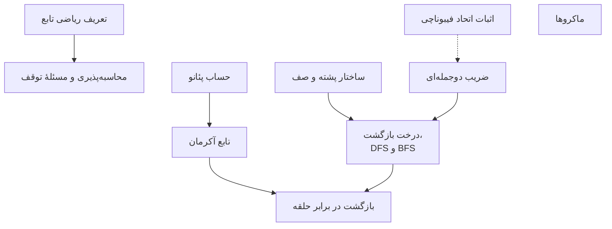
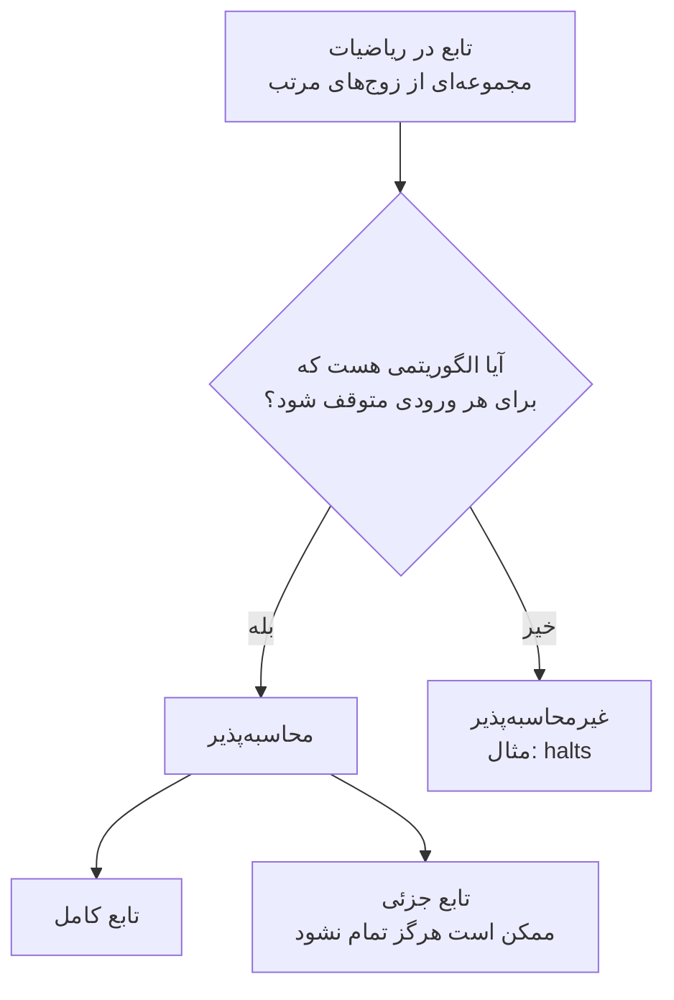
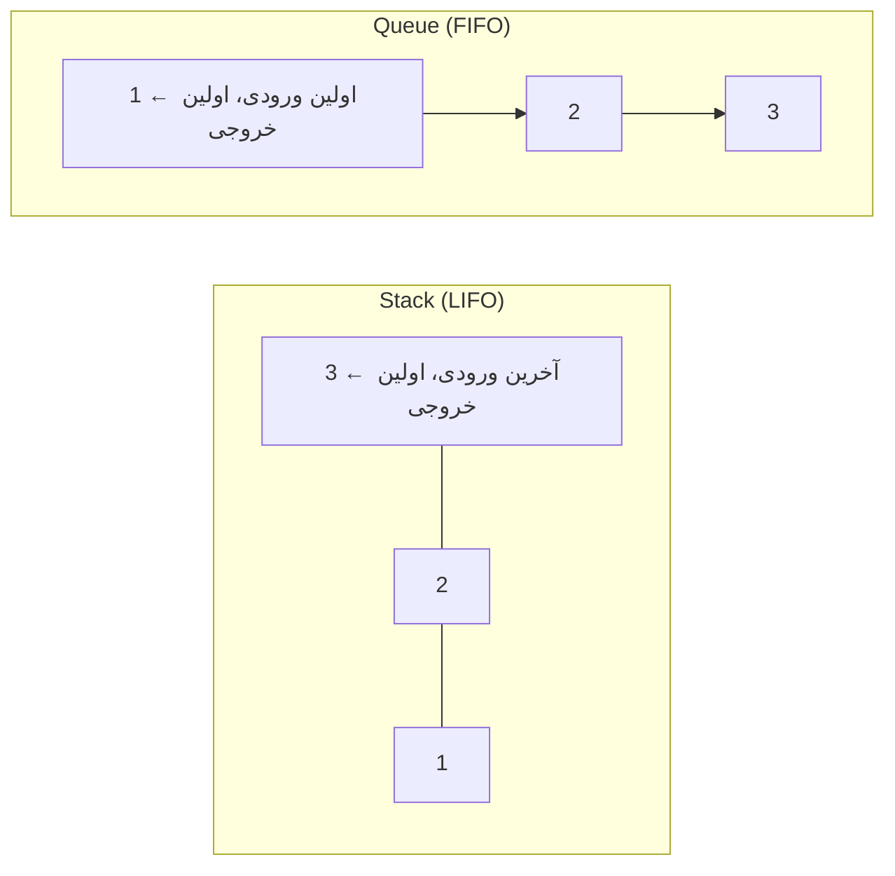
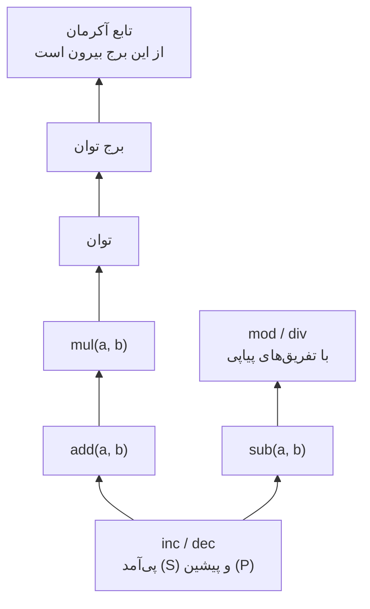
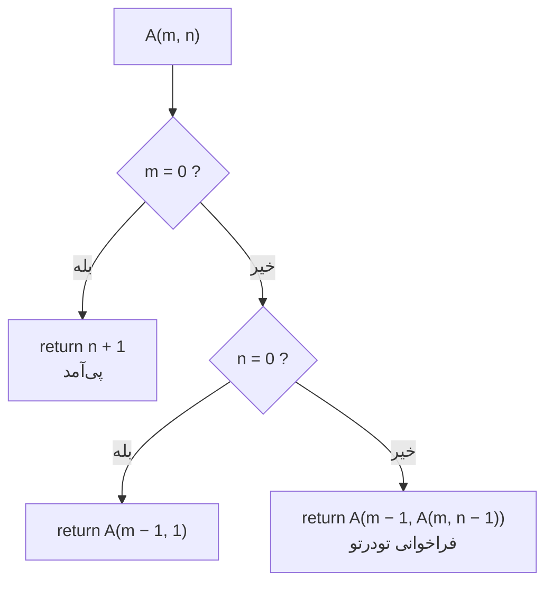
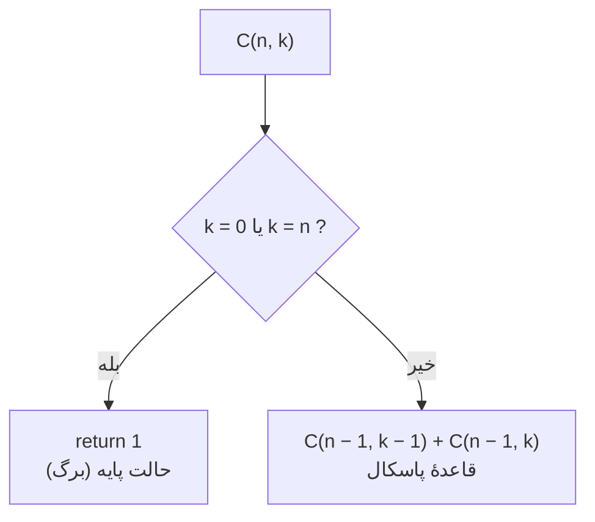
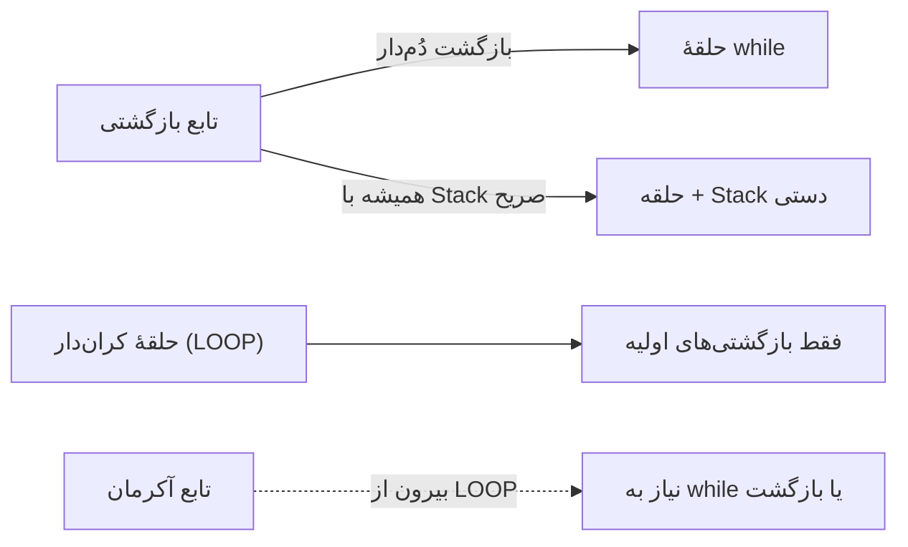
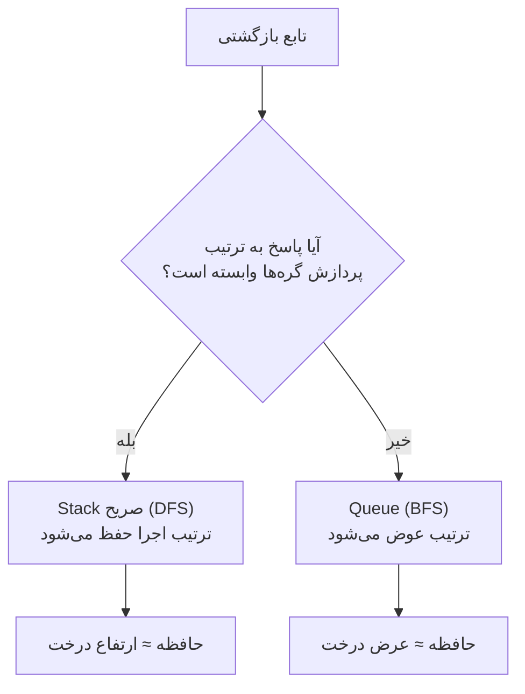
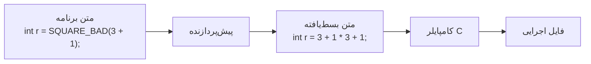

# بخش چهارم : توابع و بازگشت (مباحث تکمیلی)

## مقدمه

این فایل مکمل **درسنامه** (lecture.md) است. موضوع‌ها در اینجا دقیق‌تر، عمیق‌تر و با مثال‌های سخت‌تر مطرح می‌شوند و بیشتر برای استاد (جهت تعمیق مطلب در کلاس)، دانشجویان علاقه‌مند و تمرین‌های چالشی هستند. بخش‌ها مستقل از هم‌اند و می‌توان آن‌ها را به هر ترتیبی خواند؛ جز این‌که پیشنیاز بعضی از بعضی دیگر لازم است:



<a id="sup-function-def"></a>

## ۱. تعریف ریاضی تابع

جعبهٔ سیاه یک تصویر شهودی بود. ریاضیات همین شهود را دقیق می‌کند و مهم‌تر از همه **درون جعبه را کاملاً کنار می‌گذارد**: در تعریف ریاضی، تابع یک «مجموعه از زوج‌های مرتب» است و هیچ حرفی از «روش محاسبه» نیست.

**ضرب دکارتی:** برای دو مجموعهٔ <span dir="ltr">$A$</span> و <span dir="ltr">$B$</span>، مجموعهٔ همهٔ زوج‌های مرتب را <span dir="ltr">$A \times B$</span> می‌نامیم:

$$A \times B = \{ (a, b) \mid a \in A,\ b \in B \}$$

**رابطه:** هر زیرمجموعهٔ <span dir="ltr">$R \subseteq A \times B$</span> یک رابطه است.

**تابع:** رابطه‌ای <span dir="ltr">$f \subseteq A \times B$</span> که برای **هر** <span dir="ltr">$a \in A$</span>، **دقیقاً یک** <span dir="ltr">$b \in B$</span> با <span dir="ltr">$(a, b) \in f$</span> داشته باشد. در این صورت می‌نویسیم <span dir="ltr">$f(a) = b$</span>.

دو شرط این تعریف همان «قرارداد جعبهٔ سیاه» هستند:

- «**برای هر** <span dir="ltr">$a$</span>»: جعبه به ازای هر ورودی مجاز، خروجی دارد.
- «**دقیقاً یک**»: جعبه تعیین‌پذیر است؛ یک ورودی نمی‌تواند هم‌زمان دو خروجی بدهد.

**واژگان:** <span dir="ltr">$A$</span> را **دامنه (Domain)**، <span dir="ltr">$B$</span> را **همدامنه (Codomain)** و مجموعهٔ خروجی‌های واقعی <span dir="ltr">$\{ f(a) \mid a \in A \}$</span> را **برد (Image)** می‌نامیم. برد زیرمجموعهٔ همدامنه است، اما لزوماً با آن برابر نیست.

**برابری توابع:** دو تابع برابرند اگر دامنه و همدامنهٔ یکسان و برای هر ورودی خروجی یکسان داشته باشند. (یعنی تابع، «رفتار بیرونی» است نه روش محاسبه.)

**انواع مهم:** تابع **یک‌به‌یک (Injective)** اگر ورودی‌های متفاوت همیشه خروجی متفاوت بدهند؛ **پوشا (Surjective)** اگر برد با همدامنه برابر باشد؛ **دوسویی (Bijective)** اگر هر دو.

**توابع جزئی:** گاهی «برای هر <span dir="ltr">$a$</span>» برقرار نیست. مثلاً تقسیم صحیح برای مقسوم‌علیه صفر. چنین تابعی **جزئی (Partial)** است و با <span dir="ltr">$f : A \rightharpoonup B$</span> نشان داده می‌شود؛ تابعی که برای همهٔ ورودی‌ها تعریف شده **کامل (Total)** است.

**مثال: تابع به‌عنوان مجموعه‌ای از زوج‌ها.** تابع <span dir="ltr">$f : A \to A$</span> با <span dir="ltr">$A = \{0, 1, \dots, 7\}$</span> و <span dir="ltr">$f(x) = x^2 \bmod 8$</span> را در نظر بگیرید. برنامهٔ زیر گراف تابع را چاپ می‌کند و با حلقه‌های تودرتو یک‌به‌یک و پوشا بودن آن را وارسی می‌کند:

```c
#include <stdio.h>

int main(void)
{
    /* A = {0, 1, ..., 7} and f(x) = x^2 mod 8 */
    printf("graph of f = { ");
    for (int x = 0; x < 8; x++) {
        printf("(%d,%d) ", x, (x * x) % 8);
    }
    printf("}\n");

    /* image: count the y values reached by at least one x */
    int image_size = 0;
    for (int y = 0; y < 8; y++) {
        int reached = 0;
        for (int x = 0; x < 8; x++) {
            if ((x * x) % 8 == y) reached = 1;
        }
        image_size += reached;
    }

    /* injective? is there a pair of different x with the same output? */
    int injective = 1;
    for (int x1 = 0; x1 < 8; x1++)
        for (int x2 = x1 + 1; x2 < 8; x2++)
            if ((x1 * x1) % 8 == (x2 * x2) % 8) injective = 0;

    printf("image size  = %d (codomain size = 8)\n", image_size);
    printf("injective?    %s\n", injective ? "yes" : "no");
    printf("surjective?   %s\n", image_size == 8 ? "yes" : "no");
    return 0;
}
```

خروجی:

```text
graph of f = { (0,0) (1,1) (2,4) (3,1) (4,0) (5,1) (6,4) (7,1) }
image size  = 3 (codomain size = 8)
injective?    no
surjective?   no
```


### نگاشت ریاضی به امضای تابع در C

نمادگذاری ریاضی تابع همان اطلاعاتی را می‌دهد که یک **امضا (Signature)** در برنامه‌نویسی باید بدهد: نوع ورودی‌ها و نوع خروجی.

| نماد ریاضی | معنی | معادل در C |
| --- | --- | --- |
| <span dir="ltr">$f : A \to B$</span> | تابع کامل از <span dir="ltr">$A$</span> به <span dir="ltr">$B$</span> | ‎`B f(A x)`‎ |
| <span dir="ltr">$f : A \times B \to C$</span> | دو ورودی | ‎`C f(A x, B y)`‎ |
| <span dir="ltr">$x \mapsto x^2$</span> | «قاعدهٔ» تابع | ‎`return x * x;`‎ |
| <span dir="ltr">$f : A \rightharpoonup B$</span> | تابع جزئی | تابعی که ممکن است برای بعضی ورودی‌ها تمام نشود |
| <span dir="ltr">$g \circ f$</span> | ترکیب | ‎`g(f(x))`‎ |
| <span dir="ltr">$c : () \to B$</span> | تابع ثابت | ‎`B c(void)`‎ |

| مجموعهٔ ریاضی | نوع در C | نکته |
| --- | --- | --- |
| <span dir="ltr">$\mathbb{N}$</span> | ‎`unsigned int`‎ | **متناهی** است: <span dir="ltr">$\{0, \dots, 2^{32}-1\}$</span> |
| <span dir="ltr">$\mathbb{Z}$</span> | ‎`int`‎ | متناهی است: حدود <span dir="ltr">$\pm 2^{31}$</span> |
| <span dir="ltr">$\mathbb{R}$</span> | ‎`double`‎ | فقط یک **تقریب** با دقت محدود |

:::{admonition} هشدار مهم
:class: warning
مجموعهٔ ریاضی می‌تواند نامتناهی باشد، اما نوع‌های C همیشه متناهی‌اند. ‎`unsigned int`‎ در واقع حساب **پیمانه‌ای** است؛ یعنی ‎`0u - 1`‎ برابر <span dir="ltr">$4294967295$</span> می‌شود. پس تابع ‎`uint add(uint, uint)`‎ دقیقاً همان <span dir="ltr">$+$</span> ریاضی نیست، بلکه تابعی روی یک مجموعهٔ متناهی است. پیامد عملی این تفاوت در بخش [حساب پئانو](#sup-peano) دیده می‌شود.
:::

نمونهٔ یک برنامهٔ کامل با امضاها، پروتوتایپ و ترکیب توابع:

```c
#include <stdio.h>

/* prototypes: declare the signatures */
unsigned square(unsigned x);         /* square  : N -> N        */
unsigned add_one(unsigned x);        /* add_one : N -> N        */
int      max2(int a, int b);         /* max2    : Z x Z -> Z    */
void     print_line(void);           /* no result (side effect) */

int main(void)
{
    printf("square(7)         = %u\n", square(7));
    printf("max2(-3, 8)       = %d\n", max2(-3, 8));
    printf("square(add_one(4)) = %u\n", square(add_one(4)));  /* composition: square o add_one */
    print_line();
    return 0;
}

unsigned square(unsigned x)  { return x * x; }
unsigned add_one(unsigned x) { return x + 1; }
int      max2(int a, int b)  { if (a > b) return a; return b; }
void     print_line(void)    { printf("--------------------\n"); }
```

خروجی:

```text
square(7)         = 49
max2(-3, 8)       = 8
square(add_one(4)) = 25
--------------------
```

ترکیب <span dir="ltr">$\text{square} \circ \text{add\_one}$</span> ابتدا ‎`add_one(4)`‎ را حساب می‌کند (۵) و سپس ‎`square(5)`‎ (۲۵): از **درون به بیرون**، دقیقاً مثل ریاضیات.

<a id="sup-computability"></a>

## ۲. محاسبه‌پذیری

### چرا «بیشتر» توابع محاسبه‌پذیر نیستند؟ (استدلال شمارشی)

- هر **برنامه** یک متن متناهی روی الفبای متناهی است. مجموعهٔ همهٔ متن‌های متناهی **شمارا** است؛ پس مجموعهٔ همهٔ برنامه‌های ممکن شماراست.
- اما مجموعهٔ توابع <span dir="ltr">$f : \mathbb{N} \to \{0, 1\}$</span> **ناشماراست** (استدلال قطری کانتور، ۱۸۹۱): هر تابع معادل یک دنبالهٔ نامتناهی از ۰ و ۱ است و تعداد این دنباله‌ها <span dir="ltr">$2^{\aleph_0}$</span> است.

پس تعداد توابع به‌طرز بی‌نهایت‌باری از تعداد برنامه‌ها بیشتر است. «تقریباً همهٔ» توابع **هیچ برنامه‌ای ندارند.**

برای توابع جزئی نمادگذاری زیر استاندارد است:

- <span dir="ltr">$f(x)\downarrow$</span> : الگوریتم روی ورودی <span dir="ltr">$x$</span> **متوقف می‌شود** (خروجی تعریف شده است).
- <span dir="ltr">$f(x)\uparrow$</span> : الگوریتم روی ورودی <span dir="ltr">$x$</span> **هرگز تمام نمی‌شود** (خروجی تعریف نشده است).

پس «ممکن است برنامه تمام نشود» دقیقاً معادل «تابع جزئی است» است.

### پیشینهٔ تاریخی

| زمان | رویداد |
| --- | --- |
| حدود ۳۰۰ ق.م. | الگوریتم اقلیدس؛ یکی از قدیمی‌ترین الگوریتم‌های ثبت‌شده |
| حدود قرن ۹ میلادی | خوارزمی روش‌های گام‌به‌گام حساب و جبر را مدون کرد؛ واژهٔ **Algorithm** از نام لاتینی‌شدهٔ او می‌آید |
| ۱۸۸۸ | ددکیند «تعریف با بازگشت» روی اعداد طبیعی را صورت‌بندی کرد |
| ۱۹۰۰ و ۱۹۲۸ | هیلبرت مسائل مشهور خود را مطرح کرد و (با آکرمان) **مسئلهٔ تصمیم** را: آیا الگوریتمی هست که درستی هر حکم منطقی را تصمیم بدهد؟ |
| ۱۹۲۸ | آکرمان تابعی ساخت که کامل و محاسبه‌پذیر است اما با «ساده‌ترین نوع بازگشت» تعریف‌پذیر نیست (بخش [آکرمان](#sup-ackermann)) |
| ۱۹۳۱ | گودل با قضایای ناتمامیت حدود بیان صوری را نشان داد |
| ۱۹۳۴ تا ۱۹۳۶ | هربراند و گودل، **کلینی** (توابع μ-بازگشتی) و **چرچ** (حساب λ) |
| ۱۹۳۶ | **چرچ** و **تورینگ** مستقل از هم نشان دادند مسئلهٔ تصمیم پاسخ منفی دارد |
| ۱۹۳۷ به بعد | اثبات شد این تعریف‌های ظاهراً متفاوت **دقیقاً یک دسته از توابع** را می‌سازند |

از این هم‌ارزی شگفت‌انگیز، **تز چرچ–تورینگ** نتیجه می‌شود: هر تابعی که «شهوداً» محاسبه‌پذیر باشد، با یک ماشین تورینگ (و معادل آن، با یک برنامه در C با حافظهٔ نامحدود) قابل محاسبه است. این یک **تز** است و قضیه نیست، چون «محاسبه‌پذیری شهودی» تعریف ریاضی ندارد، اما شواهد به‌قدری قوی است که آن را مبنای علوم کامپیوتر می‌دانیم.

<a id="sup-halting"></a>

### مسئلهٔ توقف

تابع <span dir="ltr">$\text{halts}(p, x)$</span> را در نظر بگیرید: مقدار آن ۱ است اگر برنامهٔ <span dir="ltr">$p$</span> روی ورودی <span dir="ltr">$x$</span> سرانجام متوقف شود و در غیر این صورت ۰. این تابع کامل و خوش‌تعریف است، اما تورینگ ثابت کرد **محاسبه‌پذیر نیست.** ایدهٔ اثبات به زبان شبه‌C:

```c
/* Assume, for contradiction, that halts(p, x) can be written. */

void paradox(program p)
{
    if (halts(p, p))      /* if p halts on its own text ...   */
        while (1) { }     /* ... then loop forever            */
    else
        return;           /* otherwise stop immediately       */
}

/* Does paradox(paradox) halt?
   - if it halts     -> halts(paradox, paradox) = 1 -> infinite loop -> it does NOT halt!
   - if it never halts -> halts(paradox, paradox) = 0 -> return        -> it halts!
   Contradiction, so halts cannot exist. */
```

پیام: **«تعریف‌پذیر» با «محاسبه‌پذیر» یکی نیست.**



**دنبالهٔ کولاتس** نمونه‌ای است که «توقف» حتی برای یک الگوریتم ساده می‌تواند سؤال باز باشد: نمی‌دانیم تابع گام‌شمار کولاتس، <span dir="ltr">$s : \mathbb{N}_{>0} \rightharpoonup \mathbb{N}$</span>، **کامل** است یا فقط جزئی. اگر ‎`halts`‎ وجود داشت، می‌شد این حدس را با یک برنامه حل کرد؛ این نشان می‌دهد غیرمحاسبه‌پذیری فقط یک مسئلهٔ نظری نیست.

<a id="sup-stack-queue"></a>

## ۳. ساختار پشته و صف (دقیق‌تر)

### حافظهٔ برنامه: Stack و Heap

| ویژگی | Stack | Heap |
| --- | --- | --- |
| مدیریت | **خودکار** (با ورود و خروج تابع) | **دستی** (درخواست و آزادسازی توسط برنامه‌نویس) |
| طول عمر | تا پایان همان فراخوانی | تا زمانی که برنامه آزاد کند |
| سرعت | بسیار سریع (جابه‌جایی یک اشاره‌گر) | کندتر (پیدا کردن بلوک آزاد) |
| اندازه | محدود (معمولاً چند مگابایت) | بزرگ (تا حد حافظهٔ ماشین) |
| الگوی دسترسی | LIFO | دلخواه |
| محتوا | پارامترها، متغیرهای محلی، آدرس بازگشت | داده‌های با اندازه یا عمر پویا |
| خطاهای رایج | **Stack Overflow** | نشت حافظه، استفادهٔ پس از آزادسازی، تکه‌تکه شدن |

### نوع داده انتزاعی (ADT)

پشته و صف را مثل جعبهٔ سیاه، **با قرارداد رفتارشان** تعریف می‌کنیم و نه با نحوهٔ ذخیره‌سازی.

**پشته (Stack)** — LIFO:

| عمل | معنی | پیش‌شرط |
| --- | --- | --- |
| ‎`push(x)`‎ | <span dir="ltr">$x$</span> را روی بالای پشته بگذار | پشته پر نباشد |
| ‎`pop()`‎ | عنصر بالا را **بردار و برگردان** | پشته خالی نباشد |
| ‎`is_empty()`‎ | آیا پشته خالی است؟ | — |

**اصل رفتاری:** ‎`pop`‎ همیشه آخرین عنصر ‎`push`‎ شده‌ای را برمی‌گرداند که هنوز برداشته نشده است.

**صف (Queue)** — FIFO:

| عمل | معنی | پیش‌شرط |
| --- | --- | --- |
| ‎`enqueue(x)`‎ | <span dir="ltr">$x$</span> را به انتهای صف (Rear) اضافه کن | صف پر نباشد |
| ‎`dequeue()`‎ | عنصر ابتدای صف (Front) را **بردار و برگردان** | صف خالی نباشد |
| ‎`is_empty()`‎ | آیا صف خالی است؟ | — |

**اصل رفتاری:** عنصرها دقیقاً به همان ترتیبی خارج می‌شوند که وارد شده‌اند.



**تنها تفاوت** این دو، سرِ خروج است. اما همین تفاوت ترتیب پردازش را کاملاً عوض می‌کند. در بخش [DFS و BFS](#sup-dfs-bfs) می‌بینیم این دقیقاً تفاوت آن دو پیمایش است.

### پیاده‌سازی با آرایه

- **پشته:** یک آرایه و یک شمارندهٔ ‎`top`‎ (تعداد عنصرها). ‎`push`‎ در خانهٔ ‎`top`‎ می‌نویسد و آن را زیاد می‌کند؛ ‎`pop`‎ ابتدا ‎`top`‎ را کم می‌کند و بعد می‌خواند. هر دو <span dir="ltr">$O(1)$</span> هستند.
- **صف:** اگر ابتدای صف همیشه خانهٔ ۰ باشد، هر ‎`dequeue`‎ باید همهٔ عنصرها را جابه‌جا کند (<span dir="ltr">$O(n)$</span>). راه بهتر **آرایهٔ حلقوی** است: نشانگر ابتدا (‎`head`‎) را جلو می‌بریم و اندیس‌ها را به پیمانهٔ ظرفیت می‌گیریم: عنصر جدید در خانهٔ <span dir="ltr">$(\text{head} + \text{size}) \bmod \text{CAP}$</span> قرار می‌گیرد. هر دو عمل <span dir="ltr">$O(1)$</span> می‌شوند.
- **سرریز (Overflow)** و **زیرریز (Underflow):** اضافه کردن به ساختار پر یا برداشتن از ساختار خالی. در برنامهٔ زیر این خطاها شناسایی می‌شوند و حافظه خراب نمی‌شود.

```c
#include <stdio.h>

#define CAP 4

static int error = 0;                 /* set to 1 on a misuse (overflow / underflow) */

/* ---------- Stack: array + top index ---------- */
static int st[CAP];
static int top = 0;                   /* number of stored elements */

void stack_push(int x)
{
    if (top == CAP) { error = 1; return; }      /* overflow  */
    st[top++] = x;
}

int stack_pop(void)
{
    if (top == 0) { error = 1; return -1; }     /* underflow */
    return st[--top];
}

/* ---------- Queue: circular array + head index + size ---------- */
static int qu[CAP];
static int head = 0, size = 0;

void queue_push(int x)
{
    if (size == CAP) { error = 1; return; }     /* overflow  */
    qu[(head + size) % CAP] = x;                /* wrap around the end */
    size++;
}

int queue_pop(void)
{
    if (size == 0) { error = 1; return -1; }    /* underflow */
    int x = qu[head];
    head = (head + 1) % CAP;
    size--;
    return x;
}

int main(void)
{
    /* the queue wraps around: positions are reused */
    for (int x = 1; x <= 4; x++) queue_push(x);
    int first = queue_pop();
    int second = queue_pop();
    printf("dequeue: %d %d\n", first, second);
    queue_push(5);
    queue_push(6);                               /* stored in the freed cells 0 and 1 */
    printf("array  : %d %d %d %d   (head = %d, size = %d)\n",
           qu[0], qu[1], qu[2], qu[3], head, size);
    printf("rest   : ");
    while (size > 0) printf("%d ", queue_pop());
    printf("\n\n");

    /* misuse is detected instead of silently corrupting memory */
    for (int x = 1; x <= 5; x++) stack_push(x);  /* the 5th push overflows */
    printf("after 5 pushes: error = %d, top = %d\n", error, top);

    error = 0;
    while (top > 0) stack_pop();
    stack_pop();                                  /* underflow */
    printf("after extra pop: error = %d\n", error);
    return 0;
}
```

خروجی:

```text
dequeue: 1 2
array  : 5 6 3 4   (head = 2, size = 4)
rest   : 3 4 5 6 

after 5 pushes: error = 1, top = 4
after extra pop: error = 1
```

در خروجی دیده می‌شود که صف **حلقوی** خانه‌های آزادشدهٔ ابتدای آرایه (۰ و ۱) را برای عنصرهای جدید ۵ و ۶ دوباره استفاده کرده، و با این حال عنصرها با همان ترتیب ورود (۳، ۴، ۵، ۶) خارج می‌شوند.

در ادامه از پرونده‌ای به نام ‎`adt.h`‎ استفاده می‌کنیم که یک Stack و یک Queue از اعداد صحیح را در اختیارمان می‌گذارد. نیازی نیست درون آن را بفهمید؛ فقط رابط مهم است:

| عمل | Stack | Queue |
| --- | --- | --- |
| افزودن | ‎`s_push(x)`‎ | ‎`q_push(x)`‎ |
| برداشتن | ‎`s_pop()`‎ | ‎`q_pop()`‎ |
| خالی بودن | ‎`s_empty()`‎ | ‎`q_empty()`‎ |

```c
/* adt.h - black box: a Stack and a Queue of ints.
   Only the interface (names and behaviour) matters for now.
   Inside, arrays are used (you will learn them in the next part). */
#ifndef ADT_H
#define ADT_H
#define ADT_CAP (1 << 22)

/* ---------- Stack (LIFO) ---------- */
static int s_data[ADT_CAP];
static int s_top = 0, s_max = 0;                 /* s_max: peak size (for measurement) */
static inline void s_push(int x) { s_data[s_top++] = x; if (s_top > s_max) s_max = s_top; }
static inline int  s_pop(void)   { return s_data[--s_top]; }
static inline int  s_empty(void) { return s_top == 0; }

/* ---------- Queue (FIFO), circular ---------- */
static int q_data[ADT_CAP];
static int q_head = 0, q_size = 0, q_max = 0;    /* q_max: peak size (for measurement) */
static inline void q_push(int x) { q_data[(q_head + q_size++) % ADT_CAP] = x; if (q_size > q_max) q_max = q_size; }
static inline int  q_pop(void)   { int x = q_data[q_head]; q_head = (q_head + 1) % ADT_CAP; q_size--; return x; }
static inline int  q_empty(void) { return q_size == 0; }
#endif
```

آزمایش ساده: سه عدد ۱، ۲ و ۳ را به هر دو ساختار می‌دهیم و همه را برمی‌داریم.

```c
#include <stdio.h>
#include "adt.h"

int main(void)
{
    for (int x = 1; x <= 3; x++) {
        s_push(x);
        q_push(x);
    }

    printf("stack pops : ");
    while (!s_empty()) printf("%d ", s_pop());
    printf("\n");

    printf("queue pops : ");
    while (!q_empty()) printf("%d ", q_pop());
    printf("\n");
    return 0;
}
```

خروجی:

```text
stack pops : 3 2 1 
queue pops : 1 2 3 
```


<a id="sup-peano"></a>

## ۴. ساختن حساب از صفر: توابع پئانو

«واقعاً **چه چیزی** پشت ‎`+`‎ و ‎`*`‎ است؟» پاسخ ریاضی‌دانان در پایان قرن نوزدهم این بود که اعداد طبیعی را می‌توان فقط از **دو ایده** ساخت (جوزپه پئانو، ۱۸۸۹):

- یک عدد آغازین: <span dir="ltr">$0$</span>؛
- یک تابع **پی‌آمد (Successor)** <span dir="ltr">$S$</span> که «یکی بعدی» را می‌دهد: <span dir="ltr">$1 = S(0)$</span>، <span dir="ltr">$2 = S(S(0))$</span>، …

سپس همهٔ عمل‌های حسابی را می‌توان با **تعریف بازگشتی** روی این دو ساخت. به این شیوه **بازگشت اولیه (Primitive Recursion)** می‌گویند (ددکیند ۱۸۸۸؛ اسکولم ۱۹۲۳):

$$h(x, 0) = g(x), \qquad h(x, S(y)) = f\big(x, y, h(x, y)\big)$$

در برنامه، پی‌آمد <span dir="ltr">$S$</span> و پیشین <span dir="ltr">$P$</span> با ‎`inc`‎ و ‎`dec`‎ نشان داده می‌شوند:

| تابع | حالت پایه | گام بازگشتی |
| --- | --- | --- |
| <span dir="ltr">$\text{add}(a, b)$</span> | <span dir="ltr">$\text{add}(a, 0) = a$</span> | <span dir="ltr">$\text{add}(a, b) = \text{add}(S(a), P(b))$</span> |
| <span dir="ltr">$\text{sub}(a, b)$</span> | <span dir="ltr">$\text{sub}(a, 0) = a$</span> | <span dir="ltr">$\text{sub}(a, b) = \text{sub}(P(a), P(b))$</span> |
| <span dir="ltr">$\text{mul}(a, b)$</span> | <span dir="ltr">$\text{mul}(a, 0) = 0$</span> | <span dir="ltr">$\text{mul}(a, b) = \text{add}(\text{mul}(a, P(b)),\ a)$</span> |
| <span dir="ltr">$\text{mod}(a, b)$</span> | <span dir="ltr">$a < b \Rightarrow a$</span> | <span dir="ltr">$\text{mod}(a, b) = \text{mod}(\text{sub}(a, b),\ b)$</span> |
| <span dir="ltr">$\text{div}(a, b)$</span> | <span dir="ltr">$a < b \Rightarrow 0$</span> | <span dir="ltr">$\text{div}(a, b) = S(\text{div}(\text{sub}(a, b),\ b))$</span> |



هر تابع روی تابع **قبلی** ساخته شده است: ‎`mul`‎ روی ‎`add`‎ و ‎`add`‎ روی ‎`inc`‎. ‎`mod`‎ و ‎`div`‎ از نوع «تکرار تا کوچک‌شدن» هستند.

برنامه‌ای که هر پنج تابع را تعریف و امتحان می‌کند (سه ابزار نحوی: عملگر شرطی ‎`cond ? x : y`‎ که یک **عبارت** است؛ ‎`++a`‎ و ‎`--a`‎ که مقدار را تغییر می‌دهند و **مقدار جدید** را برمی‌گردانند؛ و ‎`typedef`‎ که برای یک نوع نام مستعار می‌سازد):

```c
#include <stdio.h>
typedef unsigned int uint;

uint inc(uint a){ return ++a; }
uint dec(uint a){ return --a; }

uint add(uint a, uint b){ return b == 0 ? a : add(inc(a), dec(b)); }
uint sub(uint a, uint b){ return b == 0 ? a : sub(dec(a), dec(b)); }
uint mul(uint a, uint b){ return b == 0 ? 0 : add(mul(a, dec(b)), a); }
uint mod(uint a, uint b){ return a < b  ? a : mod(sub(a, b), b); }
uint div(uint a, uint b){ return a < b  ? 0 : inc(div(sub(a, b), b)); }

int main(void){
    printf("add(7, 5)   = %u\n", add(7, 5));
    printf("sub(7, 5)   = %u\n", sub(7, 5));
    printf("mul(7, 5)   = %u\n", mul(7, 5));
    printf("mod(23, 4)  = %u\n", mod(23, 4));
    printf("div(23, 4)  = %u\n", div(23, 4));
    return 0;
}
```

خروجی:

```text
add(7, 5)   = 12
sub(7, 5)   = 2
mul(7, 5)   = 35
mod(23, 4)  = 3
div(23, 4)  = 5
```


**۱) ‎`add`‎ یک زنجیر است.** در هر گام یک واحد از <span dir="ltr">$b$</span> به <span dir="ltr">$a$</span> منتقل می‌شود:

```text
add(2, 3) → add(3, 2) → add(4, 1) → add(5, 0) = 5
```

**۲) ‎`mul`‎ یک درخت است.** ابتدا ‎`mul(a, dec(b))`‎ ارزیابی می‌شود و سپس ‎`add`‎. برای ‎`mul(2, 3)`‎:

```text
mul(2, 3)
 ├─ mul(2, 2)
 │   ├─ mul(2, 1)
 │   │   ├─ mul(2, 0) = 0
 │   │   └─ add(0, 2) = 2
 │   └─ add(2, 2) = 4
 └─ add(4, 2) = 6
```

**۳) هزینه متناسب با «مقدار» است، نه «اندازه».** ‎`add(a, b)`‎ دقیقاً <span dir="ltr">$b + 1$</span> فراخوانی انجام می‌دهد. پردازنده‌ها جمع را با یک دستور روی نمایش دودویی انجام می‌دهند؛ این برنامه به‌صورت **یکانی (Unary)** می‌شمارد. هدف فهم ساختار است، نه سرعت.

### پیامد ۱: نوع متناهی

در حافظهٔ متناهی ‎`dec(0)`‎ برابر <span dir="ltr">$2^{32} - 1$</span> می‌شود. پس ‎`sub(a, b)`‎ برای <span dir="ltr">$b > a$</span> هم «تعریف‌شده» است، اما **تفریق ریاضی طبیعی** نیست:

```c
#include <stdio.h>
typedef unsigned int uint;

uint inc(uint a){ return ++a; }
uint dec(uint a){ return --a; }
uint sub(uint a, uint b){ return b == 0 ? a : sub(dec(a), dec(b)); }

/* natural subtraction (monus): never goes below zero */
uint monus(uint a, uint b){ return a < b ? 0 : sub(a, b); }

int main(void){
    printf("dec(0)             = %u\n", dec(0));
    printf("inc(4294967295)    = %u\n", inc(4294967295u));
    printf("sub(3, 5)          = %u   (3 - 5 mod 2^32)\n", sub(3, 5));
    printf("monus(3, 5)        = %u\n", monus(3, 5));
    return 0;
}
```

خروجی:

```text
dec(0)             = 4294967295
inc(4294967295)    = 0
sub(3, 5)          = 4294967294   (3 - 5 mod 2^32)
monus(3, 5)        = 0
```


‎`sub(3, 5)`‎ برابر ‎`4294967294`‎ شد، یعنی <span dir="ltr">$-2 \bmod 2^{32}$</span>. باید قرارداد کنیم که این مقدار یا **تعریف‌نشده** باشد (تابع جزئی) یا **تفریق طبیعی (Monus)** که برابر صفر است. **انتخاب یک مدل** (حساب پیمانه‌ای، تفریق طبیعی یا تابع جزئی) بخشی از **طراحی تابع** است.

### پیامد ۲: تقسیم بر صفر

اگر <span dir="ltr">$b = 0$</span> باشد، <span dir="ltr">$\text{sub}(a, 0) = a$</span> است و <span dir="ltr">$a$</span> هرگز **کوچک‌تر** نمی‌شود، پس شرط پایه برقرار نمی‌شود. این دقیقاً همان <span dir="ltr">$f(x)\uparrow$</span> است: **تقسیم بر صفر تابعی جزئی می‌سازد.** در حافظهٔ متناهی «تا ابد ادامه دادن» به شکل Stack Overflow ظاهر می‌شود.

```c
#include <stdio.h>
typedef unsigned int uint;

uint inc(uint a){ return ++a; }
uint dec(uint a){ return --a; }
uint sub(uint a, uint b){ return b == 0 ? a : sub(dec(a), dec(b)); }
uint div(uint a, uint b){ return a < b ? 0 : inc(div(sub(a, b), b)); }

int main(void){
    printf("div(23, 4) = %u\n", div(23, 4));
    printf("about to compute div(5, 0) ...\n");
    fflush(stdout);
    printf("div(5, 0)  = %u\n", div(5, 0));      /* never reaches the base case */
    return 0;
}
```

خروجی:

```text
div(23, 4) = 5
about to compute div(5, 0) ...
exit code: 139
```


چاپ نتیجهٔ ‎`div(5, 0)`‎ هرگز اتفاق نمی‌افتد.

<a id="sup-ackermann"></a>

## ۵. تابع آکرمان

در بخش قبل دیدیم هر تابع روی تابع قبلی ساخته می‌شود: جمع روی «یکی بعدی»، ضرب روی جمع، توان روی ضرب، برج توان روی توان، … هر مرحله یک بازگشت اولیه روی مرحلهٔ قبل است. پرسش طبیعی:

> آیا می‌توان **همهٔ** توابع محاسبه‌پذیر و کامل را با ترکیب چنین بازگشت‌های اولیه ساخت؟

در سال ۱۹۲۸ ویلهلم آکرمان (شاگرد هیلبرت) و مستقل از او گابریل سودان (۱۹۲۷) نشان دادند که **پاسخ منفی است**. تابعی ساختند که **کامل** و **محاسبه‌پذیر** است اما با هیچ تعداد بازگشت اولیه قابل تعریف نیست. نسخهٔ دو‌متغیرهٔ مشهور امروزی حاصل ساده‌سازی‌های رزا پیتر و رافائل رابینسون است:

$$A(0, n) = n + 1$$
$$A(m + 1,\ 0) = A(m,\ 1)$$
$$A(m + 1,\ n + 1) = A\big(m,\ A(m + 1,\ n)\big)$$



**چرا این تابع خاص است؟**

۱) **هر سطر، تکرار سطر قبلی است:** <span dir="ltr">$A(m+1, n)$</span> برابر است با اعمال <span dir="ltr">$n + 1$</span> بار تابع <span dir="ltr">$A(m, \cdot)$</span> روی عدد ۱.

| <span dir="ltr">$m$</span> | <span dir="ltr">$A(m, n)$</span> | عملیات متناظر |
| --- | --- | --- |
| ۰ | <span dir="ltr">$n + 1$</span> | پی‌آمد |
| ۱ | <span dir="ltr">$n + 2$</span> | جمع |
| ۲ | <span dir="ltr">$2n + 3$</span> | ضرب |
| ۳ | <span dir="ltr">$2^{n+3} - 3$</span> | **توان** |
| ۴ | <span dir="ltr">$\underbrace{2^{2^{\cdot^{\cdot^{2}}}}}_{n+3} - 3$</span> | برج توان |

۲) **رشد آن از هر تابع بازگشتی اولیه سریع‌تر است:** برای هر تابع بازگشتی اولیه <span dir="ltr">$f$</span> یک <span dir="ltr">$k$</span> هست که <span dir="ltr">$f(n) < A(k, n)$</span>. پس <span dir="ltr">$A$</span> خودش بازگشتی اولیه نیست.

چند مقدار: <span dir="ltr">$A(4, 0) = 13$</span> و <span dir="ltr">$A(4, 1) = 65533$</span> و <span dir="ltr">$A(4, 2) = 2^{65536} - 3$</span> که عددی با **۱۹٬۷۲۹ رقم** است. <span dir="ltr">$A(4, 3)$</span> بیشتر از تعداد اتم‌های جهان رقم دارد. این تابع محاسبه‌پذیر است اما برای ورودی‌های نه‌چندان بزرگ **عملاً محاسبه‌ناپذیر** است. **محاسبه‌پذیری در تئوری** با **امکان‌پذیری در عمل** یکی نیست.

نکتهٔ کلیدی نحو: فراخوانی **تودرتو** در آرگومان، ‎`ack(m - 1, ack(m, n - 1))`‎. چون C آرگومان‌ها را **قبل از فراخوانی** حساب می‌کند، فراخوانی داخلی اول تمام می‌شود و **نتیجه‌اش** آرگومان دوم فراخوانی بیرونی می‌شود. برای دیدن هزینهٔ واقعی دو شمارنده می‌گذاریم: **تعداد کل فراخوانی‌ها** و **بیشینهٔ عمق**.

```c
#include <stdio.h>

static unsigned long calls, depth, max_depth;

unsigned long ack(unsigned long m, unsigned long n)
{
    unsigned long r;

    calls++;
    depth++;
    if (depth > max_depth) max_depth = depth;

    if (m == 0)       r = n + 1;
    else if (n == 0)  r = ack(m - 1, 1);
    else              r = ack(m - 1, ack(m, n - 1));

    depth--;
    return r;
}

void report(unsigned long m, unsigned long n)
{
    calls = depth = max_depth = 0;
    unsigned long v = ack(m, n);
    printf("A(%lu,%lu) = %-4lu calls = %-7lu max_depth = %lu\n",
           m, n, v, calls, max_depth);
}

int main(void)
{
    printf("Table of A(m, n):\n");
    printf("      n=0  n=1  n=2  n=3  n=4  n=5  n=6\n");
    for (unsigned long m = 0; m <= 3; m++) {
        printf("m=%lu ", m);
        for (unsigned long n = 0; n <= 6; n++) {
            printf("%5lu", ack(m, n));
        }
        printf("\n");
    }

    printf("\nCost:\n");
    report(2, 3);
    report(3, 3);
    report(3, 6);
    report(4, 0);
    return 0;
}
```

خروجی:

```text
Table of A(m, n):
      n=0  n=1  n=2  n=3  n=4  n=5  n=6
m=0     1    2    3    4    5    6    7
m=1     2    3    4    5    6    7    8
m=2     3    5    7    9   11   13   15
m=3     5   13   29   61  125  253  509

Cost:
A(2,3) = 9    calls = 44      max_depth = 10
A(3,3) = 61   calls = 2432    max_depth = 63
A(3,6) = 509  calls = 172233  max_depth = 511
A(4,0) = 13   calls = 107     max_depth = 16
```


سه مشاهدهٔ مهم:

1. سطرها دقیقاً همان جدول بالا هستند (مثلاً <span dir="ltr">$A(3, 6) = 2^9 - 3 = 509$</span>).
2. تعداد فراخوانی‌ها **انفجاری** است: با هر واحد افزایش <span dir="ltr">$n$</span> در <span dir="ltr">$m = 3$</span> حدود **چهار برابر** می‌شود.
3. **عمق** بازگشت برای <span dir="ltr">$m = 3$</span> تقریباً برابر خود **مقدار** تابع است (<span dir="ltr">$A(3,6) = 509$</span> و عمق ۵۱۱). پس Stack هم باید به اندازهٔ نتیجه بزرگ باشد.

### نگاهی به یک دانشمند: رزا پیتر

**رزا پیتر (Rózsa Péter)**، ریاضی‌دان مجار (۱۹۰۵ تا ۱۹۷۷)، در دههٔ ۱۹۳۰ به مطالعهٔ توابع بازگشتی پرداخت؛ زمانی که بازگشت بیشتر یک «ابزار تعریف در منطق» بود. او دریافت که می‌توان **خودِ بازگشت** را موضوع مطالعه قرار داد: چه توابعی با چه نوع بازگشتی ساخته می‌شوند و چه توابعی از آن‌ها فراتر می‌روند. همین پرسش او را به آکرمان رساند و ساده‌سازی‌های او باعث شد نسخهٔ دو‌متغیره‌ای که در بالا نوشتیم در کتاب‌ها رایج شود.

کتاب **«توابع بازگشتی» (۱۹۵۱)** از نخستین متن‌هایی است که این نظریه را منسجم ارائه کرد، و کتاب **«بازی با بی‌نهایت»** او ریاضیات عمیق را بدون فرمول‌های سنگین برای عموم توضیح می‌دهد.

> مسیر فکری او شبیه کاری است که در این بخش کردیم: **یک تعریف ساده (بازگشت اولیه) ← پرسش از حدود آن ← یافتن تابعی که از حدود بیرون می‌زند (آکرمان) ← ساختن نظریه‌ای برای فهم این حدود.**

<a id="sup-binomial"></a>

## ۶. ضریب دوجمله‌ای

<span dir="ltr">$C(n, k)$</span> (بخوانید «<span dir="ltr">$n$</span> انتخاب <span dir="ltr">$k$</span>») تعداد راه‌های انتخاب <span dir="ltr">$k$</span> عضو از یک مجموعهٔ <span dir="ltr">$n$</span> عضوی است. یک عضو مشخص <span dir="ltr">$x$</span> را «شاهد» می‌گیریم. هر زیرمجموعهٔ <span dir="ltr">$k$</span> عضوی **دقیقاً یکی** از دو حالت دارد:

- شامل <span dir="ltr">$x$</span> است: <span dir="ltr">$k - 1$</span> عضو باقی را از <span dir="ltr">$n - 1$</span> عضو دیگر انتخاب می‌کنیم: <span dir="ltr">$C(n - 1,\ k - 1)$</span> راه؛
- شامل <span dir="ltr">$x$</span> نیست: <span dir="ltr">$k$</span> عضو را از <span dir="ltr">$n - 1$</span> عضو دیگر انتخاب می‌کنیم: <span dir="ltr">$C(n - 1,\ k)$</span> راه.

$$C(n, k) = C(n-1,\ k-1) + C(n-1,\ k), \qquad C(n, 0) = C(n, n) = 1$$

این **قاعدهٔ پاسکال** و مولد مثلث پاسکال است؛ که در ایران قرن‌ها پیش از پاسکال (کرجی و خیام) نیز شناخته بود. **اندازهٔ کاهنده** <span dir="ltr">$n$</span> است و **حالت پایه** دو تا (<span dir="ltr">$k = 0$</span> و <span dir="ltr">$k = n$</span>).



**هزینهٔ بازگشت.** هر برگ درخت مقدار ۱ برمی‌گرداند و هر گرهٔ داخلی مجموع دو فرزندش را؛ پس مقدار ریشه **دقیقاً برابر تعداد برگ‌هاست.** یک درخت دودویی کامل با <span dir="ltr">$L$</span> برگ، <span dir="ltr">$2L - 1$</span> گره دارد، بنابراین تعداد فراخوانی‌ها برابر است با:

$$\text{calls} = 2\,C(n, k) - 1$$

یعنی برای <span dir="ltr">$C(20, 10) = 184756$</span> باید **۳۶۹٬۵۱۱** فراخوانی انجام شود. دلیل آن همان تکرار زیرمسئله‌هاست که در فیبوناچی دیدیم. برنامهٔ زیر مثلث پاسکال را چاپ می‌کند، هزینه را اندازه می‌گیرد و **الگوریتم دومی برای همان تابع** (بدون بازگشت) می‌گذارد:

$$C(n, k) = \prod_{i=0}^{k-1} \frac{n - i}{i + 1}$$

```c
#include <stdio.h>

static unsigned long calls;

/* algorithm 1: recursive, straight from Pascal's rule */
unsigned long long binom(int n, int k)
{
    calls++;
    return (k == 0 || k == n) ? 1ULL : binom(n - 1, k - 1) + binom(n - 1, k);
}

/* algorithm 2: a loop, same function */
unsigned long long binom_loop(int n, int k)
{
    unsigned long long r = 1;
    for (int i = 0; i < k; i++) {
        r = r * (n - i) / (i + 1);
    }
    return r;
}

int main(void)
{
    printf("Pascal's triangle:\n");
    for (int n = 0; n <= 6; n++) {
        for (int k = 0; k <= n; k++) {
            printf("%llu ", binom(n, k));
        }
        printf("\n");
    }

    printf("\n  (n,k)     value     calls   loop-version\n");
    int tests[][2] = { {5, 2}, {10, 5}, {20, 10}, {25, 12} };
    for (int i = 0; i < 4; i++) {
        int n = tests[i][0], k = tests[i][1];
        calls = 0;
        unsigned long long v = binom(n, k);
        printf("(%2d,%2d)  %8llu  %8lu   %llu\n", n, k, v, calls, binom_loop(n, k));
    }
    return 0;
}
```

خروجی:

```text
Pascal's triangle:
1 
1 1 
1 2 1 
1 3 3 1 
1 4 6 4 1 
1 5 10 10 5 1 
1 6 15 20 15 6 1 

  (n,k)     value     calls   loop-version
( 5, 2)        10        19   10
(10, 5)       252       503   252
(20,10)    184756    369511   184756
(25,12)   5200300  10400599   5200300
```


فرمول <span dir="ltr">$\text{calls} = 2C(n, k) - 1$</span> را وارسی کنید: برای <span dir="ltr">$(10, 5)$</span> داریم <span dir="ltr">$2 \cdot 252 - 1 = 503$</span> ✓. هر دو الگوریتم **همان تابع** را محاسبه می‌کنند اما یکی ۱۰ میلیون فراخوانی و دیگری ۱۲ ضرب لازم دارد.

> **نگاه به آینده:** با آرایه‌ها می‌توان نتایج <span dir="ltr">$C(n, k)$</span> را در جدولی ذخیره کرد و هر زیرمسئله را فقط **یک بار** حل کرد. این ایده **Memoization** و **برنامه‌ریزی پویا (Dynamic Programming)** نام دارد و فراخوانی‌ها را از نمایی به <span dir="ltr">$O(n \cdot k)$</span> می‌رساند.

<a id="sup-fib-identity"></a>

## ۷. فیبوناچی: اثبات اتحاد نصف کردن

در درسنامه با باز کردن پیاپی تعریف، اتحاد زیر را حدس زدیم (برای <span dir="ltr">$n \ge 1$</span> و <span dir="ltr">$0 \le k < n$</span> یا هر <span dir="ltr">$k$</span> که اندیس‌ها نامنفی بمانند):

$$F(n) = F(k+1)\,F(n-k) + F(k)\,F(n-k-1)$$

حالا آن را **دقیق** ثابت می‌کنیم. ایدهٔ اثبات همان «باز کردن یک مرحله» است که در هر خط درسنامه انجام شد؛ فقط حالا آن را با **استقرا روی <span dir="ltr">$k$</span>** به‌صورت منظم می‌نویسیم. (<span dir="ltr">$n$</span> را ثابت بگیرید و <span dir="ltr">$0 \le k \le n-1$</span>.)

**پایه، <span dir="ltr">$k = 0$</span>:** سمت راست برابر است با <span dir="ltr">$F(1)F(n) + F(0)F(n-1) = F(n)$</span> ✓.

**گام استقرا:** فرض کنیم حکم برای <span dir="ltr">$k$</span> درست باشد و <span dir="ltr">$k + 2 \le n$</span> (تا اندیس‌ها نامنفی بمانند). در سمت راست، <span dir="ltr">$F(n-k) = F(n-k-1) + F(n-k-2)$</span> را جای‌گذاری می‌کنیم و جمله‌ها را دسته‌بندی می‌کنیم:

$$\begin{aligned}
F(n) &= F(k+1)\,F(n-k) + F(k)\,F(n-k-1) \\
     &= F(k+1)\,\big(F(n-k-1) + F(n-k-2)\big) + F(k)\,F(n-k-1) \\
     &= \big(F(k+1) + F(k)\big)\,F(n-k-1) + F(k+1)\,F(n-k-2) \\
     &= F(k+2)\,F(n-k-1) + F(k+1)\,F(n-k-2)
\end{aligned}$$

و این دقیقاً حکم برای <span dir="ltr">$k + 1$</span> است. ∎

**سه حالت درسنامه.** حالا با انتخاب <span dir="ltr">$k$</span> و زوجیت <span dir="ltr">$n$</span>:

- <span dir="ltr">$n = 2k$</span> ← <span dir="ltr">$n - k = k$</span> ← <span dir="ltr">$F(2k) = F(k+1)F(k) + F(k)F(k-1)$</span>؛
- <span dir="ltr">$n = 2k + 1$</span> ← <span dir="ltr">$n - k = k + 1$</span> ← <span dir="ltr">$F(2k+1) = F(k+1)^2 + F(k)^2$</span>؛
- <span dir="ltr">$n = 2k + 2$</span> ← <span dir="ltr">$n - k = k + 2$</span> ← <span dir="ltr">$F(2k+2) = F(k+1)F(k+2) + F(k)F(k+1)$</span>.

و در هر سه حالت فقط <span dir="ltr">$F(k-1)$</span> و <span dir="ltr">$F(k)$</span> لازم‌اند، چون <span dir="ltr">$F(k+1) = F(k) + F(k-1)$</span> و <span dir="ltr">$F(k+2) = F(k+1) + F(k)$</span>. همین است که یک فراخوانی با جفت <span dir="ltr">$(F(k-1), F(k))$</span> برای ساختن جفت <span dir="ltr">$(F(n), F(n+1))$</span> کافی است.

<a id="sup-loop-vs-recursion"></a>

## ۸. توان محاسباتی: بازگشت در برابر حلقه

دو ابزار تکرار داریم: **حلقه** و **بازگشت**. آیا یکی می‌تواند چیزی را حساب کند که دیگری نمی‌تواند؟

**حلقه ⇒ بازگشت.** هر حلقه را می‌توان به یک تابع بازگشتی تبدیل کرد: متغیرهای حلقه تبدیل به **پارامترها** می‌شوند، شرط ادامه به **شرط بازگشت** و «بدنه + رفتن به دور بعد» به **فراخوانی خود تابع با مقدارهای تازه**. تابعی که فراخوانی بازگشتی‌اش **آخرین کار** آن است **بازگشت دُم‌دار (Tail Recursion)** نام دارد. چنین تابعی بعد از بازگشت کاری ندارد، پس فریم آن اضافی است و کامپایلر می‌تواند آن را به حلقه تبدیل کند (با ‎`-O2`‎ گاهی Stack Overflow رخ نمی‌دهد، اما نباید روی آن حساب کرد).

**بازگشت ⇒ حلقه.** هر تابع بازگشتی را می‌توان با **حلقه و یک Stack صریح** شبیه‌سازی کرد.

پس این دو از نظر **توان محاسباتی هم‌ارزند**. این با قضیهٔ **بوم–یاکوپینی (۱۹۶۶)** هم سازگار است: هر الگوریتم را می‌توان فقط با **ترتیب، انتخاب و تکرار** نوشت.

**یک ظرافت.** باید دقیق باشیم که منظورمان از «حلقه» چیست:

| مدل | توان | مثال |
| --- | --- | --- |
| دنباله + شرط (بدون تکرار) | فقط توابعی با تعداد گام ثابت | <span dir="ltr">$\max(a, b)$</span> |
| حلقه‌ای که **تعداد تکرارش پیش از شروع مشخص است** (مدل LOOP؛ مایر و ریچی، ۱۹۶۷) | دقیقاً **بازگشتی‌های اولیه**: جمع، ضرب، توان، … | ‎`for (i=0; i<b; i++)`‎ با ‎`b`‎ ثابت در طول حلقه |
| حلقهٔ **بدون سقف** (‎`while`‎ با شرط دلخواه) | **همهٔ** توابع (جزئی) محاسبه‌پذیر | کولاتس، آکرمان |
| بازگشت عمومی | **همهٔ** توابع (جزئی) محاسبه‌پذیر | آکرمان، فیبوناچی |

پس **تابع آکرمان** را با «حلقه‌های کراندار» نمی‌توان نوشت، اما با ‎`while`‎ یا بازگشت می‌توان. (دنیس ریچی، نویسندهٔ همین مقاله، سازندهٔ زبان C هم هست.)

قواعد تبدیل یک تابع دُم‌دار به حلقه:

| در تابع بازگشتی | در حلقه |
| --- | --- |
| پارامترها | متغیرهای حلقه (با مقدار اولیهٔ آرگومان‌ها) |
| شرط حالت پایه | منفیِ شرط ادامه (‎`while (!base)`‎) |
| نتیجهٔ حالت پایه | مقداری که بعد از حلقه برمی‌گردانیم |
| فراخوانی ‎`f(e1, e2)`‎ | **به‌روزرسانی هم‌زمان** پارامترها و رفتن به دور بعد |

**مثال: الگوریتم اقلیدس.** <span dir="ltr">$\gcd(a, 0) = a$</span> و <span dir="ltr">$\gcd(a, b) = \gcd(b,\ a \bmod b)$</span>. فراخوانی بازگشتی آخرین کار است (دُم‌دار) و اندازهٔ کاهنده <span dir="ltr">$b$</span> است. در نسخهٔ حلقه، **به‌روزرسانی هم‌زمان** <span dir="ltr">$a$</span> و <span dir="ltr">$b$</span> با متغیر کمکی ‎`t`‎ انجام می‌شود.



```c
#include <stdio.h>

/* recursive (tail form): gcd(a, 0) = a ; gcd(a, b) = gcd(b, a mod b) */
unsigned gcd_rec(unsigned a, unsigned b)
{
    return b == 0 ? a : gcd_rec(b, a % b);
}

/* loop: parameters become loop variables */
unsigned gcd_loop(unsigned a, unsigned b)
{
    while (b != 0) {
        unsigned t = a % b;       /* new value of b */
        a = b;                    /* simultaneous update (a, b) <- (b, a mod b) */
        b = t;
    }
    return a;
}

int main(void)
{
    unsigned tests[][2] = { {48, 18}, {17, 5}, {100, 75}, {7, 0} };

    for (int i = 0; i < 4; i++) {
        unsigned a = tests[i][0], b = tests[i][1];
        printf("gcd(%3u, %3u): recursive = %2u   loop = %2u\n",
               a, b, gcd_rec(a, b), gcd_loop(a, b));
    }
    return 0;
}
```

خروجی:

```text
gcd( 48,  18): recursive =  6   loop =  6
gcd( 17,   5): recursive =  1   loop =  1
gcd(100,  75): recursive = 25   loop = 25
gcd(  7,   0): recursive =  7   loop =  7
```


هر دو تابع یک **تابع ریاضی** با دو الگوریتم‌اند. توجه کنید ‎`mul`‎ در بخش پئانو و ‎`fib`‎ دُم‌دار **نیستند**؛ تبدیل آن‌ها به حلقه به Stack صریح یا الگوی دیگری نیاز دارد.

<a id="sup-dfs-bfs"></a>

## ۹. درخت بازگشت، DFS و BFS

**درخت بازگشت:**

- هر **فراخوانی** یک **گره** است (برچسب آن آرگومان‌هاست)؛
- ریشه، فراخوانی اولیه است؛
- اگر فراخوانی <span dir="ltr">$u$</span> در حین اجرا فراخوانی <span dir="ltr">$v$</span> را بسازد، یک **یال** از <span dir="ltr">$u$</span> به <span dir="ltr">$v$</span> هست؛ ترتیب فرزندها همان ترتیب فراخوانی‌ها در کد است؛
- **برگ‌ها** فراخوانی‌هایی هستند که به حالت پایه رسیده‌اند؛
- **ارتفاع** درخت بیشینهٔ عمق بازگشت (عمق Stack) است.

برای «پیمایش» درخت، یعنی دیدن هر گره دقیقاً یک بار، دو راهبرد اساسی داریم:

- **DFS (عمق‌اول):** تا جایی که ممکن است **عمیق** برو؛ وقتی به برگ رسیدی به نزدیک‌ترین گرهٔ دارای فرزند ندیده **برگرد (Backtrack)**. گره‌های در انتظار در یک **Stack** هستند.
- **BFS (سطحی یا عرض‌اول):** **سطح‌به‌سطح** برو: اول ریشه، بعد همهٔ فرزندان ریشه، بعد نوه‌ها و … گره‌های در انتظار در یک **Queue** هستند.

ترتیب دیدن گره‌ها در درخت ‎`fib(4)`‎ (فرزند چپ پیش از راست؛ فقط آرگومان را می‌نویسیم):

```text
DFS : 4, 3, 2, 1, 0, 1, 2, 1, 0
BFS : 4, 3, 2, 2, 1, 1, 0, 1, 0
```


الگوریتم هر دو پیمایش **تقریباً یکسان** است؛ فقط **ظرف** گره‌های در انتظار فرق می‌کند:

```text
function TRAVERSE(root, container):
    container.add(root)
    while container is not empty:
        node <- container.remove()      // Stack: last in   |   Queue: first in
        visit(node)
        for each child of node:
            container.add(child)

container = Stack  =>  DFS   (to visit the left child first, add children in reverse order)
container = Queue  =>  BFS
```

در DFS دو زمان برای هر گره داریم: **ورود (Pre-order)** و **خروج (Post-order)**؛ در تابع بازگشتی دقیقاً «لحظهٔ فراخوانی» و «لحظهٔ بازگشت» هستند.

### اجرای تابع بازگشتی، یک DFS روی درخت بازگشت

> وقتی یک تابع بازگشتی اجرا می‌شود، سیستم دقیقاً یک DFS روی درخت بازگشت آن انجام می‌دهد.

| در DFS | در اجرای تابع |
| --- | --- |
| ورود به گره (Pre-order) | **فراخوانی** (push فریم) |
| خروج از گره (Post-order) | **بازگشت** (pop فریم) |
| گره‌های در انتظار (Stack) | **Call Stack** سیستم |
| مسیر ریشه تا گرهٔ فعلی | فریم‌های موجود روی Call Stack |

پس **Call Stack در هر لحظه دقیقاً مسیر ریشه تا گرهٔ جاری است** و بیشینهٔ حافظهٔ Stack برابر **ارتفاع درخت** است، نه تعداد کل گره‌ها.

### حذف بازگشت: Stack صریح در برابر Queue

برای تبدیل تابع بازگشتی به حلقه دو روش داریم که هر دو روی درخت بازگشت کار می‌کنند:

**روش اول: Stack صریح (DFS).** Call Stack را خودمان شبیه‌سازی می‌کنیم. **همیشه** ممکن است و **ترتیب اجرا را حفظ می‌کند.**

**روش دوم: Queue (BFS).** درخت را سطح‌به‌سطح باز می‌کنیم. این روش ترتیب اجرا را عوض می‌کند، پس **فقط وقتی معتبر است** که پاسخ به ترتیب پردازش وابسته نباشد. دو شرط:

1. پاسخ از **ترکیب جابه‌جاپذیر و شرکت‌پذیر** مقدار برگ‌ها (مثلاً جمع) ساخته شود؛
2. آرگومان‌های فرزندان فقط از آرگومان‌های **والد** ساخته شوند، نه از **نتیجهٔ** گره‌های دیگر.

**تابع <span dir="ltr">$C(n, k)$</span> هر دو شرط را دارد:** مقدار آن تعداد برگ‌هاست، پس درخت را به هر ترتیبی بپیمایید و برگ‌ها را بشمارید. **تابع آکرمان شرط دوم را ندارد:** در ‎`ack(m-1, ack(m, n-1))`‎ آرگومان دوم، نتیجهٔ فراخوانی داخلی است؛ پس شکل درخت به مقدارهای هنوز حساب‌نشده بستگی دارد و فقط Stack صریح کار می‌کند. در مسئله‌هایی مثل برج هانوی که **ترتیب خروجی** اهمیت دارد هم BFS ترتیب غلط می‌دهد.

**هزینهٔ حافظه:** DFS فقط مسیر جاری (و گره‌های در انتظار آن) را نگه می‌دارد، متناسب با **ارتفاع**؛ BFS یک **سطح کامل** را نگه می‌دارد، متناسب با **عرض** که می‌تواند نمایی شود.



هر گره <span dir="ltr">$(n, k)$</span> را با **دو عدد** ذخیره می‌کنیم. در DFS چون Stack برعکس خارج می‌کند، فرزند راست را پیش از چپ push می‌کنیم.

```c
#include <stdio.h>
#include "adt.h"

/* C(n,k) with a loop + explicit Stack (DFS). nodes = number of visited nodes */
unsigned long binom_dfs(int n, int k, unsigned long *nodes)
{
    unsigned long leaves = 0;
    *nodes = 0;
    s_push(n); s_push(k);
    while (!s_empty()) {
        int kk = s_pop(), nn = s_pop();
        (*nodes)++;
        if (kk == 0 || kk == nn) {
            leaves++;                                   /* leaf: value 1 */
        } else {
            s_push(nn - 1); s_push(kk);                 /* right child (n-1, k)   */
            s_push(nn - 1); s_push(kk - 1);             /* left child  (n-1, k-1) */
        }
    }
    return leaves;
}

/* C(n,k) with a loop + Queue (BFS) */
unsigned long binom_bfs(int n, int k, unsigned long *nodes)
{
    unsigned long leaves = 0;
    *nodes = 0;
    q_push(n); q_push(k);
    while (!q_empty()) {
        int nn = q_pop(), kk = q_pop();
        (*nodes)++;
        if (kk == 0 || kk == nn) {
            leaves++;
        } else {
            q_push(nn - 1); q_push(kk - 1);             /* left child  */
            q_push(nn - 1); q_push(kk);                 /* right child */
        }
    }
    return leaves;
}

int main(void)
{
    int cases[][2] = { {5, 2}, {10, 5}, {16, 8}, {20, 10} };

    printf("  (n,k)   result   nodes   max Stack size   max Queue size\n");
    for (int i = 0; i < 4; i++) {
        int n = cases[i][0], k = cases[i][1];
        unsigned long nodes_dfs, nodes_bfs;

        unsigned long by_dfs = binom_dfs(n, k, &nodes_dfs);
        unsigned long by_bfs = binom_bfs(n, k, &nodes_bfs);

        printf("(%2d,%2d)  %7lu  %6lu  %14d  %14d   %s\n",
               n, k, by_dfs, nodes_dfs, s_max / 2, q_max / 2,
               (by_dfs == by_bfs && nodes_dfs == nodes_bfs) ? "(same)" : "(DIFFERENT!)");

        s_top = s_max = 0;  q_head = q_size = q_max = 0;      /* reset for the next experiment */
    }
    return 0;
}
```

خروجی:

```text
  (n,k)   result   nodes   max Stack size   max Queue size
( 5, 2)       10      19               3               7   (same)
(10, 5)      252     503               6             141   (same)
(16, 8)    12870   25739               9            6865   (same)
(20,10)   184756  369511              11           97241   (same)
```


دو درس:

1. هر دو روش **جواب و تعداد گره‌ها** یکسان دارند (تعداد گره‌ها <span dir="ltr">$2C(n,k)-1$</span>). تفاوت فقط در **ترتیب دیدن** است.
2. تفاوت **حافظه** عظیم است. برای <span dir="ltr">$C(20, 10)$</span> پیمایش DFS فقط ۱۱ جفت هم‌زمان در Stack دارد، اما BFS در بدترین لحظه **نزدیک ۱۰۰ هزار** گره در Queue نگه می‌دارد.

حالا آکرمان. ایدهٔ استاندارد: Stack فقط مقدارهای <span dir="ltr">$m$</span> در انتظار را نگه می‌دارد و مقدار جاری <span dir="ltr">$n$</span> در یک متغیر ساده کنار آن است:

```text
Stack <- [m]
while Stack is not empty:
    m <- pop()
    if m = 0:           n <- n + 1                           // A(0, n) = n + 1
    else if n = 0:      push(m - 1);  n <- 1                 // A(m, 0) = A(m-1, 1)
    else:               push(m - 1);  push(m);  n <- n - 1   // A(m, n) = A(m-1, A(m, n-1))
return n
```

در خط آخر ابتدا باید <span dir="ltr">$A(m, n-1)$</span> را حساب کنیم (پس ‎`m`‎ را دوباره push می‌کنیم و ‎`n`‎ را کم می‌کنیم) و سپس نتیجه‌اش را به <span dir="ltr">$A(m-1, \cdot)$</span> بدهیم (پس ‎`m-1`‎ را زیر آن push می‌کنیم). Stack همان «کارهای به تعویق افتاده» است.

```c
#include <stdio.h>
#include "adt.h"

/* recursive version, for comparison */
unsigned long ack_rec(unsigned long m, unsigned long n)
{
    return m == 0 ? n + 1 : n == 0 ? ack_rec(m - 1, 1) : ack_rec(m - 1, ack_rec(m, n - 1));
}

/* loop + explicit Stack version; steps = number of loop iterations */
unsigned long ack_iter(unsigned long m, unsigned long n, unsigned long *steps)
{
    s_top = s_max = 0;
    *steps = 0;
    s_push((int)m);

    while (!s_empty()) {
        m = (unsigned long)s_pop();
        (*steps)++;
        if (m == 0) {
            n = n + 1;
        } else if (n == 0) {
            s_push((int)m - 1);
            n = 1;
        } else {
            s_push((int)m - 1);
            s_push((int)m);
            n = n - 1;
        }
    }
    return n;
}

int main(void)
{
    unsigned long steps, value;

    int same = 1, count = 0;
    for (unsigned long m = 0; m <= 3; m++) {
        for (unsigned long n = 0; n <= 5; n++) {
            count++;
            if (ack_iter(m, n, &steps) != ack_rec(m, n)) same = 0;
        }
    }
    printf("iterative == recursive on %d inputs?  %s\n\n", count, same ? "yes" : "NO");

    value = ack_iter(3, 3, &steps);
    printf("A(3,3) = %-4lu steps = %-7lu max Stack size = %d\n", value, steps, s_max);
    value = ack_iter(3, 6, &steps);
    printf("A(3,6) = %-4lu steps = %-7lu max Stack size = %d\n", value, steps, s_max);
    value = ack_iter(4, 0, &steps);
    printf("A(4,0) = %-4lu steps = %-7lu max Stack size = %d\n", value, steps, s_max);
    return 0;
}
```

خروجی:

```text
iterative == recursive on 24 inputs?  yes

A(3,3) = 61   steps = 2432    max Stack size = 60
A(3,6) = 509  steps = 172233  max Stack size = 508
A(4,0) = 13   steps = 107     max Stack size = 12
```

دو مشاهده: تعداد **گام‌های حلقه** (مثلاً ۱۷۲٬۲۳۳ برای <span dir="ltr">$A(3,6)$</span>) **دقیقاً برابر** تعداد فراخوانی‌های نسخهٔ بازگشتی است. و Stack صریح ما را از Stack **سیستم** رها می‌کند: ظرفیت آن را خودمان تعیین می‌کنیم و پر شدن آن یک خطای قابل کنترل است نه کرش.

### جمع‌بندی هم‌ارزی بازگشت و حلقه

| | تابع بازگشتی | حلقه + Stack صریح | حلقه + Queue |
| --- | --- | --- | --- |
| پیمایش درخت | **DFS** | **DFS** | **BFS** |
| مدیریت حافظه | Call Stack (خودکار) | Stack برنامه (دستی) | Queue برنامه (دستی) |
| بیشینهٔ حافظه | ارتفاع درخت | ارتفاع درخت | **عرض** درخت |
| ترتیب اجرا | حفظ می‌شود | **حفظ می‌شود** | تغییر می‌کند |
| کاربرد | همهٔ توابع | همهٔ توابع | وقتی ترتیب مهم نیست |
| ریسک | Stack Overflow | پر شدن Stack | پر شدن Queue (سریع‌تر) |

<a id="sup-macros"></a>

## ۱۰. ‎`#define`‎ و ماکروها

پیش از آنکه کامپایلر اصلی کار کند، **پیش‌پردازنده (Preprocessor)** برنامه را به‌صورت **متن** پردازش می‌کند. خط‌هایی که با ‎`#`‎ شروع می‌شوند (‎`#include`‎، ‎`#define`‎، ‎`#ifndef`‎) دستور خود پیش‌پردازنده‌اند.

‎`#define`‎ یک **ماکرو** می‌سازد: **جایگزینی متنی** یک نام با یک تکه متن. نه نوعی وجود دارد، نه ارزیابی، نه Stack Frame؛ فقط **متن**.

**چرا شبیه رویه است؟** چون ماکرو همان «تصویر ساده» رویه است: قطعه‌ای از متن که با یک نام صدا می‌زنیم و در محل فراخوانی «کپی» می‌شود. و همین کپی‌کردن متنی دلیل **تفاوت‌های خطرناک** با تابع واقعی است:

| | تابع واقعی | ماکرو |
| --- | --- | --- |
| مکانیزم | فراخوانی (فریم روی Stack) | جایگزینی **متنی** پیش از کامپایل |
| بررسی نوع | بله | **خیر** |
| ارزیابی آرگومان | **یک بار** | هر بار که پارامتر در متن می‌آید (ممکن است **چند بار**) |
| حق تقدم عملگرها | محفوظ | **ممکن است به‌هم بریزد** |
| بازگشت | ممکن | **ناممکن** |
| کارایی | کمی سربار فراخوانی | بدون سربار فراخوانی |

**ماکرو بدون پارامتر:** ‎`#define NAME متن_جایگزین`‎، بدون ‎`=`‎ و بدون ‎`;`‎ در پایان. اگر بنویسیم ‎`#define N 10;`‎ آنگاه ‎`x = N + 1;`‎ به ‎`x = 10; + 1;`‎ تبدیل می‌شود (خطا).

**ماکرو با پارامتر:** ‎`#define NAME(p1, p2) متن_جایگزین`‎. بین ‎`NAME`‎ و ‎`(`‎ **نباید فاصله** باشد.

**قاعدهٔ طلایی پرانتزگذاری:** هر پارامتر و کل بدنه را در پرانتز بگذارید:

```c
#define SQUARE_BAD(x)  x * x             /* dangerous */
#define SQUARE(x)      ((x) * (x))       /* safe      */
```

**ماکروی شرطی** برای مقدار پیش‌فرض قابل تغییر (که در ‎`sum_to`‎ درسنامه دیدید):

```c
#ifndef N          /* if N is not defined yet ... */
#define N 1000     /* ... give it a default value */
#endif
```

و گزینهٔ ‎`-DN=100000`‎ در خط فرمان همان ‎`#define N 100000`‎ است.



برای دیدن کار پیش‌پردازنده از ‎`gcc -E -P`‎ استفاده می‌کنیم که **فقط پیش‌پردازش** می‌کند. برنامهٔ زیر فقط ماکروها را تعریف و استفاده می‌کند:

```c
#define SQUARE_BAD(x)  x * x
#define SQUARE(x)      ((x) * (x))
#define DOUBLE_BAD(x)  x + x
#define DOUBLE(x)      ((x) + (x))

int r1 = SQUARE_BAD(3 + 1);
int r2 = SQUARE(3 + 1);
int r3 = 3 * DOUBLE_BAD(2);
int r4 = 3 * DOUBLE(2);
```

خروجی ‎`gcc -E -P`‎:

```text
int r1 = 3 + 1 * 3 + 1;
int r2 = ((3 + 1) * (3 + 1));
int r3 = 3 * 2 + 2;
int r4 = 3 * ((2) + (2));
```


- ‎`SQUARE_BAD(3 + 1)`‎ شد ‎`3 + 1 * 3 + 1`‎ که برابر <span dir="ltr">$7$</span> است، نه <span dir="ltr">$16$</span>.
- ‎`3 * DOUBLE_BAD(2)`‎ شد ‎`3 * 2 + 2`‎ یعنی <span dir="ltr">$8$</span>، نه <span dir="ltr">$12$</span>.

مشکل دوم **ارزیابی چندباره** است: اگر آرگومان **اثر جانبی** داشته باشد، چند بار اجرا می‌شود.

```c
#include <stdio.h>

#define SQUARE_BAD(x)  x * x
#define SQUARE(x)      ((x) * (x))
#define DOUBLE_BAD(x)  x + x
#define DOUBLE(x)      ((x) + (x))
#define MAX(a, b)      ((a) > (b) ? (a) : (b))

static int counter = 0;

int next(void)                         /* increments the counter on every call */
{
    counter++;
    printf("   next() called -> %d\n", counter);
    return counter;
}

int max_fn(int a, int b) { return a > b ? a : b; }     /* real function version */

int main(void)
{
    printf("SQUARE_BAD(3 + 1)  = %d\n", SQUARE_BAD(3 + 1));
    printf("SQUARE(3 + 1)      = %d\n", SQUARE(3 + 1));
    printf("3 * DOUBLE_BAD(2)  = %d\n", 3 * DOUBLE_BAD(2));
    printf("3 * DOUBLE(2)      = %d\n", 3 * DOUBLE(2));

    printf("\nMAX macro: MAX(next(), 0)\n");
    int m1 = MAX(next(), 0);
    printf("   result = %d\n", m1);

    counter = 0;
    printf("max_fn function: max_fn(next(), 0)\n");
    int m2 = max_fn(next(), 0);
    printf("   result = %d\n", m2);
    return 0;
}
```

خروجی:

```text
SQUARE_BAD(3 + 1)  = 7
SQUARE(3 + 1)      = 16
3 * DOUBLE_BAD(2)  = 8
3 * DOUBLE(2)      = 12

MAX macro: MAX(next(), 0)
   next() called -> 1
   next() called -> 2
   result = 2
max_fn function: max_fn(next(), 0)
   next() called -> 1
   result = 1
```


با ماکروی ‎`MAX`‎، ‎`next()`‎ **دو بار** صدا زده شد و نتیجه ۲ شد نه ۱. با تابع واقعی آرگومان **یک بار** حساب می‌شود (Call by Value). ماکرو «یک تابع سریع‌تر» نیست؛ یک **جایگزینی متنی** است.

**دربارهٔ ‎`#define uint unsigned int`‎.** برای نام‌گذاری **نوع** بهترین انتخاب نیست؛ چون هیچ درکی از نوع ندارد. راه استاندارد ‎`typedef unsigned int uint;`‎ است (که در بخش پئانو استفاده کردیم).

**راهنمای عملی:**

- ثابت‌ها: ‎`#define`‎ (یا ‎`const`‎) مناسب است.
- «تابع‌های کوچک»: ترجیحاً **تابع واقعی** (و در صورت لزوم ‎`static inline`‎)؛ ماکرو فقط وقتی لازم است و با پرانتزگذاری کامل.
- هرگز آرگومانی با **اثر جانبی** (‎`i++`‎، فراخوانی تابع) به ماکرو ندهید.

---

## جمع‌بندی و مرور

| موضوع | نکتهٔ کلیدی |
| --- | --- |
| تعریف ریاضی تابع | <span dir="ltr">$f \subseteq A \times B$</span>؛ برای هر <span dir="ltr">$a$</span> دقیقاً یک <span dir="ltr">$b$</span>؛ امضا = نوع ورودی و خروجی |
| تابع جزئی | <span dir="ltr">$f(x)\uparrow$</span> یعنی الگوریتم تمام نمی‌شود |
| مسئلهٔ توقف | تابعی کامل و خوش‌تعریف که هیچ برنامه‌ای ندارد |
| پشته و صف | LIFO و FIFO؛ آرایهٔ حلقوی؛ overflow و underflow |
| پئانو | جمع، ضرب، … از ‎`inc`‎ و ‎`dec`‎؛ تقسیم بر صفر = تابع جزئی |
| آکرمان | کامل و محاسبه‌پذیر، غیربازگشتی‌اولیه، رشد انفجاری |
| <span dir="ltr">$C(n,k)$</span> | قاعدهٔ پاسکال؛ فراخوانی‌ها <span dir="ltr">$=2C(n,k)-1$</span> |
| اتحاد فیبوناچی | <span dir="ltr">$F(n) = F(k+1)F(n-k) + F(k)F(n-k-1)$</span>؛ پایهٔ نصف کردن |
| بازگشت ≡ حلقه | ‎`while`‎ بدون سقف لازم است؛ حلقهٔ کراندار فقط بازگشتی‌های اولیه |
| DFS و BFS | Stack و Queue؛ حافظه با ارتفاع در برابر عرض |
| ‎`#define`‎ | جایگزینی **متنی**؛ پرانتزگذاری ضروری؛ ارزیابی چندباره |

### Retrieval Practice

- چرا تعریف ریاضی تابع، «برای هر <span dir="ltr">$a$</span>» و «دقیقاً یک <span dir="ltr">$b$</span>» را می‌خواهد و این در جعبهٔ سیاه چه معنایی دارد؟
- چرا بیشتر توابع محاسبه‌پذیر نیستند؟ (شمارا و ناشمارا)
- چرا ‎`div(a, 0)`‎ تابع جزئی می‌سازد و در برنامه چگونه خودش را نشان می‌دهد؟
- چرا تابع آکرمان بازگشتی اولیه نیست؟ چرا کامپیوتر نمی‌تواند <span dir="ltr">$A(4, 3)$</span> را حساب کند با اینکه محاسبه‌پذیر است؟
- چرا تعداد فراخوانی‌های ‎`binom(n, k)`‎ برابر <span dir="ltr">$2C(n,k) - 1$</span> است؟
- چرا آکرمان با «حلقهٔ کراندار» نوشتنی نیست اما با ‎`while`‎ هست؟
- چرا BFS برای <span dir="ltr">$C(n,k)$</span> معتبر است اما برای آکرمان نیست؟
- چرا ‎`SQUARE(x)`‎ باید ‎`((x) * (x))`‎ نوشته شود؟ ارزیابی چندباره یعنی چه؟

برای تمرین‌های هر قسمت به فایل **تمارین** (exercises.md) مراجعه کنید.
