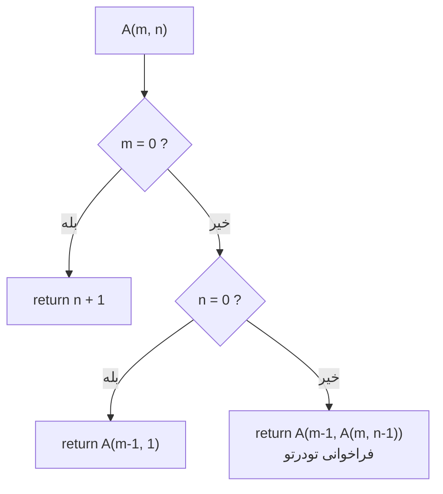
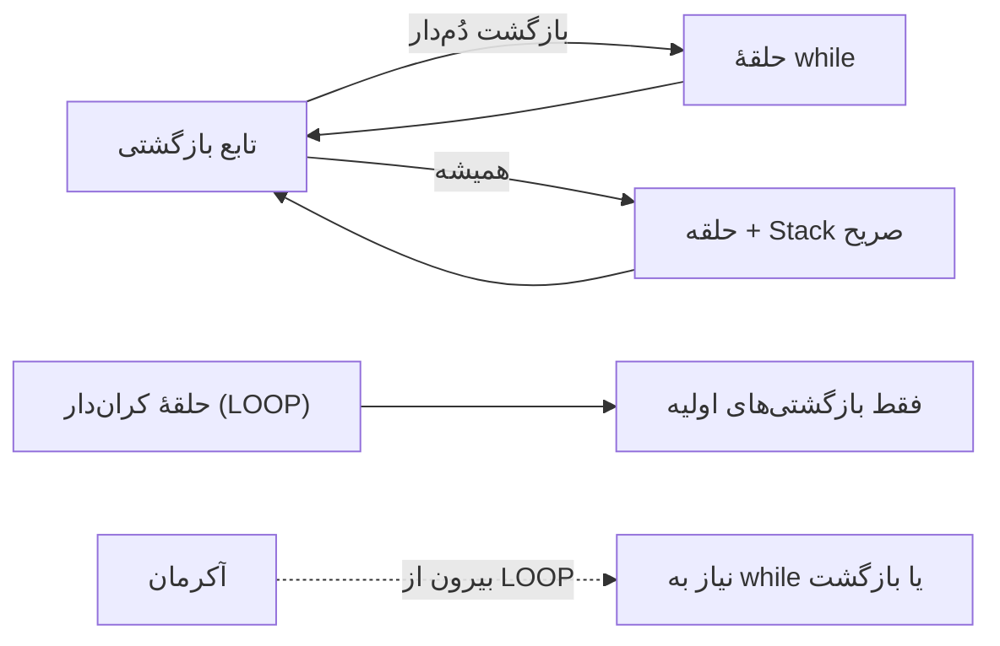
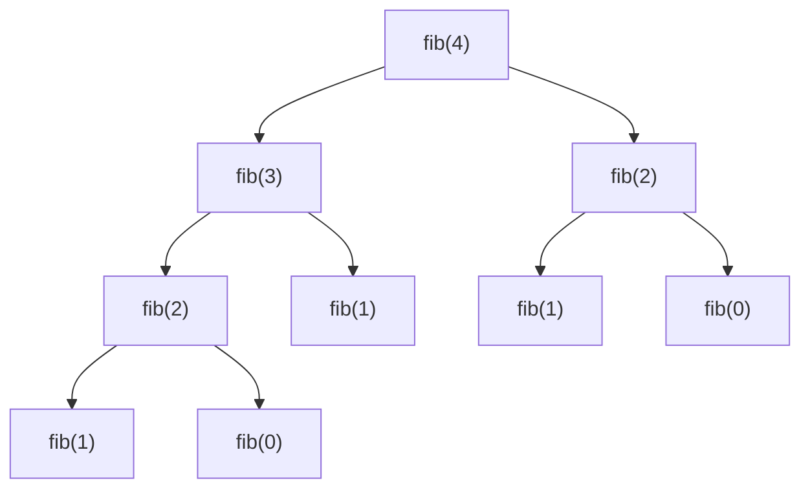
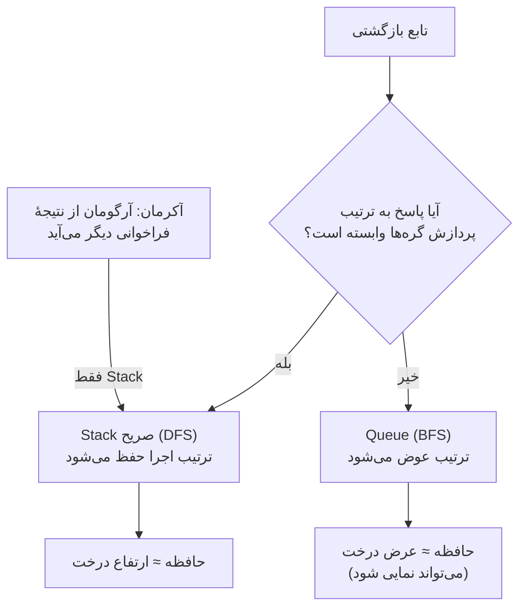

# بخش چهارم: توابع و بازگشت — مباحث تکمیلی

:::{admonition} راهنمای استفاده
:class: tip
این فایل همراه درسنامه (‎`part-four-lecture`‎) است و موضوع‌ها را **دقیق‌تر و عمیق‌تر** و با مثال‌های سخت‌تر مطرح می‌کند. هر مبحث مستقل است و در درسنامه با نشانهٔ 🔗 به آن ارجاع شده است؛ مدرس می‌تواند بسته به زمان و سطح کلاس، بعضی را تدریس کند و بقیه را به‌عنوان مطالعهٔ آزاد معرفی کند. کادرهای «پنجرهٔ بیشتر» برای کنجکاوها هستند.

فهرست:

1. [تعریف ریاضی تابع](#sup-math-function)
2. [محاسبه‌پذیری، مسئلهٔ توقف و حساب λ](#sup-computability)
3. [حساب پئانو](#sup-peano)
4. [تابع آکرمان](#sup-ackermann)
5. [بازگشت در برابر حلقه](#sup-loop)
6. [Stack و Queue به‌طور دقیق‌تر](#sup-adt)
7. [درخت بازگشت، DFS و BFS](#sup-dfs-bfs)
8. [ضریب دوجمله‌ای و هزینهٔ بازگشت](#sup-binom)
9. [فیبوناچی و توان دودویی: ماتریس و پیمانه](#sup-fast)
10. [ماکروها (‎`#define`‎)](#sup-macro)
:::

(sup-math-function)=
## ۱. تعریف ریاضی تابع

جعبهٔ سیاه یک تصویر شهودی بود. ریاضیات همین شهود را دقیق می‌کند، و مهم‌تر از همه **درون جعبه را کاملاً کنار می‌گذارد**: تابع یک «مجموعه از زوج‌های مرتب» است و حرفی از «روش محاسبه» نیست.

**ضرب دکارتی.** برای دو مجموعهٔ $A$ و $B$:

$$A \times B = \{ (a, b) \mid a \in A,\ b \in B \}$$

**رابطه** هر زیرمجموعهٔ $R \subseteq A \times B$ است. **تابع** رابطه‌ای $f \subseteq A \times B$ است که برای **هر** $a \in A$، **دقیقاً یک** $b \in B$ با $(a, b) \in f$ داشته باشد؛ می‌نویسیم $f(a) = b$.

دو شرط این تعریف همان قرارداد جعبهٔ سیاه است: «برای هر $a$» یعنی جعبه برای هر ورودی مجاز خروجی دارد؛ «دقیقاً یک» یعنی جعبه تعیین‌پذیر است.

**واژگان:** $A$ دامنه (Domain)، $B$ همدامنه (Codomain) و $\{ f(a) \mid a \in A \}$ برد (Image) است. برد زیرمجموعهٔ همدامنه است، اما لزوماً برابر آن نیست. تابع **یک‌به‌یک** است اگر ورودی‌های متفاوت همیشه خروجی متفاوت بدهند؛ **پوشا** است اگر برد با همدامنه برابر باشد؛ و **دوسویی** است اگر هر دو.

**تابع جزئی.** گاهی «برای هر $a$» برقرار نیست؛ مثلاً تقسیم صحیح برای مقسوم‌علیه صفر. چنین تابعی **جزئی (Partial)** است و با $f : A \rightharpoonup B$ نشان داده می‌شود؛ تابعی که برای همهٔ ورودی‌ها تعریف شده **کامل (Total)** است. این تفکیک در بخش‌های ۲ و ۳ همین فایل نقش مهمی پیدا می‌کند.

### امضای تابع در ریاضیات و در C

نمادگذاری ریاضی دقیقاً همان اطلاعاتی را می‌دهد که «امضا (Signature)» در برنامه‌نویسی می‌دهد: نوع ورودی‌ها و نوع خروجی.

| نماد ریاضی | معنی | معادل در C |
| --- | --- | --- |
| $f : A \to B$ | تابع کامل از $A$ به $B$ | ‎`B f(A x)`‎ |
| $f : A \times B \to C$ | دو ورودی | ‎`C f(A x, B y)`‎ |
| $x \mapsto x^2$ | «قاعدهٔ» تابع | ‎`return x * x;`‎ |
| $f : A \rightharpoonup B$ | تابع جزئی | تابعی که ممکن است برای بعضی ورودی‌ها هرگز تمام نشود |
| $g \circ f$ | ترکیب: $g(f(x))$ | ‎`g(f(x))`‎ |

اما نوع‌های C **متناهی** هستند و مجموعه‌های ریاضی می‌توانند نامتناهی باشند:

| مجموعهٔ ریاضی | نوع در C | نکته |
| --- | --- | --- |
| $\mathbb{N}$ | ‎`unsigned int`‎ | متناهی: $\{0, \dots, 2^{32}-1\}$ |
| $\mathbb{Z}$ | ‎`int`‎ | متناهی: حدود $\pm 2^{31}$ |
| $\mathbb{R}$ | ‎`double`‎ | فقط تقریب با دقت محدود |

مثلاً ‎`unsigned int`‎ در واقع حساب **پیمانه‌ای** $\mathbb{Z}_{2^{32}}$ است: ‎`0u - 1`‎ برابر $4294967295$ می‌شود. پس تابع ‎`add`‎ در C دقیقاً همان $+ : \mathbb{N} \times \mathbb{N} \to \mathbb{N}$ ریاضی نیست.

### مثال: تابع به‌عنوان مجموعه‌ای از زوج‌ها

تابع $f : A \to A$ با $A = \{0, 1, \dots, 7\}$ و $f(x) = x^2 \bmod 8$ را در نظر بگیرید. برنامهٔ زیر **گراف** تابع (همهٔ زوج‌های مرتب) را چاپ می‌کند و با حلقه‌های تودرتو یک‌به‌یکی و پوشایی را وارسی می‌کند؛ همان محاسبه‌ای که در درس ریاضی روی کاغذ انجام می‌دهید.

```c
#include <stdio.h>

int main(void)
{
    /* A = {0, 1, ..., 7} and f(x) = x^2 mod 8 */
    printf("graph of f = { ");
    for (int x = 0; x < 8; x++)
        printf("(%d,%d) ", x, (x * x) % 8);
    printf("}\n");

    /* image: count the y values that at least one x maps to */
    int image_size = 0;
    for (int y = 0; y < 8; y++) {
        int reached = 0;
        for (int x = 0; x < 8; x++)
            if ((x * x) % 8 == y) reached = 1;
        image_size += reached;
    }

    /* injective? is there a pair of different x with the same output? */
    int injective = 1;
    for (int x1 = 0; x1 < 8; x1++)
        for (int x2 = x1 + 1; x2 < 8; x2++)
            if ((x1 * x1) % 8 == (x2 * x2) % 8) injective = 0;

    printf("image size = %d (codomain size = 8)\n", image_size);
    printf("injective?   %s\n", injective ? "yes" : "no");
    printf("surjective?  %s\n", image_size == 8 ? "yes" : "no");
    return 0;
}
```

خروجی:

```text
graph of f = { (0,0) (1,1) (2,4) (3,1) (4,0) (5,1) (6,4) (7,1) }
image size = 3 (codomain size = 8)
injective?   no
surjective?  no
```


(sup-computability)=
## ۲. محاسبه‌پذیری، مسئلهٔ توقف و حساب λ

### چرا بیشتر تابع‌ها محاسبه‌پذیر نیستند؟

- هر **برنامه** یک متن متناهی روی یک الفبای متناهی است. مجموعهٔ همهٔ متن‌های متناهی **شماراست**؛ پس برنامه‌ها را می‌توان در یک فهرست $P_0, P_1, P_2, \dots$ آورد.
- اما مجموعهٔ توابع $\mathbb{N} \to \{0, 1\}$ **ناشماراست**. استدلال قطری کانتور: اگر فهرستی $f_0, f_1, \dots$ از این تابع‌ها داشته باشیم، تابع $d(n) = 1 - f_n(n)$ با هر $f_n$ دست‌کم در ورودی $n$ فرق دارد؛ پس در فهرست نیست.

بنابراین تعداد تابع‌ها بی‌نهایت‌بار بیشتر از تعداد برنامه‌هاست.

**تعریف (غیررسمی).** تابع $f$ **محاسبه‌پذیر** است اگر الگوریتمی باشد که به ازای هر ورودی $x$ از دامنه، پس از تعداد متناهی گام **متوقف شود** و $f(x)$ را بدهد. برای توابع جزئی: $f(x)\downarrow$ یعنی الگوریتم روی $x$ متوقف می‌شود، و $f(x)\uparrow$ یعنی هرگز تمام نمی‌شود. پس **«ممکن است برنامه تمام نشود» دقیقاً معادل «تابع جزئی است»**.

### مسئلهٔ توقف

تابع $\text{halts}(p, x)$ مقدار ۱ می‌دهد اگر برنامهٔ $p$ روی ورودی $x$ سرانجام متوقف شود و در غیر این صورت ۰. این تابع کامل و خوش‌تعریف است. ایدهٔ اثبات تورینگ که **محاسبه‌پذیر نیست** (به زبان شبه‌C):

```text
Assume halts(p, x) can be written.

void paradox(program p) {
    if (halts(p, p))      // if p halts on its own text ...
        while (1) { }     // ... then loop forever
    else
        return;           // otherwise stop immediately
}

Does paradox(paradox) halt?
  - if it halts     -> halts(paradox, paradox) = 1 -> infinite loop -> it does not halt!
  - if it not halts -> halts(paradox, paradox) = 0 -> return        -> it halts!
Contradiction, so halts cannot exist.
```

پیام: **«تعریف‌پذیر» با «محاسبه‌پذیر» یکی نیست.**

### حدس کولاتس: الگوریتمی که نمی‌دانیم همیشه تمام می‌شود

عدد $n$ را بگیر؛ تا وقتی $n \neq 1$ است، اگر $n$ زوج بود نصفش کن و اگر فرد بود $3n + 1$ بساز؛ گام‌ها را بشمار. این الگوریتم کاملاً مشخص است، اما هیچ‌کس نمی‌داند به ازای **هر** $n$ سرانجام متوقف می‌شود (حدس کولاتس، ۱۹۳۷). یعنی نمی‌دانیم این تابع **کامل** است یا فقط **جزئی**.

```c
#include <stdio.h>

int main(void)
{
    int tests[] = {1, 6, 7, 27};

    for (int t = 0; t < 4; t++) {
        unsigned long long n = tests[t];
        int steps = 0;

        while (n != 1) {                       /* repetition */
            if (n % 2 == 0) n = n / 2;         /* selection  */
            else            n = 3 * n + 1;
            steps++;                           /* sequence   */
        }
        printf("s(%2d) = %d steps\n", tests[t], steps);
    }
    return 0;
}
```

خروجی:

```text
s( 1) = 0 steps
s( 6) = 8 steps
s( 7) = 16 steps
s(27) = 111 steps
```


برنامه برای این چهار ورودی تمام شد، نه به این دلیل که ثابت شده همیشه تمام می‌شود: **یک آزمایش هرگز اثبات نیست.**

### پیشینهٔ تاریخی

| زمان | رویداد |
| --- | --- |
| حدود ۳۰۰ ق.م. | الگوریتم اقلیدس برای بزرگ‌ترین مقسوم‌علیه مشترک |
| حدود قرن ۹ میلادی | خوارزمی روش‌های گام‌به‌گام حساب و جبر را مدون کرد؛ واژهٔ Algorithm از نام لاتینی‌شدهٔ او می‌آید |
| ۱۸۸۸ | ددکیند «تعریف با بازگشت» روی اعداد طبیعی را صورت‌بندی کرد |
| ۱۹۰۰ و ۱۹۲۸ | هیلبرت مسائل مشهورش را ارائه کرد و بعدها (با آکرمان) **مسئلهٔ تصمیم** را مطرح کرد |
| ۱۹۲۸ | آکرمان تابعی ساخت که کامل و محاسبه‌پذیر است ولی با «بازگشت اولیه» تعریف‌پذیر نیست (مبحث ۴) |
| ۱۹۳۱ | گودل با قضایای ناتمامیت حدود بیان صوری را نشان داد |
| ۱۹۳۲ تا ۱۹۳۶ | **چرچ** حساب λ را ساخت؛ کلینی توابع μ-بازگشتی را معرفی کرد |
| ۱۹۳۶ | چرچ و مستقل از او **تورینگ** (با ماشین تورینگ) نشان دادند مسئلهٔ تصمیم پاسخ منفی دارد |
| ۱۹۳۷ به بعد | اثبات شد همهٔ این تعریف‌های ظاهراً متفاوت **دقیقاً یک دسته از تابع‌ها** را می‌سازند |

از همین هم‌ارزی، **تز چرچ–تورینگ** می‌آید: هر تابع «به‌طور شهودی» محاسبه‌پذیر، با یک ماشین تورینگ (و با یک برنامهٔ C روی حافظهٔ نامحدود) قابل محاسبه است. نتیجهٔ عملی: هر زبانی که شرط و حلقه (یا بازگشت) داشته باشد، از نظر **توان محاسباتی** با زبان‌های دیگر هم‌ارز است.

:::{admonition} پنجرهٔ بیشتر: عددها هم تابع‌اند (اعداد چرچ)
:class: note
در حساب λ چرچ، حتی عددها با «تابع» ساخته می‌شوند. عدد $n$ یعنی «تابعی که $f$ را $n$ بار به $x$ اعمال می‌کند»:

$$\underline{0} = \lambda f.\,\lambda x.\; x, \qquad \underline{1} = \lambda f.\,\lambda x.\; f\,x, \qquad \underline{2} = \lambda f.\,\lambda x.\; f\,(f\,x)$$

تابع **پی‌آمد** و **جمع** هم تابع‌اند:

$$\text{succ} = \lambda n.\,\lambda f.\,\lambda x.\; f\,(n\,f\,x), \qquad \text{plus} = \lambda m.\,\lambda n.\,\lambda f.\,\lambda x.\; m\,f\,(n\,f\,x)$$

این دقیقاً همان ایدهٔ **حساب پئانو** (مبحث بعد) است: ساختن همهٔ حساب از «صفر» و «پی‌آمد». فقط اینجا حتی عددها هم تابع هستند و هیچ دادهٔ دیگری لازم نیست.
:::

(sup-peano)=
## ۳. حساب پئانو: ساختن حساب از صفر

«واقعاً **چه چیزی** پشت ‎`+`‎ و ‎`*`‎ است؟» پاسخ ریاضی‌دانان پایان قرن نوزدهم (جوزپه پئانو، ۱۸۸۹): اعداد طبیعی فقط از **دو ایده** ساخته می‌شوند:

- یک عدد آغازین $0$؛
- یک تابع **پی‌آمد** $S$ که «یکی بعدی» را می‌دهد: $1 = S(0)$، $2 = S(S(0))$ و ...

و سپس همهٔ عمل‌های حسابی با **تعریف بازگشتی** روی همین دو ایده ساخته می‌شوند. به این شیوه **بازگشت اولیه (Primitive Recursion)** می‌گویند (ددکیند، اسکولم): تابع $h$ را برای ورودی $0$ مستقیماً تعریف می‌کنیم و برای $S(y)$ بر حسب $h(\cdot, y)$:

$$h(x, 0) = g(x), \qquad h(x, S(y)) = f\big(x, y, h(x, y)\big)$$

در برنامه، $S$ و تابع **پیشین** $P$ را با ‎`inc`‎ و ‎`dec`‎ نشان می‌دهیم. تعریف‌ها:

| تابع | حالت پایه | گام بازگشتی |
| --- | --- | --- |
| $\text{add}(a, b)$ | $\text{add}(a, 0) = a$ | $\text{add}(S(a), P(b))$ |
| $\text{sub}(a, b)$ | $\text{sub}(a, 0) = a$ | $\text{sub}(P(a), P(b))$ |
| $\text{mul}(a, b)$ | $\text{mul}(a, 0) = 0$ | $\text{add}(\text{mul}(a, P(b)),\ a)$ |
| $\text{pow}(a, b)$ | $\text{pow}(a, 0) = 1$ | $\text{mul}(\text{pow}(a, P(b)),\ a)$ |
| $\text{mod}(a, b)$ | $a < b \Rightarrow a$ | $\text{mod}(\text{sub}(a, b),\ b)$ |
| $\text{div}(a, b)$ | $a < b \Rightarrow 0$ | $S(\text{div}(\text{sub}(a, b),\ b))$ |

دو لایه در این جدول هست. اول، هر تابع روی تابع **قبلی** ساخته شده است (‎`mul`‎ روی ‎`add`‎، ‎`pow`‎ روی ‎`mul`‎، ...؛ این «برج» در مبحث بعد به تابع آکرمان می‌رسد). دوم، ‎`mod`‎ و ‎`div`‎ از نوع «تفریق پیاپی تا کوچک‌شدن» هستند.

در کد از عملگر شرطی ‎`cond ? x : y`‎ استفاده می‌کنیم (یک **عبارت** که اگر ‎`cond`‎ درست باشد مقدار ‎`x`‎ و وگرنه ‎`y`‎ را دارد) و از ‎`++a`‎ و ‎`--a`‎ (یکی زیاد یا کم می‌کنند و مقدار جدید را می‌دهند؛ چون ‎`a`‎ پارامتر است، فقط نسخهٔ محلی تغییر می‌کند). برای نام کوتاه ‎`uint`‎، از ‎`typedef`‎ استفاده می‌کنیم (تفاوتش با ‎`#define`‎ در [مبحث ۱۰](#sup-macro) است).

```c
#include <stdio.h>

typedef unsigned int uint;

uint inc(uint a) { return ++a; }
uint dec(uint a) { return --a; }

uint add(uint a, uint b)    { return b == 0 ? a : add(inc(a), dec(b)); }
uint sub(uint a, uint b)    { return b == 0 ? a : sub(dec(a), dec(b)); }
uint mul(uint a, uint b)    { return b == 0 ? 0 : add(mul(a, dec(b)), a); }
uint power(uint a, uint b)  { return b == 0 ? 1 : mul(power(a, dec(b)), a); }
uint modulo(uint a, uint b) { return a < b ? a : modulo(sub(a, b), b); }
uint divide(uint a, uint b) { return a < b ? 0 : inc(divide(sub(a, b), b)); }

int main(void)
{
    printf("add(7, 5)     = %u\n", add(7, 5));
    printf("sub(7, 5)     = %u\n", sub(7, 5));
    printf("mul(7, 5)     = %u\n", mul(7, 5));
    printf("power(2, 10)  = %u\n", power(2, 10));
    printf("modulo(23, 4) = %u\n", modulo(23, 4));
    printf("divide(23, 4) = %u\n", divide(23, 4));
    return 0;
}
```

خروجی:

```text
add(7, 5)     = 12
sub(7, 5)     = 2
mul(7, 5)     = 35
power(2, 10)  = 1024
modulo(23, 4) = 3
divide(23, 4) = 5
```


چند نکته در فهم برنامه:

**۱) ‎`add`‎ یک زنجیر است.** در هر گام یک واحد از $b$ به $a$ منتقل می‌شود:

```text
add(2, 3) -> add(3, 2) -> add(4, 1) -> add(5, 0) = 5
```

**۲) ‎`mul`‎ یک درخت (در واقع زنجیر دوگانه) است.** ابتدا ‎`mul(a, dec(b))`‎ ارزیابی می‌شود، سپس ‎`add`‎:

```text
mul(2, 3)
 +- mul(2, 2)
 |   +- mul(2, 1)
 |   |   +- mul(2, 0) = 0
 |   |   +- add(0, 2) = 2
 |   +- add(2, 2) = 4
 +- add(4, 2) = 6
```

**۳) هزینه متناسب با «مقدار» است، نه «اندازه».** ‎`add(a, b)`‎ دقیقاً $b + 1$ فراخوانی دارد؛ این برنامه در واقع به‌صورت **یکانی (Unary)** می‌شمارد. هدف، فهم ساختار است، نه سرعت. (به همین دلیل ‎`power(2, 10)`‎ خیلی بیشتر از ۱۰ گام کار می‌کند: چند بار ‎`mul`‎ که هر کدام چند بار ‎`add`‎.)

**۴) همه‌چیز از ‎`inc`‎، ‎`dec`‎ و شرط ساخته شده است.**

### دو پیامد نظری

**نوع متناهی.** ‎`dec(0)`‎ برابر $2^{32} - 1$ می‌شود. پس ‎`sub(a, b)`‎ برای $b > a$ هم «تعریف‌شده» است، اما **تفریق طبیعی** نیست. یا باید قرارداد کنیم تعریف‌نشده باشد (تابع جزئی)، یا **تفریق طبیعی (Monus)** که برابر صفر است:

```c
#include <stdio.h>

typedef unsigned int uint;

uint inc(uint a) { return ++a; }
uint dec(uint a) { return --a; }
uint sub(uint a, uint b) { return b == 0 ? a : sub(dec(a), dec(b)); }

/* natural subtraction (monus): never goes below zero */
uint monus(uint a, uint b) { return a < b ? 0 : sub(a, b); }

int main(void)
{
    printf("dec(0)          = %u\n", dec(0));
    printf("inc(4294967295) = %u\n", inc(4294967295u));
    printf("sub(3, 5)       = %u   (3 - 5 mod 2^32)\n", sub(3, 5));
    printf("monus(3, 5)     = %u\n", monus(3, 5));
    return 0;
}
```

خروجی:

```text
dec(0)          = 4294967295
inc(4294967295) = 0
sub(3, 5)       = 4294967294   (3 - 5 mod 2^32)
monus(3, 5)     = 0
```


پس **انتخاب یک مدل** (حساب پیمانه‌ای، تفریق طبیعی، یا تابع جزئی) بخشی از **طراحی تابع** است، نه یک جزئیات فنی.

**تقسیم بر صفر و تابع جزئی.** اگر $b = 0$ باشد، $\text{sub}(a, 0) = a$ است و $a$ هرگز کوچک‌تر نمی‌شود؛ شرط پایه ($a < 0$) هیچ‌وقت برقرار نمی‌شود: $\text{div}(a, 0)\uparrow$. در حافظهٔ متناهی، «تا ابد ادامه دادن» به شکل Stack Overflow ظاهر می‌شود:

```c
#include <stdio.h>

typedef unsigned int uint;

uint inc(uint a) { return ++a; }
uint dec(uint a) { return --a; }
uint sub(uint a, uint b)    { return b == 0 ? a : sub(dec(a), dec(b)); }
uint divide(uint a, uint b) { return a < b ? 0 : inc(divide(sub(a, b), b)); }

int main(void)
{
    printf("divide(23, 4) = %u\n", divide(23, 4));
    printf("about to compute divide(5, 0) ...\n");
    fflush(stdout);
    printf("divide(5, 0)  = %u\n", divide(5, 0));      /* never reaches the base case */
    return 0;
}
```

خروجی:

```text
divide(23, 4) = 5
about to compute divide(5, 0) ...
exit code: 139
```


(کد خروج ۱۳۹ یعنی $128 + 11$، یعنی سیگنال ۱۱ = ‎`SIGSEGV`‎.)

(sup-ackermann)=
## ۴. تابع آکرمان

در مبحث قبل دیدیم هر تابع روی تابع قبلی ساخته می‌شود: جمع روی «یکی بعدی»، ضرب روی جمع، توان روی ضرب، «برج توان» روی توان، و ... سؤال طبیعی:

> آیا می‌توان **همهٔ** تابع‌های کامل و محاسبه‌پذیر را با ترکیب چنین بازگشت‌های اولیه ساخت؟

در ۱۹۲۸ ویلهلم آکرمان (شاگرد هیلبرت) و مستقل از او گابریل سودان (۱۹۲۷) نشان دادند **پاسخ منفی است**. نسخهٔ دومتغیرهٔ مشهور امروزی حاصل ساده‌سازی‌های رزا پیتر و رافائل رابینسون است:

$$\begin{aligned} A(0, n) &= n + 1 \\ A(m + 1,\ 0) &= A(m,\ 1) \\ A(m + 1,\ n + 1) &= A\big(m,\ A(m + 1,\ n)\big) \end{aligned}$$



**چرا این تابع خاص است؟**

۱) **هر سطر، تکرار سطر قبلی است.** از دو قاعدهٔ آخر نتیجه می‌شود $A(m+1, n)$ برابر است با اعمال $n+1$ بار $A(m, \cdot)$ روی عدد ۱:

| $m$ | $A(m, n)$ | عملیات متناظر |
| --- | --- | --- |
| ۰ | $n + 1$ | پی‌آمد |
| ۱ | $n + 2$ | جمع |
| ۲ | $2n + 3$ | ضرب |
| ۳ | $2^{n+3} - 3$ | توان |
| ۴ | $2^{2^{\cdot^{\cdot^{2}}}} - 3$ (برجی از $n+3$ تا ۲) | برج توان (Tetration) |

۲) **رشد آن از هر تابع بازگشتی اولیه سریع‌تر است:** برای هر تابع بازگشتی اولیه $f$ یک $k$ هست که $f(n) < A(k, n)$. پس $A$ خودش بازگشتی اولیه نیست.

چند مقدار: $A(4, 0) = 13$ و $A(4, 1) = 65533$ و $A(4, 2) = 2^{65536} - 3$ که عددی **۱۹٬۷۲۹ رقمی** است. $A(4, 3)$ بیشتر از تعداد اتم‌های جهان رقم دارد. تابع **محاسبه‌پذیر** است، اما برای ورودی‌های نه‌چندان بزرگ **عملاً محاسبه‌ناپذیر**؛ محاسبه‌پذیری در تئوری با امکان‌پذیری در عمل یکی نیست.

نکتهٔ کلیدی: در ‎`ack(m - 1, ack(m, n - 1))`‎ آرگومان دوم **نتیجهٔ یک فراخوانی دیگر** است. برای دیدن هزینهٔ واقعی دو شمارنده می‌گذاریم: تعداد کل فراخوانی‌ها و بیشینهٔ عمق (حداکثر فریم‌های هم‌زمان).

```c
#include <stdio.h>

static unsigned long calls, depth, max_depth;

unsigned long ack(unsigned long m, unsigned long n)
{
    unsigned long r;

    calls++;
    depth++;
    if (depth > max_depth) max_depth = depth;

    if (m == 0)       r = n + 1;
    else if (n == 0)  r = ack(m - 1, 1);
    else              r = ack(m - 1, ack(m, n - 1));

    depth--;
    return r;
}

void report(unsigned long m, unsigned long n)
{
    calls = depth = max_depth = 0;
    unsigned long v = ack(m, n);
    printf("A(%lu,%lu) = %-4lu calls = %-7lu max_depth = %lu\n", m, n, v, calls, max_depth);
}

int main(void)
{
    printf("Table of A(m, n):\n");
    printf("      n=0  n=1  n=2  n=3  n=4  n=5  n=6\n");
    for (unsigned long m = 0; m <= 3; m++) {
        printf("m=%lu ", m);
        for (unsigned long n = 0; n <= 6; n++)
            printf("%5lu", ack(m, n));
        printf("\n");
    }

    printf("\nCost:\n");
    report(2, 3);
    report(3, 3);
    report(3, 6);
    report(4, 0);
    return 0;
}
```

خروجی:

```text
Table of A(m, n):
      n=0  n=1  n=2  n=3  n=4  n=5  n=6
m=0     1    2    3    4    5    6    7
m=1     2    3    4    5    6    7    8
m=2     3    5    7    9   11   13   15
m=3     5   13   29   61  125  253  509

Cost:
A(2,3) = 9    calls = 44      max_depth = 10
A(3,3) = 61   calls = 2432    max_depth = 63
A(3,6) = 509  calls = 172233  max_depth = 511
A(4,0) = 13   calls = 107     max_depth = 16
```


سه مشاهدهٔ مهم:

1. سطرها همان جدول بالا هستند ($A(3, 6) = 2^9 - 3 = 509$).
2. تعداد فراخوانی‌ها **انفجاری** است: در $m = 3$ با اضافه شدن هر واحد به $n$ حدود **چهار برابر** می‌شود.
3. **عمق** بازگشت برای $m = 3$ تقریباً برابر خود مقدار تابع است ($A(3,6) = 509$ و عمق ۵۱۱). Stack باید به اندازهٔ نتیجه بزرگ باشد.

:::{admonition} نگاهی به یک دانشمند: رزا پیتر (Rózsa Péter)
:class: note
رزا پیتر، ریاضی‌دان مجار (۱۹۰۵ تا ۱۹۷۷)، در دههٔ ۱۹۳۰ به مطالعهٔ توابع بازگشتی پرداخت؛ زمانی که بازگشت بیشتر یک «ابزار تعریف در منطق» بود. او دریافت می‌توان **خودِ بازگشت** را موضوع مطالعه قرار داد: چه تابع‌هایی با چه نوع بازگشتی ساخته می‌شوند و چه تابع‌هایی از آن‌ها فراتر می‌روند. همین پرسش او را به تابع آکرمان رساند و ساده‌سازی‌هایش سبب شد نسخهٔ دومتغیرهٔ بالا در کتاب‌ها رایج شود.

کتاب او «توابع بازگشتی» (Rekursive Funktionen, 1951) از نخستین کتاب‌هایی است که این نظریه را منسجم ارائه کرد. او همچنین کتاب «بازی با بی‌نهایت» (Playing with Infinity) را برای عموم نوشت؛ نشان می‌دهد ریاضیات عمیق و بیان ساده با هم قابل جمع‌اند.

مسیر فکری او شبیه کاری است که در این مباحث کردیم: **یک تعریف ساده (بازگشت اولیه) ← پرسش از حدودش ← پیدا کردن تابعی که از حدود بیرون می‌زند (آکرمان) ← ساختن نظریه‌ای برای فهم این حدود.**
:::

:::{admonition} پنجرهٔ بیشتر: Busy Beaver
:class: note
تابع $\text{BB}(n)$ (Busy Beaver) از هر تابع محاسبه‌پذیر، از جمله آکرمان، سریع‌تر رشد می‌کند و خودش **محاسبه‌پذیر نیست**؛ اگر بود، مسئلهٔ توقف حل‌شدنی می‌شد. درباره‌اش جست‌وجو کنید.
:::

(sup-loop)=
## ۵. بازگشت در برابر حلقه: توان محاسباتی

دو ابزار تکرار داریم: **حلقه** و **بازگشت**. آیا یکی می‌تواند چیزی را حساب کند که دیگری نمی‌تواند؟

**حلقه ⇒ بازگشت.** هر حلقه را می‌توان به تابع بازگشتی تبدیل کرد: متغیرهای حلقه تبدیل به **پارامترها** می‌شوند، شرط ادامه به **شرط بازگشت** و «بدنه + رفتن به دور بعد» به **فراخوانی خود تابع با مقدارهای تازه**. تابعی که فراخوانی بازگشتی‌اش **آخرین کار** آن است (و نتیجه را بدون تغییر برمی‌گرداند) **بازگشت دُم‌دار (Tail Recursion)** دارد. چنین تابعی بعد از بازگشت هیچ کاری ندارد، پس فریم آن اضافی است و کامپایلر می‌تواند آن را به حلقه تبدیل کند.

**بازگشت ⇒ حلقه.** هر تابع بازگشتی را می‌توان با یک **حلقه و یک Stack صریح** شبیه‌سازی کرد (مبحث ۷).

پس **از نظر توان محاسباتی هم‌ارزند.** این با قضیهٔ **بوم–یاکوپینی (۱۹۶۶)** هم سازگار است: هر الگوریتم را می‌توان فقط با ترتیب، انتخاب و تکرار نوشت. اما باید دقیق باشیم که «حلقه» یعنی چه:

| مدل | توان | مثال |
| --- | --- | --- |
| دنباله + شرط (بدون تکرار) | فقط تابع‌هایی با تعداد گام ثابت | $\max(a, b)$ |
| حلقه‌ای که **تعداد تکرارش پیش از شروع مشخص است** (مدل LOOP؛ مایر و ریچی، ۱۹۶۷) | دقیقاً **بازگشتی‌های اولیه**: جمع، ضرب، توان، ... | ‎`for (i = 0; i < b; i++)`‎ با ‎`b`‎ ثابت در طول حلقه |
| حلقهٔ **بدون سقف** (‎`while`‎ با شرط دلخواه) | **همهٔ** توابع (جزئی) محاسبه‌پذیر | کولاتس، آکرمان |
| بازگشت عمومی | **همهٔ** توابع (جزئی) محاسبه‌پذیر | آکرمان، فیبوناچی |

پس تابع آکرمان با «حلقه‌های کراندار» نوشتنی نیست، اما با ‎`while`‎ یا بازگشت هست. (جالب است که دنیس ریچی، نویسندهٔ همین مقاله، سازندهٔ زبان C هم هست.)



### تبدیل بازگشت دُم‌دار به حلقه

| در تابع بازگشتی | در حلقه |
| --- | --- |
| پارامترها | متغیرهای حلقه (با مقدار اولیهٔ آرگومان‌ها) |
| شرط حالت پایه | نقیض آن به‌عنوان شرط ادامه: ‎`while (!base)`‎ |
| نتیجهٔ حالت پایه | مقداری که بعد از حلقه برمی‌گردانیم |
| فراخوانی ‎`f(e1, e2)`‎ | **به‌روزرسانی هم‌زمان** پارامترها و رفتن به دور بعد |

الگوریتم اقلیدس $\gcd(a, 0) = a$ و $\gcd(a, b) = \gcd(b,\ a \bmod b)$ دُم‌دار است و اندازهٔ کاهنده‌اش $b$ است. به‌روزرسانی هم‌زمان ‎`a`‎ و ‎`b`‎ در حلقه با یک متغیر کمکی انجام می‌شود:

```c
#include <stdio.h>

/* recursive (tail): gcd(a, 0) = a ; gcd(a, b) = gcd(b, a mod b) */
unsigned gcd_rec(unsigned a, unsigned b)
{
    return b == 0 ? a : gcd_rec(b, a % b);
}

/* loop: parameters become loop variables */
unsigned gcd_loop(unsigned a, unsigned b)
{
    while (b != 0) {
        unsigned t = a % b;       /* the new b */
        a = b;                    /* simultaneous update (a, b) <- (b, a mod b) */
        b = t;
    }
    return a;
}

int main(void)
{
    unsigned tests[][2] = { {48, 18}, {17, 5}, {100, 75}, {7, 0} };

    for (int i = 0; i < 4; i++) {
        unsigned a = tests[i][0], b = tests[i][1];
        printf("gcd(%3u, %3u): recursive = %2u   loop = %2u\n", a, b, gcd_rec(a, b), gcd_loop(a, b));
    }
    return 0;
}
```

خروجی:

```text
gcd( 48,  18): recursive =  6   loop =  6
gcd( 17,   5): recursive =  1   loop =  1
gcd(100,  75): recursive = 25   loop = 25
gcd(  7,   0): recursive =  7   loop =  7
```


اما فاکتوریل دُم‌دار **نیست**: بعد از بازگشت از ‎`fact(n-1)`‎ هنوز یک ضرب باقی است. ترفند استاندارد: یک پارامتر **انباره (Accumulator)** اضافه کنیم تا «کار باقی‌مانده» را همراه خود ببرد. آن‌وقت فراخوانی آخرین کار می‌شود:

$$\text{fact}(n, acc) = \begin{cases} acc & n \le 1 \\ \text{fact}(n - 1,\ n \cdot acc) & n > 1 \end{cases}$$

```c
#include <stdio.h>

/* not tail recursive: a multiplication is left after the call */
unsigned long long fact_plain(unsigned n)
{
    return n <= 1 ? 1ULL : n * fact_plain(n - 1);
}

/* tail recursive with an accumulator */
unsigned long long fact_tail(unsigned n, unsigned long long acc)
{
    return n <= 1 ? acc : fact_tail(n - 1, n * acc);
}

/* the same thing as a loop */
unsigned long long fact_loop(unsigned n)
{
    unsigned long long acc = 1;
    while (n > 1) {
        acc = n * acc;
        n = n - 1;
    }
    return acc;
}

int main(void)
{
    for (unsigned n = 0; n <= 20; n += 5)
        printf("%2u! = %20llu %20llu %20llu\n", n, fact_plain(n), fact_tail(n, 1), fact_loop(n));
    return 0;
}
```

خروجی:

```text
 0! =                    1                    1                    1
 5! =                  120                  120                  120
10! =              3628800              3628800              3628800
15! =        1307674368000        1307674368000        1307674368000
20! =  2432902008176640000  2432902008176640000  2432902008176640000
```


### هزینهٔ بازگشت: عمق Stack

بازگشت رایگان نیست. تا وقتی یک فراخوانی تمام نشده، فریمش روی Stack می‌ماند، پس $\text{memory} \approx \text{frame size} \times \text{depth}$ (حافظه ≈ اندازهٔ فریم × عمق). در Linux اندازهٔ پیش‌فرض Stack برابر ۸ مگابایت است. برنامهٔ زیر $\sum_{i=1}^{N} i$ را بازگشتی حساب می‌کند و عمق را زیاد می‌کند (با ‎`fflush`‎ هر خط پیش از محاسبه چاپ می‌شود تا هنگام Crash هم دیده شود):

```c
#include <stdio.h>

unsigned long long sum_to(unsigned long long n)     /* sum_to(n) = 1 + 2 + ... + n */
{
    return (n == 0) ? 0 : n + sum_to(n - 1);
}

int main(void)
{
    unsigned long long depths[] = {1000, 100000, 10000000};

    for (int i = 0; i < 3; i++) {
        printf("computing sum_to(%llu) ...\n", depths[i]);
        fflush(stdout);
        printf("   = %llu\n", sum_to(depths[i]));
        fflush(stdout);
    }
    return 0;
}
```

خروجی:

```text
computing sum_to(1000) ...
   = 500500
computing sum_to(100000) ...
   = 5000050000
computing sum_to(10000000) ...
exit code: 139
```


عمق ۱۰۰۰ و ۱۰۰٬۰۰۰ مشکلی ندارد، اما عمق ۱۰٬۰۰۰٬۰۰۰ باعث **Stack Overflow** می‌شود (کد خروج ۱۳۹). **درست بودن** یک تعریف بازگشتی با **عملی بودن** آن یکی نیست.

اگر همین مسئله را دُم‌دار بنویسیم و با ‎`-O2`‎ کامپایل کنیم، معمولاً کامپایلر آن را به حلقه تبدیل می‌کند و عمق ۱۰۰ میلیون هم مشکلی ندارد:

```c
#include <stdio.h>

unsigned long long sum_acc(unsigned long long n, unsigned long long acc)
{
    return (n == 0) ? acc : sum_acc(n - 1, acc + n);      /* tail call */
}

int main(void)
{
    printf("sum_acc(100000000, 0) = %llu\n", sum_acc(100000000ULL, 0));
    return 0;
}
```

خروجی:

```text
sum_acc(100000000, 0) = 5000000050000000
```


> **هشدار:** استاندارد C تبدیل بازگشت دُم‌دار به حلقه را **تضمین نمی‌کند**؛ فقط یک بهینه‌سازی کامپایلر است. در زبان‌هایی مثل Scheme این رفتار جزو تعریف زبان است، ولی در C نباید رویش حساب کرد.

(sup-adt)=
## ۶. Stack و Queue به‌طور دقیق‌تر

**نوع داده انتزاعی (ADT).** مثل جعبهٔ سیاه، یک ساختار داده را با **قرارداد رفتارش** تعریف می‌کنیم، نه با نحوهٔ ذخیره‌سازی.

| | Stack (پشته) | Queue (صف) |
| --- | --- | --- |
| قاعده | **LIFO**: آخرین ورودی، اولین خروجی | **FIFO**: اولین ورودی، اولین خروجی |
| افزودن | ‎`s_push(x)`‎ روی بالای پشته | ‎`q_push(x)`‎ به انتهای صف (Rear) |
| برداشتن | ‎`s_pop()`‎ بالاترین عنصر | ‎`q_pop()`‎ عنصر ابتدای صف (Front) |
| آزمون خالی بودن | ‎`s_empty()`‎ | ‎`q_empty()`‎ |
| پیش‌شرط برداشتن | ساختار خالی نباشد | ساختار خالی نباشد |
| مثال روزمره | ظرف‌های روی هم، دکمهٔ Undo | صف نانوایی، صف چاپگر |

**اصل‌های رفتاری** (قرارداد): اگر $x$ را ‎`push`‎ کنیم و بلافاصله ‎`pop`‎ کنیم، همان $x$ برمی‌گردد و ساختار به حال قبلی برمی‌گردد (Stack). در Queue عنصرها دقیقاً به همان ترتیبی خارج می‌شوند که وارد شده‌اند.

**تنها تفاوت** این دو، سر خروج است؛ اما همین تفاوت کوچک ترتیب پردازش را کاملاً عوض می‌کند و در مبحث ۷ می‌بینیم دقیقاً تفاوت **DFS** و **BFS** است. **Call Stack** سیستم هم دقیقاً یک Stack است: فراخوانی = ‎`push`‎ و بازگشت = ‎`pop`‎.

### پیاده‌سازی با آرایه

در مثال‌های این فایل از پرونده‌ای به نام ‎`adt.h`‎ استفاده می‌کنیم. **رابط** آن همان جدول بالاست. درونش فقط آرایه‌ها به کار رفته که در بخش پنجم کامل می‌آموزید؛ اما ایدهٔ آن را می‌شود همین حالا فهمید:

- **Stack:** یک آرایه و یک شمارندهٔ ‎`s_top`‎ که تعداد عنصرهای موجود را نگه می‌دارد. ‎`push`‎ در خانهٔ ‎`s_top`‎ می‌نویسد و ‎`s_top`‎ را یکی زیاد می‌کند؛ ‎`pop`‎ اول ‎`s_top`‎ را کم می‌کند و بعد می‌خواند.
- **Queue (حلقوی):** یک آرایه، اندیس ‎`q_head`‎ برای ابتدای صف و ‎`q_size`‎ برای تعداد عنصرها. عنصر تازه در خانهٔ ‎`(q_head + q_size) % CAP`‎ نوشته می‌شود. چون اندیس‌ها «دور می‌زنند»، هیچ‌وقت لازم نیست عنصرها را جابه‌جا کنیم.

```text
capacity = 8, head = 6, size = 4   (elements 'a','b','c','d')

index:  0   1   2   3   4   5   6   7
      +---+---+---+---+---+---+---+---+
      | c | d |   |   |   |   | a | b |
      +---+---+---+---+---+---+---+---+
                                ^ head      next push goes to (6 + 4) % 8 = 2
```

```c
/* adt.h - a "black box": Stack and Queue of ints.
   Only the interface matters for now (names and behavior).
   Inside, plain arrays are used; you will learn them in part five. */
#ifndef ADT_H
#define ADT_H
#define ADT_CAP (1 << 22)

/* ---------- Stack (LIFO) ---------- */
static int s_data[ADT_CAP];
static int s_top = 0, s_max = 0;      /* s_max: peak size (for measurements) */
static inline void s_push(int x) { s_data[s_top++] = x; if (s_top > s_max) s_max = s_top; }
static inline int  s_pop(void)   { return s_data[--s_top]; }
static inline int  s_empty(void) { return s_top == 0; }

/* ---------- Queue (FIFO), circular ---------- */
static int q_data[ADT_CAP];
static int q_head = 0, q_size = 0, q_max = 0;   /* q_max: peak size (for measurements) */
static inline void q_push(int x) { q_data[(q_head + q_size++) % ADT_CAP] = x; if (q_size > q_max) q_max = q_size; }
static inline int  q_pop(void)   { int x = q_data[q_head]; q_head = (q_head + 1) % ADT_CAP; q_size--; return x; }
static inline int  q_empty(void) { return q_size == 0; }
#endif
```


> این پیاده‌سازی عمداً ساده است: ظرفیت ثابت دارد و پر شدن یا خالی بودن را **بررسی نمی‌کند**. در یک ADT واقعی ‎`pop`‎ روی ساختار خالی باید خطا بدهد.

آزمایش ساده: سه عدد ۱، ۲ و ۳ را به هر دو ساختار می‌دهیم و بعد همه را برمی‌داریم.

```c
#include <stdio.h>
#include "adt.h"

int main(void)
{
    for (int x = 1; x <= 3; x++) {
        s_push(x);
        q_push(x);
    }

    printf("stack pops : ");
    while (!s_empty()) printf("%d ", s_pop());
    printf("\n");

    printf("queue pops : ");
    while (!q_empty()) printf("%d ", q_pop());
    printf("\n");
    return 0;
}
```

خروجی:

```text
stack pops : 3 2 1 
queue pops : 1 2 3 
```


### کاربرد Stack: بررسی پرانتزهای متوازن

رشته‌ای مثل ‎`{[()()]}`‎ **متوازن** است ولی ‎`([)]`‎ نه. ایده: هر بار پرانتز بازشونده دیدیم ‎`push`‎ می‌کنیم؛ هر بار پرانتز بسته دیدیم باید با آخرین بازشوندهٔ باز (بالای Stack) جور باشد، یعنی ‎`pop`‎ و مقایسه. این دقیقاً همان «آخرین بازشده، اولین بسته‌شونده» یعنی LIFO است. (آرایه و رشته را در بخش بعد کامل یاد می‌گیرید؛ فعلاً فقط برنامه را بخوانید.)

```c
#include <stdio.h>
#include "adt.h"

/* returns 1 if every bracket is closed by the matching bracket in the right order */
int balanced(const char *text)
{
    s_top = 0;
    for (int i = 0; text[i] != '\0'; i++) {
        char c = text[i];
        if (c == '(' || c == '[' || c == '{') {
            s_push(c);
        } else if (c == ')' || c == ']' || c == '}') {
            if (s_empty()) return 0;                   /* closing bracket with no opener */
            char open = (char)s_pop();
            if ((c == ')' && open != '(') || (c == ']' && open != '[') || (c == '}' && open != '{'))
                return 0;                              /* wrong kind of opener */
        }
    }
    return s_empty();                                  /* leftover openers? */
}

int main(void)
{
    const char *tests[] = { "(a[b]{c})", "{[()()]}", "([)]", "((", "())" };

    for (int i = 0; i < 5; i++)
        printf("%-12s -> %s\n", tests[i], balanced(tests[i]) ? "balanced" : "NOT balanced");
    return 0;
}
```

خروجی:

```text
(a[b]{c})    -> balanced
{[()()]}     -> balanced
([)]         -> NOT balanced
((           -> NOT balanced
())          -> NOT balanced
```


### کاربرد Stack: محاسبهٔ عبارت پسوندی

در **نمایش پسوندی (Postfix)** عملگر بعد از عملوندها می‌آید و نیازی به پرانتز نیست: ‎`3 4 + 2 *`‎ یعنی $(3 + 4) \cdot 2$. الگوریتم: عدد را ‎`push`‎ کن؛ عملگر را که دیدی، دو عدد بالای Stack را ‎`pop`‎ کن، عمل را انجام بده و نتیجه را ‎`push`‎ کن.

```c
#include <stdio.h>
#include "adt.h"

/* evaluates a postfix expression made of single digits and + - * */
int eval_postfix(const char *text)
{
    s_top = 0;
    for (int i = 0; text[i] != '\0'; i++) {
        char c = text[i];
        if (c >= '0' && c <= '9') {
            s_push(c - '0');
        } else {
            int b = s_pop();                  /* right operand first */
            int a = s_pop();
            if (c == '+') s_push(a + b);
            if (c == '-') s_push(a - b);
            if (c == '*') s_push(a * b);
        }
    }
    return s_pop();
}

int main(void)
{
    const char *tests[] = { "34+2*", "512+4*+3-", "93-2*" };

    for (int i = 0; i < 3; i++)
        printf("%-10s = %d\n", tests[i], eval_postfix(tests[i]));
    return 0;
}
```

خروجی:

```text
34+2*      = 14
512+4*+3-  = 14
93-2*      = 12
```


### کاربرد Queue: مسئلهٔ یوسف (Josephus)

$n$ نفر دور یک دایره نشسته‌اند و هر بار نفر $k$ام حذف می‌شود؛ تا یک نفر بماند. با Queue شبیه‌سازی مستقیم است: $k-1$ نفر اول را از ابتدای صف برمی‌داریم و به انتها می‌فرستیم؛ نفر بعدی حذف می‌شود.

اما یک **تعریف بازگشتی** هم هست. اگر $J(n)$ شمارهٔ بازمانده (از ۰) باشد، بعد از حذف اولین نفر مسئله به $n - 1$ نفر تبدیل می‌شود و شماره‌ها $k$ جا جابه‌جا می‌شوند:

$$J(1) = 0, \qquad J(n) = \big(J(n-1) + k\big) \bmod n$$

یک زنجیر بازگشتی به طول $n$، در برابر شبیه‌سازی با Queue که $O(nk)$ کار می‌کند:

```c
#include <stdio.h>
#include "adt.h"

/* simulation with a Queue; people are numbered 1..n */
int josephus_queue(int n, int k, int verbose)
{
    q_head = q_size = 0;
    for (int i = 1; i <= n; i++) q_push(i);

    while (q_size > 1) {
        for (int i = 1; i < k; i++) q_push(q_pop());    /* skip k-1 people */
        int out = q_pop();                              /* the k-th leaves */
        if (verbose) printf("%d ", out);
    }
    return q_pop();
}

/* recursive formula, people numbered from 0 */
int josephus_rec(int n, int k)
{
    return n == 1 ? 0 : (josephus_rec(n - 1, k) + k) % n;
}

int main(void)
{
    printf("n = 7, k = 3, elimination order: ");
    int survivor = josephus_queue(7, 3, 1);
    printf("\nsurvivor = %d\n\n", survivor);

    int cases[][2] = { {7, 3}, {41, 3}, {100, 7}, {5000, 13} };
    for (int i = 0; i < 4; i++) {
        int n = cases[i][0], k = cases[i][1];
        printf("n = %4d, k = %2d : queue = %4d   recursion = %4d\n",
               n, k, josephus_queue(n, k, 0), josephus_rec(n, k) + 1);
    }
    return 0;
}
```

خروجی:

```text
n = 7, k = 3, elimination order: 3 6 2 7 5 1 
survivor = 4

n =    7, k =  3 : queue =    4   recursion =    4
n =   41, k =  3 : queue =   31   recursion =   31
n =  100, k =  7 : queue =   50   recursion =   50
n = 5000, k = 13 : queue = 2493   recursion = 2493
```


(sup-dfs-bfs)=
## ۷. درخت بازگشت، DFS و BFS

### درخت بازگشت

- هر **فراخوانی** یک **گره** است (برچسب آن، آرگومان‌هاست)؛
- ریشه، فراخوانی اولیه است؛
- اگر فراخوانی $u$ در حین اجرا فراخوانی $v$ را بسازد، یک **یال** از $u$ به $v$ است؛ ترتیب فرزندها همان ترتیب فراخوانی‌ها در کد است؛
- **برگ‌ها** فراخوانی‌هایی هستند که به حالت پایه رسیده‌اند؛
- **ارتفاع** درخت، بیشینهٔ عمق بازگشت (عمق Stack) است.

درخت ‎`fib(4)`‎:



برای **پیمایش** یک درخت (دیدن هر گره دقیقاً یک بار) دو راهبرد اساسی داریم:

- **DFS (جست‌وجوی عمق‌اول):** تا جایی که ممکن است عمیق برو؛ وقتی به برگ رسیدی، به نزدیک‌ترین گرهٔ دارای فرزند ندیده **برگرد (Backtrack)**. گره‌های در انتظار در یک **Stack** هستند.
- **BFS (جست‌وجوی سطحی):** سطح‌به‌سطح: اول ریشه، بعد همهٔ فرزندان ریشه، بعد نوه‌ها و ... گره‌های در انتظار در یک **Queue** هستند.

ترتیب دیدن گره‌های ‎`fib(4)`‎ (فرزند چپ پیش از راست؛ فقط آرگومان نوشته شده):

```text
DFS : 4, 3, 2, 1, 0, 1, 2, 1, 0
BFS : 4, 3, 2, 2, 1, 1, 0, 1, 0
```

الگوریتم هر دو پیمایش تقریباً یکسان است و فقط **ظرف** گره‌های در انتظار فرق می‌کند:

```text
TRAVERSE(root, container):
    container.add(root)
    while container is not empty:
        node = container.remove()     // Stack: last-in   |   Queue: first-in
        visit(node)
        for each child of node:
            container.add(child)

container = Stack  ->  DFS  (to visit the left child first, add children in reverse order)
container = Queue  ->  BFS
```

در DFS دو لحظه برای هر گره داریم: **ورود (Pre-order)** هنگام اولین دیدن، و **خروج (Post-order)** پس از دیدن همهٔ فرزندان. اگر کار میانی بین دو فرزند انجام شود، **In-order** داریم.

### اجرای تابع بازگشتی، یک DFS است

> **وقتی یک تابع بازگشتی اجرا می‌شود، سیستم دقیقاً یک DFS روی درخت بازگشت آن انجام می‌دهد.**

دلیل: بعد از فراخوانی هر فرزند، تا تمام نشدن کل زیردرخت آن سراغ فرزند بعدی نمی‌رویم.

| در DFS | در اجرای تابع |
| --- | --- |
| ورود به گره (Pre-order) | **فراخوانی** تابع (push فریم) |
| خروج از گره (Post-order) | **بازگشت** تابع (pop فریم) |
| گره‌های در انتظار (Stack) | **Call Stack** سیستم |
| مسیر ریشه تا گرهٔ فعلی | فریم‌های موجود روی Call Stack |

پس Call Stack در هر لحظه دقیقاً **مسیر ریشه تا گرهٔ جاری** است و بیشینهٔ حافظهٔ Stack برابر **ارتفاع** درخت است (نه تعداد کل گره‌ها). مقدارها هم در **Post-order** محاسبه می‌شوند: مقدار هر گره بعد از بازگشت از فرزندانش به‌دست می‌آید.

```c
#include <stdio.h>

static int depth = 0;

int fib(int n)
{
    printf("%*s-> fib(%d)\n", depth * 3, "", n);          /* enter: pre-order */
    depth++;

    int r = (n < 2) ? n : fib(n - 1) + fib(n - 2);

    depth--;
    printf("%*s<- fib(%d) = %d\n", depth * 3, "", n, r);  /* leave: post-order */
    return r;
}

int main(void)
{
    fib(4);
    return 0;
}
```

خروجی:

```text
-> fib(4)
   -> fib(3)
      -> fib(2)
         -> fib(1)
         <- fib(1) = 1
         -> fib(0)
         <- fib(0) = 0
      <- fib(2) = 1
      -> fib(1)
      <- fib(1) = 1
   <- fib(3) = 2
   -> fib(2)
      -> fib(1)
      <- fib(1) = 1
      -> fib(0)
      <- fib(0) = 0
   <- fib(2) = 1
<- fib(4) = 3
```


ترتیب خطوط ‎`->`‎ را بخوانید: ۴، ۳، ۲، ۱، ۰، ۱، ۲، ۱، ۰؛ دقیقاً ترتیب DFS. و هر مقدار ‎`<-`‎ فقط بعد از همهٔ ‎`->`‎ های زیردرختش چاپ می‌شود.

### حذف بازگشت: Stack صریح و Queue

برای تبدیل تابع بازگشتی به حلقه دو روش داریم که هر دو روی درخت بازگشت عمل می‌کنند.

**روش اول: Stack صریح (DFS).** Call Stack را خودمان شبیه‌سازی می‌کنیم: «کارهای به تعویق افتاده» را در یک Stack می‌گذاریم. این روش **همیشه** ممکن است و **ترتیب اجرا را دقیقاً حفظ می‌کند**.

**روش دوم: Queue (BFS).** به‌جای Stack از Queue استفاده می‌کنیم و درخت را سطح‌به‌سطح باز می‌کنیم. این روش ترتیب اجرا را عوض می‌کند، پس **فقط وقتی معتبر است** که پاسخ نهایی به ترتیب پردازش گره‌ها وابسته نباشد. دو شرط لازم است:

1. پاسخ از **ترکیب جابه‌جاپذیر و شرکت‌پذیر** مقدار برگ‌ها ساخته شود (مثلاً جمع)؛
2. آرگومان‌های فرزندان فقط از آرگومان‌های **والد** ساخته شوند، نه از **نتیجهٔ** گره‌های دیگر.

تابع $C(n,k)$ (مبحث بعد) هر دو شرط را دارد: مقدارش **تعداد برگ‌هاست**. اما در تابع آکرمان، آرگومان دوم فراخوانی بیرونی **نتیجهٔ** فراخوانی داخلی است؛ پس شکل درخت پیش از محاسبه معلوم نیست و فقط Stack صریح کار می‌کند. در مسئله‌هایی که **ترتیب خروجی** مهم است (مثل برج هانوی) هم BFS ترتیب غلط می‌دهد.

**هزینهٔ حافظه** تفاوت اصلی است: DFS فقط **مسیر جاری** را نگه می‌دارد (حافظه ∼ **ارتفاع** درخت)؛ BFS **یک سطح کامل** را نگه می‌دارد (حافظه ∼ **عرض** درخت، که می‌تواند نمایی شود).



برنامهٔ زیر $C(n,k)$ را با Stack صریح (DFS) و با Queue (BFS) حساب می‌کند. هر گره $(n,k)$ با **دو عدد** ذخیره می‌شود. در DFS، چون Stack برعکس خارج می‌کند، فرزند راست را **پیش از** فرزند چپ ‎`push`‎ می‌کنیم.

```c
#include <stdio.h>
#include "adt.h"

/* C(n,k) with a loop + explicit Stack (DFS). nodes = number of visited nodes */
unsigned long binom_dfs(int n, int k, unsigned long *nodes)
{
    unsigned long leaves = 0;
    *nodes = 0;
    s_push(n); s_push(k);
    while (!s_empty()) {
        int kk = s_pop(), nn = s_pop();
        (*nodes)++;
        if (kk == 0 || kk == nn) {
            leaves++;                                   /* leaf: value 1 */
        } else {
            s_push(nn - 1); s_push(kk);                 /* right child (n-1, k)   */
            s_push(nn - 1); s_push(kk - 1);             /* left child  (n-1, k-1) */
        }
    }
    return leaves;
}

/* C(n,k) with a loop + Queue (BFS) */
unsigned long binom_bfs(int n, int k, unsigned long *nodes)
{
    unsigned long leaves = 0;
    *nodes = 0;
    q_push(n); q_push(k);
    while (!q_empty()) {
        int nn = q_pop(), kk = q_pop();
        (*nodes)++;
        if (kk == 0 || kk == nn) {
            leaves++;
        } else {
            q_push(nn - 1); q_push(kk - 1);             /* left child  */
            q_push(nn - 1); q_push(kk);                 /* right child */
        }
    }
    return leaves;
}

int main(void)
{
    int cases[][2] = { {5, 2}, {10, 5}, {16, 8}, {20, 10} };

    printf("  (n,k)   result   nodes   max Stack size   max Queue size\n");
    for (int i = 0; i < 4; i++) {
        int n = cases[i][0], k = cases[i][1];
        unsigned long nodes_dfs, nodes_bfs;

        unsigned long by_dfs = binom_dfs(n, k, &nodes_dfs);
        unsigned long by_bfs = binom_bfs(n, k, &nodes_bfs);

        printf("(%2d,%2d)  %7lu  %6lu  %14d  %14d   %s\n",
               n, k, by_dfs, nodes_dfs, s_max / 2, q_max / 2,
               (by_dfs == by_bfs && nodes_dfs == nodes_bfs) ? "(same)" : "(DIFFERENT!)");

        s_top = s_max = 0;  q_head = q_size = q_max = 0;    /* reset for the next experiment */
    }
    return 0;
}
```

خروجی:

```text
  (n,k)   result   nodes   max Stack size   max Queue size
( 5, 2)       10      19               3               7   (same)
(10, 5)      252     503               6             141   (same)
(16, 8)    12870   25739               9            6865   (same)
(20,10)   184756  369511              11           97241   (same)
```


دو درس مهم: ۱) هر دو روش **جواب و تعداد گره‌ها یکسان** دارند (تفاوتشان فقط در ترتیب دیدن است). ۲) تفاوت **حافظه** عظیم است: برای $C(20, 10)$ در DFS فقط ۱۱ گره هم‌زمان در Stack است، اما BFS در بدترین لحظه نزدیک **۱۰۰ هزار** گره در Queue دارد.

**عرض درخت فیبوناچی.** BFS سطح‌به‌سطح می‌رود، پس می‌تواند تعداد گره‌های هر سطح را بشمارد. برای هر گره دو عدد (آرگومان و سطح) در Queue می‌گذاریم:

```c
#include <stdio.h>
#include "adt.h"

int main(void)
{
    int N = 10;
    int cur_level = 0;
    unsigned long width = 0, total = 0;

    q_push(N); q_push(0);                       /* (argument, level) */
    while (!q_empty()) {
        int n = q_pop(), level = q_pop();
        if (level != cur_level) {               /* a new level began: report the previous one */
            printf("level %2d: %3lu nodes\n", cur_level, width);
            cur_level = level;
            width = 0;
        }
        width++;
        total++;
        if (n >= 2) {
            q_push(n - 1); q_push(level + 1);
            q_push(n - 2); q_push(level + 1);
        }
    }
    printf("level %2d: %3lu nodes\n", cur_level, width);
    printf("total nodes = %lu, max Queue size = %d pairs\n", total, q_max / 2);
    return 0;
}
```

خروجی:

```text
level  0:   1 nodes
level  1:   2 nodes
level  2:   4 nodes
level  3:   8 nodes
level  4:  16 nodes
level  5:  32 nodes
level  6:  52 nodes
level  7:  44 nodes
level  8:  16 nodes
level  9:   2 nodes
total nodes = 177, max Queue size = 61 pairs
```


### آکرمان با Stack صریح

چون ورودی فراخوانی بیرونی به نتیجهٔ فراخوانی درونی بستگی دارد، **فقط Stack** کار می‌کند. ایدهٔ استاندارد: Stack فقط مقدارهای $m$ در انتظار را نگه می‌دارد و مقدار جاری $n$ در یک متغیر ساده کنار آن است.

```text
Stack = [m]
while Stack is not empty:
    m = pop()
    if m == 0:        n = n + 1                         // A(0, n) = n + 1
    else if n == 0:   push(m - 1);  n = 1               // A(m, 0) = A(m-1, 1)
    else:             push(m - 1);  push(m);  n = n - 1 // A(m, n) = A(m-1, A(m, n-1))
return n
```

در خط آخر ابتدا باید $A(m, n-1)$ را حساب کنیم (پس ‎`m`‎ را دوباره push می‌کنیم و ‎`n`‎ را کم می‌کنیم) و سپس نتیجه‌اش را به $A(m-1, \cdot)$ بدهیم (پس ‎`m-1`‎ را زیر آن push می‌کنیم). Stack دقیقاً «کارهای به تعویق افتاده» است.

```c
#include <stdio.h>
#include "adt.h"

/* recursive version, for comparison */
unsigned long ack_rec(unsigned long m, unsigned long n)
{
    return m == 0 ? n + 1 : n == 0 ? ack_rec(m - 1, 1) : ack_rec(m - 1, ack_rec(m, n - 1));
}

/* loop + explicit Stack; steps = number of loop iterations */
unsigned long ack_iter(unsigned long m, unsigned long n, unsigned long *steps)
{
    s_top = s_max = 0;
    *steps = 0;
    s_push((int)m);

    while (!s_empty()) {
        m = (unsigned long)s_pop();
        (*steps)++;
        if (m == 0) {
            n = n + 1;
        } else if (n == 0) {
            s_push((int)m - 1);
            n = 1;
        } else {
            s_push((int)m - 1);
            s_push((int)m);
            n = n - 1;
        }
    }
    return n;
}

int main(void)
{
    unsigned long steps, value;

    int same = 1, count = 0;
    for (unsigned long m = 0; m <= 3; m++)
        for (unsigned long n = 0; n <= 5; n++) {
            count++;
            if (ack_iter(m, n, &steps) != ack_rec(m, n)) same = 0;
        }
    printf("iterative == recursive on %d inputs?  %s\n\n", count, same ? "yes" : "NO");

    value = ack_iter(3, 3, &steps);
    printf("A(3,3) = %-4lu steps = %-7lu max Stack size = %d\n", value, steps, s_max);
    value = ack_iter(3, 6, &steps);
    printf("A(3,6) = %-4lu steps = %-7lu max Stack size = %d\n", value, steps, s_max);
    value = ack_iter(4, 0, &steps);
    printf("A(4,0) = %-4lu steps = %-7lu max Stack size = %d\n", value, steps, s_max);
    return 0;
}
```

خروجی:

```text
iterative == recursive on 24 inputs?  yes

A(3,3) = 61   steps = 2432    max Stack size = 60
A(3,6) = 509  steps = 172233  max Stack size = 508
A(4,0) = 13   steps = 107     max Stack size = 12
```


- تعداد **گام‌های حلقه** (مثلاً ۱۷۲٬۲۳۳ برای $A(3,6)$) دقیقاً برابر تعداد فراخوانی‌های نسخهٔ بازگشتی در مبحث ۴ است؛ همان کار را انجام می‌دهیم، فقط Stack را خودمان مدیریت می‌کنیم.
- Stack صریح ما را از Stack **سیستم** رها می‌کند: ظرفیتش را خودمان تعیین می‌کنیم و پر شدنش یک خطای قابل کنترل است، نه Crash سیستم‌عامل.

### جدول جمع‌بندی

| | تابع بازگشتی | حلقه + Stack صریح | حلقه + Queue |
| --- | --- | --- | --- |
| پیمایش درخت بازگشت | **DFS** | **DFS** | **BFS** |
| مدیریت حافظه | Call Stack (خودکار) | Stack برنامه (دستی) | Queue برنامه (دستی) |
| بیشینهٔ حافظه | ارتفاع درخت | ارتفاع درخت | **عرض** درخت |
| ترتیب اجرا | حفظ می‌شود | **حفظ می‌شود** | تغییر می‌کند |
| کاربرد | همهٔ توابع | همهٔ توابع | وقتی ترتیب مهم نیست (مثل شمارش برگ‌ها) |
| ریسک | Stack Overflow | پر شدن ظرفیت Stack | پر شدن ظرفیت Queue (سریع‌تر) |

نتیجه: **توان محاسباتی یکسان است**؛ تفاوت‌ها در خوانایی، مدیریت حافظه و ترتیب پردازش است. تعریف بازگشتی خواناتر و نزدیک به ساختار ریاضی مسئله است؛ Stack صریح کنترل بیشتری بر حافظه می‌دهد؛ BFS زمانی مفید است که ترتیب مهم نباشد یا بخواهیم **کم‌عمق‌ترین** جواب را زودتر ببینیم.

(sup-binom)=
## ۸. ضریب دوجمله‌ای و هزینهٔ بازگشت

$C(n, k)$ تعداد راه‌های انتخاب $k$ عضو از یک مجموعهٔ $n$ عضوی است. یک **استدلال ترکیبیاتی** تعریف بازگشتی می‌دهد: عضو مشخص $x$ را «شاهد» بگیرید. هر زیرمجموعهٔ $k$ عضوی **دقیقاً یکی** از دو حالت را دارد:

- شامل $x$ است: بقیهٔ $k-1$ عضو را از $n-1$ عضو دیگر انتخاب می‌کنیم: $C(n-1,\, k-1)$ راه؛
- شامل $x$ نیست: همهٔ $k$ عضو را از $n-1$ عضو دیگر انتخاب می‌کنیم: $C(n-1,\, k)$ راه.

$$C(n, k) = C(n-1,\, k-1) + C(n-1,\, k), \qquad C(n, 0) = C(n, n) = 1$$

این **قاعدهٔ پاسکال** است (در ایران قرن‌ها پیش از پاسکال، توسط کرجی و خیام شناخته بود). حالت پایه دو تاست و اندازهٔ کاهنده $n$.

**هزینه.** هر برگ درخت مقدار ۱ برمی‌گرداند و هر گرهٔ داخلی مجموع دو فرزندش را؛ پس مقدار ریشه **دقیقاً برابر تعداد برگ‌هاست**. درخت دودویی کامل با $L$ برگ، $2L - 1$ گره دارد:

$$\#\text{calls} = 2\,C(n, k) - 1$$

یعنی برای $C(20, 10) = 184756$ باید ۳۶۹٬۵۱۱ فراخوانی انجام شود؛ دلیلش همان تکرار زیرمسئله‌هاست که در فیبوناچی دیدیم. یک **الگوریتم دوم** برای همان تابع هم داریم (بدون بازگشت):

$$C(n, k) = \prod_{i=0}^{k-1} \frac{n - i}{i + 1}$$

در حلقه، تقسیم در هر مرحله بدون باقی‌مانده است چون نتیجهٔ جزئی خودش یک ضریب دوجمله‌ای (عدد صحیح) است.

```c
#include <stdio.h>

static unsigned long calls;

/* algorithm 1: recursive, straight from Pascal's rule */
unsigned long long binom(int n, int k)
{
    calls++;
    return (k == 0 || k == n) ? 1ULL : binom(n - 1, k - 1) + binom(n - 1, k);
}

/* algorithm 2: loop, the same function */
unsigned long long binom_loop(int n, int k)
{
    unsigned long long r = 1;
    for (int i = 0; i < k; i++)
        r = r * (n - i) / (i + 1);
    return r;
}

int main(void)
{
    printf("Pascal's triangle:\n");
    for (int n = 0; n <= 6; n++) {
        for (int k = 0; k <= n; k++)
            printf("%llu ", binom(n, k));
        printf("\n");
    }

    printf("\n  (n,k)     value     calls   loop-version\n");
    int tests[][2] = { {5, 2}, {10, 5}, {20, 10}, {25, 12}, {25, 13} };
    for (int i = 0; i < 5; i++) {
        int n = tests[i][0], k = tests[i][1];
        calls = 0;
        unsigned long long v = binom(n, k);
        printf("(%2d,%2d)  %8llu  %8lu   %llu\n", n, k, v, calls, binom_loop(n, k));
    }
    return 0;
}
```

خروجی:

```text
Pascal's triangle:
1 
1 1 
1 2 1 
1 3 3 1 
1 4 6 4 1 
1 5 10 10 5 1 
1 6 15 20 15 6 1 

  (n,k)     value     calls   loop-version
( 5, 2)        10        19   10
(10, 5)       252       503   252
(20,10)    184756    369511   184756
(25,12)   5200300  10400599   5200300
(25,13)   5200300  10400599   5200300
```


بررسی فرمول: برای $(10, 5)$ داریم $2 \cdot 252 - 1 = 503$. دو سطر آخر نشان می‌دهند $C(25,12) = C(25,13)$ و تعداد فراخوانی‌هایشان **یکسان** است (چون تعداد فراخوانی فقط به مقدار $C$ بستگی دارد). این **تقارن** $C(n, k) = C(n, n-k)$ را می‌توان برای کم کردن کار به‌کار برد: همیشه $k$ را کوچک‌تر از $n/2$ بگیرید. هر دو الگوریتم یک **تابع** را حساب می‌کنند، اما یکی میلیون‌ها فراخوانی و دیگری چند ضرب لازم دارد.

> **نگاه به آینده:** وقتی با آرایه‌ها آشنا شدید، می‌توانید نتیجهٔ $C(n, k)$ را در جدول ذخیره کنید و هر زیرمسئله را فقط **یک بار** حل کنید. این ایده **Memoization** و **برنامه‌ریزی پویا (Dynamic Programming)** نام دارد و تعداد فراخوانی‌ها را از نمایی به $O(n \cdot k)$ می‌رساند.

(sup-fast)=
## ۹. فیبوناچی و توان دودویی: ماتریس و پیمانه

در درسنامه برای $F(n)$ رابطهٔ نصف‌کننده را بدون اثبات آوردیم. حالا ثابتش کنیم.

**ماتریس فیبوناچی.** فرض کنید $M = \begin{pmatrix}1&1\\1&0\end{pmatrix}$. با استقرا روی $n$ ثابت می‌شود:

$$M^n = \begin{pmatrix} F(n+1) & F(n) \\ F(n) & F(n-1) \end{pmatrix}$$

(پایه: $M^1$ همان ماتریس است؛ گام: ضرب $M^n \cdot M$ همان رابطهٔ $F(n+2) = F(n+1) + F(n)$ را می‌دهد.) از $M^{m+k} = M^m \cdot M^k$ و مقایسهٔ درایهٔ بالا–راست دو طرف:

$$F(m + k) = F(m+1)\,F(k) + F(m)\,F(k-1)$$

حالا با $m = k$ داریم $F(2k) = F(k+1)F(k) + F(k)F(k-1) = F(k)\big(F(k) + 2F(k-1)\big)$، و با $m = k+1$ داریم $F(2k+1) = F(k+2)F(k) + F(k+1)F(k-1)$ که پس از ساده‌سازی برابر $F(k+1)^2 + F(k)^2$ است. این‌ها همان دو رابطهٔ درسنامه‌اند.

**نکتهٔ ساختاری:** محاسبهٔ $M^n$ با روش نصف‌کردن، **دقیقاً همان الگوریتم توان دودویی** است، فقط به‌جای ضرب اعداد، ماتریس ضرب می‌شود: $O(\log n)$ ضرب ماتریس $2 \times 2$. الگوریتم ‎`fib_pair`‎ همان کار را بدون ماتریس صریح انجام می‌دهد.

### فیبوناچی‌های خیلی بزرگ با حساب پیمانه‌ای

$F(93)$ بزرگ‌ترین فیبوناچی‌ای است که در ‎`unsigned long long`‎ جا می‌شود. اما در مسئله‌های واقعی اغلب فقط **باقی‌مانده** بر یک عدد ثابت لازم است، مثلاً $F(n) \bmod (10^9 + 7)$ برای $n$ تا $10^{18}$. چون جمع و ضرب با باقی‌مانده سازگارند، می‌توانیم در هر گام باقی‌مانده بگیریم و عددها هرگز بزرگ نمی‌شوند. با $10^{18}$ ورودی، حلقهٔ خطی عملاً غیرممکن است، اما روش نصف‌کردن فقط حدود ۶۰ فراخوانی لازم دارد.

```c
#include <stdio.h>

#define MOD 1000000007ULL

static unsigned long calls;

/* returns F(n) mod MOD and stores F(n-1) mod MOD in *prev */
unsigned long long fib_mod(unsigned long long n, unsigned long long *prev)
{
    calls++;
    if (n == 0) {
        *prev = 1;                                   /* F(-1) = 1 */
        return 0;
    }
    unsigned long long b;
    unsigned long long a = fib_mod(n / 2, &b);       /* a = F(k), b = F(k-1) */
    unsigned long long f2k   = a * ((a + 2 * b) % MOD) % MOD;         /* F(2k)   */
    unsigned long long f2k1  = ((a + b) * (a + b) + a * a) % MOD;     /* F(2k+1) */
    unsigned long long f2km1 = (a * a + b * b) % MOD;                 /* F(2k-1) */

    if (n % 2 == 0) { *prev = f2km1; return f2k; }
    *prev = f2k;
    return f2k1;
}

int main(void)
{
    /* check against a plain loop with remainders, for n = 0..90 */
    unsigned long long x = 0, y = 1;
    int bad = 0;
    for (int n = 0; n <= 90; n++) {
        unsigned long long dummy;
        if (fib_mod((unsigned long long)n, &dummy) != x) bad++;
        unsigned long long t = (x + y) % MOD;
        x = y;
        y = t;
    }
    printf("mismatches for n = 0..90: %d\n", bad);

    unsigned long long dummy;
    unsigned long long big = 1000000000000000000ULL;      /* 10^18 */
    calls = 0;
    unsigned long long r = fib_mod(big, &dummy);
    printf("F(10^18) mod (10^9+7) = %llu   calls = %lu\n", r, calls);
    return 0;
}
```

خروجی:

```text
mismatches for n = 0..90: 0
F(10^18) mod (10^9+7) = 209783453   calls = 61
```


:::{admonition} پنجرهٔ بیشتر: دورهٔ پیسانو
:class: note
دنبالهٔ $F(n) \bmod m$ همیشه **متناوب** است (دورهٔ پیسانو). برای مثال دنبالهٔ باقی‌مانده بر ۱۰ بعد از ۶۰ جمله تکرار می‌شود. می‌توانید با نوشتن یک حلقه دورهٔ چند $m$ را پیدا کنید.
:::

(sup-macro)=
## ۱۰. ماکروها (‎`#define`‎)

پیش از آنکه کامپایلر اصلی کار کند، یک مرحلهٔ مقدماتی به نام **پیش‌پردازنده (Preprocessor)** برنامه را به‌صورت **متن** پردازش می‌کند. خط‌هایی که با ‎`#`‎ شروع می‌شوند (‎`#include`‎، ‎`#define`‎، ‎`#ifndef`‎) دستور خود پیش‌پردازنده‌اند، نه C.

‎`#define`‎ یک **ماکرو** می‌سازد: یک **جایگزینی متنی**. پیش‌پردازنده هر جا آن نام را ببیند، همان تکه متن را **کپی** می‌کند. نه نوعی وجود دارد، نه ارزیابی، نه Stack Frame.

**چرا شکل تابعی ‎`#define`‎ شبیه رویه است؟** چون ماکرو همان «تصویر ساده» رویه است: قطعه‌ای از متن که با یک نام صدا می‌زنیم و در محل فراخوانی کپی می‌شود. رویه در همان جا «کپی» نبود و فقط یک نسخه داشت؛ اما ماکرو به معنای واقعی کپی می‌کند، و همین دلیل **تفاوت‌های خطرناک** با تابع واقعی است:

| | تابع واقعی | ماکرو |
| --- | --- | --- |
| مکانیزم | فراخوانی (فریم روی Stack) | جایگزینی **متنی** پیش از کامپایل |
| بررسی نوع | بله | **خیر** |
| ارزیابی آرگومان | **یک بار**، پیش از فراخوانی | هر بار که پارامتر در متن می‌آید (ممکن است **چند بار**) |
| حق تقدم عملگرها | محفوظ (آرگومان یک مقدار است) | **ممکن است به‌هم بریزد** (آرگومان یک متن است) |
| بازگشت | ممکن | **ناممکن** |
| سربار فراخوانی | کمی دارد | ندارد |

**ماکرو ذاتاً بازگشت ندارد**، چون «Stack» ندارد؛ دقیقاً مثل رویه. حتی یک ماکروی خودارجاع فقط **یک بار** بسط داده می‌شود:

```c
#define LOOP  LOOP + 1
int x = LOOP;
```

خروجی:

```text
int x = LOOP + 1;
```


### قالب نوشتن ماکرو

- **بدون پارامتر:** ‎`#define NAME متن`‎ (بدون ‎`=`‎ و بدون ‎`;`‎ در پایان). اگر بنویسیم ‎`#define N 10;`‎ آنگاه ‎`x = N + 1;`‎ تبدیل می‌شود به ‎`x = 10; + 1;`‎ (خطا).
- **با پارامتر:** ‎`#define NAME(p1, p2) متن`‎؛ بین ‎`NAME`‎ و ‎`(`‎ **نباید فاصله** باشد.
- **قاعدهٔ طلایی پرانتزگذاری:** هر پارامتر و کل بدنه را در پرانتز بگذارید.
- **ماکروی شرطی** برای مقدار پیش‌فرض قابل تغییر: ‎`#ifndef N`‎ ... ‎`#define N 1000`‎ ... ‎`#endif`‎ و گزینهٔ ‎`-DN=100000`‎ در خط فرمان همان ‎`#define N 100000`‎ است.

برای دیدن اینکه پیش‌پردازنده دقیقاً چه کرده، از ‎`gcc -E`‎ استفاده می‌کنیم که **فقط پیش‌پردازش** می‌کند (‎`-P`‎ خطوط اضافه را حذف می‌کند):

```c
#define SQUARE_BAD(x)  x * x
#define SQUARE(x)      ((x) * (x))
#define DOUBLE_BAD(x)  x + x
#define DOUBLE(x)      ((x) + (x))

int r1 = SQUARE_BAD(3 + 1);
int r2 = SQUARE(3 + 1);
int r3 = 3 * DOUBLE_BAD(2);
int r4 = 3 * DOUBLE(2);
```

خروجی:

```text
int r1 = 3 + 1 * 3 + 1;
int r2 = ((3 + 1) * (3 + 1));
int r3 = 3 * 2 + 2;
int r4 = 3 * ((2) + (2));
```


- ‎`SQUARE_BAD(3 + 1)`‎ شد ‎`3 + 1 * 3 + 1`‎ که طبق اولویت عملگرها $7$ است نه $16$.
- ‎`3 * DOUBLE_BAD(2)`‎ شد ‎`3 * 2 + 2`‎، یعنی $8$ نه $12$.

مشکل دوم **ارزیابی چندباره** است: چون ماکرو آرگومان را کپی می‌کند، اگر آرگومان اثر جانبی داشته باشد چند بار اجرا می‌شود.

```c
#include <stdio.h>

#define SQUARE_BAD(x)  x * x
#define SQUARE(x)      ((x) * (x))
#define DOUBLE_BAD(x)  x + x
#define DOUBLE(x)      ((x) + (x))
#define MAX(a, b)      ((a) > (b) ? (a) : (b))

static int counter = 0;

int next(void)                         /* every call increases the counter */
{
    counter++;
    printf("   next() called -> %d\n", counter);
    return counter;
}

int max_fn(int a, int b) { return a > b ? a : b; }     /* the real function */

int main(void)
{
    printf("SQUARE_BAD(3 + 1)  = %d\n", SQUARE_BAD(3 + 1));
    printf("SQUARE(3 + 1)      = %d\n", SQUARE(3 + 1));
    printf("3 * DOUBLE_BAD(2)  = %d\n", 3 * DOUBLE_BAD(2));
    printf("3 * DOUBLE(2)      = %d\n", 3 * DOUBLE(2));

    printf("\nMAX macro: MAX(next(), 0)\n");
    int m1 = MAX(next(), 0);
    printf("   result = %d\n", m1);

    counter = 0;
    printf("max_fn function: max_fn(next(), 0)\n");
    int m2 = max_fn(next(), 0);
    printf("   result = %d\n", m2);
    return 0;
}
```

خروجی:

```text
SQUARE_BAD(3 + 1)  = 7
SQUARE(3 + 1)      = 16
3 * DOUBLE_BAD(2)  = 8
3 * DOUBLE(2)      = 12

MAX macro: MAX(next(), 0)
   next() called -> 1
   next() called -> 2
   result = 2
max_fn function: max_fn(next(), 0)
   next() called -> 1
   result = 1
```


با ماکروی ‎`MAX`‎، ‎`next()`‎ **دو بار** صدا زده شد و نتیجه ۲ شد نه ۱. با تابع واقعی آرگومان **یک بار** حساب می‌شود (Call by Value). پس ماکرو «تابع سریع‌تر» نیست؛ یک جایگزینی متنی است با همهٔ پیامدهایش.

### ‎`#define`‎ در برابر ‎`typedef`‎ برای نام‌گذاری نوع

‎`#define`‎ هیچ درکی از نوع ندارد و فقط متن را عوض می‌کند. راه استاندارد ‎`typedef`‎ است که **نام مستعار واقعی** می‌سازد. تفاوت وقتی ظاهر می‌شود که نوع پیچیده‌تر شود، مثلاً اشاره‌گر (اشاره‌گرها را در بخش‌های بعد می‌آموزید؛ فعلاً فقط به اندازه‌ها نگاه کنید):

```c
#include <stdio.h>

#define PINT_MACRO  int *
typedef int *pint_type;

int main(void)
{
    PINT_MACRO a, b;        /* expands to: int * a, b;  -> a is a pointer, b is a plain int */
    pint_type  c, d;        /* both c and d are pointers */

    printf("sizeof(a) = %zu\n", sizeof(a));
    printf("sizeof(b) = %zu\n", sizeof(b));
    printf("sizeof(c) = %zu\n", sizeof(c));
    printf("sizeof(d) = %zu\n", sizeof(d));
    return 0;
}
```

خروجی:

```text
sizeof(a) = 8
sizeof(b) = 4
sizeof(c) = 8
sizeof(d) = 8
```


### یک ثابت قابل تغییر از خط فرمان

```c
#include <stdio.h>

#ifndef N
#define N 1000          /* default value if N was not given on the command line */
#endif

int main(void)
{
    printf("N = %d\n", N);
    return 0;
}
```

خروجی:

```text
N = 5
```


**راهنمای عملی انتخاب:**

- ثابت‌ها: ‎`#define`‎ (یا ‎`const`‎) مناسب است؛ مقدار را یک‌جا نگه می‌دارد.
- «تابع‌های کوچک»: ترجیحاً **تابع واقعی** (و در صورت لزوم ‎`static inline`‎)؛ ماکرو فقط وقتی لازم است و با پرانتزگذاری کامل.
- هرگز آرگومانی با **اثر جانبی** (‎`i++`‎، فراخوانی تابع) به ماکرو ندهید.
- برای نام نوع، ‎`typedef`‎ را ترجیح دهید.
