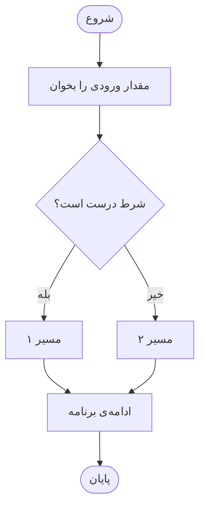
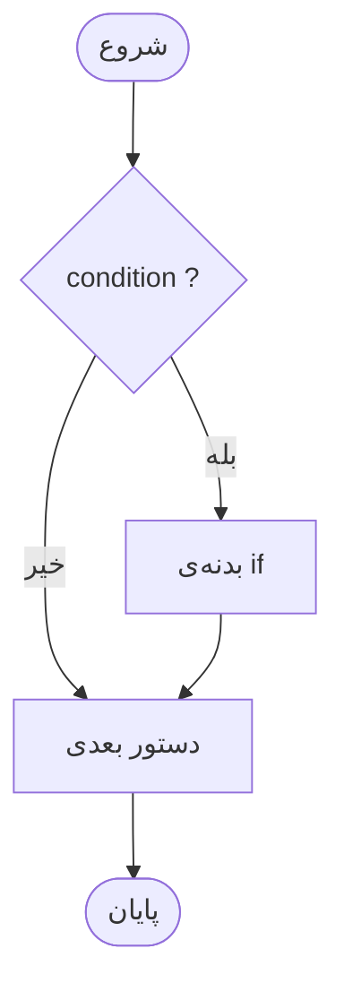
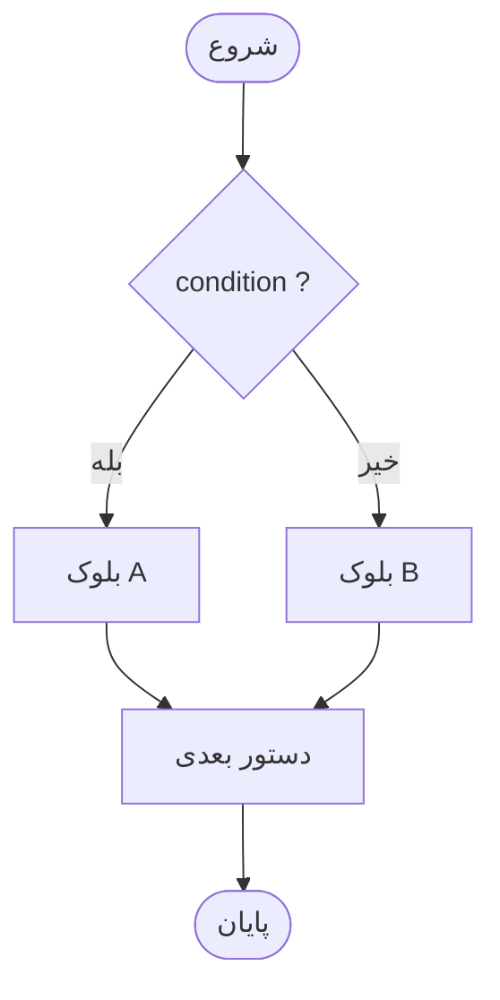
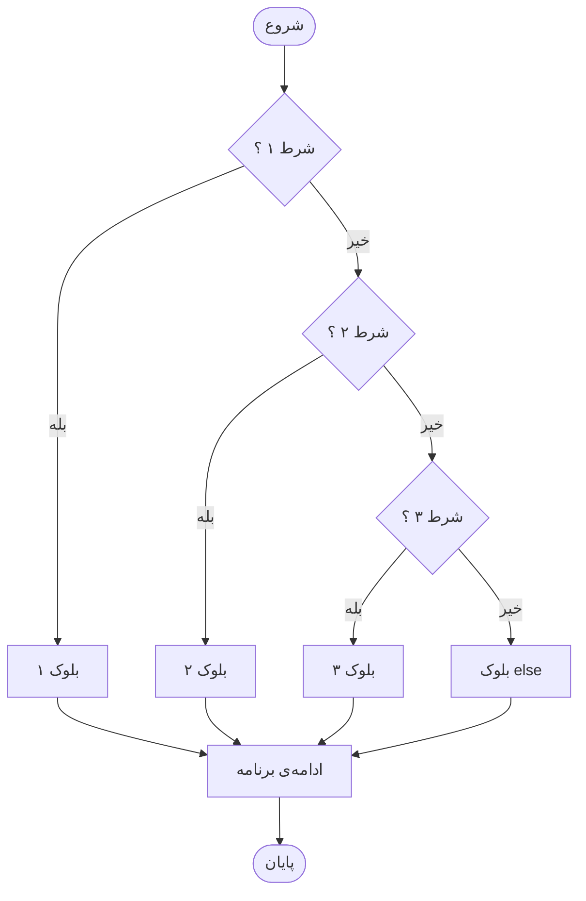
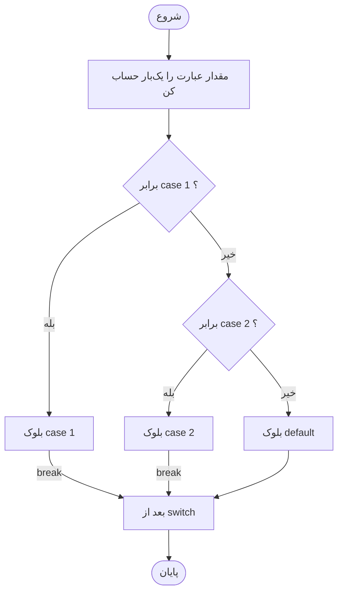
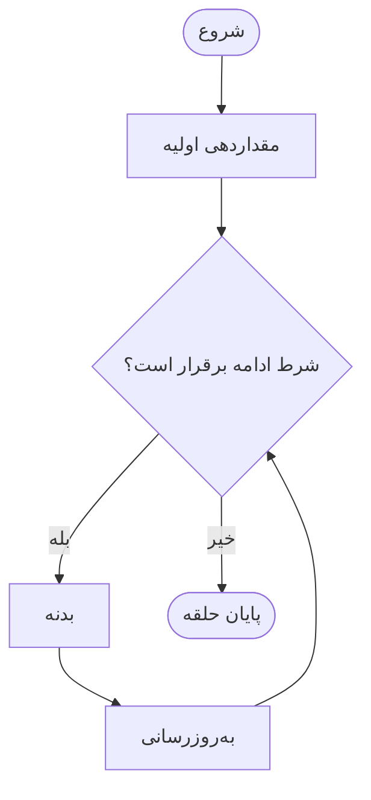
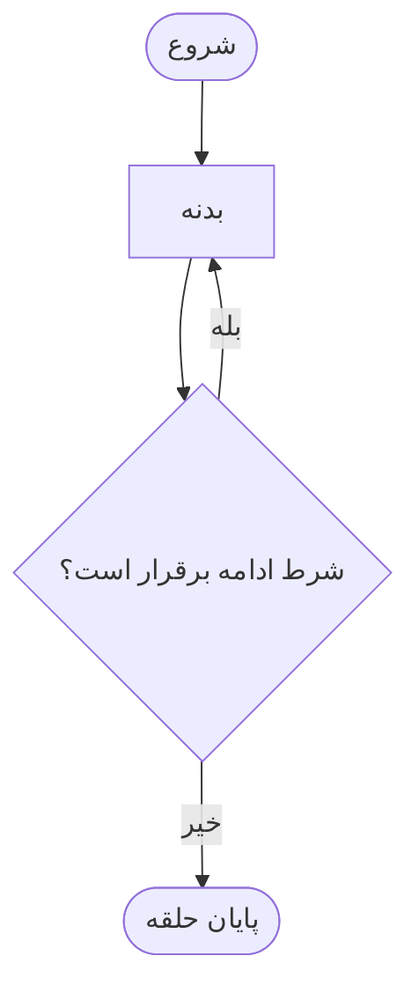
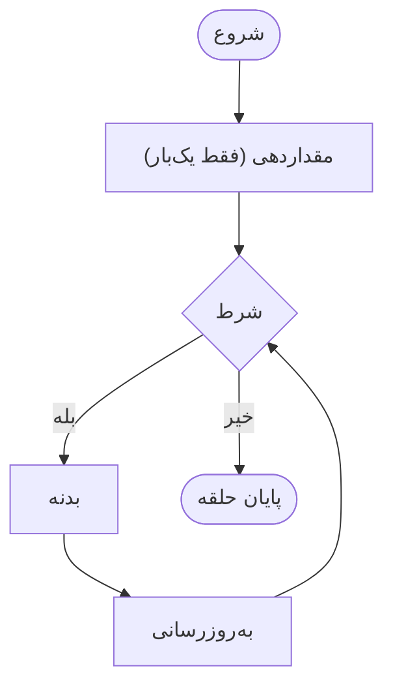
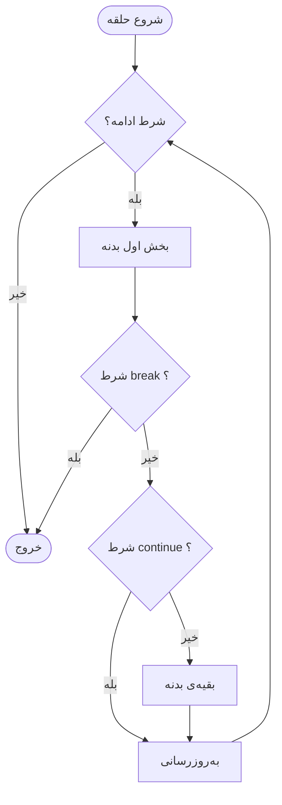
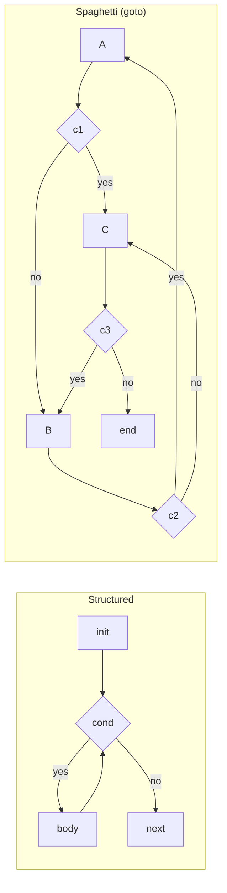

# بخش سوم : کنترل جریان برنامه

## مقدمه

تا اینجای درس، همه‌ی برنامه‌های ما یک ویژگی مشترک داشتند: دستورها از اولین خط تا آخرین خط، **دقیقاً یک‌بار** و به همان ترتیبی که نوشته شده‌اند اجرا می‌شدند. به این الگو **اجرای ترتیبی (Sequence)** می‌گوییم. اما مسئله‌های واقعی این‌طور نیستند. یک سیستم بانکی باید ابتدا تصمیم بگیرد: «اگر موجودی کافی است، برداشت را ثبت کن؛ وگرنه پیام خطا بده». برنامه‌ی میانگین‌گیری باید یک کار را **برای هر دانشجو** تکرار کند، بی‌آن‌که تعداد دانشجوها در زمان نوشتن برنامه معلوم باشد. یعنی دو نیاز تازه داریم: **تصمیم‌گیری** و **تکرار**.

در بخش اول، الگوریتم‌هایی دیدید که از «اگر» و «تکرار کن» ساخته می‌شدند (مثل بازی حدس عدد) و کدشان را بدون توضیح سینتکس خواندید. حالا وقت آن است که همان ابزارها را دقیق یاد بگیریم. در **فصل ۶** ساختارهای شرطی (`if`، `else if`، `else`، عمل‌گر `?:` و `switch`) و در **فصل ۷** حلقه‌ها (`while`، `do-while`، `for`) و ابزارهای کنترل آن‌ها (`break`، `continue`) را می‌بینیم و در پایان، دلیل پرهیز از `goto` را بررسی می‌کنیم.

یک نکته درباره‌ی هدف این بخش: **هدف ما یادگیری سینتکس نیست؛ هدف ما یادگیری الگوریتم‌هاست.** سینتکس `if` و `for` را می‌توان در ده دقیقه یاد گرفت. چیزی که ارزشمند است، توانایی تبدیل یک مسئله به «تصمیم‌ها و تکرارهای دقیق» و اطمینان از درستی آن است. برای همین در طول بخش، برای هر مسئله چهار ابزار را کنار هم می‌بینید:

- **Pseudocode** و **Flowchart** (که در بخش اول دیدید) برای طراحی الگوریتم.
- **Trace (دنبال کردن دستی):** نوشتن مقدار متغیرها در هر گام، مثل یک کامپیوتر.
- **Test Cases:** انتخاب ورودی‌هایی که همه‌ی مسیرها و لبه‌ها (Edge Cases) را آزمایش کنند؛ همان نگاهِ «ورودی صفر، منفی و بزرگ» که در بخش اول گفتیم.

در طول این بخش یک سناریوی واحد داریم: **برنامه‌ی ارزیابی نمرات کلاس**؛ نمره‌ها را اعتبارسنجی، درجه‌بندی و جمع‌بندی می‌کنیم و در پایان یک منوی تعاملی می‌سازیم (که در بخش پنجم با آرایه‌ها کامل می‌شود). در کنار آن چند الگوریتم کلاسیک کوچک (سال کبیسه، شمارش ارقام، عدد اول، ب.م.م) می‌بینیم.

> **نکته درباره‌ی ورودی:** تا برنامه‌ها در همین نوت‌بوک بدون تعامل دستی اجرا شوند، ورودی را با `echo ... | ./prog` به آن‌ها می‌دهیم. مثل بخش دوم، مقدار برگشتی `scanf` را بررسی می‌کنیم.

#### نقشه کلی بخش:

```text
اجرای ترتیبی (Sequence)
          │
          ├── نیاز به «تصمیم‌گیری» ──► Selection  (فصل ۶)
          │         if / if-else / else-if / ?: / switch
          │
          └── نیاز به «تکرار» ──────► Iteration   (فصل ۷)
                    while / do-while / for
                              │
                              ├── الگوهای حلقه (Counter, Min/Max, Search, Sentinel, ...)
                              ├── حلقه‌های تودرتو
                              ├── break / continue
                              ├── goto  (و دلیل پرهیز از آن)
                              └── هزینه‌ی حلقه‌ها (مرتبه‌ی رشد)
```

---

## فصل ۶ : ساختارهای شرطی (Conditional Structures)

### 6.1 چرا به شرط نیاز داریم؟

در برنامه‌ی ارزیابی نمرات می‌خواهیم برای یک دانشجو وضعیت «قبول» یا «مردود» را چاپ کنیم (نمره‌ی قبولی ۱۰ از ۲۰ است). با دانش فعلی‌مان می‌نویسیم:

```c
#include <stdio.h>

int main(void)
{
    int score = 8;

    printf("Score: %d\n", score);
    printf("Status: Pass\n");
    printf("Status: Fail\n");

    return 0;
}
```

```text
Score: 8
Status: Pass
Status: Fail
```

هر دو پیام چاپ شده است، و با تغییر `score` هم همین دو خط چاپ می‌شود؛ چون در اجرای ترتیبی برنامه راهی برای «نگاه کردن به داده و تصمیم گرفتن» ندارد. ما به سازه‌ای نیاز داریم که یک **شرط** را بسنجد، **فقط یکی از چند مسیر** را اجرا کند و مسیرهای انتخاب‌نشده را کاملاً نادیده بگیرد. این همان **ساختار انتخاب (Selection)** است:



#### تمرین درون فصل ۶.۱

**نوع تمرین: Quick Reasoning**

اگر در برنامه‌ی `sequential_naive` مقدار `score` را به `19` تغییر دهیم، خروجی چه می‌شود؟ توضیح دهید چه چیزی در **ساختار** برنامه کم است.

### 6.2 شرط‌ها به‌عنوان ابزار طراحی

عمل‌گرهای مقایسه‌ای (`==`, `<`, ...) و منطقی (`&&`, `||`, `!`)، نتیجه‌ی `0/1` و درست بودن هر مقدار غیرصفر را در بخش دوم دیدید؛ اینجا دوباره نمی‌گوییم. دو ابزار طراحی را اضافه می‌کنیم که در ساختن شرط‌ها بارها به کار می‌آیند.

#### ۱) قوانین دمورگان (De Morgan's Laws)

وقتی می‌خواهیم حالت‌های **نامعتبر** را از روی حالت‌های **معتبر** بسازیم، نقیض شرط را می‌نویسیم:

| عبارت اصلی | عبارت معادل |
|---|---|
| `!(A && B)` | `!A \|\| !B` |
| `!(A \|\| B)` | `!A && !B` |

مثال: نمره‌ی معتبر یعنی `score >= 0 && score <= 20`. پس نامعتبر یعنی `score < 0 || score > 20`. به عمل‌گر دقت کنید: `&&` تبدیل به `||` شد و هر مقایسه برعکس شد.

#### ۲) شرط نگهبان (Guard) با ارزیابی کوتاه‌مدار

در بخش دوم دیدید که در `A && B` اگر `A` نادرست باشد، `B` اصلاً ارزیابی نمی‌شود. حالا نتیجه‌ی الگوریتمی آن: **شرطِ نگهبان را سمت چپ بگذارید تا طرف راست فقط وقتی اجرا شود که امن است.** مثلاً `count != 0 && sum / count > 10` هیچ‌وقت تقسیم بر صفر نمی‌کند، اما اگر ترتیب را برعکس کنید، می‌کند. همین ایده را در الگوی «میانگین‌گیری» فصل بعد می‌بینید.

#### تمرین درون فصل ۶.۲

**نوع تمرین: Predict the Output**

```c
int x = 5;
printf("%d %d\n", x > 3 && x < 10, x < 3 || x > 10);
```

خروجی را پیش‌بینی کنید. سپس با دمورگان، `!(x > 3 && x < 10)` را بدون `!` بنویسید.

### 6.3 دستور if

#### ایده الگوریتم

ساده‌ترین شکل تصمیم‌گیری: «**اگر** شرط برقرار بود، یک کار اضافه انجام بده؛ در غیر این صورت آن را رد کن و ادامه بده.»

#### Pseudocode

```text
if condition:
    statements          // only when the condition is true
next statement          // always runs
```

#### Flowchart



#### Example A - Simple: پاداش برای نمره‌ی بالا

```c
#include <stdio.h>

int main(void)
{
    int score;

    if (scanf("%d", &score) != 1) {
        return 1;
    }

    printf("Score: %d\n", score);
    if (score >= 18) {
        printf("Excellent! Bonus point awarded.\n");
    }
    printf("Report finished.\n");

    return 0;
}
```

```text
$ echo "19" | ./p03_c06_02_if_bonus
Score: 19
Excellent! Bonus point awarded.
Report finished.
$ echo "12" | ./p03_c06_02_if_bonus
Score: 12
Report finished.
```

در اجرای دوم پیام پاداش چاپ نشده، اما خط آخر در هر دو اجرا آمده است.

کدام خط‌ها «زیر کنترل» `if` هستند؟
	فقط دستورهای داخل آکولاد. خط `Report finished.` بیرون از آکولاد است؛ یعنی بعد از پایان `if` ــ چه بدنه اجرا شده باشد چه نه ــ برنامه از همین خط ادامه می‌یابد (همان گره‌ی «دو مسیر که دوباره به هم می‌رسند» در Flowchart).

چرا برای بدنه‌ی `if` همیشه آکولاد می‌نویسیم؟
	اگر آکولاد نباشد، فقط **اولین دستور** بعد از شرط به آن وابسته است و دستورهای بعدی ــ حتی با تورفتگی ــ مستقل می‌شوند:

```c
if (score < 10)
    printf("Fail\n");
    printf("Please retake the course\n");   // همیشه اجرا می‌شود!
```

تورفتگی فقط برای انسان است و کامپایلر آن را نمی‌بیند؛ آکولاد تنها منبع حقیقت است.

#### Example B - Real: اعتبارسنجی بازه‌ی نمره

```c
#include <stdio.h>

int main(void)
{
    int score;

    if (scanf("%d", &score) != 1) {
        return 1;
    }

    if (score < 0 || score > 20) {
        printf("%d: invalid score (must be between 0 and 20)\n", score);
        return 1;
    }

    printf("%d: valid score\n", score);
    return 0;
}
```

```text
$ echo "15" | ./p03_c06_03_if_validate
15: valid score
$ echo "20" | ./p03_c06_03_if_validate
20: valid score
$ echo "0" | ./p03_c06_03_if_validate
0: valid score
$ echo "21" | ./p03_c06_03_if_validate
21: invalid score (must be between 0 and 20)
$ echo "-1" | ./p03_c06_03_if_validate
-1: invalid score (must be between 0 and 20)
```

چرا شرط نامعتبر را با `||` نوشته‌ایم، نه `&&`؟
	چون نمره وقتی نامعتبر است که **از یک طرف** بازه بیرون باشد. عبارت `score < 0 && score > 20` هیچ‌وقت درست نمی‌شود. این همان دمورگان است.

چرا بعد از پیام خطا `return 1` نوشته‌ایم؟
	`return` در `main` برنامه را فوراً تمام می‌کند و مقدار غیرصفر یعنی «با خطا تمام شد». این الگو (**Guard Clause**: «اگر ورودی بد است، همین‌جا کار را تمام کن») باعث می‌شود بقیه‌ی برنامه فقط با داده‌ی معتبر سروکار داشته باشد؛ در 6.6 بیشتر از آن استفاده می‌کنیم.

#### تمرین درون فصل ۶.۳

**نوع تمرین: Predict the Output**

```c
int x = 4;
if (x > 5)
    printf("A\n");
    printf("B\n");
```

خروجی چیست؟ دلیل را با قاعده‌ی «یک دستور بدون آکولاد» توضیح دهید.

### 6.4 دستور if-else

#### ایده الگوریتم

در بسیاری از مسئله‌ها هر دو حالت «شرط درست» و «شرط نادرست» کاری دارند. `if-else` یک **تقسیم دوشاخه** است: **دقیقاً یکی** از دو مسیر اجرا می‌شود. با آن، مشکل برنامه‌ی `sequential_naive` حل می‌شود.

#### Pseudocode

```text
if condition:
    statements A        // condition is true
else:
    statements B        // condition is false
```

#### Flowchart



#### Example A - Simple: قبول یا مردود

```c
#include <stdio.h>

int main(void)
{
    int score;

    if (scanf("%d", &score) != 1) {
        return 1;
    }

    if (score >= 10) {
        printf("%d: Pass\n", score);
    } else {
        printf("%d: Fail\n", score);
    }

    return 0;
}
```

```text
$ echo "8" | ./p03_c06_04_pass_fail
8: Fail
$ echo "15" | ./p03_c06_04_pass_fail
15: Pass
$ echo "10" | ./p03_c06_04_pass_fail
10: Pass
```

حالا دقیقاً یکی از دو پیام چاپ می‌شود. به ورودی `10` دقت کنید: روی **مرز** شرط است و باید «Pass» شود؛ اگر `>` نوشته بودیم، این باگ فقط با همین ورودی معلوم می‌شد.

#### Example B - Real: سال کبیسه (Leap Year)

قاعده‌ی تقویم میلادی چندلایه است: سالی کبیسه است که بر ۴ بخش‌پذیر باشد، **مگر** این‌که بر ۱۰۰ بخش‌پذیر باشد، **مگر** این‌که بر ۴۰۰ هم بخش‌پذیر باشد. در بخش دوم این قاعده را با یک عبارت منطقی (`% && || !`) نوشتید؛ اینجا همان را به‌صورت یک **زنجیره‌ی تصمیم** می‌نویسیم که از **خاص‌ترین استثنا** به عمومی‌ترین قاعده می‌رود (۴۰۰ ← ۱۰۰ ← ۴).

#### Pseudocode

```text
if year divisible by 400:       LEAP
else if year divisible by 100:  NOT leap
else if year divisible by 4:    LEAP
else:                           NOT leap
```

```c
#include <stdio.h>

int main(void)
{
    int year;

    if (scanf("%d", &year) != 1) {
        return 1;
    }

    int leap;
    if (year % 400 == 0) {
        leap = 1;
    } else if (year % 100 == 0) {
        leap = 0;
    } else {
        leap = (year % 4 == 0);
    }

    if (leap) {
        printf("%d: leap year\n", year);
    } else {
        printf("%d: common year\n", year);
    }

    return 0;
}
```

```text
$ echo "1900" | ./p03_c06_05_leap_year
1900: common year
$ echo "2000" | ./p03_c06_05_leap_year
2000: leap year
$ echo "2024" | ./p03_c06_05_leap_year
2024: leap year
$ echo "2023" | ./p03_c06_05_leap_year
2023: common year
$ echo "2100" | ./p03_c06_05_leap_year
2100: common year
$ echo "1600" | ./p03_c06_05_leap_year
1600: leap year
```

چرا این شش سال برای تست انتخاب شده‌اند؟
	هر سال یک **مسیر متفاوت** را آزمایش می‌کند: ۲۰۰۰ و ۱۶۰۰ مسیر «بخش‌پذیر بر ۴۰۰»؛ ۱۹۰۰ و ۲۱۰۰ مسیر «بر ۱۰۰ ولی نه ۴۰۰»؛ ۲۰۲۴ مسیر «بر ۴ ولی نه ۱۰۰»؛ و ۲۰۲۳ مسیر «هیچ‌کدام». به این ایده **پوشش مسیرها (Path Coverage)** می‌گویند: برای هر مسیر حداقل یک ورودی آزمایشی. اگر فقط ۲۰۲۴ و ۲۰۲۳ را تست می‌کردیم، پیاده‌سازی غلط `year % 4 == 0` هم قبول می‌شد.

چرا ترتیب ۴۰۰ ← ۱۰۰ ← ۴ مهم است؟
	چون در یک زنجیره‌ی تصمیم **هر شرط فقط وقتی بررسی می‌شود که همه‌ی شرط‌های قبلی نادرست بوده‌اند**؛ پس باید از خاص به عام مرتب شوند. اگر ابتدا `year % 4` را می‌پرسیدیم، ۱۹۰۰ همان‌جا کبیسه تلقی می‌شد. مسیر تصمیم را برای دو سال ببینید:

*🎬 انیمیشن تعاملی (فقط در نسخه‌ی نوت‌بوک نمایش داده می‌شود).*

*🎬 انیمیشن تعاملی (فقط در نسخه‌ی نوت‌بوک نمایش داده می‌شود).*

#### Example C - Tricky: باقی‌مانده‌ی اعداد منفی

```c
#include <stdio.h>

int main(void)
{
    int n = -7;

    printf("n %% 2 = %d\n", n % 2);

    if (n % 2 == 1) {
        printf("version 1 (n %% 2 == 1): odd\n");
    } else {
        printf("version 1 (n %% 2 == 1): even   <-- wrong!\n");
    }

    if (n % 2 != 0) {
        printf("version 2 (n %% 2 != 0): odd\n");
    } else {
        printf("version 2 (n %% 2 != 0): even\n");
    }

    return 0;
}
```

```text
n % 2 = -1
version 1 (n % 2 == 1): even   <-- wrong!
version 2 (n % 2 != 0): odd
```

در C تقسیم صحیح به سمت صفر گرد می‌شود و علامت باقی‌مانده با علامت **مقسوم** یکی است؛ پس `-7 % 2` برابر `-1` است. نسخه‌ی اول (که در تمرین «زوج/فرد» بخش اول نوشتن آن طبیعی بود) فقط برای عددهای نامنفی درست است؛ نسخه‌ی دوم به‌جای «آیا باقی‌مانده دقیقاً ۱ است؟» می‌پرسد «آیا باقی‌مانده صفر **نیست**؟». درس الگوریتمی: **شرط را طوری بنویس که روی کل دامنه‌ی ورودی درست باشد، نه فقط روی مثال‌هایی که امتحان کرده‌ای.**

#### تمرین درون فصل ۶.۴

**نوع تمرین: Trace**

الگوریتم سال کبیسه را برای `year = 2100` و `year = 2000` دنبال کنید. در هر مورد بنویسید کدام شرط‌ها به ترتیب بررسی می‌شوند و نتیجه‌ی هرکدام چیست.

### تمرین‌های پایانی زیربخش: if و if-else

★ **سطح پایه**

1. **Small Implementation:**
   برنامه‌ای بنویسید که عدد بخواند و فقط اگر منفی بود، `Negative number` چاپ کند؛ در هر حالت در انتها `Done`.

2. **Find the Bug:**

```c
if (score >= 0 && score <= 20);
{
    printf("Valid\n");
}
```

این کد برای هر ورودی «Valid» چاپ می‌کند. علت را پیدا کنید.

★★ **سطح متوسط**

3. **Edge Case Reasoning:**
   سال کبیسه را برای `0`، `-4` و `100` اجرا کنید. آیا الگوریتم برای سال‌های ≤ ۰ معنای تقویمی دارد؟ مسئله‌ی الگوریتم است یا داده‌ی ورودی؟

★★★ **سطح چالشی**

4. **Design:**
   شرط «x در بازه‌ی [۱۰, ۲۰] **نیست**» را یک‌بار با `!` و یک‌بار با دمورگان بنویسید و با جدول مقادیر آزمایشی نشان دهید معادل‌اند.

### 6.5 زنجیره‌ی else if (انتخاب چندمسیره)

#### ایده الگوریتم

گاهی بیش از دو مسیر داریم؛ مثلاً نمره باید به «عالی» (۱۷ تا ۲۰)، «خوب» (۱۴ تا ۱۶)، «قبول» (۱۰ تا ۱۳) یا «مردود» (زیر ۱۰) تبدیل شود. راه‌حل، **زنجیره‌ای از شرط‌هاست که از بالا به پایین بررسی می‌شوند و اولین شرطی که درست باشد برنده است**؛ بقیه‌ی زنجیره اصلاً بررسی نمی‌شود. این جمله‌ی کوتاه مهم‌ترین نکته‌ی این بخش است.

#### Pseudocode

```text
if condition 1:      statements 1
else if condition 2: statements 2
else if condition 3: statements 3
else:                statements N     // optional: everything not matched above
```

#### Flowchart



#### Example A - Simple: درجه‌بندی نمره

```c
#include <stdio.h>

int main(void)
{
    int score;

    if (scanf("%d", &score) != 1) {
        return 1;
    }

    if (score < 0 || score > 20) {
        printf("%d: invalid score\n", score);
    } else if (score >= 17) {
        printf("%d: Excellent\n", score);
    } else if (score >= 14) {
        printf("%d: Good\n", score);
    } else if (score >= 10) {
        printf("%d: Pass\n", score);
    } else {
        printf("%d: Fail\n", score);
    }

    return 0;
}
```

```text
$ echo "20" | ./p03_c06_07_grade_ladder
20: Excellent
$ echo "17" | ./p03_c06_07_grade_ladder
17: Excellent
$ echo "16" | ./p03_c06_07_grade_ladder
16: Good
$ echo "14" | ./p03_c06_07_grade_ladder
14: Good
$ echo "13" | ./p03_c06_07_grade_ladder
13: Pass
$ echo "10" | ./p03_c06_07_grade_ladder
10: Pass
$ echo "9" | ./p03_c06_07_grade_ladder
9: Fail
$ echo "0" | ./p03_c06_07_grade_ladder
0: Fail
$ echo "21" | ./p03_c06_07_grade_ladder
21: invalid score
$ echo "-5" | ./p03_c06_07_grade_ladder
-5: invalid score
```

چرا در شرط سوم فقط `score >= 14` نوشته‌ایم و `score < 17` را ننوشته‌ایم؟
	چون برای رسیدن به این شرط، شرط قبلی (`score >= 17`) باید **نادرست** شده باشد؛ یعنی از قبل «می‌دانیم» `score < 17` است. هر شرط در زنجیره به‌طور ضمنی نقیض همه‌ی شرط‌های بالایی را هم دارد. این شرط‌ها را کوتاه می‌کند، اما یعنی **ترتیب شرط‌ها بخشی از منطق برنامه است**.

چرا اعتبارسنجی در ابتدای زنجیره آمده است؟
	چون نمره‌ی `25` اگر وارد زنجیره می‌شد، به `score >= 17` می‌رسید و «Excellent» چاپ می‌شد. حالت‌های **خاص و استثنایی** باید پیش از حالت‌های عمومی بررسی شوند.

مسیر تصمیم برای نمره‌ی ۱۵ را قدم‌به‌قدم ببینید:

*🎬 انیمیشن تعاملی (فقط در نسخه‌ی نوت‌بوک نمایش داده می‌شود).*

#### تست مرزی (Boundary Value Testing)

برای زنجیره‌های شرطی، پاسخ استاندارد به «چه ورودی‌هایی را تست کنیم؟» این است: **روی مرز هر شرط** یک مقدار قبل از مرز، خود مرز و یک مقدار بعد از آن. بیشتر باگ‌های شرطی (مثل `>` به‌جای `>=`) همان‌جا پنهان می‌شوند. ورودی‌های اجرای بالا دقیقاً همین‌اند:

| مرز | ورودی‌ها | خروجی مورد انتظار |
|---|---|---|
| اعتبار پایین | `-5` , `0` | invalid , Fail |
| Fail / Pass | `9` , `10` | Fail , Pass |
| Pass / Good | `13` , `14` | Pass , Good |
| Good / Excellent | `16` , `17` | Good , Excellent |
| اعتبار بالا | `20` , `21` | Excellent , invalid |

#### Example B - Real: دسته‌بندی مثلث

سه عدد صحیح، طول ضلع‌ها هستند. باید بگوییم معتبرند؟ مثلث می‌سازند؟ از چه نوعی (متساوی‌الاضلاع، متساوی‌الساقین، مختلف‌الاضلاع) و قائم‌الزاویه هستند یا نه؟ ایده: سؤال‌ها را به **ترتیب وابستگی** مرتب کنیم: تا ضلع‌ها مثبت نباشند، نامساوی مثلث بی‌معناست؛ تا نامساوی برقرار نباشد، نوع مثلث بی‌معناست.

#### Pseudocode

```text
if a <= 0 or b <= 0 or c <= 0:      invalid
else if a+b <= c or a+c <= b or b+c <= a:   not a triangle
else:
    type ← equilateral | isosceles | scalene
    right ← a²+b² = c² or a²+c² = b² or b²+c² = a²
```

```c
#include <stdio.h>

int main(void)
{
    int a, b, c;

    if (scanf("%d %d %d", &a, &b, &c) != 3) {
        return 1;
    }

    if (a <= 0 || b <= 0 || c <= 0) {
        printf("%d %d %d: invalid (sides must be positive)\n", a, b, c);
    } else if (a + b <= c || a + c <= b || b + c <= a) {
        printf("%d %d %d: not a triangle\n", a, b, c);
    } else {
        int right = (a * a + b * b == c * c) ||
                    (a * a + c * c == b * b) ||
                    (b * b + c * c == a * a);

        printf("%d %d %d: ", a, b, c);
        if (a == b && b == c) {
            printf("equilateral");
        } else if (a == b || b == c || a == c) {
            printf("isosceles");
        } else {
            printf("scalene");
        }
        if (right) {
            printf(", right-angled");
        }
        printf("\n");
    }

    return 0;
}
```

```text
$ echo "3 4 5" | ./p03_c06_08_triangle
3 4 5: scalene, right-angled
$ echo "5 5 5" | ./p03_c06_08_triangle
5 5 5: equilateral
$ echo "5 5 8" | ./p03_c06_08_triangle
5 5 8: isosceles
$ echo "6 7 9" | ./p03_c06_08_triangle
6 7 9: scalene
$ echo "1 2 3" | ./p03_c06_08_triangle
1 2 3: not a triangle
$ echo "0 4 4" | ./p03_c06_08_triangle
0 4 4: invalid (sides must be positive)
```

چرا نامساوی مثلث با `<=` نوشته شده، نه `<`؟
	در مثلث واقعی مجموع هر دو ضلع **اکیداً** بزرگ‌تر از ضلع سوم است. ورودی `1 2 3` (که `1 + 2 == 3`) سه نقطه روی یک خط است و یک **تست مرزی** عالی.

چرا ساختار برنامه ترکیبی از زنجیره و `if` تو در تو است؟
	بخش اول (اعتبار ← مثلث بودن) یک انتخاب چندمسیره است. اما وقتی مثلث معتبر شد، **دو سؤال مستقل** داریم: نوع از نظر ضلع‌ها و قائم‌الزاویه بودن؛ و در یک زنجیره فقط یک مسیر اجرا می‌شود. پس پاسخ سؤال دوم را در متغیر `right` نگه می‌داریم و در انتها اضافه می‌کنیم.

#### Example C - Tricky: ترتیب اشتباه شرط‌ها

```c
#include <stdio.h>

int main(void)
{
    int score;

    if (scanf("%d", &score) != 1) {
        return 1;
    }

    /* BUG: conditions are in the wrong order */
    if (score >= 10) {
        printf("%d: Pass\n", score);
    } else if (score >= 14) {
        printf("%d: Good\n", score);
    } else if (score >= 17) {
        printf("%d: Excellent\n", score);
    } else {
        printf("%d: Fail\n", score);
    }

    return 0;
}
```

```text
$ echo "18" | ./p03_c06_09_ladder_wrong_order
18: Pass
$ echo "15" | ./p03_c06_09_ladder_wrong_order
15: Pass
$ echo "12" | ./p03_c06_09_ladder_wrong_order
12: Pass
$ echo "5" | ./p03_c06_09_ladder_wrong_order
5: Fail
```

کد بدون هیچ هشداری کامپایل می‌شود و برای نمره‌های پایین حتی درست کار می‌کند؛ اما برای `18` و `15` غلط است. چون `score >= 10` برای هر نمره‌ی قبولی درست است و دو شاخه‌ی بعدی هرگز اجرا نمی‌شوند (**Unreachable Code**). **قاعده‌ی طراحی:** در زنجیره‌ی بازه‌ها، شرط‌ها را از محدودترین به عمومی‌ترین بنویسید، یا از عمومی‌ترین با `<` (مثلاً `score < 10`، سپس `score < 14`، ...). هر دو درست‌اند؛ مهم مرتب بودن است. هزینه‌ی زنجیره‌ی `k` شرطی هم در بدترین حالت `k` مقایسه است که معمولاً ناچیز است.

#### تمرین درون فصل ۶.۵

**نوع تمرین: Trace**

برای `score = 14` و سپس `score = 13` زنجیره‌ی درجه‌بندی را دنبال کنید و بگویید چرا دو ورودی که فقط یک واحد اختلاف دارند، نتیجه‌ی متفاوت می‌دهند.

### تمرین‌های پایانی زیربخش: else if

★ **سطح پایه**

1. **Predict the Output:**

```c
int x = 7;
if (x > 10) {
    printf("A\n");
} else if (x > 5) {
    printf("B\n");
} else if (x > 0) {
    printf("C\n");
}
```

★★ **سطح متوسط**

2. **Small Implementation:**
   دمای هوا را به «یخبندان» (زیر ۰)، «سرد» (۰ تا ۱۴)، «معتدل» (۱۵ تا ۲۵) و «گرم» (بالای ۲۵) تبدیل کنید و مرزها را تست کنید.

3. **Find the Bug:**
   در زنجیره‌ی `age >= 18` / `age >= 13` / `age >= 0 && age < 13`، برای `age = -4` چه اتفاقی می‌افتد؟ چه چیزی در مدیریت ورودی نامعتبر کم است؟

★★★ **سطح چالشی**

4. **Design:**
   مالیات پله‌ای: تا ۱۰۰۰ واحد معاف؛ از ۱۰۰۰ تا ۵۰۰۰، ۱۰٪ مقدار **اضافه‌بر ۱۰۰۰**؛ بالای ۵۰۰۰، ۴۰۰ واحد به‌علاوه‌ی ۲۰٪ مقدار **اضافه‌بر ۵۰۰۰**. با زنجیره‌ی `else if` حساب کنید و مرزهای ۱۰۰۰ و ۵۰۰۰ را تست کنید.

### 6.6 شرط‌های تو در تو و Guard Clause

#### ایده الگوریتم

یک `if` می‌تواند داخل بدنه‌ی `if` یا `else` دیگری باشد؛ طبیعی است وقتی یک تصمیم **فقط وقتی معنا دارد** که تصمیم قبلی به نتیجه‌ی مشخصی رسیده باشد. مثال: برداشت از خودپرداز با این قواعد: مبلغ مثبت باشد؛ مضرب ۱۰ باشد؛ از موجودی (۱۰۰۰) بیشتر نباشد؛ از سقف روزانه (۵۰۰) بیشتر نباشد. نسخه‌ی تو در تو چنین است:

```c
if (amount > 0) {
    if (amount % 10 == 0) {
        if (amount <= balance) {
            if (amount <= limit) {
                balance -= amount;                      /* OK */
            } else { /* above the daily limit */ }
        } else { /* insufficient balance */ }
    } else { /* not a multiple of 10 */ }
} else { /* amount must be positive */ }
```

این کد درست است، اما دو مشکل دارد: پیام هر خطا از شرطش **دور افتاده** و کد به شکل **هرم** به راست رشد می‌کند؛ با هر سطر، خواننده باید یک شرط دیگر را به‌خاطر بسپارد. راه‌حل **Guard Clause** است: به‌جای «اگر معتبر بود ادامه بده»، می‌نویسیم «اگر **نامعتبر** است همین‌جا رد کن»؛ هر شرط، خطای خودش را کنار پیامش مدیریت می‌کند و حالت **موفق** در انتها می‌ماند:

```c
#include <stdio.h>

int main(void)
{
    int balance = 1000, limit = 500, amount;

    if (scanf("%d", &amount) != 1) {
        return 1;
    }

    if (amount <= 0) {
        printf("Denied: amount must be positive\n");
    } else if (amount % 10 != 0) {
        printf("Denied: amount must be a multiple of 10\n");
    } else if (amount > balance) {
        printf("Denied: insufficient balance\n");
    } else if (amount > limit) {
        printf("Denied: above the daily limit\n");
    } else {
        balance -= amount;
        printf("OK: withdrew %d, balance = %d\n", amount, balance);
    }

    return 0;
}
```

```text
$ echo "200" | ./p03_c06_10_atm_guard
OK: withdrew 200, balance = 800
$ echo "0" | ./p03_c06_10_atm_guard
Denied: amount must be positive
$ echo "25" | ./p03_c06_10_atm_guard
Denied: amount must be a multiple of 10
$ echo "700" | ./p03_c06_10_atm_guard
Denied: above the daily limit
$ echo "1500" | ./p03_c06_10_atm_guard
Denied: insufficient balance
```

خروجی این نسخه با نسخه‌ی تو در تو برای ورودی‌های یکسان **یکی** است، اما ساختار تخت و خواناتر است. **قاعده‌ی سرانگشتی:** اگر عمق تو در تویی از سه سطح گذشت، زنجیره‌ی تخت یا ترکیب شرط‌ها با `&&` احتمالاً ساده‌تر است.

#### Example C - Tricky: Dangling Else

وقتی در `if` تو در تو آکولاد نمی‌گذاریم، قاعده‌ی C این است: **هر `else` به نزدیک‌ترین `if` بدون `else` متصل می‌شود**، صرف‌نظر از تورفتگی.

```c
#include <stdio.h>

int main(void)
{
    int a = 1, b = 0;

    /* looks like "else belongs to the outer if", but it does not */
    if (a == 1)
        if (b == 1)
            printf("both are 1\n");
    else
        printf("else: runs when a == 1 and b != 1\n");

    /* braces make the intention explicit */
    if (a == 1) {
        if (b == 1) {
            printf("both are 1\n");
        }
    } else {
        printf("a is not 1\n");
    }

    return 0;
}
```

```text
p03_c06_11_dangling_else.c: In function ‘main’:
p03_c06_11_dangling_else.c:8:8: warning: suggest explicit braces to avoid ambiguous ‘else’ [-Wdangling-else]
    8 |     if (a == 1)
      |        ^
else: runs when a == 1 and b != 1
```

خروجی نشان می‌دهد `else` به `if (b == 1)` چسبیده است نه `if (a == 1)`؛ کامپایلر هم با یک هشدار همین ابهام را گزارش کرده. با آکولاد، نیت برنامه‌نویس بدون ابهام بیان می‌شود.

#### تمرین درون فصل ۶.۶

**نوع تمرین: Refactoring**

کد زیر را بدون هیچ `if` تو در تو و فقط با `&&` بازنویسی کنید، و بگویید کدام نسخه برای افزودن یک قاعده‌ی جدید (مثلاً «حداقل برداشت ۵۰») راحت‌تر است:

```c
if (age >= 18) {
    if (has_id) {
        printf("Entry allowed\n");
    }
}
```

### 6.7 عمل‌گر شرطی سه‌تایی ?:

#### ایده الگوریتم

گاهی تصمیم ما فقط برای **انتخاب یک مقدار** است، نه اجرای چند دستور (مثل «بزرگ‌ترین دو عدد»)؛ نوشتن `if-else` کامل برای آن پرحرف است. عمل‌گر `?:` (که در بخش دوم فقط نامش آمد) این کار را در یک عبارت انجام می‌دهد:

```text
شرط ? مقدار_اگر_درست : مقدار_اگر_نادرست
```

تفاوت بنیادین با `if`: **`if` یک دستور (Statement) است و مقدار ندارد؛ `?:` یک عبارت (Expression) است و خودش مقدار دارد.** برای همین می‌توان آن را سمت راست انتساب یا داخل `printf` گذاشت.

#### Pseudocode

```text
result ← (condition) ? value_if_true : value_if_false
```

```c
#include <stdio.h>

int main(void)
{
    int a = 12, b = 20;

    int max  = (a > b) ? a : b;
    int diff = (a > b) ? (a - b) : (b - a);                 /* |a - b| */
    int sign = (a - b > 0) ? 1 : ((a - b < 0) ? -1 : 0);

    printf("max = %d, |a - b| = %d, sign = %d\n", max, diff, sign);
    printf("a is %s\n", (a % 2 == 0) ? "even" : "odd");

    for (int n = 0; n <= 2; n++) {      /* a for loop: see chapter 7 */
        printf("%d file%s\n", n, (n == 1) ? "" : "s");
    }

    return 0;
}
```

```text
max = 20, |a - b| = 8, sign = -1
a is even
0 files
1 file
2 files
```

چرا `?:` را داخل `printf` گذاشته‌ایم؟
	چون `?:` مقدار تولید می‌کند (اینجا رشته‌ی `"even"` یا `"odd"`، یا پسوند جمع) و `printf` به همان مقدار نیاز دارد؛ با `if` باید دو `printf` یا یک متغیر کمکی می‌داشتیم. (حلقه‌ی `for` را در فصل بعد کامل می‌بینیم؛ فعلاً فقط بدانید `n` را از ۰ تا ۲ می‌شمارد.)

محاسبه‌ی `sign` با `?:` تو در تو، کار درستی است؟
	از نظر عملکرد درست است، اما خواندنش از معادل `if-else if-else` سخت‌تر است؛ تو در تو کردن `?:` یعنی به مرز **کاهش خوانایی** رسیده‌ایم.

**اولویت پایین `?:`:** این عمل‌گر از تقریباً همه‌ی عمل‌گرها اولویت پایین‌تر دارد (فقط از انتساب بالاتر است)، پس بدون پرانتز نتیجه‌ی غیرمنتظره می‌دهد:

```c
int a = 1, b = 3;
int r = a > b ? 100 : 200 + 1;      // r = 201: «+ 1» جزو شاخه‌ی نادرست است
```

قاعده: هر عبارت `?:` را کامل داخل پرانتز بنویسید. اگر دو شاخه از نوع‌های متفاوت باشند (مثلاً `int` و `double`)، نتیجه به نوع بزرگ‌تر تبدیل می‌شود.

| معیار | `if-else` | `?:` |
|---|---|---|
| نوع | دستور (بدون مقدار) | عبارت (دارای مقدار) |
| چند دستور در یک شاخه | بله | خیر |
| مناسب برای | «چه کاری انجام شود» | «چه مقداری استفاده شود» |

#### تمرین درون فصل ۶.۷

**نوع تمرین: Complete the Code**

عبارت `abs_val` را با `?:` کامل کنید، سپس با `if-else` بنویسید و بگویید کدام را ترجیح می‌دهید:

```c
int x = -9;
int abs_val = /* ??? */;
```

### 6.8 switch-case

#### ایده الگوریتم

گاهی **یک مقدار را با چند مقدار ثابت** مقایسه می‌کنیم: نوع عملگر ماشین‌حساب، شماره‌ی ماه، انتخاب منو. با `else if` باید عبارت `op == ...` را بارها تکرار کنیم. `switch` مقدار عبارت را **یک‌بار** حساب می‌کند و مستقیماً به `case` مطابق «می‌پرد»؛ اگر هیچ‌کدام نبود، به `default` می‌رود.

#### Pseudocode

```text
evaluate expression once
jump to the case whose constant equals the value
    execute from there downwards, until "break" or the end of the switch
if no case matches: jump to default (if any)
```

#### Flowchart



**قوانین:** عبارت `switch` باید صحیح باشد (`int`، `char`، `enum`)، نه اعشاری یا رشته. هر `case` باید یک **ثابت صحیح** و منحصربه‌فرد باشد (متغیر یا بازه مثل `case 1..5` مجاز نیست). `switch` فقط **تساوی** را می‌سنجد. `default` اختیاری است ولی برای ورودی‌های پیش‌بینی‌نشده مفید است.

#### Example A - Simple: ماشین‌حساب

```c
#include <stdio.h>

int main(void)
{
    int a, b;
    char op;

    if (scanf("%d %c %d", &a, &op, &b) != 3) {
        printf("Bad input\n");
        return 1;
    }

    switch (op) {
        case '+':
            printf("%d + %d = %d\n", a, b, a + b);
            break;
        case '-':
            printf("%d - %d = %d\n", a, b, a - b);
            break;
        case '*':
            printf("%d * %d = %d\n", a, b, a * b);
            break;
        case '/':
            if (b == 0) {
                printf("Error: division by zero\n");
            } else {
                printf("%d / %d = %d (remainder %d)\n", a, b, a / b, a % b);
            }
            break;
        default:
            printf("Error: unknown operator '%c'\n", op);
    }

    return 0;
}
```

```text
$ echo "8 + 2" | ./p03_c06_13_switch_calculator
8 + 2 = 10
$ echo "8 - 12" | ./p03_c06_13_switch_calculator
8 - 12 = -4
$ echo "6 * 7" | ./p03_c06_13_switch_calculator
6 * 7 = 42
$ echo "17 / 5" | ./p03_c06_13_switch_calculator
17 / 5 = 3 (remainder 2)
$ echo "8 / 0" | ./p03_c06_13_switch_calculator
Error: division by zero
$ echo "8 ^ 2" | ./p03_c06_13_switch_calculator
Error: unknown operator '^'
```

چرا شاخه‌ی `/` یک `if` داخلی دارد؟
	`switch` فقط می‌گوید «کدام عملگر»؛ اما «آیا تقسیم امن است؟» تصمیم دیگری است. ساختارهای شرطی را می‌توان آزادانه داخل هم گذاشت.

چرا `8 ^ 2` به `default` می‌رود؟
	`default` جای مدیریت ورودی‌های پیش‌بینی‌نشده است؛ بدون آن، برنامه بی‌صدا هیچ کاری نمی‌کرد.

#### نقش break و پدیده‌ی Fall-Through

پرش به `case` مناسب فقط **نقطه‌ی شروع** اجراست، نه پایان آن. بعد از رسیدن به `case`، برنامه به اجرا ادامه می‌دهد و از `case` بعدی هم رد می‌شود، مگر به `break` برسد. به این رفتار **Fall-Through** (سقوط به بلوک بعدی) می‌گوییم.

```c
#include <stdio.h>

int main(void)
{
    int level = 2;

    printf("--- without break ---\n");
    switch (level) {
        case 3:
            printf("A ");
        case 2:
            printf("B ");
        case 1:
            printf("C ");
        default:
            printf("D ");
    }
    printf("\n");

    printf("--- with break ---\n");
    switch (level) {
        case 3:
            printf("A ");
            break;
        case 2:
            printf("B ");
            break;
        case 1:
            printf("C ");
            break;
        default:
            printf("D ");
    }
    printf("\n");

    return 0;
}
```

```text
p03_c06_14_switch_fallthrough.c: In function ‘main’:
p03_c06_14_switch_fallthrough.c:10:13: warning: this statement may fall through [-Wimplicit-fallthrough=]
   10 |             printf("A ");
      |             ^~~~~~~~~~~~
p03_c06_14_switch_fallthrough.c:11:9: note: here
   11 |         case 2:
      |         ^~~~
p03_c06_14_switch_fallthrough.c:12:13: warning: this statement may fall through [-Wimplicit-fallthrough=]
   12 |             printf("B ");
      |             ^~~~~~~~~~~~
p03_c06_14_switch_fallthrough.c:13:9: note: here
   13 |         case 1:
      |         ^~~~
p03_c06_14_switch_fallthrough.c:14:13: warning: this statement may fall through [-Wimplicit-fallthrough=]
   14 |             printf("C ");
      |             ^~~~~~~~~~~~
p03_c06_14_switch_fallthrough.c:15:9: note: here
   15 |         default:
      |         ^~~~~~~
--- without break ---
B C D 
--- with break ---
B 
```

*🎬 انیمیشن تعاملی (فقط در نسخه‌ی نوت‌بوک نمایش داده می‌شود).*

*🎬 انیمیشن تعاملی (فقط در نسخه‌ی نوت‌بوک نمایش داده می‌شود).*

Fall-Through همیشه باگ نیست؛ گاهی **عمداً** از آن استفاده می‌کنیم، مثلاً وقتی چند `case` یک کار مشترک دارند (مثال بعد). چون فراموش کردن `break` رایج‌ترین خطای `switch` است، کامپایلر با `-Wextra` هر Fall-Through بدون توضیح را هشدار می‌دهد (هشدارهای بالای خروجی برنامه‌ی قبل). اگر عمداً `break` نمی‌گذارید، با یک توضیح (`/* fall through */`) مشخصش کنید تا هشدار حذف شود و خواننده هم بداند عمدی است.

#### Example B - Real: تعداد روزهای ماه

ترکیب دو الگوریتم قبلی: ماه‌ها سه گروه‌اند (۳۰ روزه، ۳۱ روزه و فوریه) و فوریه خودش یک تصمیم است: همان زنجیره‌ی سال کبیسه‌ی 6.4.

```c
#include <stdio.h>

int main(void)
{
    int month, year, days = 0;

    if (scanf("%d %d", &month, &year) != 2) {
        return 1;
    }

    switch (month) {
        case 4: case 6: case 9: case 11:
            days = 30;
            break;
        case 2:
            if (year % 400 == 0) {
                days = 29;
            } else if (year % 100 == 0) {
                days = 28;
            } else {
                days = (year % 4 == 0) ? 29 : 28;
            }
            break;
        case 1: case 3: case 5: case 7: case 8: case 10: case 12:
            days = 31;
            break;
        default:
            printf("Invalid month: %d\n", month);
            return 1;
    }

    printf("Month %d of year %d has %d days\n", month, year, days);
    return 0;
}
```

```text
$ echo "2 2024" | ./p03_c06_15_days_in_month
Month 2 of year 2024 has 29 days
$ echo "2 1900" | ./p03_c06_15_days_in_month
Month 2 of year 1900 has 28 days
$ echo "4 2023" | ./p03_c06_15_days_in_month
Month 4 of year 2023 has 30 days
$ echo "12 2023" | ./p03_c06_15_days_in_month
Month 12 of year 2023 has 31 days
$ echo "13 2023" | ./p03_c06_15_days_in_month
Invalid month: 13
```

سه ایده با هم: (۱) گروه‌بندی `case`ها برای مقدارهایی با پاسخ مشترک (Fall-Through عمدی)، (۲) تصمیم تو در تو داخل یک `case`، (۳) `default` برای ورودی نامعتبر. مقدار اولیه‌ی `days = 0` هم تضمین می‌کند متغیر در هیچ مسیری مقداردهی‌نشده نماند.

#### Example C - Tricky: تبدیل بازه به مقدار گسسته

`switch` بازه را نمی‌فهمد؛ اما یک ترفند الگوریتمی هست: **بازه را با یک محاسبه‌ی ساده به یک مقدار گسسته تبدیل کنیم.** در نمره‌دهی ۱۰۰تایی، تقسیم صحیح بر ۱۰ همه‌ی ۹۰ تا ۹۹ را به ۹ و همه‌ی ۸۰ تا ۸۹ را به ۸ می‌برد:

```c
#include <stdio.h>

int main(void)
{
    int score;
    char grade = '?';

    if (scanf("%d", &score) != 1) {
        return 1;
    }

    if (score < 0 || score > 100) {
        printf("%d: invalid score\n", score);
        return 1;
    }

    switch (score / 10) {
        case 10:            /* only 100 */
        case 9:
            grade = 'A';
            break;
        case 8:
            grade = 'B';
            break;
        case 7:
            grade = 'C';
            break;
        case 6:
            grade = 'D';
            break;
        default:
            grade = 'F';
    }

    printf("%d -> %c\n", score, grade);
    return 0;
}
```

```text
$ echo "100" | ./p03_c06_16_switch_score_div10
100 -> A
$ echo "95" | ./p03_c06_16_switch_score_div10
95 -> A
$ echo "90" | ./p03_c06_16_switch_score_div10
90 -> A
$ echo "89" | ./p03_c06_16_switch_score_div10
89 -> B
$ echo "60" | ./p03_c06_16_switch_score_div10
60 -> D
$ echo "59" | ./p03_c06_16_switch_score_div10
59 -> F
$ echo "105" | ./p03_c06_16_switch_score_div10
105: invalid score
$ echo "-5" | ./p03_c06_16_switch_score_div10
-5: invalid score
```

چرا `case 10` لازم است؟
	چون `100 / 10` برابر `10` است؛ یک **مورد مرزی** که فقط با تست `100` پیدا می‌شود.

چرا اعتبارسنجی پیش از `switch` ضروری است؟
	چون `105 / 10` برابر `10` است و بدون اعتبارسنجی «A» می‌گرفت؛ و `-5 / 10` در C برابر `0` است و «F» می‌داد. ترفند فقط وقتی امن است که ورودی از قبل در بازه‌ی مورد انتظار باشد.

| معیار | `switch` | زنجیره‌ی `else if` |
|---|---|---|
| نوع شرط | فقط تساوی با ثابت صحیح | هر شرط دلخواه (بازه، ترکیب منطقی، اعشاری) |
| ترتیب | معمولاً بی‌اثر | حیاتی |
| Fall-Through | وجود دارد | ندارد |
| مناسب برای | منو، دستور، کد وضعیت، ماه | بازه‌ها و شرط‌های مرکب |

#### تمرین درون فصل ۶.۸

**نوع تمرین: Predict the Output**

```c
int x = 3;
switch (x) {
    case 1: printf("one ");
    case 3: printf("three ");
    case 4: printf("four "); break;
    case 5: printf("five ");
}
printf("end\n");
```

خروجی را پیش‌بینی کنید. اگر `x = 5` باشد چه می‌شود؟ و چرا `switch (price)` با `double price` خطای کامپایل می‌دهد؟

### تمرین‌های پایانی زیربخش: switch

★ **سطح پایه**

1. **Small Implementation:**
   شماره‌ی ماه (۱ تا ۱۲) را بگیرید و نام فصل را با Fall-Through عمدی چاپ کنید.

★★ **سطح متوسط**

2. **Find the Bug:**
   در `switch (op)` با `case '+': printf("add\n");` که `break` ندارد و بعدش `case '-'` هست، برای `op = '+'` چه چاپ می‌شود؟ اصلاح کنید.

3. **Modify the Algorithm:**
   ماشین‌حساب را با عمل‌گر `%` گسترش دهید و برای آن هم از تقسیم بر صفر محافظت کنید.

★★★ **سطح چالشی**

4. **Compare Approaches:**
   در چه موقعیتی نسخه‌ی `else if` کاملاً غیرقابل جایگزینی با `switch` است؟ یک مثال از نمره‌دهی ۲۰تایی (مرزهای ۱۰، ۱۴ و ۱۷) بزنید.

### 6.9 انتخاب ساختار مناسب

| نوع مسئله | ساختار پیشنهادی |
|---|---|
| یک کار اضافه فقط در صورت برقراری شرط | `if` |
| دو مسیر متقابل | `if-else` |
| چند بازه یا شرط مرکب که **دسته‌های ناسازگار** می‌سازند | زنجیره‌ی `else if` |
| فقط انتخاب یک **مقدار** | `?:` |
| مقایسه‌ی یک عبارت صحیح با چند ثابت گسسته | `switch` |
| چند شرط **مستقل** که ممکن است هم‌زمان درست باشند | چند `if` جداگانه (نه زنجیره!) |

سطر آخر پنهان‌ترین تفاوت است. فرض کنید عضو باشگاه ۵٪ و سفارش بالای ۱۰۰۰ مقدار ۱۰٪ تخفیف می‌گیرد، و **هر دو قابل جمع‌اند**. اگر این دو شرط را به هم بچسبانیم، فقط یکی اعمال می‌شود:

```c
#include <stdio.h>

int main(void)
{
    int total, member;

    if (scanf("%d %d", &total, &member) != 2) {
        return 1;
    }

    int independent = 0;               /* both discounts may apply */
    if (member) {
        independent += 5;
    }
    if (total >= 1000) {
        independent += 10;
    }

    int chained = 0;                   /* only the first match applies */
    if (member) {
        chained = 5;
    } else if (total >= 1000) {
        chained = 10;
    }

    printf("total=%d member=%d | independent: %d%% | chained: %d%%\n",
           total, member, independent, chained);
    return 0;
}
```

```text
$ echo "1200 1" | ./p03_c06_17_independent_vs_chain
total=1200 member=1 | independent: 15% | chained: 5%
$ echo "300 1" | ./p03_c06_17_independent_vs_chain
total=300 member=1 | independent: 5% | chained: 5%
$ echo "1200 0" | ./p03_c06_17_independent_vs_chain
total=1200 member=0 | independent: 10% | chained: 10%
$ echo "300 0" | ./p03_c06_17_independent_vs_chain
total=300 member=0 | independent: 0% | chained: 0%
```

فقط در ورودی `1200 1` دو نسخه فرق دارند. **سؤال همیشگی:** «آیا این شرط‌ها متقابل (فقط یکی می‌تواند درست باشد) هستند یا مستقل؟» پاسخ، انتخاب بین `else if` و چند `if` را تعیین می‌کند.

#### تمرین درون فصل ۶.۹

**نوع تمرین: Choose the Structure**

برای هر سناریو ساختار مناسب را با دلیل بنویسید: (الف) تبدیل شماره‌ی ماه به نام فصل، (ب) هزینه‌ی ارسال بر اساس بازه‌های وزن، (ج) چاپ هشدار «باتری ضعیف» و «حافظه‌ی پر» که ممکن است هم‌زمان رخ دهند، (د) انتخاب کوچک‌تر از دو عدد، (هـ) اجرای دستور منوی «۱ ثبت‌نام، ۲ ورود، ۳ خروج».

### 6.10 خطاهای رایج در ساختارهای شرطی

`=` به‌جای `==` و مقایسه‌ی دقیق اعداد اعشاری را در بخش‌های اول و دوم دیدید و اینجا تکرار نمی‌کنیم. اشتباه‌های دیگری که خاص شرط‌هاست:

**❌ اشتباه ۱: نقطه‌ویرگول بعد از شرط**

```c
if (score >= 18);
{
    printf("Excellent\n");
}
```

چرا اشتباه است؟
	`;` یک «دستور خالی» است و بدنه‌ی `if` همان می‌شود؛ بلوک بعدی مستقل است و همیشه اجرا می‌شود.

**✅ نسخه صحیح:** `;` را حذف کنید.

**❌ اشتباه ۲: مقایسه‌ی زنجیره‌ای**

```c
if (0 <= score <= 20) { ... }       // همیشه درست است
```

چرا اشتباه است؟
	`0 <= score` نتیجه‌ی `0` یا `1` است و بعد آن عدد با `20` مقایسه می‌شود. **✅ نسخه صحیح:** `score >= 0 && score <= 20`.

**❌ اشتباه ۳: `x == 1 || 2`**

```c
if (x == 1 || 2) { ... }            // همیشه درست است
```

چرا اشتباه است؟
	عبارت `(x == 1) || 2` خوانده می‌شود و `2` غیرصفر است. **✅ نسخه صحیح:** `x == 1 || x == 2`.

این سه مورد را با هم اجرا کنید و به **هشدارهای کامپایلر** هم دقت کنید:

```c
#include <stdio.h>

int main(void)
{
    int score = 5;

    if (score >= 18);
    {
        printf("1) this line runs for ANY score\n");
    }

    if (3 > 2 > 1) {
        printf("2) 3 > 2 > 1 is true\n");
    } else {
        printf("2) 3 > 2 > 1 is FALSE (surprise!)\n");
    }

    int y = 7;
    if (y == 1 || 2) {
        printf("3) y == 1 || 2 is true even for y = %d\n", y);
    }

    return 0;
}
```

```text
p03_c06_18_pitfalls.c: In function ‘main’:
p03_c06_18_pitfalls.c:7:21: warning: suggest braces around empty body in an ‘if’ statement [-Wempty-body]
    7 |     if (score >= 18);
      |                     ^
p03_c06_18_pitfalls.c:7:5: warning: this ‘if’ clause does not guard... [-Wmisleading-indentation]
    7 |     if (score >= 18);
      |     ^~
p03_c06_18_pitfalls.c:8:5: note: ...this statement, but the latter is misleadingly indented as if it were guarded by the ‘if’
    8 |     {
      |     ^
p03_c06_18_pitfalls.c:12:15: warning: comparisons like ‘X<=Y<=Z’ do not have their mathematical meaning [-Wparentheses]
   12 |     if (3 > 2 > 1) {
      |               ^
1) this line runs for ANY score
2) 3 > 2 > 1 is FALSE (surprise!)
3) y == 1 || 2 is true even for y = 7
```

دو خطای دیگر (فراموش کردن `break` در `switch` و ترتیب غلط زنجیره‌ی `else if`) را در 6.8 و 6.5 دیدید.

### 6.11 کاربردهای واقعی ساختارهای شرطی

- اعتبارسنجی ورودی کاربر (فرم‌ها، رمزها، سن، مبلغ) پیش از پردازش.
- کنترل دسترسی و سطح مجوز (مدیر / کاربر عادی / مهمان).
- منوها و دستورها (`switch` روی انتخاب کاربر) و کدهای خطا و وضعیت در سیستم‌عامل و پروتکل‌ها.
- محاسبه‌ی مالیات، تخفیف و تعرفه‌ی پله‌ای.
- سیستم‌های کنترلی: روشن/خاموش شدن بر اساس آستانه‌ی دما یا فشار.
- ...

### تمرین‌های پایانی فصل ۶

1. **Predict the Output:**

```c
int a = 5, b = 10;
if (a > 3 && b < 5 || a == 5) printf("X\n"); else printf("Y\n");
```

خروجی را پیش‌بینی کنید و پرانتزهای «ضمنی» را با رعایت اولویت عمل‌گرها بنویسید.

2. **Find the Bug:**

```c
if (n % 2 == 0)
    printf("even\n");
    printf("divisible by two\n");
else
    printf("odd\n");
```

این کد کامپایل نمی‌شود. دلیل و راه اصلاح را بنویسید.

3. **Design + Implementation:**
   ساعت (۰ تا ۲۳) را بخوانید و «صبح بخیر» (۵ تا ۱۱)، «ظهر بخیر» (۱۲ و ۱۳)، «عصر بخیر» (۱۴ تا ۱۸) یا «شب بخیر» (بقیه) چاپ کنید؛ برای ورودی نامعتبر پیام خطا. مرزها را تست کنید.

4. **Refactoring:**
   `!(a > 0 && b > 0) && !(c < 0 || d < 0)` را با دمورگان ساده کنید و معادل بودن را ثابت کنید.

5. **Algorithm Design:**
   سه عدد را بدون آرایه و فقط با `if` به ترتیب صعودی چاپ کنید. حداقل چند مقایسه لازم است؟

6. **Compare Approaches:**
   «سال کبیسه» را (الف) با یک عبارت منطقی (بخش دوم)، (ب) با زنجیره‌ی `else if`، (ج) با `if` تو در تو بنویسید و خوانایی و احتمال خطا را مقایسه کنید.

### Retrieval Practice فصل ۶

- قوانین دمورگان در نوشتن شرط «نامعتبر» چه کاربردی دارند؟
- چرا در `else if` ترتیب شرط‌ها بخشی از منطق برنامه است؟
- تست مرزی و پوشش مسیرها یعنی چه؟ برای `score >= 14` چه ورودی‌هایی را شامل می‌شود؟
- Guard Clause چه مشکلی از کد تو در تو را حل می‌کند؟
- تفاوت «دستور» و «عبارت» در `if` و `?:` چیست؟
- Fall-Through چیست؟ یک مورد مفید و یک مورد خطرناک بگویید.
- چه موقع چند `if` مستقل می‌نویسیم و چه موقع زنجیره‌ی `else if`؟

---

### 6.12 جمع‌بندی فصل ۶

در این فصل دیدیم اجرای ترتیبی چرا کافی نیست و **شرط** چگونه به برنامه امکان انتخاب بین چند مسیر می‌دهد. دمورگان و شرط نگهبان را به‌عنوان ابزار طراحی شرط‌ها اضافه کردیم. با `if`، `if-else` و زنجیره‌ی `else if` فهمیدیم «اولین شرط درست برنده است» و ترتیب بخشی از الگوریتم است؛ با تست مرزی و پوشش مسیرها یاد گرفتیم درستی شرط‌ها را سیستماتیک بیازماییم. `?:` برای انتخاب **مقدار** و `switch` برای مقایسه‌ی یک عبارت با ثابت‌های گسسته است، با نقش حیاتی `break` و پدیده‌ی Fall-Through. در نهایت بین «شرط‌های متقابل» (زنجیره) و «شرط‌های مستقل» (چند `if`) تمایز گذاشتیم.

حالا که می‌توانیم تصمیم بگیریم، سؤال طبیعی بعدی این است: چطور یک تصمیم یا محاسبه را **چندین بار** تکرار کنیم؟ مثلاً چطور همین درجه‌بندی را برای نمره‌ی ۵۰۰ دانشجو انجام دهیم، بی‌آن‌که ۵۰۰ بار کد را کپی کنیم؟ این موضوع فصل بعد است.

---

## فصل ۷ : حلقه‌ها (Loops)

### 7.1 چرا به حلقه نیاز داریم؟

می‌خواهیم اعداد ۱ تا ۵ را چاپ کنیم و مجموعشان را حساب کنیم. با دانش فعلی‌مان:

```c
#include <stdio.h>

int main(void)
{
    int sum = 0;

    printf("1\n");
    sum += 1;
    printf("2\n");
    sum += 2;
    printf("3\n");
    sum += 3;
    printf("4\n");
    sum += 4;
    printf("5\n");
    sum += 5;

    printf("Sum: %d\n", sum);
    return 0;
}
```

```text
1
2
3
4
5
Sum: 15
```

برای ۵ عدد قابل تحمل است، اما برای ۱۰۰۰ عدد باید ۲۰۰۰ خط بنویسیم و اگر تعداد را کاربر تعیین کند، اصلاً نمی‌توانیم: **کدی که تعداد اجرایش در زمان نوشتن ثابت است، با اندازه‌ی مسئله رشد نمی‌کند.** ما سازه‌ای می‌خواهیم که یک دسته دستور را **بارها** اجرا کند، تعداد تکرار را از **داده‌ی زمان اجرا** بگیرد و در هر تکرار وضعیت را کمی تغییر دهد تا به پایان برسد. این همان **حلقه (Loop)** است؛ همان فلش برگشتیِ Flowchartهای بخش اول.

#### آناتومی یک حلقه

هر حلقه‌ی درست از چهار بخش ساخته می‌شود؛ تشخیص آن‌ها مهم‌ترین مهارت این فصل است:

| بخش | پرسش | مثال (چاپ ۱ تا ۵) |
|---|---|---|
| **مقداردهی اولیه** | از کجا شروع می‌کنیم؟ | `i = 1` |
| **شرط ادامه** | تا کی تکرار کنیم؟ | `i <= 5` |
| **بدنه** | در هر تکرار چه کنیم؟ | `printf`, `sum += i` |
| **به‌روزرسانی** | چطور به پایان نزدیک شویم؟ | `i++` |

اگر یکی غلط یا فراموش شود، حلقه یا اجرا نمی‌شود، یا غلط کار می‌کند، یا هرگز تمام نمی‌شود. یک ایده‌ی عمیق‌تر هم هست: **نامتغیر حلقه (Loop Invariant)**، یعنی چیزی که **در ابتدای هر تکرار** درست است. در جمع ۱ تا n، قبل از هر تکرار می‌دانیم «`sum` مجموع همه‌ی اعداد کوچک‌تر از `i` است». درستی الگوریتم یعنی این جمله از اول تا آخر برقرار بماند.

#### تمرین درون فصل ۷.۱

**نوع تمرین: Quick Reasoning**

در برنامه‌ی `loops_naive`، اگر آن را به یک حلقه تبدیل کنیم، چهار بخش آناتومی چه می‌شوند؟ چه چیزی در هر تکرار ثابت و چه چیزی متغیر است؟

### 7.2 حلقه‌ی while

#### ایده الگوریتم

«**تا وقتی** شرط برقرار است، بدنه را تکرار کن.» شرط **قبل از هر تکرار** بررسی می‌شود؛ پس اگر از همان ابتدا نادرست باشد، بدنه حتی یک‌بار هم اجرا نمی‌شود (**Pre-test Loop**).

#### Pseudocode

```text
initialise state
while condition:
    body
    update state        // must move the state toward making the condition false
```

#### Flowchart



#### Example A - Simple: شمارش معکوس و مجموع

```c
#include <stdio.h>

int main(void)
{
    int n = 5;
    int sum = 0;

    while (n > 0) {
        printf("%d ", n);
        sum += n;
        n--;
    }
    printf("Liftoff! sum = %d\n", sum);

    return 0;
}
```

```text
5 4 3 2 1 Liftoff! sum = 15
```

اگر `n` از همان ابتدا `0` یا منفی بود، شرط نادرست می‌شد و بدنه **صفر بار** اجرا می‌شد؛ نتیجه «مجموع هیچ عددی» یعنی همان مقدار اولیه‌ی `sum` (صفر) است. این رفتار بدون هیچ `if` اضافه، حالت‌های مرزی را درست پوشش می‌دهد.

#### Example B - Real: جمع ارقام یک عدد

مجموع ارقام `n` را می‌خواهیم (`472` ← `4+7+2`). رقم آخر را با `n % 10` جدا می‌کنیم و با `n / 10` حذف می‌کنیم؛ پس تا وقتی عدد صفر نشده، رقم آخر را بردار و به مجموع اضافه کن. **تعداد تکرار از قبل معلوم نیست** (به تعداد ارقام بستگی دارد)، پس `while` طبیعی‌ترین انتخاب است.

#### Pseudocode

```text
sum ← 0, count ← 0
while n > 0:
    sum ← sum + (n mod 10)
    n ← n div 10
    count ← count + 1
```

```c
#include <stdio.h>

int main(void)
{
    int n;

    if (scanf("%d", &n) != 1 || n < 0) {
        printf("Please enter a non-negative integer\n");
        return 1;
    }

    int original = n;
    int sum = 0, count = 0;

    while (n > 0) {
        sum += n % 10;
        n /= 10;
        count++;
    }

    printf("%d: digit sum = %d, digit count = %d\n", original, sum, count);
    return 0;
}
```

```text
$ echo "472" | ./p03_c07_03_digit_sum
472: digit sum = 13, digit count = 3
$ echo "999" | ./p03_c07_03_digit_sum
999: digit sum = 27, digit count = 3
$ echo "1000" | ./p03_c07_03_digit_sum
1000: digit sum = 1, digit count = 4
$ echo "0" | ./p03_c07_03_digit_sum
0: digit sum = 0, digit count = 0
```

*🎬 انیمیشن تعاملی (فقط در نسخه‌ی نوت‌بوک نمایش داده می‌شود).*

چرا برای `0` تعداد ارقام صفر شده است؟
	چون شرط `n > 0` برای `0` از ابتدا نادرست است و بدنه اجرا نمی‌شود: `sum = 0` درست است، اما `count = 0` غلط است (عدد `0` یک رقم دارد). این یک **باگ مرزی** واقعی است؛ راه‌حلش در بخش بعد (`do-while`) می‌آید.

چرا مقدار اصلی را در `original` کپی کرده‌ایم؟
	چون حلقه خودِ `n` را تغییر می‌دهد و در پایان `n` همیشه صفر است.

#### Example C - Tricky: الگوی Sentinel

گاهی تعداد داده از قبل معلوم نیست و کاربر پایان داده‌ها را با یک مقدار ویژه اعلام می‌کند؛ این مقدار را **Sentinel** (نگهبان) می‌نامیم (اینجا `-1` که نمره‌ی معتبر نیست). `scanf(...) == 1` هم تضمین می‌کند ورودی واقعاً خوانده شد و در پایان ورودی حلقه خودبه‌خود تمام می‌شود.

```c
#include <stdio.h>

int main(void)
{
    int x, count = 0, sum = 0;

    while (scanf("%d", &x) == 1 && x != -1) {
        sum += x;
        count++;
    }

    if (count == 0) {
        printf("No scores entered\n");
    } else {
        printf("count = %d, sum = %d, average = %.2f\n",
               count, sum, (double)sum / count);
    }

    return 0;
}
```

```text
$ echo "18 15 20 12 17 -1" | ./p03_c07_04_while_sentinel_avg
count = 5, sum = 82, average = 16.40
$ echo "-1" | ./p03_c07_04_while_sentinel_avg
No scores entered
$ echo "14" | ./p03_c07_04_while_sentinel_avg
count = 1, sum = 14, average = 14.00
```

چرا قبل از تقسیم `count == 0` را بررسی می‌کنیم؟
	اگر کاربر بلافاصله `-1` بزند، `sum / count` تقسیم بر صفر می‌شد. هر الگوریتم میانگین‌گیر باید «ورودی خالی» را پیش‌بینی کند.

ورودی سوم (`14` بدون `-1`) چرا درست کار می‌کند؟
	با تمام شدن ورودی `scanf` مقدار `1` برنمی‌گرداند و شرط حلقه نادرست می‌شود؛ و چون `&&` کوتاه‌مدار است، `x` فقط وقتی با `-1` مقایسه می‌شود که واقعاً مقدار گرفته باشد (همان شرط نگهبان 6.2).

#### تمرین درون فصل ۷.۲

**نوع تمرین: Trace**

الگوریتم جمع ارقام را برای `n = 305` دستی دنبال کنید و جدولی با ستون‌های `n` ، `n % 10` ، `sum` بسازید.

### تمرین‌های پایانی زیربخش: while

★ **سطح پایه**

1. **Predict the Output:**

```c
int i = 3;
while (i > 0) {
    printf("%d ", i * i);
    i--;
}
```

★★ **سطح متوسط**

2. **Find the Bug:**

```c
int i = 1;
while (i <= 5) {
    printf("%d ", i);
}
```

کدام بخش آناتومی فراموش شده؟

3. **Small Implementation:**
   عدد مثبت `n` را بگیرید و معکوسش را چاپ کنید (`1234` ← `4321`). راهنمایی: `rev = rev * 10 + n % 10`.

★★★ **سطح چالشی**

4. **Design:**
   بشمارید `n` را چند بار می‌توان بر ۲ تقسیم صحیح کرد تا به ۱ برسد. برای `n = 1000` و `n = 1` تست کنید.

### 7.3 حلقه‌ی do-while

#### ایده الگوریتم

گاهی بدنه باید **حداقل یک‌بار** اجرا شود و بعد بپرسیم ادامه بدهیم یا نه. مثال کلاسیک: گرفتن ورودی معتبر؛ پیش از این‌که اعتبارش را بسنجیم، باید مقداری گرفته باشیم. `do-while` شرط را **بعد از هر تکرار** بررسی می‌کند (**Post-test Loop**).

#### Pseudocode

```text
do:
    body
while condition        // checked AFTER the body, so the body runs at least once
```

#### Flowchart



#### Example A - Simple: رفع باگ شمارش ارقام

```c
#include <stdio.h>

int main(void)
{
    int n;

    if (scanf("%d", &n) != 1 || n < 0) {
        return 1;
    }

    int original = n;
    int count = 0;

    do {
        count++;
        n /= 10;
    } while (n > 0);

    printf("%d has %d digit(s)\n", original, count);
    return 0;
}
```

```text
$ echo "0" | ./p03_c07_05_digit_count_do_while
0 has 1 digit(s)
$ echo "7" | ./p03_c07_05_digit_count_do_while
7 has 1 digit(s)
$ echo "472" | ./p03_c07_05_digit_count_do_while
472 has 3 digit(s)
$ echo "1000" | ./p03_c07_05_digit_count_do_while
1000 has 4 digit(s)
```

حالا `0` یک رقم دارد: بدنه حتماً یک‌بار اجرا می‌شود و بعد `n` که صفر شده شرط را نادرست می‌کند. انتخاب نوع حلقه فقط سلیقه نیست؛ گاهی **درستی الگوریتم** را تعیین می‌کند.

#### Example B - Real: ورودی معتبر، حتی وقتی کاربر متن می‌نویسد

در بخش دوم دیدید که `scanf` تعداد مقدارهای خوانده‌شده را برمی‌گرداند. حالا می‌توانیم از آن استفاده کنیم. نکته‌ی ظریف: اگر کاربر به‌جای عدد، متن بنویسد، `scanf` شکست می‌خورد اما **متن در ورودی می‌ماند**؛ پس دور بعد دوباره همان متن خوانده می‌شود و حلقه بی‌نهایت می‌شود. باید کلمه‌ی بد را دور بریزیم (`%*s` یعنی «یک کلمه بخوان و ذخیره نکن»):

```c
#include <stdio.h>

int main(void)
{
    int s = -1;

    do {
        printf("Enter score (0-20): ");
        int got = scanf("%d", &s);

        if (got == EOF) {
            printf("\nNo more input\n");
            return 1;
        }
        if (got == 0) {                  /* text instead of a number */
            printf("Not a number\n");
            scanf("%*s");                /* throw the bad word away */
            s = -1;
        } else if (s < 0 || s > 20) {
            printf("Invalid: %d\n", s);
        }
    } while (s < 0 || s > 20);

    printf("Accepted: %d\n", s);
    return 0;
}
```

```text
$ echo "abc 25 17" | ./p03_c07_06_do_while_validation
Enter score (0-20): Not a number
Enter score (0-20): Invalid: 25
Enter score (0-20): Accepted: 17
$ echo "12" | ./p03_c07_06_do_while_validation
Enter score (0-20): Accepted: 12
$ echo "x" | ./p03_c07_06_do_while_validation
Enter score (0-20): Not a number
Enter score (0-20): 
No more input
```

الگوی «**بخوان ← بررسی کن ← اگر نامعتبر بود تکرار کن**» دقیقاً شکل `do-while` است؛ با `while` باید خواندن را دو جا می‌نوشتیم. سه حالت جدا مدیریت شده است: پایان ورودی (`EOF`)، متن به‌جای عدد، و عدد خارج از بازه. بدون حالت اول، ورودی `x` حلقه را برای همیشه نگه می‌داشت.

| معیار | `while` | `do-while` |
|---|---|---|
| زمان بررسی شرط | قبل از بدنه | بعد از بدنه |
| حداقل اجرای بدنه | صفر | یک |
| مناسب برای | داده‌ای که ممکن است خالی باشد | «یک‌بار انجام بده، بعد بسنج» (ورودی، منو) |
| نقطه‌ویرگول | ندارد | بعد از `while(...)` **الزامی** است |

#### تمرین درون فصل ۷.۳

**نوع تمرین: Predict the Output**

```c
int i = 10;
do {
    printf("%d ", i);
    i++;
} while (i < 5);
```

خروجی چیست؟ اگر همین را با `while` بنویسیم چه می‌شود؟

### تمرین‌های پایانی زیربخش: do-while

★★ **سطح متوسط**

1. **Choose the Algorithm:**
   برای هر مورد `while` یا `do-while` را انتخاب کنید: (الف) خواندن اعداد تا پایان ورودی، (ب) نمایش منو و گرفتن انتخاب، (ج) شمارش ارقام یک عدد.

★★★ **سطح چالشی**

2. **Design:**
   بازی «حدس عدد»: عدد مخفی ثابت ۴۲ است؛ حدس‌ها از ورودی خوانده می‌شود، «Higher» یا «Lower» چاپ می‌شود و در پایان تعداد حدس‌ها. (همان ایده‌ی بخش اول، این‌بار با حلقه‌ای که خودتان می‌نویسید.)

### 7.4 حلقه‌ی for

#### ایده الگوریتم

در بسیاری از حلقه‌ها سه بخش آناتومی (مقداردهی، شرط، به‌روزرسانی) به یک **شمارنده** مربوط‌اند. `for` آن‌ها را در **یک خط** می‌نویسد تا «محدوده‌ی حلقه» یک‌جا دیده شود:

```text
for (مقداردهی ; شرط ; به‌روزرسانی) {
    بدنه
}
```

#### Flowchart



ترتیب اجرا مهم است: **مقداردهی (۱ بار) ← شرط ← بدنه ← به‌روزرسانی ← شرط ← ... ← شرط (نادرست) ← خروج.** به‌روزرسانی **بعد از بدنه** اجرا می‌شود، هرچند در خط اول نوشته شده است:

*🎬 انیمیشن تعاملی (فقط در نسخه‌ی نوت‌بوک نمایش داده می‌شود).*

```c
#include <stdio.h>

int main(void)
{
    printf("Up:     ");
    for (int i = 1; i <= 5; i++) {
        printf("%d ", i);
    }

    printf("\nDown:   ");
    for (int i = 5; i >= 1; i--) {
        printf("%d ", i);
    }

    printf("\nStep 2: ");
    for (int i = 0; i <= 10; i += 2) {
        printf("%d ", i);
    }

    printf("\nTwo variables: ");
    for (int lo = 0, hi = 6; lo < hi; lo++, hi--) {
        printf("(%d,%d) ", lo, hi);
    }
    printf("\n");

    return 0;
}
```

```text
Up:     1 2 3 4 5 
Down:   5 4 3 2 1 
Step 2: 0 2 4 6 8 10 
Two variables: (0,6) (1,5) (2,4) 
```

متغیر شمارنده را می‌توان داخل خودِ `for` تعریف کرد (`int i`)؛ حوزه‌ی چنین متغیری **فقط همان حلقه** است (جزئیات حوزه‌ی متغیرها در بخش توابع می‌آید). در حلقه‌ی دوم هر سه بخش عوض شده‌اند: **جهت شرط باید با جهت به‌روزرسانی هماهنگ باشد**، وگرنه حلقه یا اجرا نمی‌شود یا تمام نمی‌شود.

#### تعداد تکرارها: خطای یکی‌کم‌یکی‌زیاد (Off-by-One)

برای حلقه‌ای که `i` را از `a` تا `b` با گام ۱ می‌شمارد: با شرط `i <= b` (بازه‌ی بسته) تعداد تکرارها `b - a + 1` و با `i < b` (نیمه‌باز) `b - a` است. مثلاً `for (i = 1; i <= 5; i++)` و `for (i = 0; i < 5; i++)` هر دو پنج بار اجرا می‌شوند. بیشترین باگ‌های حلقه از اشتباه `<` و `<=` یا شروع از ۰ و ۱ می‌آید؛ **پیش از نوشتن حلقه، تعداد تکرار موردنیاز را بنویسید و با فرمول بالا بسنجید.**

#### Example C - Tricky: شمارنده‌ی اعشاری

```c
#include <stdio.h>

int main(void)
{
    /* Danger: counting with a double and testing with != */
    double x = 0.0;
    int k = 0;
    while (x != 1.0 && k < 12) {     /* k < 12 is a safety cap for this demo */
        x += 0.1;
        k++;
    }
    printf("after %d additions: x = %.17f, x == 1.0 ? %d\n", k, x, x == 1.0);

    /* Safer: count with an integer, derive the double from it */
    int hits = 0;
    for (int j = 0; j <= 10; j++) {
        double y = j * 0.1;
        if (y == 1.0) {
            hits++;
        }
    }
    printf("integer counter: reached 1.0 exactly %d time(s)\n", hits);

    return 0;
}
```

```text
after 12 additions: x = 1.19999999999999996, x == 1.0 ? 0
integer counter: reached 1.0 exactly 1 time(s)
```

ده بار جمع `0.1` به عددی کمی کمتر از `1.0` می‌رسد (همان ناتوانی بخش‌های اول و دوم در نمایش `0.1`)؛ پس شرط `x != 1.0` هرگز نادرست نمی‌شود و بدون سقف ایمنی، حلقه بی‌نهایت می‌شد. **شمارنده‌ی حلقه را عدد صحیح بگیرید** و مقدار اعشاری را از روی آن محاسبه کنید.

| وضعیت | حلقه‌ی مناسب |
|---|---|
| تعداد تکرار از قبل معلوم است یا شمارنده داریم | `for` |
| تعداد نامعلوم و بسته به شرط؛ ممکن است صفر بار اجرا شود | `while` |
| بدنه باید حداقل یک‌بار اجرا شود (ورودی، منو) | `do-while` |

هر سه حلقه از نظر قدرت **هم‌ارزند** (حتی `for` در C می‌تواند هر شرطی داشته باشد)؛ تفاوت‌شان در **صراحت نیت** است: وقتی `for` می‌بینید، می‌دانید با یک شمارنده‌ی مشخص سروکار دارید.

#### تمرین درون فصل ۷.۴

**نوع تمرین: Complete the Code**

حلقه‌ی زیر را با `while` بازنویسی کنید (چهار بخش آناتومی را مشخص کنید). خروجی چیست و بدنه چند بار اجرا می‌شود؟

```c
for (int i = 10; i > 0; i -= 3) {
    printf("%d ", i);
}
```

### تمرین‌های پایانی زیربخش: for

★★ **سطح متوسط**

1. **Trace:**
   برای `for (int i = 1; i < 20; i *= 2)` مقدارهای `i` و تعداد تکرارها را بنویسید. این حلقه خطی است یا لگاریتمی؟

2. **Explain Why:**
   چرا در `for (unsigned i = 3; i >= 0; i--)` حلقه بی‌نهایت است؟ (راهنمایی: کوچک‌ترین مقدار `unsigned` چیست؟)

★★★ **سطح چالشی**

3. **Design:**
   مقدار `e ≈ 1 + 1/1! + 1/2! + ...` را تا ۱۰ جمله با یک `for` حساب کنید، بدون این‌که هر بار فاکتوریل را از ابتدا بشمارید (از جمله‌ی قبلی استفاده کنید).

### 7.5 الگوهای رایج حلقه (Loop Patterns)

اگر ده‌ها برنامه‌ی دارای حلقه را کنار هم بگذارید، بیشترشان از **تعداد کمی الگوی تکرارشونده** ساخته شده‌اند. شناختن این الگوها از حفظ کردن سینتکس ارزشمندتر است، چون هر مسئله‌ی جدید را به یکی از آن‌ها تبدیل می‌کند:

| الگو | پرسش اصلی | نمونه |
|---|---|---|
| **Counter** | چند مورد شرط را دارد؟ | تعداد مضرب‌های ۳ |
| **Accumulator** | مجموع (یا حاصل‌ضرب) چیست؟ | جمع نمرات |
| **Min / Max** | کوچک‌ترین یا بزرگ‌ترین کدام است؟ | بیشترین نمره |
| **Search + Flag** | آیا وجود دارد؟ اولین مورد کدام است؟ | عدد اول بودن |
| **Sentinel** | تا کی داده می‌آید؟ | ورودی تا `-1` (7.2) |
| **Convergence** | تا کی تکرار کنیم تا جواب به‌اندازه‌ی کافی خوب شود؟ | ب.م.م، ریشه‌ی دوم |
| **Transform** | هر عنصر ورودی را تغییر بده و خروجی بساز | رمز سزار |

#### Counter و Accumulator

مجموع و تعداد همه‌ی اعداد کوچک‌تر از ۱۰۰۰ که مضرب ۳ یا ۵ هستند: از همه‌ی اعداد بگذر، یک شرط بسنج، و در صورت برقراری شمارنده را بالا ببر و عدد را به مجموع اضافه کن. هر دو متغیر کمکی را **قبل از حلقه** صفر می‌کنیم.

```c
#include <stdio.h>

int main(void)
{
    int count = 0;
    int sum = 0;

    for (int i = 1; i < 1000; i++) {
        if (i % 3 == 0 || i % 5 == 0) {
            count++;
            sum += i;
        }
    }

    printf("count = %d, sum = %d\n", count, sum);
    return 0;
}
```

```text
count = 466, sum = 233168
```

چرا `||` و نه دو `if` جدا؟
	با دو `if` مستقل، مضرب‌های ۱۵ دو بار شمرده می‌شدند (همان تمایز «شرط‌های مستقل» در 6.9). و حلقه تا `i < 1000` می‌رود چون صورت مسئله «**کوچک‌تر** از ۱۰۰۰» می‌گوید: نوع مرز در صورت مسئله علامت شرط را تعیین می‌کند.

#### Min / Max

اگر همه‌ی داده‌ها را هم‌زمان در حافظه نداریم، حین خواندن «بهترین تا اینجا» را نگه می‌داریم. نکته‌ی کلیدی: مقدار اولیه را **با اولین داده‌ی واقعی** بسازید، نه با عددی دلخواه مثل `0`؛ وگرنه اگر همه‌ی داده‌ها منفی باشند جواب غلط می‌شود.

```c
#include <stdio.h>

int main(void)
{
    int x, min = 0, max = 0, count = 0;

    while (scanf("%d", &x) == 1) {
        if (count == 0) {
            min = x;
            max = x;
        } else {
            if (x < min) {
                min = x;
            }
            if (x > max) {
                max = x;
            }
        }
        count++;
    }

    if (count == 0) {
        printf("No data\n");
    } else {
        printf("count = %d, min = %d, max = %d\n", count, min, max);
    }

    return 0;
}
```

```text
$ echo "7 -3 12 0 9" | ./p03_c07_10_min_max
count = 5, min = -3, max = 12
$ echo "5" | ./p03_c07_10_min_max
count = 1, min = 5, max = 5
$ echo "-8 -2 -15" | ./p03_c07_10_min_max
count = 3, min = -15, max = -2
$ echo "" | ./p03_c07_10_min_max
No data
```

چهار ورودی چهار مسیر را می‌آزمایند: حالت عادی، **تک‌عنصری**، **همه منفی** (اگر `max` از `0` شروع می‌شد، `0` به‌اشتباه بیشترین می‌شد) و **ورودی خالی**.

#### Search + Flag: آیا n اول است؟

عدد اول، عددی بزرگ‌تر از ۱ است که فقط بر ۱ و خودش بخش‌پذیر است. برای `d` از ۲ به بعد ببین آیا `n` بر `d` بخش‌پذیر است؛ **اگر حتی یک مقسوم‌علیه پیدا شد، جواب «اول نیست» است و ادامه‌دادن بی‌معنی است.** پس متغیر `is_prime` را با فرض «اول است» می‌سازیم و در صورت یافتن شاهد مخالف، آن را عوض و حلقه را با `break` قطع می‌کنیم (**الگوی پرچم**). بهبود مهم: اگر `n = a × b` باشد، دست‌کم یکی از `a` و `b` از `√n` بزرگ‌تر نیست؛ پس کافی است `d` را فقط تا `√n` بررسی کنیم (شرط `d * d <= n`).

#### Pseudocode

```text
if n < 2: NOT PRIME
is_prime ← TRUE
for d from 2 while d × d ≤ n:
    if n mod d = 0:
        is_prime ← FALSE
        break
```

```c
#include <stdio.h>

int main(void)
{
    int n;

    if (scanf("%d", &n) != 1) {
        return 1;
    }

    if (n < 2) {
        printf("%d: not prime (must be at least 2)\n", n);
        return 0;
    }

    /* Version 1: try every d from 2 to n-1 */
    int prime_slow = 1, steps_slow = 0;
    for (int d = 2; d < n; d++) {
        steps_slow++;
        if (n % d == 0) {
            prime_slow = 0;
            break;
        }
    }

    /* Version 2: try d only while d*d <= n */
    int prime_fast = 1, steps_fast = 0;
    for (int d = 2; (long long)d * d <= n; d++) {
        steps_fast++;
        if (n % d == 0) {
            prime_fast = 0;
            break;
        }
    }

    printf("%d: %s | steps: slow = %d, fast = %d%s\n", n,
           prime_fast ? "prime" : "not prime", steps_slow, steps_fast,
           prime_slow != prime_fast ? "  MISMATCH!" : "");
    return 0;
}
```

```text
$ echo "1" | ./p03_c07_11_prime_check
1: not prime (must be at least 2)
$ echo "2" | ./p03_c07_11_prime_check
2: prime | steps: slow = 0, fast = 0
$ echo "17" | ./p03_c07_11_prime_check
17: prime | steps: slow = 15, fast = 3
$ echo "21" | ./p03_c07_11_prime_check
21: not prime | steps: slow = 2, fast = 2
$ echo "97" | ./p03_c07_11_prime_check
97: prime | steps: slow = 95, fast = 8
$ echo "1000003" | ./p03_c07_11_prime_check
1000003: prime | steps: slow = 1000001, fast = 999
```

چرا برای `21` هر دو نسخه خیلی سریع تمام می‌شوند؟
	چون `21 = 3 × 7` و در گام دوم مقسوم‌علیه پیدا شده و `break` حلقه را قطع کرده است. حلقه فقط در **بدترین حالت** تا آخر می‌رود، و بدترین حالت این الگوریتم همان **اعداد اول** است (هیچ شاهدی پیدا نمی‌شود).

چرا برای `2` نسخه‌ی سریع هیچ گامی برنمی‌دارد؟
	شرط `2 × 2 <= 2` از ابتدا نادرست است و `is_prime` همان مقدار اولیه‌ی `1` می‌ماند که درست است؛ حالت مرزی بدون کد اضافه حل شده. (و `(long long)d * d` از سرریز برای `n`های بزرگ جلوگیری می‌کند.)

برای `1000003` نسخه‌ی کند حدود یک میلیون گام و نسخه‌ی سریع حدود هزار گام برمی‌دارد:

*🎬 انیمیشن تعاملی (فقط در نسخه‌ی نوت‌بوک نمایش داده می‌شود).*

#### Convergence: الگوریتم اقلیدس (ب.م.م)

ایده: `gcd(a, b) = gcd(b, a mod b)`؛ مسئله را هر بار به مسئله‌ی **کوچک‌تری** با همان جواب تبدیل می‌کنیم تا به `b = 0` برسیم که جواب همان `a` است. شرط ادامه `b != 0` است و هر تکرار `b` را اکیداً کوچک‌تر می‌کند (چون `a mod b < b`).

#### Pseudocode

```text
while b ≠ 0:
    r ← a mod b
    a ← b
    b ← r
return a
```

```c
#include <stdio.h>

int main(void)
{
    int a, b;

    if (scanf("%d %d", &a, &b) != 2 || a < 0 || b < 0) {
        printf("Please enter two non-negative integers\n");
        return 1;
    }

    int x = a, y = b, steps = 0;
    while (y != 0) {
        int r = x % y;
        x = y;
        y = r;
        steps++;
    }

    printf("gcd(%d, %d) = %d  (%d step(s))\n", a, b, x, steps);
    return 0;
}
```

```text
$ echo "48 18" | ./p03_c07_12_euclid_gcd
gcd(48, 18) = 6  (3 step(s))
$ echo "17 5" | ./p03_c07_12_euclid_gcd
gcd(17, 5) = 1  (3 step(s))
$ echo "100 0" | ./p03_c07_12_euclid_gcd
gcd(100, 0) = 100  (0 step(s))
$ echo "0 7" | ./p03_c07_12_euclid_gcd
gcd(0, 7) = 7  (1 step(s))
$ echo "270 192" | ./p03_c07_12_euclid_gcd
gcd(270, 192) = 6  (4 step(s))
```

*🎬 انیمیشن تعاملی (فقط در نسخه‌ی نوت‌بوک نمایش داده می‌شود).*

از کجا بدانیم حلقه حتماً تمام می‌شود؟
	باید یک **کمیت نزولی** پیدا کنیم که در هر تکرار اکیداً کم شود و هرگز از صفر پایین‌تر نرود؛ این اثبات پایان‌پذیری حلقه است. اینجا `b` چنین کمیتی است. حلقه‌ای که چنین کمیتی نداشته باشد، «شاید» تمام نشود.

الگوی دیگری از Convergence جایی است که جواب دقیق نداریم و فقط می‌توانیم «هر بار بهتر» شویم. برای `√x` از حدس `g` شروع می‌کنیم و آن را با `g = (g + x / g) / 2` بهبود می‌دهیم؛ شرط توقف «برابر شدن» نیست (در اعداد اعشاری قابل اعتماد نیست) بلکه «خطا از یک **تلورانس** کوچک‌تر شد». هر حلقه‌ی همگرا یک **سقف تکرار** هم می‌خواهد تا اگر فرض‌های روش نقض شد، برنامه برای همیشه نایستد (قدر مطلق را فعلاً با `?:` می‌نویسیم؛ تابع آماده‌ی `fabs` هم در `math.h` هست):

```c
#include <stdio.h>

int main(void)
{
    double x = 2.0;
    double g = x;                 /* initial guess */
    double eps = 1e-9;
    int steps = 0;

    double err = g * g - x;
    err = (err < 0) ? -err : err;          /* absolute value via ?: */

    while (err > eps && steps < 50) {      /* 50 = safety cap */
        g = (g + x / g) / 2.0;
        err = g * g - x;
        err = (err < 0) ? -err : err;
        steps++;
        printf("step %d: g = %.10f, error = %.3e\n", steps, g, err);
    }

    printf("sqrt(%.1f) ~ %.10f after %d step(s)\n", x, g, steps);
    return 0;
}
```

```text
step 1: g = 1.5000000000, error = 2.500e-01
step 2: g = 1.4166666667, error = 6.944e-03
step 3: g = 1.4142156863, error = 6.007e-06
step 4: g = 1.4142135624, error = 4.511e-12
sqrt(2.0) ~ 1.4142135624 after 4 step(s)
```

خطا در هر گام تقریباً **مجذور** می‌شود؛ به همین دلیل در چند گام به دقت بالا می‌رسیم.

#### Transform: رمز سزار

در بخش دوم رمز سزار را فقط برای یک حرف دیدید و گفتیم نسخه‌ی کامل بعد از `if` و حلقه می‌آید. حالا یک خط ورودی را کاراکتر به کاراکتر می‌خوانیم؛ هر حرف را به اندازه‌ی `shift` جلو می‌بریم و با `% 26` از `z` به `a` برمی‌گردانیم و بقیه‌ی کاراکترها را دست‌نخورده چاپ می‌کنیم. دقت کنید حرف‌های کوچک و بزرگ **بازه‌اند** (پس `if` لازم است نه `switch`).

```c
#include <stdio.h>

int main(void)
{
    int shift = 3;
    char ch;

    /* read one line character by character: until newline or end of input */
    while (scanf("%c", &ch) == 1 && ch != '\n') {
        if (ch >= 'a' && ch <= 'z') {
            ch = 'a' + (ch - 'a' + shift) % 26;
        } else if (ch >= 'A' && ch <= 'Z') {
            ch = 'A' + (ch - 'A' + shift) % 26;
        }
        printf("%c", ch);
    }
    printf("\n");

    return 0;
}
```

```text
$ echo "Hello, World xyz" | ./p03_c07_14_caesar
Khoor, Zruog abc
$ echo "ABC" | ./p03_c07_14_caesar
DEF
```

چرا از `scanf("%c", &ch)` (بدون فاصله) استفاده شد؟
	در بخش دوم دیدید `" %c"` فاصله‌ها را رد می‌کند؛ اینجا فاصله‌ها بخشی از متن‌اند و باید خوانده شوند.

#### تمرین درون فصل ۷.۵

**نوع تمرین: Explain Why**

اگر در الگوریتم Min/Max مقدار اولیه‌ی `max` را صفر بگیریم و ورودی `-8 -2 -15` باشد، نتیجه چه می‌شود؟ و چرا الگوریتم سزار برای `shift` منفی (رمزگشایی) باید با دقت اصلاح شود؟ (راهنمایی: `%` روی عدد منفی، 6.4)

### تمرین‌های پایانی زیربخش: الگوهای حلقه

★ **سطح پایه**

1. **Small Implementation:**
   تعداد اعداد زوج بین ۱ تا ۱۰۰ را بشمارید و حاصل‌ضرب اعداد فرد ۱ تا ۹ را حساب کنید.

★★ **سطح متوسط**

2. **Modify the Algorithm:**
   الگوریتم عدد اول را طوری تغییر دهید که **کوچک‌ترین مقسوم‌علیه** را هم چاپ کند.

3. **Design:**
   با استفاده از gcd، کوچک‌ترین مضرب مشترک را با `lcm = a / gcd * b` حساب کنید. چرا ابتدا تقسیم و بعد ضرب؟

★★★ **سطح چالشی**

4. **Algorithm Design:**
   برنامه‌ی سزار را طوری بنویسید که با `shift` منفی هم درست کار کند (رمزگشایی).

### 7.6 حلقه‌های تودرتو (Nested Loops)

#### ایده الگوریتم

بسیاری از مسئله‌ها ذاتاً «دوبعدی»اند: جدول ضرب (سطر × ستون)، جفت‌های ممکن، الگوهای تصویری. وقتی یک حلقه را **داخل بدنه‌ی** حلقه‌ی دیگر می‌گذاریم، حلقه‌ی داخلی برای **هر تکرار** حلقه‌ی بیرونی یک‌بار **کامل** اجرا می‌شود؛ مثل عقربه‌ی ساعت‌شمار و دقیقه‌شمار.

#### Pseudocode

```text
for i from 1 to n:                    // outer: runs n times
    for j from 1 to m:                // inner: runs m times, FOR EACH i
        body
// body runs  n × m  times in total
```

#### Example A - Simple: الگوی ستاره‌ای

```c
#include <stdio.h>

int main(void)
{
    printf("Rectangle (3 x 5):\n");
    for (int i = 0; i < 3; i++) {
        for (int j = 0; j < 5; j++) {
            printf("*");
        }
        printf("\n");
    }

    int n = 4;
    printf("\nRight triangle (n = %d):\n", n);
    for (int i = 1; i <= n; i++) {
        for (int j = 1; j <= i; j++) {
            printf("*");
        }
        printf("\n");
    }

    return 0;
}
```

```text
Rectangle (3 x 5):
*****
*****
*****

Right triangle (n = 4):
*
**
***
****
```

الگوی ذهنی: **حلقه‌ی بیرونی «سطرها» و حلقه‌ی داخلی «ستون‌ها» را تعیین می‌کند؛ و `printf("\n")` بعد از پایان حلقه‌ی داخلی (نه داخل آن) سطر را می‌بندد.** در مستطیل تعداد ستون ثابت است؛ در مثلث **شرط حلقه‌ی داخلی به متغیر بیرونی وابسته است** (`j <= i`) و همین وابستگی شکل را می‌سازد:

*🎬 انیمیشن تعاملی (فقط در نسخه‌ی نوت‌بوک نمایش داده می‌شود).*

#### Example B - Real: جدول ضرب

```c
#include <stdio.h>

int main(void)
{
    printf("    ");
    for (int j = 1; j <= 5; j++) {
        printf("%4d", j);
    }
    printf("\n");

    for (int i = 1; i <= 5; i++) {
        printf("%4d", i);
        for (int j = 1; j <= 5; j++) {
            printf("%4d", i * j);
        }
        printf("\n");
    }

    return 0;
}
```

```text
       1   2   3   4   5
   1   1   2   3   4   5
   2   2   4   6   8  10
   3   3   6   9  12  15
   4   4   8  12  16  20
   5   5  10  15  20  25
```

**هزینه:** اگر حلقه‌ی بیرونی `n` بار و حلقه‌ی داخلی (مستقل از آن) `m` بار اجرا شود، بدنه `n × m` بار اجرا می‌شود. اگر حلقه‌ی داخلی به متغیر بیرونی وابسته باشد (مثلث)، مجموع `1 + 2 + ... + n = n(n+1)/2` است. پس دو حلقه‌ی تودرتو روی `n` عنصر، با دو برابر شدن `n` زمان را **چهار برابر** می‌کند (در 7.10 دقیق‌ترش می‌کنیم).

**❌ اشتباه رایج: یک شمارنده برای هر دو حلقه**

```c
for (int i = 0; i < 3; i++) {
    for (i = 0; i < 3; i++) {      // همان i بیرونی!
        printf("*");
    }
}
```

چرا اشتباه است؟
	حلقه‌ی داخلی همان `i` بیرونی را دستکاری می‌کند: بعد از آن `i` برابر ۳ است و حلقه‌ی بیرونی هم تمام می‌شود؛ پس به‌جای ۹ فقط ۳ ستاره چاپ می‌شود. **✅ نسخه صحیح:** برای حلقه‌ی داخلی `j` بگیرید.

#### تمرین درون فصل ۷.۶

**نوع تمرین: Predict the Output**

```c
for (int i = 1; i <= 3; i++) {
    for (int j = 1; j <= 3; j++) {
        if (i == j) printf("%d ", i);
    }
}
```

خروجی چیست؟ بدنه‌ی داخلی در مجموع چند بار اجرا می‌شود و شرط `i == j` چند بار درست است؟

### تمرین‌های پایانی زیربخش: حلقه‌های تودرتو

★★ **سطح متوسط**

1. **Small Implementation:**
   مثلث «وارونه» (سطر اول `n` ستاره، سطر آخر ۱ ستاره) و سپس هرم را چاپ کنید.

2. **Find the Bug:**
   در الگوی مثلث، اگر `printf("\n")` داخل حلقه‌ی داخلی باشد چه چاپ می‌شود؟

★★★ **سطح چالشی**

3. **Design:**
   همه‌ی سه‌تایی‌های فیثاغورسی `(a, b, c)` با `1 ≤ a < b < c ≤ 50` را با سه حلقه پیدا کنید. چطور با حذف حلقه‌ی سوم (محاسبه‌ی `c` از `a` و `b`) سریع‌ترش می‌کنید؟

### 7.7 دستورهای break و continue

#### ایده الگوریتم

گاهی در **میانه‌ی** یک تکرار می‌فهمیم باید رفتار حلقه را تغییر دهیم: **`break`** یعنی «کار تمام شد؛ همین الان کل حلقه را ترک کن» (مثلاً جواب را پیدا کردیم) و **`continue`** یعنی «این تکرار را رها کن و برو به تکرار بعدی». هر دو فقط روی **نزدیک‌ترین** حلقه‌ی دربرگیرنده اثر می‌گذارند. در `for`، بعد از `continue` قسمت **به‌روزرسانی** هنوز اجرا می‌شود؛ اما در `while` و `do-while` کنترل مستقیماً به **بررسی شرط** می‌رود و هر به‌روزرسانیِ بعد از `continue` نادیده می‌ماند.



#### Example A - Simple: پیدا کردن اولین مورد (break)

```c
#include <stdio.h>

int main(void)
{
    /* first number greater than 100 that is divisible by both 7 and 11 */
    int found = -1;
    for (int i = 101; i <= 1000; i++) {
        if (i % 7 == 0 && i % 11 == 0) {
            found = i;
            break;
        }
    }
    printf("first match = %d\n", found);

    /* break leaves only the INNER loop */
    printf("pairs:");
    for (int i = 1; i <= 3; i++) {
        for (int j = 1; j <= 3; j++) {
            if (j == 2) {
                break;
            }
            printf(" (%d,%d)", i, j);
        }
    }
    printf("\n");

    return 0;
}
```

```text
first match = 154
pairs: (1,1) (2,1) (3,1)
```

مثال اول همان الگوی «جستجو + `break`» است؛ بدون `break` حلقه تا ۱۰۰۰ ادامه می‌داد و `found` دوباره نوشته می‌شد (آخرین مضرب مشترک را می‌گرفتیم، نه اولین!). مثال دوم نشان می‌دهد `break` فقط حلقه‌ی داخلی را قطع کرده است. هر دو دستور را در یک حلقه ببینید:

*🎬 انیمیشن تعاملی (فقط در نسخه‌ی نوت‌بوک نمایش داده می‌شود).*

#### Example B - Tricky: continue در while و خطر حلقه‌ی بی‌نهایت

```c
#include <stdio.h>

int main(void)
{
    /* BUGGY: continue skips "i++" so i stays 0 forever.
       guard < 5 is only a safety cap for this demo. */
    int i = 0, guard = 0;
    while (i < 10 && guard < 5) {
        guard++;
        if (i % 2 == 0) {
            continue;
        }
        i++;
    }
    printf("buggy version : after %d iterations i = %d (stuck)\n", guard, i);

    /* FIXED: update before continue */
    int sum = 0;
    int k = 0;
    while (k < 10) {
        k++;
        if (k % 2 == 0) {
            continue;
        }
        sum += k;
    }
    printf("fixed version : sum of odd numbers up to 10 = %d\n", sum);

    return 0;
}
```

```text
buggy version : after 5 iterations i = 0 (stuck)
fixed version : sum of odd numbers up to 10 = 25
```

در نسخه‌ی اول `continue` قبل از `i++` اجرا می‌شود و چون `i` هرگز تغییر نمی‌کند، شرط `i % 2 == 0` همیشه درست می‌ماند؛ بدون سقف ایمنی، **بی‌نهایت**. در `for` این مشکل پیش نمی‌آید چون به‌روزرسانی در سرِ حلقه است. **قاعده:** در `while` اگر `continue` دارید، مطمئن شوید به‌روزرسانی **قبل** از آن انجام شده است.

| دستور | اثر | محدوده |
|---|---|---|
| `break` | کل حلقه (یا `switch`) را ترک می‌کند | نزدیک‌ترین حلقه/`switch` |
| `continue` | تکرار فعلی را رها می‌کند | نزدیک‌ترین حلقه |
| `return` | کل تابع (اینجا `main`) را تمام می‌کند | همه‌ی حلقه‌ها |

#### تمرین درون فصل ۷.۷

**نوع تمرین: Predict the Output**

```c
for (int i = 1; i <= 6; i++) {
    if (i == 2) continue;
    if (i == 5) break;
    printf("%d ", i);
}
```

### تمرین‌های پایانی زیربخش: break و continue

★★ **سطح متوسط**

1. **Find the Bug:**

```c
int i = 0;
while (i < 10) {
    if (i == 5) continue;
    printf("%d ", i);
    i++;
}
```

چه مشکلی دارد؟ دو راه اصلاح بنویسید.

2. **Modify the Algorithm:**
   در برنامه‌ی میانگین با Sentinel، نمره‌های نامعتبر (خارج از ۰ تا ۲۰) را با `continue` نادیده بگیرید.

★★★ **سطح چالشی**

3. **Compare Approaches:**
   یک حلقه‌ی دارای `continue` را با `if` معکوس و بدون `continue` بنویسید. چه موقع نسخه‌ی با `continue` خواناتر است؟

### 7.8 حلقه‌های بی‌نهایت (عمدی و سهوی)

**بی‌نهایت سهوی:** حلقه‌ای که شرطش هرگز نادرست نمی‌شود. چهار علت رایج: (۱) فراموش‌کردن به‌روزرسانی، (۲) به‌روزرسانی در جهت اشتباه، (۳) شرطی که با نوع داده جور نیست (شمارنده‌ی `unsigned` با `i >= 0`، یا `!=` روی اعشاری)، (۴) `continue` پیش از به‌روزرسانی در `while`. راه کشف: مقدار متغیرهای شرط را داخل حلقه چاپ کنید و ببینید به سمت پایان حرکت می‌کنند یا نه (همان `printf` ردیابی بخش اول).

**بی‌نهایت عمدی:** گاهی «تا ابد تکرار کن مگر وقتی که...» بهترین شکل مسئله است (منو، سرور). شرط را ثابت درست (`while (1)`) می‌گذاریم و **از داخل بدنه** با `break` (یا `return`) خارج می‌شویم:

```c
#include <stdio.h>

int main(void)
{
    int x, total = 0;

    while (1) {
        if (scanf("%d", &x) != 1) {
            printf("input ended\n");
            break;
        }
        if (x == 0) {
            printf("zero received: stop\n");
            break;
        }
        total += x;
        printf("running total = %d\n", total);
    }

    printf("final total = %d\n", total);
    return 0;
}
```

```text
$ echo "5 10 -2 0 99" | ./p03_c07_19_infinite_loop_break
running total = 5
running total = 15
running total = 13
zero received: stop
final total = 13
$ echo "4 6" | ./p03_c07_19_infinite_loop_break
running total = 4
running total = 10
input ended
final total = 10
```

مزیت: دو شرط توقف مستقل (پایان ورودی و مقدار صفر) هرکدام جا و پیام خودشان را دارند. هزینه: خواننده باید **همه‌ی `break`های بدنه** را بررسی کند. پس این الگو را فقط وقتی به کار ببرید که شرط‌های توقف متعدد یا در میانه‌ی بدنه باشند. این سه خطا را هم با هم ببینید (برنامه سقف ایمنی دارد):

```c
#include <stdio.h>

int main(void)
{
    /* 1. off-by-one: < versus <= */
    int sum_lt = 0, sum_le = 0, it_lt = 0, it_le = 0;
    for (int i = 1; i < 10; i++)  { sum_lt += i; it_lt++; }
    for (int i = 1; i <= 10; i++) { sum_le += i; it_le++; }
    printf("1) i < 10  : %d iterations, sum = %d\n", it_lt, sum_lt);
    printf("   i <= 10 : %d iterations, sum = %d\n", it_le, sum_le);

    /* 2. unsigned counter: i >= 0 is always true (capped here at 5 iterations) */
    printf("2) unsigned countdown from 2:");
    int guard = 0;
    for (unsigned int u = 2; u >= 0 && guard < 5; u--, guard++) {
        printf(" %u", u);
    }
    printf("\n");

    /* 3. a stray semicolon turns the body into an empty statement */
    int count = 0;
    for (int i = 0; i < 5; i++);
    {
        count++;
    }
    printf("3) count = %d (expected 5)\n", count);

    return 0;
}
```

```text
p03_c07_20_loop_pitfalls.c: In function ‘main’:
p03_c07_20_loop_pitfalls.c:15:32: warning: comparison of unsigned expression in ‘>= 0’ is always true [-Wtype-limits]
   15 |     for (unsigned int u = 2; u >= 0 && guard < 5; u--, guard++) {
      |                                ^~
p03_c07_20_loop_pitfalls.c:22:5: warning: this ‘for’ clause does not guard... [-Wmisleading-indentation]
   22 |     for (int i = 0; i < 5; i++);
      |     ^~~
p03_c07_20_loop_pitfalls.c:23:5: note: ...this statement, but the latter is misleadingly indented as if it were guarded by the ‘for’
   23 |     {
      |     ^
1) i < 10  : 9 iterations, sum = 45
   i <= 10 : 10 iterations, sum = 55
2) unsigned countdown from 2: 2 1 0 4294967295 4294967294
3) count = 1 (expected 5)
```

با `-Wextra` کامپایلر برای مورد دوم (شرط همیشه‌درست `u >= 0`) و مورد سوم (تورفتگی گمراه‌کننده) هشدار داده، اما برای مورد اول (Off-by-One) کاملاً بی‌صدا است؛ چون برنامه‌ای که «یک تکرار کم یا زیاد» دارد از نظر زبان کاملاً معتبر است. پس به هشدارها اکتفا نکنید و **به خروجی هم شک کنید**: `count` برابر ۱ شد، نه ۵.

### 7.9 دستور goto و دلیل پرهیز از آن

#### goto چیست؟

زبان C دستوری دارد که کنترل برنامه را **بدون هیچ ساختار** به یک **برچسب (Label)** دلخواه در همان تابع می‌برد (`goto name;` ... `name:`). هر ساختاری که تا اینجا دیدید را می‌توان با `goto` و `if` ساخت؛ کامپایلر در پایین‌ترین سطح همین کار را می‌کند. یک حلقه‌ی جمع ۱ تا ۵ با `goto` و همان حلقه با `while`:

```c
#include <stdio.h>

int main(void)
{
    /* version 1: a loop built from goto */
    int i = 1, sum1 = 0;
loop:
    if (i > 5) {
        goto done;
    }
    sum1 += i;
    i++;
    goto loop;
done:
    printf("goto  version: sum = %d\n", sum1);

    /* version 2: the same loop with while */
    int sum2 = 0;
    int k = 1;
    while (k <= 5) {
        sum2 += k;
        k++;
    }
    printf("while version: sum = %d\n", sum2);

    return 0;
}
```

```text
goto  version: sum = 15
while version: sum = 15
```

خروجی یکی است؛ پس `goto` از نظر **قدرت** چیزی کم ندارد. مشکل در **قابل فهم بودن** است: در نسخه‌ی `while` با یک نگاه شروع، شرط و پایان حلقه را می‌بینید؛ در نسخه‌ی `goto` باید برچسب‌ها را پیدا و پرش‌ها را در ذهن دنبال کنید. چون کنترل می‌تواند از **هر جا** به **هر جا** بپرد، برای فهم یک خط باید همه‌ی راه‌های رسیدن به آن را بشناسید و نامتغیر حلقه دیگر قابل استدلال نیست. هرچه `goto`ها بیشتر شوند، کد به **کد اسپاگتی (Spaghetti Code)** نزدیک‌تر می‌شود:



#### داستان تاریخی

در سال ۱۹۶۸، **ادسخر دایکسترا (Edsger W. Dijkstra)** نامه‌ای کوتاه در مجله‌ی Communications of the ACM منتشر کرد با عنوان معروف «Go To Statement Considered Harmful». استدلالش: **فاصله‌ی بین متن برنامه و رفتار آن در زمان اجرا** باید تا حد امکان کم باشد؛ `goto` این فاصله را بی‌نهایت زیاد می‌کند. دو سال پیش‌تر (۱۹۶۶)، **بوم و یاکوپینی (Böhm–Jacopini)** ثابت کرده بودند هر برنامه‌ی قابل محاسبه را می‌توان فقط با سه ساختار **ترتیب، انتخاب و تکرار** نوشت؛ یعنی `goto` از نظر نظری **هیچ‌وقت لازم نیست** و این دقیقاً سه ساختاری است که در این بخش دیدید.

#### جایگزین‌های goto

وسوسه‌ی رایج `goto`، **خروج از حلقه‌های تودرتو** است. راه‌های ساخت‌یافته: یک **پرچم**، یا انتقال حلقه‌ها به **تابع** و `return` (در بخش بعد). برنامه‌ی زیر اولین جفت `(i, j)` با `i * j == 24` و `i + j == 10` را با `goto` و با پرچم پیدا می‌کند:

```c
#include <stdio.h>

int main(void)
{
    /* Version 1: goto out of both loops */
    for (int i = 1; i <= 9; i++) {
        for (int j = 1; j <= 9; j++) {
            if (i * j == 24 && i + j == 10) {
                printf("goto version: i = %d, j = %d\n", i, j);
                goto found;
            }
        }
    }
    printf("goto version: not found\n");
found:

    /* Version 2: a flag in both loop conditions */
    int fi = 0, fj = 0, done = 0;
    for (int i = 1; i <= 9 && !done; i++) {
        for (int j = 1; j <= 9 && !done; j++) {
            if (i * j == 24 && i + j == 10) {
                fi = i;
                fj = j;
                done = 1;
            }
        }
    }
    if (done) {
        printf("flag version: i = %d, j = %d\n", fi, fj);
    } else {
        printf("flag version: not found\n");
    }

    return 0;
}
```

```text
goto version: i = 4, j = 6
flag version: i = 4, j = 6
```

هر دو یک جواب می‌دهند؛ نسخه‌ی پرچم کمی بلندتر است، اما **هر حلقه شرط خروج خودش را صریحاً دارد**. یک استثنای مشهور: در برخی کدهای حرفه‌ای C (مثل هسته‌ی سیستم‌عامل‌ها) `goto` در یک الگوی بسیار محدود برای **پاک‌سازی خطا** به کار می‌رود (پرش رو به جلو به برچسب `cleanup:` در انتهای تابع). این با اسپاگتی فرق دارد؛ اما در این درس شما `goto` لازم ندارید: برای هر وسوسه‌ی `goto`، ابتدا بازنویسی با حلقه، `break`، پرچم یا تابع را امتحان کنید.

#### تمرین درون فصل ۷.۹

**نوع تمرین: Refactoring**

کد زیر را با `while` بازنویسی کنید و نامتغیر حلقه را برای هر دو نسخه بنویسید:

```c
int n = 5;
again:
if (n == 0) goto end;
printf("%d ", n);
n--;
goto again;
end:
```

### تمرین‌های پایانی زیربخش: goto

★★★ **سطح چالشی**

1. **Explain Why:**
   قضیه‌ی بوم و یاکوپینی چه چیزی را ثابت می‌کند؟ چرا از آن نتیجه نمی‌شود که «`goto` بد است» بلکه فقط «لازم نیست»؟

2. **Design:**
   الگوریتم «باز کردن سه منبع پشت‌سرهم با خروج در هر خطا» را به‌صورت شبه‌کد با `if` تودرتو، با پرچم و با `goto cleanup` بنویسید و خوانایی را مقایسه کنید.

### 7.10 هزینه‌ی حلقه‌ها و مرتبه‌ی رشد (Big-O)

برای مقایسه‌ی الگوریتم‌ها معیاری لازم است که به سرعت کامپیوتر وابسته نباشد. ساده‌ترین معیار: **بدنه‌ی حلقه چند بار اجرا می‌شود؟** این عدد را به‌صورت تابعی از اندازه‌ی ورودی `n` می‌نویسیم. در بخش اول دیدید جست‌وجوی دودویی برای ۱ میلیون حالت فقط حدود ۲۰ حدس می‌خواهد؛ حالا زبان دقیق‌تری برای گفتنش داریم.

```c
#include <stdio.h>

int main(void)
{
    int n = 1000;

    int linear = 0;
    for (int i = 0; i < n; i++) {
        linear++;
    }

    int halving = 0;
    for (int m = n; m > 1; m /= 2) {
        halving++;
    }

    long long quadratic = 0;
    for (int i = 0; i < n; i++) {
        for (int j = 0; j < n; j++) {
            quadratic++;
        }
    }

    printf("n = %d\n", n);
    printf("single loop      : %d iterations\n", linear);
    printf("halving loop     : %d iterations\n", halving);
    printf("two nested loops : %lld iterations\n", quadratic);

    return 0;
}
```

```text
n = 1000
single loop      : 1000 iterations
halving loop     : 9 iterations
two nested loops : 1000000 iterations
```

*🎬 انیمیشن تعاملی (فقط در نسخه‌ی نوت‌بوک نمایش داده می‌شود).*

#### مرتبه‌ی رشد و نماد O

**مرتبه‌ی رشد** یعنی وقتی `n` بزرگ می‌شود، تعداد تکرارها چگونه بزرگ می‌شود. در **نماد O (Big-O)** فقط به همین رفتار نگاه می‌کنیم و ضریب‌های ثابت و جمله‌های کوچک‌تر را کنار می‌گذاریم: تعداد تکرارهای مثلث `n(n+1)/2` است و می‌گوییم `O(n²)`؛ حلقه‌ای که ۳ دستور در بدنه دارد هم همان `O(n)` است. ترتیب رایج‌ها از سریع به کند:

| مرتبه | نمونه‌ی حلقه | با دو برابر شدن `n` |
|---|---|---|
| `O(1)` | بدون حلقه (مثل فرمول) | ثابت |
| `O(log n)` | مقدار را هر بار نصف کردن | یک گام بیشتر |
| `O(√n)` | حلقه تا `d * d <= n` | حدود ۱٫۴ برابر |
| `O(n)` | یک حلقه‌ی ساده | ۲ برابر |
| `O(n²)` | دو حلقه‌ی تودرتو | ۴ برابر |

**بهترین، بدترین و میانگین حالت:** تعداد تکرار گاهی به **خود داده** هم بستگی دارد، نه فقط به `n`. در آزمون اول بودن، عدد زوج در همان گام اول رد می‌شود (**بهترین حالت**) ولی عدد اول تا آخر می‌رود (**بدترین حالت**). معمولاً **بدترین حالت** را گزارش می‌کنیم، چون یک سقف مطمئن به ما می‌دهد؛ **حالت میانگین** رفتار معمول روی داده‌های «تصادفی» است. در بخش‌های بعد (جستجو و مرتب‌سازی) از همین زبان استفاده می‌کنیم.

#### تمرین درون فصل ۷.۱۰

**نوع تمرین: Complexity Reasoning**

هر حلقه چند بار بدنه را اجرا می‌کند (برحسب `n`) و از چه مرتبه‌ای است؟

```c
for (int i = 1; i < n; i *= 2)         { ... }   // الف
for (int i = 0; i < n; i += 3)         { ... }   // ب
for (int i = 0; i < n; i++)
    for (int j = 0; j < 5; j++)        { ... }   // ج
```

### 7.11 خطاهای رایج و کاربردهای واقعی

- **Off-by-One:** اشتباه `<` و `<=` یا شروع از ۰ و ۱. درمان: پیش از نوشتن، تعداد تکرار را با فرمول بازه بسنجید.
- **فراموش‌کردن یا اشتباه‌گرفتن به‌روزرسانی:** درمان: بپرسید «کدام کمیت هر بار به پایان نزدیک‌تر می‌شود؟»
- **نقطه‌ویرگول بعد از `for` یا `while`**، **شمارنده‌ی اعشاری یا `unsigned`**، **تغییر شمارنده داخل بدنه‌ی `for`** و **`continue` پیش از به‌روزرسانی در `while`**.
- **مقداردهی اولیه‌ی اشتباه:** `max = 0` به‌جای اولین داده، یا `prime = 1` بیرون از حلقه‌ی بیرونی.
- **سرریز در Accumulator** و **ورودی خالی** (تقسیم بر `count` وقتی `count = 0`).

کاربردها: پردازش همه‌ی رکوردهای یک پایگاه‌داده یا خطوط یک فایل؛ حلقه‌ی اصلی بازی‌ها و برنامه‌های گرافیکی (ورودی ← به‌روزرسانی ← رسم)؛ شبیه‌سازی‌های علمی و روش‌های عددی که تا رسیدن به دقت مطلوب تکرار می‌شوند؛ سرورها و سیستم‌های نهفته که برای همیشه منتظر رویداد می‌مانند (`while (1)` عمدی).

### تمرین‌های پایانی فصل ۷

1. **Predict the Output:**

```c
int x = 20, count = 0;
while (x > 1) {
    x /= 2;
    count++;
}
printf("%d %d\n", x, count);
```

مرتبه‌ی رشد `count` را برحسب مقدار اولیه‌ی `x` بنویسید.

2. **Find the Bug:**

```c
int n = 10, sum = 0;
for (int i = 1; i <= n; i++) {
    sum += i;
}
double avg = sum / n;
printf("%.2f\n", avg);
```

حلقه درست است، اما میانگین برای `n = 10` دقیق نیست. خطا را پیدا کنید.

3. **Edge Case Reasoning:**
   برای «جمع ارقام»، «عدد اول» و «Min/Max» رفتار ورودی‌های `0`، `1`، عدد منفی و عدد خیلی بزرگ را بررسی کنید.

4. **Design + Implementation:**
   اعداد کامل (عددی که برابر مجموع مقسوم‌علیه‌های کوچک‌تر از خود است، مثل ۶ و ۲۸) در بازه‌ی ۱ تا ۱۰۰۰ را پیدا کنید و مرتبه‌ی رشد روش خود را بنویسید.

5. **Refactoring:**
   `while (1)` با دو `break` در برنامه‌ی `infinite_loop_break` را به یک `while` با شرط مرکب تبدیل کنید. چه چیزی از خوانایی کم می‌شود؟

6. **Algorithm Design:**
   تعداد رقم‌های `1` در نمایش دودویی یک عدد را بشمارید (راهنمایی: `n % 2` و `n / 2` در یک `while`).

### Retrieval Practice فصل ۷

- چهار بخش آناتومی یک حلقه چیست؟ در `for` هرکدام کجا نوشته می‌شود؟
- `while` و `do-while` از نظر حداقل اجرای بدنه چه فرقی دارند؟
- نامتغیر حلقه یعنی چه؟ برای جمع ۱ تا n آن را بنویسید.
- چرا Min/Max را با اولین داده شروع می‌کنیم؟
- چرا در آزمون اول بودن کافی است تا `√n` بررسی کنیم؟
- چرا الگوریتم اقلیدس حتماً تمام می‌شود؟ کمیت نزولی آن چیست؟
- حلقه‌ی داخلی در حلقه‌های تودرتو چند بار اجرا می‌شود؟
- `break` و `continue` روی کدام حلقه اثر می‌گذارند؟ چرا `continue` در `while` خطرناک است؟
- دو دلیل برای پرهیز از `goto` و دو جایگزین ساخت‌یافته را نام ببرید.
- نماد `O(n²)` یعنی چه و چرا ضریب‌های ثابت را کنار می‌گذاریم؟

---

### 7.12 جمع‌بندی فصل ۷

در این فصل دیدیم تکرار دستی دستورها با رشد مسئله ناممکن می‌شود و **حلقه** با چهار بخش (مقداردهی، شرط، بدنه، به‌روزرسانی) آن را حل می‌کند. `while` (شرط اول)، `do-while` (شرط آخر، حداقل یک‌بار) و `for` (شمارنده‌ی مشخص) را شناختیم و دیدیم انتخاب بین آن‌ها گاهی درستی الگوریتم را تعیین می‌کند. با هفت **الگوی حلقه** دیدیم بیشتر مسئله‌ها ترکیبی از چند الگوی آشنا هستند. حلقه‌های تودرتو را برای داده‌های دوبعدی به کار بردیم و هزینه‌شان را ضرب کردیم. با `break` و `continue` رفتار حلقه را در میانه‌ی تکرار تغییر دادیم، خطر حلقه‌ی بی‌نهایت را دیدیم و دلیل پرهیز از `goto` را از دید خوانایی و استدلال‌پذیری بررسی کردیم. در پایان تکرارها را شمردیم و با نماد `O` الگوریتم‌ها را مقایسه کردیم.

---

## جمع‌بندی بخش

#### نقشه مفهومی

```text
                         Sequence (اجرای ترتیبی)
                                    │
                  ┌─────────────────┴─────────────────┐
                  ▼                                   ▼
       Selection (تصمیم‌گیری)                 Iteration (تکرار)
                  │                                   │
   ┌──────┬───────┼───────┬────────┐        ┌─────────┼──────────┐
   ▼      ▼       ▼       ▼        ▼        ▼         ▼          ▼
  if  if-else  else-if    ?:     switch   while   do-while      for
                  │                          │
          ترتیب شرط‌ها مهم است          الگوهای حلقه
                                  Counter / Accumulator / Min-Max
                                  Search+Flag / Sentinel / Convergence / Transform
                                             │
                          ┌──────────────────┼──────────────────┐
                          ▼                  ▼                  ▼
                    Nested Loops      break / continue        goto
                    (هزینه ضرب‌شونده)   (نزدیک‌ترین حلقه)   (پرهیز؛ جایگزین: پرچم/تابع)
```

#### جدول مرور سریع

| مفهوم | نکته کلیدی | هزینه |
|---|---|---|
| دمورگان و شرط نگهبان | `!(A && B)` = `!A \|\| !B`؛ نگهبان را سمت چپ `&&` بگذار | - |
| `else if` | اولین شرط درست برنده است؛ ترتیب بخشی از منطق است | بدترین حالت: `k` مقایسه |
| تست مرزی و پوشش مسیرها | روی مرز هر شرط و برای هر مسیر یک ورودی | - |
| Guard Clause | خطاها را زودتر رد کن؛ تودرتویی را کم کن | - |
| `?:` | یک عبارت است (مقدار دارد)؛ همیشه پرانتز بگذار | - |
| `switch` | فقط تساوی با ثابت صحیح؛ `break` را فراموش نکن | - |
| `while` / `do-while` / `for` | شرط قبل / شرط بعد (حداقل یک‌بار) / شمارنده‌ی مشخص | بسته به مسئله |
| الگوهای حلقه | Counter، Accumulator، Min/Max (با اولین داده)، Search+Flag، Sentinel، Convergence، Transform | معمولاً `O(n)` |
| عدد اول | فقط تا `√n` بررسی کن | `O(√n)` |
| اقلیدس | `gcd(a,b) = gcd(b, a mod b)` | `O(log n)` |
| حلقه‌ی تودرتو | تعداد تکرارها ضرب می‌شود | دو سطح: `O(n²)` |
| `break` / `continue` | فقط نزدیک‌ترین حلقه | - |
| `goto` | از نظر نظری لازم نیست؛ خوانایی را نابود می‌کند | - |

### اشتباه‌های رایج

| اشتباه | چه می‌شود؟ | راه درست |
|:--|:--|:--|
| `;` بعد از `if` یا `for` | بدنه خالی می‌شود | حذف `;` و استفاده از آکولاد |
| `x == 1 \|\| 2` یا `0 <= x <= 20` | شرط همیشه درست است | `x == 1 \|\| x == 2` و `x >= 0 && x <= 20` |
| ترتیب غلط شاخه‌های `else if` | شاخه‌ی غیرقابل‌دسترس | از محدودترین به عمومی‌ترین |
| فراموش‌کردن `break` در `switch` | Fall-Through ناخواسته | `break` یا توضیح `/* fall through */` |
| `<` به‌جای `<=` (یا برعکس) | یک تکرار کم یا زیاد | شمردن تکرارها با فرمول بازه |
| `continue` پیش از به‌روزرسانی در `while` | حلقه‌ی بی‌نهایت | به‌روزرسانی پیش از `continue` |
| شمارنده‌ی اعشاری یا `unsigned` با `!=` و `>= 0` | حلقه‌ی بی‌نهایت | شمارنده‌ی صحیح |
| `max = 0` به‌جای اولین داده | جواب غلط برای ورودی منفی | شروع با اولین داده |

### Retrieval Practice جامع بخش سوم

- چرا در یک زنجیره‌ی `else if` فقط یک شاخه اجرا می‌شود، ولی در چند `if` پشت‌سرهم ممکن است چند شاخه اجرا شود؟
- «تست مرزی» و «پوشش مسیرها» چه فرقی دارند؟
- چرا ترفند `switch (score / 10)` بدون اعتبارسنجی ورودی خطرناک است؟
- کدام الگوی حلقه برای «بزرگ‌ترین» و کدام برای «اولین» مناسب است؟
- چرا هر حلقه‌ی همگرا باید سقف تکرار هم داشته باشد؟

---

### تمرین‌های نهایی بخش سوم

#### Level 1 : Fundamental

1. عدد صحیحی بخوانید و بگویید مثبت، منفی یا صفر است.
2. با `for`، مجموع اعداد فرد بین ۱ تا ۹۹ را چاپ کنید.

#### Level 2 : Intermediate

3. ساعت و دقیقه‌ی یک رویداد را بخوانید، اعتبارسنجی کنید (ساعت ۰ تا ۲۳، دقیقه ۰ تا ۵۹) و بگویید «صبح»، «بعدازظهر» یا «شب» است.
4. اعداد را تا رسیدن به صفر بخوانید و تعداد اعداد مثبت، منفی و میانگین کل را چاپ کنید (با مدیریت ورودی خالی).

#### Level 3 : Advanced

5. همه‌ی اعداد آرمسترانگ سه‌رقمی (مجموع مکعب ارقام برابر خودش، مثل ۱۵۳) را بین ۱۰۰ تا ۹۹۹ پیدا کنید.
6. `n` جمله‌ی اول فیبوناچی را بدون آرایه و با دو متغیر کمکی چاپ کنید. برای چه `n`ای از `int` سرریز می‌کند؟

#### Level 4 : Challenge

7. برنامه‌ای بنویسید که عددی بین ۱ تا ۱۰۰۰ را با **روش نصف‌کردن بازه** (`low`، `high`، `mid`) حدس بزند و تعداد حدس‌ها را بشمارد. بیشترین تعداد حدس لازم چند است؟ (همان الگوریتم بازی حدس عدد بخش اول، این‌بار با کدی که خودتان می‌نویسید.)

### Final Challenge : مسئله جامع بخش سوم

**برنامه‌ی تحلیل نمرات کلاس**

برنامه‌ای با یک منوی تعاملی بنویسید:

1. **افزودن نمره:** یک نمره بخواند؛ اگر خارج از ۰ تا ۲۰ بود تا گرفتن نمره‌ی معتبر دوباره بپرسد.
2. **نمایش آمار:** تعداد، میانگین، بیشترین و کمترین را چاپ کند (اگر هنوز نمره‌ای نیست، پیام مناسب بدهد و تقسیم بر صفر نکند).
3. **نمایش توزیع:** تعداد نمره‌ها در هر دسته (مردود: زیر ۱۰، قبول: ۱۰ تا ۱۳، خوب: ۱۴ تا ۱۶، عالی: ۱۷ تا ۲۰) را به‌صورت هیستوگرام ستاره‌ای چاپ کند.
4. **خروج.**

این مسئله چند مفهوم بخش را ترکیب می‌کند: منو با `do-while` و `switch`، اعتبارسنجی با `do-while`، آمار با الگوهای Counter/Accumulator/Min-Max (بدون آرایه)، درجه‌بندی با `else if` مرتب‌شده و هیستوگرام با حلقه‌های تودرتو. پیش از دیدن راهنمایی‌ها سعی کنید خودتان مسئله را تحلیل و پیاده‌سازی کنید.

**راهنمایی 1:**

برای آمار بدون آرایه، پیش از حلقه‌ی منو این متغیرها را تعریف کنید: `count`، `sum`، `min`، `max` و چهار شمارنده‌ی دسته. `min` و `max` را با **اولین نمره** مقداردهی کنید (از `count == 0` بفهمید اولین نمره است).

**راهنمایی 2:**

چون منو باید حداقل یک‌بار نمایش داده شود، `do { ... } while (choice != 4);` مناسب است. مراقب باشید `scanf` در پایان ورودی شکست می‌خورد و متن به‌جای عدد در ورودی می‌ماند (7.3)؛ این حالت‌ها را مدیریت کنید تا حلقه بی‌نهایت نشود.

**راهنمایی 3:**

برای هیستوگرام برای هر دسته یک `printf` نام دسته و یک `for` ساده برای ستاره‌ها بنویسید؛ کد تکراری فعلاً قابل قبول است (در بخش توابع راه تمیزتری یاد می‌گیرید و در بخش پنجم با آرایه‌ها این سناریو کامل می‌شود).

**راهنمایی 4:**

حالت‌های مرزی را تست کنید: خروج بدون هیچ نمره، آمار پیش از ثبت نمره، نمره‌های `0` و `20`، و `9` و `10`، `13` و `14`، `16` و `17`.

---

### بخش بعد

حالا که می‌توانیم تصمیم بگیریم و تکرار کنیم، برنامه‌ها بلندتر می‌شوند و کپی‌کردن یک تکه کد (مثل چاپ هیستوگرام برای چهار دسته) آزارنده است. در بخش چهارم یاد می‌گیریم یک تکه کد را زیر یک نام بسته‌بندی کنیم (تابع) و تابعی بنویسیم که خودش را صدا بزند (بازگشت).

---

## نگاهی به یک دانشمند تأثیرگذار در این حوزه

خب، حالا که با ساختارهای تصمیم و تکرار آشنا شدیم و دیدیم چرا از `goto` پرهیز می‌کنیم، بد نیست با دانشمندی آشنا شویم که این نگاه را در علوم کامپیوتر جا انداخت.

**ادسخر ویبه دایکسترا (Edsger W. Dijkstra)** دانشمند علوم کامپیوتر هلندی (۱۹۳۰ تا ۲۰۰۲) بود. او الگوریتم معروف **کوتاه‌ترین مسیر** در گراف‌ها را (که ریشه‌ی بسیاری از نقشه‌یاب‌های امروزی است) در دهه‌ی ۱۹۵۰ ابداع کرد. اما شاید تأثیرگذارترین کار او در نگاه ما به «**ساختار برنامه**» باشد: در سال ۱۹۶۸ نامه‌ی کوتاه او درباره‌ی دستور `goto` منتشر شد و بحثی را آغاز کرد که به **برنامه‌نویسی ساخت‌یافته (Structured Programming)** انجامید. استدلال او فنی بود، نه سلیقه‌ای: اگر نتوانیم از روی **متن برنامه** رفتار آن در **زمان اجرا** را پیش‌بینی کنیم، نمی‌توانیم درستی‌اش را اثبات یا حتی با اطمینان بررسی کنیم. او در سال ۱۹۷۲ جایزه‌ی **تورینگ** را دریافت کرد.

مسیر فکری دایکسترا با کاری که در این بخش کردیم دور نیست: **یک برنامه‌ی پیچیده ← تشخیص این‌که فهمش سخت است ← پیدا کردن ساختارهایی که استدلال درباره‌ی آن‌ها آسان است (یک ورودی، یک خروجی) ← ساختن همه‌چیز از همان‌ها**. نامتغیر حلقه، شرط توقف و Trace که تمرین کردید، همه ابزارهای همین نگاه‌اند.

> **شاید یکی از نکات جالب این داستان این باشد که یکی از مؤثرترین ایده‌های برنامه‌نویسی، نه افزودن یک قابلیت جدید، بلکه «محدود کردن» قدرت برنامه‌نویس به ساختارهای قابل فهم بود.**
