<div dir="rtl" style="direction: rtl; text-align: right;">

# بخش چهارم : توابع و بازگشت

## مقدمه

فرض کنید برنامه‌ای باید بزرگ‌ترین عدد را در چند جای مختلف پیدا کند. می‌توانیم مقایسه را یک بار در تابعی به نام ⁦`max_of_two`⁩ بنویسیم و هرجا لازم بود همان تابع را صدا بزنیم. با این کار، ⁦`main`⁩ خواناتر می‌شود و هر قسمت برنامه کار مشخصی انجام می‌دهد.

#### نقشهٔ کلی بخش

1. **فصل ۸:** ورودی و خروجی تابع را مشخص می‌کنیم و چند تابع ساده در C می‌نویسیم.
2. **فصل ۹:** فراخوانی، متغیر محلی و بازگشت را با مثال دنبال می‌کنیم.
3. **فصل ۱۰:** بازگشت و حلقه را مقایسه می‌کنیم و درخت فراخوانی می‌کشیم.

اثبات‌ها، مثال‌های پیشرفته و آزمایش‌های بیشتر در بخش «مباحث تکمیلی» همین درس آمده‌اند.

## فصل ۸ : از جعبه سیاه تا رویه

### ۸.۱ تابع به‌عنوان جعبهٔ سیاه

#### معناشناسی (Semantics)

وقتی از تابعی برای محاسبهٔ مساحت مستطیل استفاده می‌کنید، کافی است بدانید چه چیزی به آن بدهید و چه چیزی تحویل می‌گیرید. **ورودی‌ها** طول و عرض‌اند و **خروجی** حاصل‌ضرب آن‌هاست. به این توضیح، همراه با شرط‌هایی مثل مثبت بودن اندازه‌ها، **قرارداد تابع** می‌گوییم.

#### نحو (Syntax)

در ریاضی، ⁦$f(3)$⁩ یعنی تابع ⁦$f$⁩ را روی ورودی ۳ به کار می‌بریم. در C نیز ⁦`rectangle_area(3, 4)`⁩ یک فراخوانی با دو ورودی است و در این مثال مقدار ۱۲ را برمی‌گرداند.

تابع و الگوریتم دو پرسش متفاوت را پاسخ می‌دهند. تابع می‌گوید هر ورودی چه خروجی‌ای دارد و الگوریتم می‌گوید چگونه آن خروجی را حساب کنیم. برای نمونه، مجموع ⁦$1 + 2 + \cdots + n$⁩ را می‌توان با یک حلقه یا با فرمول ⁦$\frac{n(n+1)}{2}$⁩ به دست آورد. مثال زیر دو روش را برای چند مقدار کوچک مقایسه می‌کند.

</div>

<div dir="ltr" style="direction: ltr; text-align: left;">

```c
#include <stdio.h>

int main(void)
{
    for (int n = 1; n <= 10; n += 3) {

        /* جعبه ۱: حلقه */
        int by_loop = 0;
        for (int i = 1; i <= n; i++) {
            by_loop += i;
        }

        /* جعبه ۲: فرمول */
        int by_formula = n * (n + 1) / 2;

        printf("n = %2d | loop = %2d | formula = %2d | same? %s\n",
               n, by_loop, by_formula, by_loop == by_formula ? "yes" : "no");
    }
    return 0;
}
```

</div>

<div dir="rtl" style="direction: rtl; text-align: right;">

خروجی:

</div>

<div dir="ltr" style="direction: ltr; text-align: left;">

```text
n =  1 | loop =  1 | formula =  1 | same? yes
n =  4 | loop = 10 | formula = 10 | same? yes
n =  7 | loop = 28 | formula = 28 | same? yes
n = 10 | loop = 55 | formula = 55 | same? yes
```

</div>

<div dir="rtl" style="direction: rtl; text-align: right;">

#### تمرین درون فصل ۸.۱

تابعی با ورودی قیمت واحد و تعداد کالا در نظر بگیرید. قرارداد آن را در یک جمله بنویسید و خروجی را برای قیمت ۵۰ و تعداد ۳ پیش‌بینی کنید.

### ۸.۲ تعریف ریاضی تابع

#### معناشناسی (Semantics)

در ریاضی، تابع برای **هر ورودی مجاز دقیقاً یک خروجی** تعیین می‌کند. مجموعهٔ ورودی‌های مجاز **دامنه** است. مجموعه‌ای که خروجی‌ها باید در آن باشند **همدامنه** است و مجموعهٔ خروجی‌هایی که واقعاً به دست می‌آیند **برد** نام دارد.

مثلاً اگر دامنهٔ تابع مربع را ⁦$\{-2,0,2\}$⁩ بگیریم، برد آن ⁦$\{0,4\}$⁩ است. دو ورودی متفاوت می‌توانند خروجی یکسان داشته باشند. عدد صفر هم برای مقسوم‌علیه مجاز نیست، چون تقسیم بر صفر تعریف نشده است.

#### نحو (Syntax)

نماد ⁦$f\colon A\to B$⁩ یعنی تابع ⁦$f$⁩ از مجموعهٔ ⁦$A$⁩ ورودی می‌گیرد و خروجی آن در مجموعهٔ ⁦$B$⁩ است. در C، نوع پارامترها و نوع نتیجه را می‌نویسیم. محدودیت‌هایی مانند مثبت‌بودن ورودی یا جا شدن نتیجه در نوع خروجی را در قرارداد تابع مشخص می‌کنیم.

#### تمرین درون فصل ۸.۲

اگر دامنهٔ تابع مربع ⁦$\{-3,-1,0,1,3\}$⁩ باشد، برد آن چیست؟

### ۸.۴ رویه (Procedure)

#### معناشناسی (Semantics)

گاهی یک تابع برای انجام یک **کار** فراخوانی می‌شود، مانند چاپ یک پیام. در C با نوع بازگشتی ⁦`void`⁩ مشخص می‌کنیم که تابع مقداری به فراخواننده تحویل نمی‌دهد. چنین تابعی می‌تواند پارامتر داشته باشد.

#### نحو (Syntax)

در تعریف ⁦`void print_score(int score)`⁩، واژهٔ ⁦`void`⁩ در ابتدای تعریف به نوع بازگشتی اشاره دارد. در ⁦`void print_separator(void)`⁩، واژهٔ ⁦`void`⁩ داخل پرانتز یعنی تابع هیچ پارامتری ندارد.

#### مثال‌های سادهٔ تابع در C

در برنامهٔ زیر، ⁦`square`⁩ یک عدد می‌گیرد و مربع آن را برمی‌گرداند؛ برای نمونه‌ها از اعداد کوچک استفاده می‌کنیم تا حاصل در ⁦`int`⁩ جا شود. تابع ⁦`max_of_two`⁩ دو عدد می‌گیرد و بزرگ‌تر را برمی‌گرداند. تابع ⁦`is_even`⁩ برای عدد زوج مقدار ۱ و برای عدد فرد مقدار ۰ می‌دهد. دو تابع چاپی نمونه‌ای از ⁦`void`⁩ هستند.

تعریف‌ها پیش از ⁦`main`⁩ آمده‌اند تا هنگام اولین استفاده برای کامپایلر شناخته‌شده باشند. در فراخوانی ⁦`print_score(square(3))`⁩، ابتدا ⁦`square(3)`⁩ محاسبه می‌شود و سپس حاصل آن به ⁦`print_score`⁩ داده می‌شود.

</div>

<div dir="ltr" style="direction: ltr; text-align: left;">

```c
#include <stdio.h>

int square(int x)
{
    return x * x;
}

int max_of_two(int a, int b)
{
    if (a >= b) {
        return a;
    }
    return b;
}

int is_even(int n)
{
    return n % 2 == 0;
}

void print_separator(void)
{
    puts("----");
}

void print_score(int score)
{
    printf("Score: %d\n", score);
}

int main(void)
{
    printf("square(4) = %d\n", square(4));
    printf("max_of_two(7, 3) = %d\n", max_of_two(7, 3));
    printf("is_even(-4) = %d\n", is_even(-4));
    printf("is_even(5) = %d\n", is_even(5));
    print_separator();
    print_score(square(3));
    return 0;
}
```

</div>

<div dir="rtl" style="direction: rtl; text-align: right;">

خروجی برنامه

</div>

<div dir="ltr" style="direction: ltr; text-align: left;">

```text
square(4) = 16
max_of_two(7, 3) = 7
is_even(-4) = 1
is_even(5) = 0
----
Score: 9
```

</div>

<div dir="rtl" style="direction: rtl; text-align: right;">

#### تمرین درون فصل ۸.۴

فراخوانی ⁦`print_score(max_of_two(4, 9))`⁩ را به ⁦`main`⁩ اضافه کنید. ابتدا خروجی را پیش‌بینی کنید و سپس برنامه را اجرا کنید.

### ۸.۵ جمع‌بندی فصل ۸

برای نوشتن یک تابع، نخست کار آن را در یک جمله مشخص کنید. سپس نوع پارامترها و نوع نتیجه را انتخاب کنید، بدنه را بنویسید و تابع را با چند ورودی امتحان کنید.

### تمرین بازیابی فصل ۸

- در ⁦`max_of_two(4, 9)`⁩، دو آرگومان و مقدار بازگشتی کدام‌اند؟
- تفاوت ⁦`return`⁩ و ⁦`printf`⁩ در برنامهٔ بالا چیست؟
- ⁦`void`⁩ در آغاز تعریف و داخل پرانتز چه معنایی دارد؟

### تمرین‌های پایانی فصل ۸

1. تابع ⁦`int min_of_two(int a, int b)`⁩ را بنویسید. آن را با دو عدد برابر، دو عدد منفی و دو عدد با علامت متفاوت امتحان کنید.
2. تابع ⁦`int is_in_range(int x, int low, int high)`⁩ را برای شرط ⁦$low \le x \le high$⁩ بنویسید. فرض کنید کران پایین از کران بالا بیشتر نیست. هر دو کران را هم امتحان کنید.
3. تابع ⁦`double celsius_to_fahrenheit(double celsius)`⁩ را با فرمول ⁦$F = \frac{9}{5}C + 32$⁩ بنویسید. در C از ⁦`9.0 / 5.0`⁩ استفاده کنید تا تقسیم اعشاری انجام شود. صفر و ۱۰۰ درجهٔ سلسیوس را امتحان کنید.

## فصل ۹ : پشته، فراخوانی و تابع

### ۹.۱ حافظهٔ برنامه: پشته و هیپ

یک **متغیر محلی** درون تابع تعریف می‌شود. برای مثال، تابعی می‌تواند مساحت را در متغیر محلی ⁦`area`⁩ محاسبه و سپس آن را با ⁦`return`⁩ تحویل دهد. هر فراخوانی فعال، نمونهٔ خودش از متغیرهای محلی عادی را دارد.

برای تصور اجرای تابع‌ها از **پشتهٔ فراخوانی** کمک می‌گیریم. آخرین تابعی که فراخوانی شده، زودتر به فراخوانندهٔ خود برمی‌گردد. **هیپ** معمولاً برای حافظه‌ای به کار می‌رود که برنامه هنگام اجرا درخواست می‌کند. برای مثال‌های اصلی این بخش، مدل پشته کافی است.

### ۹.۲ فراخوانی تابع و قاب پشته (Stack Frame)

#### معناشناسی (Semantics)

فرض کنید ⁦`main`⁩ تابع ⁦`square`⁩ را فراخوانی می‌کند. اجرای ⁦`main`⁩ در همان نقطه منتظر می‌ماند. ⁦`square`⁩ مقدار ورودی را در پارامتر خود می‌گیرد، محاسبه را انجام می‌دهد و با ⁦`return`⁩ نتیجه را برمی‌گرداند. اجرای ⁦`main`⁩ سپس از همان نقطه ادامه پیدا می‌کند.

در مدل پشته، اطلاعات لازم برای هر فراخوانی فعال در یک **قاب** نگه‌داری می‌شود. به کمک این مدل می‌توان پارامترها، متغیرهای محلی و محل ادامهٔ اجرا را جداگانه دنبال کرد.

#### نحو (Syntax)

در ⁦`int square(int x)`⁩، نخستین ⁦`int`⁩ نوع نتیجه و ⁦`x`⁩ پارامتر تابع است. در ⁦`square(7)`⁩، مقدار ۷ **آرگومان** فراخوانی است. اگر فراخوانی پیش از تعریف تابع بیاید، می‌توان پیش از فراخوانی اعلان ⁦`int square(int x);`⁩ را نوشت.

</div>

<div dir="ltr" style="direction: ltr; text-align: left;">

```c
#include <stdio.h>

/* پروتوتایپ‌ها: اعلان امضا */
unsigned square(unsigned x);         /* square  : N -> N        */
unsigned add_one(unsigned x);        /* add_one : N -> N        */
int      max2(int a, int b);         /* max2    : Z x Z -> Z    */
void     print_line(void);           /* بدون خروجی (اثر جانبی)  */

int main(void)
{
    printf("square(7)         = %u\n", square(7));
    printf("max2(-3, 8)       = %d\n", max2(-3, 8));
    printf("square(add_one(4)) = %u\n", square(add_one(4)));  /* ترکیب: square ∘ add_one */
    print_line();
    return 0;
}

unsigned square(unsigned x)  { return x * x; }
unsigned add_one(unsigned x) { return x + 1; }
int      max2(int a, int b)  { if (a > b) return a; return b; }
void     print_line(void)    { printf("--------------------\n"); }
```

</div>

<div dir="rtl" style="direction: rtl; text-align: right;">

خروجی:

</div>

<div dir="ltr" style="direction: ltr; text-align: left;">

```text
square(7)         = 49
max2(-3, 8)       = 8
square(add_one(4)) = 25
--------------------
```

</div>

<div dir="rtl" style="direction: rtl; text-align: right;">

اگر یک تابع از درون خودش یا از طریق تابعی دیگر دوباره فراخوانی شود، فراخوانی قبلی تا بازگشت فراخوانی جدید منتظر می‌ماند. مثال بعدی چند فراخوانی فعال را نشان می‌دهد.

</div>

<div dir="ltr" style="direction: ltr; text-align: left;">

```c
#include <stdio.h>

static char *first;

void level(int depth)
{
    int local = depth * 10;                       /* متغیر محلی همین فریم */

    if (depth == 0) first = (char *)&local;
    printf("depth=%d  local=%2d  distance_from_first_frame=%ld bytes\n",
           depth, local, (long)(first - (char *)&local));

    if (depth < 3) level(depth + 1);

    printf("returning from depth=%d  (local is still %d)\n", depth, local);
}

int main(void)
{
    level(0);
    return 0;
}
```

</div>

<div dir="rtl" style="direction: rtl; text-align: right;">

خروجی:

</div>

<div dir="ltr" style="direction: ltr; text-align: left;">

```text
depth=0  local= 0  distance_from_first_frame=0 bytes
depth=1  local=10  distance_from_first_frame=48 bytes
depth=2  local=20  distance_from_first_frame=96 bytes
depth=3  local=30  distance_from_first_frame=144 bytes
returning from depth=3  (local is still 30)
returning from depth=2  (local is still 20)
returning from depth=1  (local is still 10)
returning from depth=0  (local is still 0)
```

</div>

<div dir="rtl" style="direction: rtl; text-align: right;">

#### ارسال مقدار در C

در C، مقدار هر آرگومان به پارامتر مربوط کپی می‌شود. اگر تابعی پارامتر ⁦`x`⁩ را روی ۹۹ بگذارد، متغیری که مقدارش به تابع داده شده از این انتساب تأثیر نمی‌گیرد. خروجی مثال بعدی را پیش از اجرا پیش‌بینی کنید.

</div>

<div dir="ltr" style="direction: ltr; text-align: left;">

```c
#include <stdio.h>

void try_to_change(int x)
{
    x = 99;                                   /* فقط نسخهٔ محلی تغییر می‌کند */
    printf("inside  : x = %d\n", x);
}

int main(void)
{
    int x = 5;
    try_to_change(x);
    printf("outside : x = %d\n", x);
    return 0;
}
```

</div>

<div dir="rtl" style="direction: rtl; text-align: right;">

خروجی:

</div>

<div dir="ltr" style="direction: ltr; text-align: left;">

```text
inside  : x = 99
outside : x = 5
```

</div>

<div dir="rtl" style="direction: rtl; text-align: right;">

#### تمرین درون فصل ۹.۲

در ⁦`int result = square(4);`⁩ نام تابع، پارامتر تعریف، آرگومان فراخوانی و مقدار نهایی ⁦`result`⁩ را مشخص کنید. اگر ⁦`square`⁩ درون خودش ⁦`x`⁩ را تغییر دهد، آیا متغیر ورودی در فراخواننده هم تغییر می‌کند؟

### ۹.۳ تابع کامل و بازگشت (Recursion)

یک تابع **بازگشتی**، برای حل مسئله خودش را با ورودی ساده‌تری فراخوانی می‌کند. برای نوشتن آن، دو پرسش بپرسید.

1. **حالت پایه:** کدام ورودی را می‌توانیم مستقیم پاسخ دهیم؟
2. **گام بازگشتی:** چگونه ورودی را به حالت پایه نزدیک کنیم و نتیجهٔ فراخوانی کوچک‌تر را به کار ببریم؟

برای فاکتوریل، حالت پایه عدد صفر است و در گام بازگشتی ورودی یک واحد کم می‌شود.

</div>

<div dir="ltr" style="direction: ltr; text-align: center;">

$$
0! = 1, \qquad n! = n \cdot (n-1)! \quad (n \ge 1)
$$

</div>

<div dir="rtl" style="direction: rtl; text-align: right;">

برای ⁦`fact(3)`⁩ ابتدا فراخوانی‌ها تا ⁦`fact(0)`⁩ پایین می‌روند. بعد نتیجه‌ها به‌ترتیب از صفر تا سه برمی‌گردند.

</div>

<div dir="ltr" style="direction: ltr; text-align: left;">

```text
Calls:    fact(3) → fact(2) → fact(1) → fact(0)
Returns:        6 ←       2 ←       1 ←       1
```

</div>

<div dir="ltr" style="direction: ltr; text-align: left;">

```c
#include <stdio.h>

static int depth = 0;                 /* فقط برای تورفتگی در خروجی */

unsigned long long fact(unsigned n)   /* fact : N -> N */
{
    printf("%*s-> fact(%u)\n", depth * 3, "", n);
    depth++;

    unsigned long long r = (n <= 1) ? 1ULL : n * fact(n - 1);

    depth--;
    printf("%*s<- fact(%u) = %llu\n", depth * 3, "", n, r);
    return r;
}

int main(void)
{
    fact(4);
    return 0;
}
```

</div>

<div dir="rtl" style="direction: rtl; text-align: right;">

خروجی:

</div>

<div dir="ltr" style="direction: ltr; text-align: left;">

```text
-> fact(4)
   -> fact(3)
      -> fact(2)
         -> fact(1)
         <- fact(1) = 1
      <- fact(2) = 2
   <- fact(3) = 6
<- fact(4) = 24
```

</div>

<div dir="rtl" style="direction: rtl; text-align: right;">

برای فاکتوریل از ورودی‌های صحیح نامنفی استفاده می‌کنیم. فاکتوریل به‌سرعت بزرگ می‌شود. جدول بعدی نزدیک‌شدن نتیجه به ظرفیت نوع خروجی را نشان می‌دهد. اگر ⁦`unsigned long long`⁩ برابر ۶۴ بیت باشد، ⁦`20!`⁩ در آن جا می‌شود و ⁦`21!`⁩ از ظرفیت آن بیرون می‌زند.

</div>

<div dir="ltr" style="direction: ltr; text-align: left;">

```c
#include <stdio.h>

unsigned long long fact(unsigned n)
{
    return (n <= 1) ? 1ULL : n * fact(n - 1);
}

int main(void)
{
    for (unsigned n = 18; n <= 22; n++) {
        printf("%2u! = %llu\n", n, fact(n));
    }
    return 0;
}
```

</div>

<div dir="rtl" style="direction: rtl; text-align: right;">

خروجی:

</div>

<div dir="ltr" style="direction: ltr; text-align: left;">

```text
18! = 6402373705728000
19! = 121645100408832000
20! = 2432902008176640000
21! = 14197454024290336768
22! = 17196083355034583040
```

</div>

<div dir="rtl" style="direction: rtl; text-align: right;">

#### تمرین درون فصل ۹.۳

تابع ⁦`unsigned int sum_to(unsigned int n)`⁩ را برای جمع اعداد از ۱ تا ⁦`n`⁩ بنویسید. مجموع تا صفر را صفر بگیرید و تابع را برای ۰، ۱ و ۴ امتحان کنید.

### ۹.۴ هزینهٔ بازگشت: عمق پشته و Stack Overflow

هنگام فراخوانی بازگشتی، قاب تابع قبلی تا برگشت نتیجه روی پشته می‌ماند. **عمق فراخوانی** در این درس یعنی بیشترین تعداد فراخوانی‌های فعال همان تابع. برای ⁦`fact(3)`⁩، با احتساب ⁦`fact(0)`⁩، این تعداد ۴ است.

اگر تعداد قاب‌های فعال از ظرفیت پشته بیشتر شود، ممکن است برنامه متوقف شود. به این وضعیت **سرریز پشته** می‌گوییم. ظرفیت پشته و اندازهٔ قاب به محیط اجرا و نحوهٔ کامپایل بستگی دارند.

#### تمرین درون فصل ۹.۴

با حالت پایهٔ ⁦`n == 0`⁩، عمق فراخوانی‌های ⁦`fact(5)`⁩ را حساب کنید. اگر فاکتوریل را در یک حلقه محاسبه کنید، چند فراخوانی از خود تابع فاکتوریل هم‌زمان فعال است؟

### ۹.۵ بازگشت دوشاخه: فیبوناچی و تکرار محاسبات

برای اعداد فیبوناچی دو حالت پایه داریم. هر جملهٔ بعدی جمع دو جملهٔ قبلی است.

</div>

<div dir="ltr" style="direction: ltr; text-align: center;">

$$
F(0) = 0, \qquad F(1) = 1, \qquad F(n) = F(n-1) + F(n-2) \quad (n \ge 2)
$$

</div>

<div dir="rtl" style="direction: rtl; text-align: right;">

پیاده‌سازی مستقیم تعریف دو فراخوانی بازگشتی دارد. مثلاً در ⁦`fib(4)`⁩، یک بار ⁦`fib(2)`⁩ مستقیماً فراخوانی می‌شود و بار دیگر هنگام محاسبهٔ ⁦`fib(3)`⁩. هر شاخه نتیجهٔ خودش را از نو محاسبه می‌کند.

نمونهٔ زیر چند جملهٔ فیبوناچی و تعداد کل فراخوانی‌ها را چاپ می‌کند.

</div>

<div dir="ltr" style="direction: ltr; text-align: left;">

```c
#include <stdio.h>

static unsigned long calls = 0;       /* شمارندهٔ مشترک بین همهٔ فراخوانی‌ها */

unsigned long fib(int n)
{
    calls++;
    return (n < 2) ? (unsigned long)n : fib(n - 1) + fib(n - 2);
}

int main(void)
{
    int tests[] = {10, 20, 30};

    for (int i = 0; i < 3; i++) {
        calls = 0;
        unsigned long value = fib(tests[i]);
        printf("fib(%2d) = %7lu   calls = %lu\n", tests[i], value, calls);
    }
    return 0;
}
```

</div>

<div dir="rtl" style="direction: rtl; text-align: right;">

خروجی:

</div>

<div dir="ltr" style="direction: ltr; text-align: left;">

```text
fib(10) =      55   calls = 177
fib(20) =    6765   calls = 21891
fib(30) =  832040   calls = 2692537
```

</div>

<div dir="rtl" style="direction: rtl; text-align: right;">

#### تمرین درون فصل ۹.۵

مقدار ⁦`fib(4)`⁩ را حساب کنید و هر فراخوانی ⁦`fib(2)`⁩ را علامت بزنید. سپس با دو متغیر که دو جملهٔ قبلی را نگه می‌دارند، همان دنباله را در یک حلقه بسازید.

### ۹.۹ جمع‌بندی فصل ۹

هر فراخوانی فعال متغیرهای محلی خودش را دارد. برای بررسی بازگشت، اول رسیدن به حالت پایه را دنبال کنید، بعد نتیجه را از حالت پایه به فراخواننده‌ها برگردانید.

### تمرین بازیابی فصل ۹

- چرا انتساب به یک پارامتر معمولی، متغیر فراخواننده را عوض نمی‌کند؟
- حالت پایهٔ ⁦`fact`⁩ چیست و ورودی چگونه به آن نزدیک می‌شود؟
- چرا در فیبوناچی بازگشتی بعضی فراخوانی‌ها تکرار می‌شوند؟

### تمرین‌های پایانی فصل ۹

1. تعداد قاب‌های فعال را در هر مرحلهٔ اجرای ⁦`fact(2)`⁩ بنویسید.
2. تابعی بازگشتی بنویسید که تعداد رقم‌های یک عدد صحیح نامنفی را حساب کند. صفر یک رقم دارد. تقسیم صحیح بر ۱۰ چگونه مسئله را کوچک می‌کند؟

## فصل ۱۰ : بازگشت، حلقه و درخت بازگشت

### ۱۰.۱ مقایسهٔ بازگشت و حلقه

بعضی مسئله‌ها را می‌توان هم با حلقه و هم با بازگشت حل کرد. در الگوریتم اقلیدس برای بزرگ‌ترین مقسوم‌علیه مشترک، اگر ⁦`b`⁩ برابر صفر باشد، پاسخ ⁦`a`⁩ است. در غیر این صورت مسئله را با جفت ⁦`(b, a % b)`⁩ ادامه می‌دهیم. برای ورودی‌های نامنفی که هر دو صفر نباشند، باقی‌مانده از ⁦`b`⁩ کوچک‌تر است.

نسخهٔ حلقه‌ای همان دو متغیر را به‌روزرسانی می‌کند. نسخهٔ بازگشتی جفت جدید را به فراخوانی بعدی می‌دهد. در مثال زیر هر دو نسخه را کنار هم ببینید.

</div>

<div dir="ltr" style="direction: ltr; text-align: left;">

```c
#include <stdio.h>

/* بازگشتی (دُم‌دار): gcd(a, 0) = a ;  gcd(a, b) = gcd(b, a mod b) */
unsigned gcd_rec(unsigned a, unsigned b)
{
    return b == 0 ? a : gcd_rec(b, a % b);
}

/* حلقه: پارامترها → متغیرهای حلقه */
unsigned gcd_loop(unsigned a, unsigned b)
{
    while (b != 0) {
        unsigned t = a % b;       /* مقدار جدید b */
        a = b;                    /* به‌روزرسانی هم‌زمان (a, b) ← (b, a mod b) */
        b = t;
    }
    return a;
}

int main(void)
{
    unsigned tests[][2] = { {48, 18}, {17, 5}, {100, 75}, {7, 0} };

    for (int i = 0; i < 4; i++) {
        unsigned a = tests[i][0], b = tests[i][1];
        printf("gcd(%3u, %3u): recursive = %2u   loop = %2u\n",
               a, b, gcd_rec(a, b), gcd_loop(a, b));
    }
    return 0;
}
```

</div>

<div dir="rtl" style="direction: rtl; text-align: right;">

خروجی:

</div>

<div dir="ltr" style="direction: ltr; text-align: left;">

```text
gcd( 48,  18): recursive =  6   loop =  6
gcd( 17,   5): recursive =  1   loop =  1
gcd(100,  75): recursive = 25   loop = 25
gcd(  7,   0): recursive =  7   loop =  7
```

</div>

<div dir="rtl" style="direction: rtl; text-align: right;">

#### تمرین درون فصل ۱۰.۱

جفت‌های ورودی را به‌ترتیب برای ⁦`gcd(48, 18)`⁩ بنویسید. پاسخ در کدام جفت مشخص می‌شود؟

### ۱۰.۳ درخت بازگشت

روی کاغذ برای هر فراخوانی یک **گره** بکشید. اگر فراخوانی‌ای تابع دیگری را در همان محاسبه صدا زد، آن را به‌عنوان فرزند رسم کنید. شکل زیر درخت ⁦`fib(4)`⁩ است. عدد هر گره آرگومان همان فراخوانی است.

</div>

<div dir="ltr" style="direction: ltr; text-align: left;">

```text
fib(4)
├── fib(3)
│   ├── fib(2)
│   │   ├── fib(1)
│   │   └── fib(0)
│   └── fib(1)
└── fib(2)
    ├── fib(1)
    └── fib(0)
```

</div>

<div dir="rtl" style="direction: rtl; text-align: right;">

تعداد گره‌ها تعداد کل فراخوانی‌هاست. طولانی‌ترین مسیر از ریشه تا برگ، با شمردن گره‌های مسیر، بیشترین تعداد فراخوانی‌های هم‌زمان را نشان می‌دهد.

#### تمرین درون فصل ۱۰.۳

درخت ⁦`fib(3)`⁩ را رسم کنید. چند گره و چند برگ دارد؟

### ۱۰.۴ ترتیب اجرای فراخوانی‌های بازگشتی

اگر کد ابتدا فراخوانی سمت چپ را در یک دستور جداگانه انجام دهد، تمام شاخهٔ چپ پیش از شروع شاخهٔ راست تمام می‌شود. به این الگو **پیمایش عمقی** یا DFS می‌گوییم. در C، ترتیب ارزیابی دو عملوند ⁦`+`⁩ مشخص نیست. نمونهٔ خروجی زیر حالتی را نشان می‌دهد که فراخوانی ⁦`fib(n - 1)`⁩ زودتر اجرا شده است. در این خروجی، ⁦`->`⁩ ورود به تابع و ⁦`<-`⁩ خروج از آن را نشان می‌دهد. تورفتگی هر سطر مشخص می‌کند چند فراخوانی پیش از آن در انتظارند.

</div>

<div dir="ltr" style="direction: ltr; text-align: left;">

```c
#include <stdio.h>

static int depth = 0;

int fib(int n)
{
    printf("%*s-> fib(%d)\n", depth * 3, "", n);          /* ورود: Pre-order */
    depth++;

    int r = (n < 2) ? n : fib(n - 1) + fib(n - 2);

    depth--;
    printf("%*s<- fib(%d) = %d\n", depth * 3, "", n, r);  /* خروج: Post-order */
    return r;
}

int main(void)
{
    fib(4);
    return 0;
}
```

</div>

<div dir="rtl" style="direction: rtl; text-align: right;">

خروجی:

</div>

<div dir="ltr" style="direction: ltr; text-align: left;">

```text
-> fib(4)
   -> fib(3)
      -> fib(2)
         -> fib(1)
         <- fib(1) = 1
         -> fib(0)
         <- fib(0) = 0
      <- fib(2) = 1
      -> fib(1)
      <- fib(1) = 1
   <- fib(3) = 2
   -> fib(2)
      -> fib(1)
      <- fib(1) = 1
      -> fib(0)
      <- fib(0) = 0
   <- fib(2) = 1
<- fib(4) = 3
```

</div>

<div dir="rtl" style="direction: rtl; text-align: right;">

#### تمرین درون فصل ۱۰.۴

در نمونهٔ خروجی ⁦`fib(4)`⁩، کدام فراخوانی نخستین نتیجه را تحویل می‌دهد؟ نتیجهٔ ریشه چه زمانی چاپ می‌شود؟

### ۱۰.۸ جمع‌بندی فصل ۱۰

برای ردگیری بازگشت از درخت استفاده کنید. تعداد گره‌ها مقدار کار را وقتی کار هر گره تقریباً یکسان است نشان می‌دهد و عمق درخت به تعداد فراخوانی‌های هم‌زمان مربوط است.

### تمرین بازیابی فصل ۱۰

- نسخهٔ حلقه‌ای اقلیدس در هر گام چه چیزی را جایگزین ورودی قبلی می‌کند؟
- برگ درخت بازگشت چه چیزی را نشان می‌دهد؟
- در ردگیری برنامه، چرا خروج از ریشه در پایان ثبت می‌شود؟

### تمرین‌های پایانی فصل ۱۰

1. جمع اعداد از ۱ تا ⁦`n`⁩ را یک بار با حلقه و یک بار با بازگشت بنویسید و خروجی را برای ورودی‌های یکسان مقایسه کنید.
2. درخت ⁦`fib(5)`⁩ را بکشید. تعداد فراخوانی‌های ⁦`fib(2)`⁩ را بشمارید و بیشترین تعداد فراخوانی‌های هم‌زمان را پیدا کنید.

## جمع‌بندی بخش چهارم

### نقشهٔ مفهومی

1. **تعریف تابع** مشخص می‌کند تابع چه ورودی‌هایی می‌گیرد و چه نتیجه‌ای می‌دهد یا چه کاری انجام می‌دهد.
2. **فراخوانی تابع** اجرای تابع را آغاز می‌کند. پس از پایان تابع، اجرای فراخواننده ادامه می‌یابد.
3. **بازگشت** مسئله را با ورودی ساده‌تری دوباره حل می‌کند. **درخت فراخوانی** ارتباط این فراخوانی‌ها را نشان می‌دهد.

### جدول مرور سریع

| مفهوم | مثال | چه چیزی را بررسی کنیم؟ |
| --- | --- | --- |
| پارامتر و آرگومان | ⁦`int square(int x)`⁩ و ⁦`square(3)`⁩ | ⁦`x`⁩ پارامتر است و ۳ آرگومان است. |
| مقدار بازگشتی | ⁦`return x * x;`⁩ | فراخواننده می‌تواند نتیجه را ذخیره کند. |
| تابع بدون نتیجه | ⁦`void print_score(int score)`⁩ | فراخوانی پیام را چاپ می‌کند. |
| حالت پایه | ⁦`fact(0)`⁩ | پاسخ مستقیم برابر ۱ است. |
| گام بازگشتی | ⁦`fact(n - 1)`⁩ | ورودی به صفر نزدیک‌تر می‌شود. |

### تمرین بازیابی جامع بخش چهارم

- چه زمانی نتیجه را با ⁦`return`⁩ تحویل می‌دهیم و چه زمانی آن را چاپ می‌کنیم؟
- هنگام اجرای ⁦`square(max_of_two(2, 5))`⁩ کدام تابع زودتر اجرا می‌شود؟
- چه تفاوتی میان تعداد گره‌های درخت و تعداد فراخوانی‌های هم‌زمان هست؟

### تمرین‌های نهایی بخش چهارم

#### سطح ۱ ـ پایه

1. تابع ⁦`int max_of_three(int a, int b, int c)`⁩ را با دو فراخوانی ⁦`max_of_two`⁩ بسازید.
2. تابع ⁦`void print_line(int width)`⁩ را بنویسید که به تعداد ⁦`width`⁩ ستاره و سپس یک سطر جدید چاپ کند.

#### سطح ۲ ـ میانی

3. تابع بازگشتی ⁦`int count_even_digits(unsigned int n)`⁩ را بنویسید. برای ورودی صفر پاسخ ۱ است، چون نمایش عدد صفر یک رقم زوج دارد. برای اعداد چندرقمی با ⁦`n % 10`⁩ رقم آخر را جدا کنید و با ⁦`n / 10`⁩ مسئله را کوچک کنید.
4. تابعی بنویسید که میانگین دو عدد صحیح را به صورت ⁦`double`⁩ برگرداند. ورودی‌های ۲ و ۳ را امتحان کنید و مطمئن شوید حاصل ۲٫۵ است.

#### سطح ۳ ـ پیشرفته

5. نسخهٔ حلقه‌ای فیبوناچی را برای ورودی‌های ۰ تا ۱۰ با نسخهٔ بازگشتی مقایسه کنید. تعداد فراخوانی‌های بازگشتی را هم ثبت کنید.

#### سطح ۴ ـ چالش اختیاری

6. بخش تکمیلی ضریب دوجمله‌ای را بخوانید و درخت ⁦`binom(4, 2)`⁩ را رسم کنید.

### چالش پایانی اختیاری ـ برج‌های هانوی

سه میله و تعدادی دیسک روی میلهٔ اول داریم. دیسک بزرگ‌تر زیر دیسک کوچک‌تر می‌ماند و در هر حرکت تنها یک دیسک جابه‌جا می‌شود. برای انتقال ⁦`n`⁩ دیسک به میلهٔ مقصد، ابتدا ⁦`n - 1`⁩ دیسک را به میلهٔ کمکی ببرید، سپس بزرگ‌ترین دیسک را به مقصد ببرید و در آخر ⁦`n - 1`⁩ دیسک را از میلهٔ کمکی به مقصد منتقل کنید.

1. تابع ⁦`hanoi(n, from, to, via)`⁩ را طوری بنویسید که هر حرکت را چاپ کند. حالت پایه ⁦`n == 0`⁩ است.
2. حرکت‌ها را برای ۱، ۲ و ۳ دیسک بررسی کنید. با رابطهٔ زیر تعداد حرکت‌ها را به دست آورید.

</div>

<div dir="ltr" style="direction: ltr; text-align: center;">

$$
T(0) = 0, \qquad T(n) = 2T(n-1) + 1 = 2^n - 1 \quad (n \ge 1)
$$

</div>

<div dir="rtl" style="direction: rtl; text-align: right;">

## مباحث تکمیلی بخش چهارم

این بخش پس از تمرین‌های اصلی خوانده می‌شود. اگر می‌خواهید شکل دقیق تعریف تابع، محدودیت الگوریتم‌ها، رفتار حافظه یا روش‌های دیگر پیمایش را بررسی کنید، موضوع مورد علاقه‌تان را در ادامه انتخاب کنید. شماره‌های بخش‌های تکمیلی جایگاه آن‌ها را در فصل مرتبط نشان می‌دهند.

### تعریف دقیق تابع و نمایش آن در C

#### معناشناسی (Semantics)

جعبهٔ سیاه یک تصویر شهودی بود. ریاضیات همین شهود را دقیق می‌کند، و مهم‌تر از همه **درون جعبه را کاملاً کنار می‌گذارد**: در تعریف ریاضی، تابع یک «مجموعه از زوج‌های مرتب» است و هیچ حرفی از «روش محاسبه» نیست.

**ضرب دکارتی:** برای دو مجموعهٔ ⁦$A$⁩ و ⁦$B$⁩، مجموعهٔ همهٔ زوج‌های مرتب را ⁦$A \times B$⁩ می‌نامیم:

</div>

<div dir="ltr" style="direction: ltr; text-align: center;">

$$
A \times B = \{ (a, b) \mid a \in A,\ b \in B \}
$$

</div>

<div dir="rtl" style="direction: rtl; text-align: right;">

**رابطه:** هر زیرمجموعه ⁦$R \subseteq A \times B$⁩ یک رابطه است.

**تابع:** رابطه‌ای ⁦$f \subseteq A \times B$⁩ که برای **هر** ⁦$a \in A$⁩، **دقیقاً یک** ⁦$b \in B$⁩ با ⁦$(a, b) \in f$⁩ وجود داشته باشد. در این صورت می‌نویسیم ⁦$f(a) = b$⁩.

دو شرط داخل این تعریف دقیقاً همان «قرارداد جعبهٔ سیاه» است:

- «**برای هر** ⁦$a$⁩»: جعبه به ازای هر ورودی مجاز، خروجی دارد.
- «**دقیقاً یک**»: جعبه تعیین‌پذیر است؛ یک ورودی نمی‌تواند دو خروجی همزمان بدهد.

**واژگان:** ⁦$A$⁩ را **دامنه (Domain)**، ⁦$B$⁩ را **همدامنه (Codomain)** و مجموعهٔ خروجی‌های واقعی ⁦$\{ f(a) \mid a \in A \}$⁩ را **برد (Image / Range)** می‌نامیم. برد همیشه زیرمجموعه‌ای از همدامنه است، اما لزوماً با آن برابر نیست.

**برابری توابع:** دو تابع **برابرند** اگر دامنه و همدامنهٔ یکسان و برای هر ورودی خروجی یکسان داشته باشند. (همان نتیجهٔ سوم بخش قبل: تابع یعنی «رفتار بیرونی»، نه روش محاسبه.)

**انواع مهم** (که در درس مبانی علوم ریاضی با اثبات دیده‌اید): تابع **یک‌به‌یک (Injective)** اگر ورودی‌های متفاوت همیشه خروجی متفاوت بدهند؛ **پوشا (Surjective)** اگر برد با همدامنه برابر باشد؛ و **دوسویی (Bijective)** اگر هر دو.

**توابع جزئی (Partial Functions):** گاهی «برای هر ⁦$a$⁩» برقرار نیست؛ یعنی برای بعضی ورودی‌ها خروجی تعریف نشده است. مثلاً تقسیم صحیح روی اعداد طبیعی برای مقسوم‌علیه صفر. چنین تابعی را **جزئی** می‌گوییم و با ⁦$f : A \rightharpoonup B$⁩ نشان می‌دهیم؛ در مقابل، تابعی که برای همهٔ ورودی‌ها تعریف شده **کامل (Total)** است. این تفکیک در بخش بعد نقش بسیار مهمی پیدا می‌کند.

#### مثال: تابع به‌عنوان مجموعه‌ای از زوج‌ها

تابع ⁦$f : A \to A$⁩ با ⁦$A = \{0, 1, \dots, 7\}$⁩ و ⁦$f(x) = x^2 \bmod 8$⁩ را در نظر بگیرید. برنامهٔ زیر **گراف** این تابع (همهٔ زوج‌های مرتب) را چاپ می‌کند و با کمک حلقه‌های تودرتو، یک‌به‌یک بودن و پوشا بودن آن را وارسی می‌کند. این همان محاسبه‌ای است که در درس ریاضی روی کاغذ انجام می‌دهید.

</div>

<div dir="ltr" style="direction: ltr; text-align: left;">

```c
#include <stdio.h>

int main(void)
{
    /* A = {0, 1, ..., 7}  و  f(x) = x^2 mod 8 */
    printf("graph of f = { ");
    for (int x = 0; x < 8; x++) {
        printf("(%d,%d) ", x, (x * x) % 8);
    }
    printf("}\n");

    /* برد: تعداد y هایی که حداقل یک x به آن‌ها می‌رسد */
    int image_size = 0;
    for (int y = 0; y < 8; y++) {
        int reached = 0;
        for (int x = 0; x < 8; x++) {
            if ((x * x) % 8 == y) reached = 1;
        }
        image_size += reached;
    }

    /* یک‌به‌یک؟ آیا دو x متفاوت با خروجی یکسان وجود دارد؟ */
    int injective = 1;
    for (int x1 = 0; x1 < 8; x1++)
        for (int x2 = x1 + 1; x2 < 8; x2++)
            if ((x1 * x1) % 8 == (x2 * x2) % 8) injective = 0;

    printf("image size  = %d (codomain size = 8)\n", image_size);
    printf("injective?    %s\n", injective ? "yes" : "no");
    printf("surjective?   %s\n", image_size == 8 ? "yes" : "no");
    return 0;
}
```

</div>

<div dir="rtl" style="direction: rtl; text-align: right;">

خروجی:

</div>

<div dir="ltr" style="direction: ltr; text-align: left;">

```text
graph of f = { (0,0) (1,1) (2,4) (3,1) (4,0) (5,1) (6,4) (7,1) }
image size  = 3 (codomain size = 8)
injective?    no
surjective?   no
```

</div>

<div dir="rtl" style="direction: rtl; text-align: right;">

#### نحو (Syntax)

نمادگذاری ریاضی تابع، دقیقاً اطلاعاتی را می‌دهد که یک «امضا (Signature)» در برنامه‌نویسی باید بدهد: **نوع ورودی‌ها** و **نوع خروجی**.

| نماد ریاضی | معنی | معادل در C (بخش ۹.۲) |
| --- | --- | --- |
| ⁦$f : A \to B$⁩ | ⁦$f$⁩ تابعی کامل از ⁦$A$⁩ به ⁦$B$⁩ | ⁦`B f(A x)`⁩ |
| ⁦$f : A \times B \to C$⁩ | تابعی با دو ورودی | ⁦`C f(A x, B y)`⁩ |
| ⁦$x \mapsto x^2$⁩ | قاعدهٔ تعیین خروجی | ⁦`return x * x;`⁩ |
| ⁦$f : A \rightharpoonup B$⁩ | تابع جزئی | تابعی با شرط ورودی؛ نحوهٔ برخورد برنامه با ورودی نامجاز را قرارداد تعیین می‌کند |
| ⁦$g \circ f$⁩ | ترکیب: ⁦$(g \circ f)(x) = g(f(x))$⁩ | ⁦`g(f(x))`⁩ |
| تابع بدون ورودی (ثابت) | ⁦$c : () \to B$⁩ | ⁦`B c(void)`⁩ |
| تابع بدون خروجی | (در ریاضیات بی‌معنی؛ در برنامه‌نویسی «اثر جانبی») | ⁦`void f(A x)`⁩ |

نوع‌های مجموعه‌ای ریاضی را به این صورت به نوع‌های C نگاشت می‌کنیم:

| مجموعهٔ ریاضی | نوع در C | نکته |
| --- | --- | --- |
| ⁦$\mathbb{N}$⁩ (اعداد طبیعی) | ⁦`unsigned int`⁩ | با ⁦`unsigned int`⁩ ۳۲ بیتی، ⁦$\{0,\dots,2^{32}-1\}$⁩ |
| ⁦$\mathbb{Z}$⁩ (اعداد صحیح) | ⁦`int`⁩ | متناهی است: در محیطی با ⁦`int`⁩ ۳۲ بیتیِ مکملِ دو، از ⁦$-2^{31}$⁩ تا ⁦$2^{31}-1$⁩ |
| ⁦$\mathbb{R}$⁩ (اعداد حقیقی) | ⁦`double`⁩ | فقط یک **تقریب** با دقت محدود |

> **هشدار مهم:** یک مجموعهٔ ریاضی می‌تواند نامتناهی باشد، اما نوع‌های C همیشه متناهی هستند. مثلاً با ⁦`unsigned int`⁩ ۳۲ بیتی، حساب از نوع **پیمانه‌ای** ⁦$\mathbb{Z}_{2^{32}}$⁩ است؛ یعنی ⁦`0u - 1`⁩ برابر ⁦$4294967295$⁩ می‌شود، نه «تعریف‌نشده». بنابراین تابع ⁦`uint add(uint, uint)`⁩ در C دقیقاً همان تابع ⁦$+ : \mathbb{N} \times \mathbb{N} \to \mathbb{N}$⁩ ریاضی نیست، بلکه تابعی روی یک مجموعهٔ متناهی است. در بخش ۹.۶ پیامد این تفاوت را به‌طور عملی می‌بینیم.

#### تمرین درون فصل ۸.۲

**نوع تمرین: Classify**

برای هر مورد مشخص کنید آیا تابع (کامل) است، تابع جزئی است، یا اصلاً تابع نیست:

1. ⁦$f : \mathbb{N} \to \mathbb{N}$⁩ با ⁦$f(x) = x - 1$⁩
2. ⁦$g : \mathbb{Z} \to \mathbb{Z}$⁩ با ⁦$g(x) = x - 1$⁩
3. ⁦$R = \{(x, y) \in \mathbb{N} \times \mathbb{N} \mid y^2 = x\}$⁩ از ⁦$\mathbb{N}$⁩ به ⁦$\mathbb{N}$⁩
4. ⁦$h : \mathbb{N} \times \mathbb{N} \rightharpoonup \mathbb{N}$⁩ با ⁦$h(a, b) = a / b$⁩ (تقسیم صحیح)

### ۸.۳ محاسبه‌پذیری

#### معناشناسی (Semantics)

تعریف ریاضی تابع یک ویژگی عجیب دارد: **هیچ‌جا نگفته چگونه خروجی را پیدا کنیم.** تابع فقط یک جدول (یک مجموعهٔ زوج‌های مرتب) است. اینجا نقطه‌ای است که علوم کامپیوتر از ریاضیات جدا می‌شود:

> آیا برای **هر** تابعی که در ریاضیات تعریف می‌شود، می‌توان **روشی مکانیکی و متناهی** نوشت که خروجی را بسازد؟

پاسخ شگفت‌انگیز این است: **خیر.** و حتی بدتر: بیشتر توابع این‌گونه‌اند.

#### مفهوم نظری: چرا «بیشتر» توابع محاسبه‌پذیر نیستند؟ (استدلال شمارشی)

- هر **برنامه** یک متن متناهی روی یک الفبای متناهی است. مجموعهٔ همهٔ متن‌های متناهی **شمارا (Countable)** است؛ پس مجموعهٔ همهٔ برنامه‌های ممکن (در هر زبان) شمارا است.
- اما مجموعهٔ توابع ⁦$f : \mathbb{N} \to \{0, 1\}$⁩ **ناشماراست** (استدلال قطری کانتور، ۱۸۹۱): هر تابع معادل یک دنبالهٔ نامتناهی از ۰ و ۱ است و تعداد این دنباله‌ها ⁦$2^{\aleph_0}$⁩ است.

پس تعداد توابع، به‌طرز بی‌نهایت‌باری بیشتر از تعداد برنامه‌هاست. یعنی «تقریباً همهٔ» توابع **هیچ برنامه‌ای ندارند.** هر برنامه‌ای که می‌نویسیم، یک نقطهٔ بسیار نادر از جهان توابع را نشان می‌دهد.

**تعریف (غیررسمی).** تابع کامل ⁦$f$⁩ **محاسبه‌پذیر** است اگر الگوریتمی برای هر ورودی مجاز ⁦$x$⁩ پس از تعداد متناهی گام پایان یابد و ⁦$f(x)$⁩ را بدهد. برای محاسبهٔ یک تابع جزئی، الگوریتم در ورودی‌هایی که خروجی برایشان تعریف نشده است پایان نمی‌یابد. (الگوریتم: دنباله‌ای متناهی و دقیق از دستورهای مکانیکی.)

برای توابع جزئی، نمادگذاری زیر استاندارد است:

- ⁦$f(x)\downarrow$⁩ : الگوریتم روی ورودی ⁦$x$⁩ **متوقف می‌شود** (خروجی تعریف شده است).
- ⁦$f(x)\uparrow$⁩ : الگوریتم روی ورودی ⁦$x$⁩ **هرگز تمام نمی‌شود** (خروجی تعریف نشده است).

بنابراین یک نتیجهٔ ظریف: **«ممکن است برنامه تمام نشود» دقیقاً معادل «تابع جزئی است».** (در بخش ۹.۶ یک نمونهٔ عملی می‌بینید: تقسیم بر صفر در حساب پئانو.)

#### پیشینهٔ تاریخی

مفهوم «روش مکانیکی» قدیمی است، اما تعریف **دقیق** آن تنها در قرن بیستم ممکن شد:

| زمان | رویداد |
| --- | --- |
| حدود ۳۰۰ ق.م. | الگوریتم اقلیدس برای بزرگ‌ترین مقسوم‌علیه مشترک؛ یکی از قدیمی‌ترین الگوریتم‌های ثبت‌شده |
| حدود قرن ۹ میلادی | محمد بن موسی خوارزمی، ریاضی‌دان ایرانی، روش‌های گام‌به‌گام حساب و جبر را مدون کرد؛ واژهٔ **Algorithm** از نام لاتینی‌شدهٔ او (Algoritmi) آمده است |
| ۱۸۸۸ | ددکیند «تعریف با بازگشت» روی اعداد طبیعی را صورت‌بندی کرد |
| ۱۹۰۰ و ۱۹۲۸ | هیلبرت فهرست مسائل مشهور خود را ارائه کرد و بعدها (با آکرمان) **مسئلهٔ تصمیم (Entscheidungsproblem)** را مطرح کرد: آیا الگوریتمی هست که درستی هر حکم منطقی را تصمیم بدهد؟ |
| ۱۹۲۸ | آکرمان تابعی ساخت که کامل و محاسبه‌پذیر است اما «ساده‌ترین نوع بازگشت» برای تعریف آن کافی نیست (بخش ۹.۷) |
| ۱۹۳۱ | گودل با قضایای ناتمامیت و استفاده از «توابع بازگشتی اولیه»، حدود بیان صوری را نشان داد |
| ۱۹۳۴ تا ۱۹۳۶ | هربراند–گودل و سپس **کلینی** (توابع μ-بازگشتی)؛ **چرچ** (حساب λ) |
| ۱۹۳۶ | **آلن تورینگ** با «ماشین تورینگ» تعریفی ملموس از محاسبه ارائه داد و نشان داد مسئلهٔ تصمیم **پاسخ منفی** دارد؛ چرچ نیز مستقل به همین نتیجه رسید |
| ۱۹۳۷ به بعد | اثبات شد که همهٔ این تعریف‌های ظاهراً متفاوت **دقیقاً یک دسته از توابع** را می‌سازند |

از این هم‌ارزی شگفت‌انگیز، **تز چرچ–تورینگ** نتیجه می‌شود:

> هر تابعی که «به‌طور شهودی» محاسبه‌پذیر باشد، با یک ماشین تورینگ (و معادل آن، با یک برنامه در زبان C با حافظهٔ نامحدود) قابل محاسبه است.

این یک **تز** است، نه قضیه، چون «محاسبه‌پذیری شهودی» تعریف ریاضی ندارد. اما شواهد به‌قدری قوی است که امروز آن را مبنای علوم کامپیوتر می‌دانیم. نتیجهٔ عملی: هر زبانی که شرط و حلقه (یا بازگشت) داشته باشد، **از نظر توان محاسباتی هم‌ارز** زبان‌های دیگر است.

#### یک تابع که هیچ برنامه‌ای ندارد: مسئلهٔ توقف

تابع ⁦$\text{halts} : \text{Programs} \times \text{Inputs} \to \{0, 1\}$⁩ را در نظر بگیرید: مقدار آن ۱ است اگر برنامهٔ ⁦$p$⁩ روی ورودی ⁦$x$⁩ سرانجام متوقف شود و در غیر این صورت ۰. این تابع **کامل** و کاملاً خوش‌تعریف است. تورینگ ثابت کرد **محاسبه‌پذیر نیست.** ایدهٔ اثبات (به زبان شبه‌C):

</div>

<div dir="ltr" style="direction: ltr; text-align: left;">

```text
فرض (برای رسیدن به تناقض): تابع halts(p, x) نوشتنی است.

void paradox(program p) {
    if (halts(p, p))      // اگر p روی ورودی خودش متوقف می‌شود ...
        while (1) { }     // ... پس من تا ابد حلقه بزنم
    else
        return;           // وگرنه، من فوراً تمام می‌کنم
}

سؤال: paradox(paradox) متوقف می‌شود؟
  - اگر متوقف شود  → halts(paradox, paradox) = 1 → حلقهٔ بی‌پایان  → متوقف نمی‌شود!
  - اگر متوقف نشود → halts(paradox, paradox) = 0 → return         → متوقف می‌شود!
تناقض؛ پس halts نمی‌تواند وجود داشته باشد.
```

</div>

<div dir="rtl" style="direction: rtl; text-align: right;">

پیام این بخش: **«تعریف‌پذیر» با «محاسبه‌پذیر» یکی نیست.** ما همیشه دنبال تابع‌هایی هستیم که در دستهٔ کوچک اما بسیار مفید محاسبه‌پذیرها قرار دارند.

#### مفهوم نظری مثال بعدی: دنبالهٔ کولاتس

برای دیدن اینکه «متوقف شدن» حتی برای یک الگوریتم ساده هم می‌تواند سؤال باز باشد، تابع ⁦$s : \mathbb{N}_{>0} \rightharpoonup \mathbb{N}$⁩ را تعریف می‌کنیم: عدد ⁦$n$⁩ را بگیر؛ تا وقتی ⁦$n \neq 1$⁩ است، اگر ⁦$n$⁩ زوج بود آن را نصف کن و اگر فرد بود ⁦$3n + 1$⁩ بساز؛ تعداد گام‌ها را بشمار. این الگوریتم کاملاً مشخص است. اما هیچ‌کس نمی‌داند آیا **به ازای هر** ⁦$n$⁩ سرانجام متوقف می‌شود (حدس کولاتس، ۱۹۳۷). یعنی نمی‌دانیم ⁦$s$⁩ تابعی **کامل** است یا فقط جزئی!

#### نحو (Syntax)

محاسبه‌پذیری را با «نوشتن الگوریتم» نشان می‌دهیم. در C، سه ابزار پایه برای بیان هر الگوریتمی کافی است: **ترتیب** (دستورها پشت‌سرهم)، **انتخاب** (⁦`if`⁩) و **تکرار** (⁦`while`⁩). برنامهٔ زیر الگوریتم کولاتس را به همین ابزارها می‌نویسد.

#### فلوچارت: محاسبه‌پذیری: مرز میان «تعریف‌پذیر» و «محاسبه‌پذیر»

</div>

<div dir="ltr" style="direction: ltr; text-align: center;">

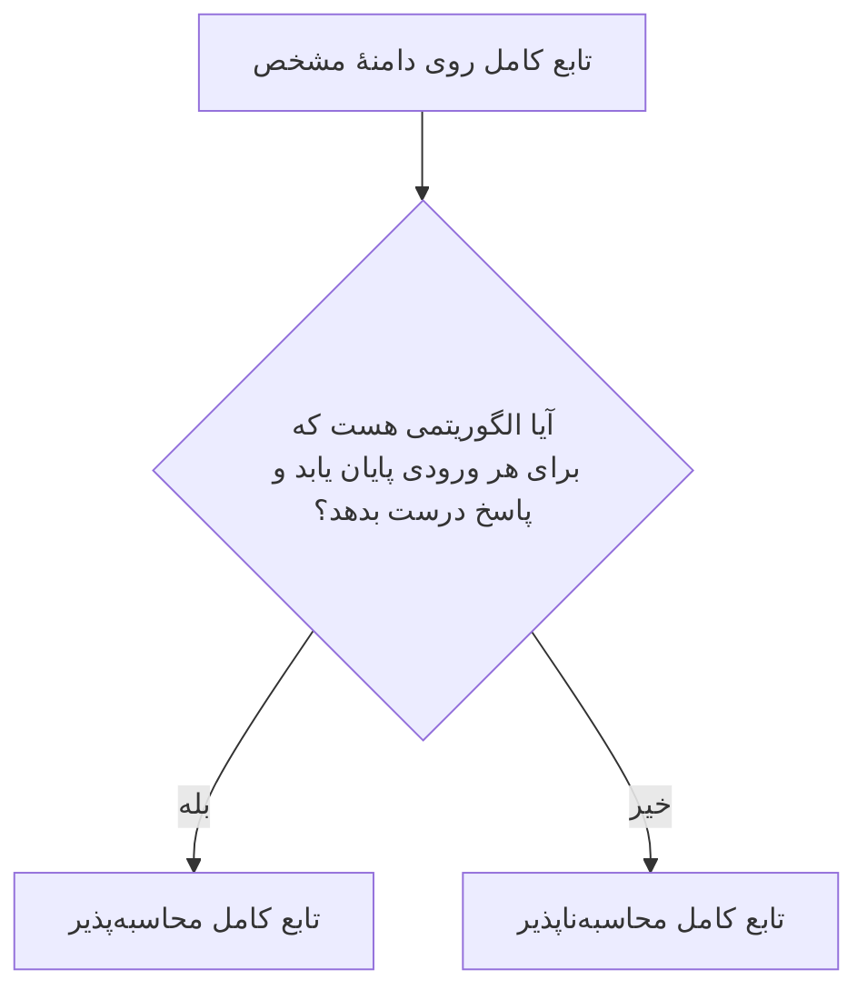

</div>

<div dir="ltr" style="direction: ltr; text-align: left;">

```c
#include <stdio.h>

int main(void)
{
    int tests[] = {1, 6, 7, 27};

    for (int t = 0; t < 4; t++) {
        unsigned long long n = tests[t];
        int steps = 0;

        while (n != 1) {                      /* تکرار  */
            if (n % 2 == 0) n = n / 2;        /* انتخاب */
            else            n = 3 * n + 1;
            steps++;                          /* ترتیب  */
        }
        printf("s(%2d) = %d steps\n", tests[t], steps);
    }
    return 0;
}
```

</div>

<div dir="rtl" style="direction: rtl; text-align: right;">

خروجی:

</div>

<div dir="ltr" style="direction: ltr; text-align: left;">

```text
s( 1) = 0 steps
s( 6) = 8 steps
s( 7) = 16 steps
s(27) = 111 steps
```

</div>

<div dir="rtl" style="direction: rtl; text-align: right;">

چرا برنامه برای ۱ تا ۲۷ همیشه تمام شد؟ چون **تا امروز** برای همهٔ ورودی‌های آزمایش‌شده متوقف شده است، نه به این دلیل که کسی ثابت کرده باشد همیشه متوقف می‌شود. یک آزمایش، هرگز اثبات نیست.

#### تمرین درون فصل ۸.۳

**نوع تمرین: Explain Why**

1. با توجه به اثبات مسئلهٔ توقف، چرا نمی‌توانیم برای تشخیص اینکه «آیا برنامه‌ای تمام می‌شود» صرفاً آن را اجرا کنیم و صبر کنیم؟ (راهنمایی: تفاوت «بعد از یک ساعت هنوز تمام نشده» با «هرگز تمام نمی‌شود» چیست؟)
2. فرض کنید ⁦`halts`⁩ وجود داشت. با آن چگونه می‌شد حدس کولاتس را حل کرد؟ (این نشان می‌دهد چرا «غیرمحاسبه‌پذیری» تنها یک مسئلهٔ تئوریک نیست.)

### رویه‌ای با متغیرهای سراسری

این نمایش از چند متغیر سراسری به‌عنوان ورودی و خروجی استفاده می‌کند. محدودیت‌ها به همین نمونه مربوط‌اند. در C، یک تابع با نتیجهٔ ⁦`void`⁩ هم می‌تواند پارامتر داشته باشد یا خودش را فراخوانی کند.

</div>

<div dir="ltr" style="direction: ltr; text-align: left;">

```c
#include <stdio.h>

int a, b, result;            /* حافظهٔ مشترک: ورودی و خروجی‌های رویه */

void add_proc(void)          /* رویه: بدون ورودی، بدون خروجی */
{
    result = a + b;
}

int main(void)
{
    a = 3; b = 4;
    add_proc();
    printf("3 + 4  = %d\n", result);

    a = 10; b = 25;
    add_proc();
    printf("10 + 25 = %d\n", result);

    return 0;
}
```

</div>

<div dir="rtl" style="direction: rtl; text-align: right;">

خروجی:

</div>

<div dir="ltr" style="direction: ltr; text-align: left;">

```text
3 + 4  = 7
10 + 25 = 35
```

</div>

<div dir="rtl" style="direction: rtl; text-align: right;">

این کد کار می‌کند، و **استفادهٔ مجدد** را هم نشان می‌دهد. اما ببینید وقتی بخواهیم رویه‌ای بنویسیم که خودش را صدا بزند (**بازگشت**) چه می‌شود.

#### مفهوم نظری مثال بعدی: تعریف بازگشتی فاکتوریل

فاکتوریل را ریاضیات این‌طور تعریف می‌کند:

</div>

<div dir="ltr" style="direction: ltr; text-align: center;">

$$
0! = 1, \qquad n! = n \cdot (n-1)! \quad (n \ge 1)
$$

</div>

<div dir="rtl" style="direction: rtl; text-align: right;">

این تعریف از نوع **خودمشابه** است: مقدار ⁦$n!$⁩ بر حسب مقدار یک نمونهٔ کوچک‌تر از همان مسئله بیان شده. برای ترجمهٔ مستقیم آن به رویه، می‌خواهیم رویه برای ⁦$n$⁩ خودش را برای ⁦$n-1$⁩ صدا بزند و نتیجه را در ⁦$n$⁩ ضرب کند. ورودی را در ⁦`n`⁩ می‌گذاریم و خروجی را از ⁦`result`⁩ می‌خوانیم.

</div>

<div dir="ltr" style="direction: ltr; text-align: left;">

```c
#include <stdio.h>

int  n;                      /* «ورودی» رویه */
long result;                 /* «خروجی» رویه */

void fact_proc(void)
{
    if (n <= 1) {
        result = 1;
        return;
    }
    n = n - 1;               /* می‌خواهیم برای n-1 حل کنیم ... */
    fact_proc();             /* ... پس خودمان را صدا می‌زنیم */
    result = result * n;     /* و حالا می‌خواهیم در n «اصلی» ضرب کنیم */
}

int main(void)
{
    n = 5;
    fact_proc();
    printf("5! = %ld (expected 120)\n", result);
    return 0;
}
```

</div>

<div dir="rtl" style="direction: rtl; text-align: right;">

خروجی:

</div>

<div dir="ltr" style="direction: ltr; text-align: left;">

```text
5! = 1 (expected 120)
```

</div>

<div dir="rtl" style="direction: rtl; text-align: right;">

نتیجه **اشتباه** است. چرا؟ چون ⁦`n`⁩ فقط **یک نسخه** دارد. هنگام بازگشت از فراخوانی داخلی، ⁦`n`⁩ دیگر مقدار اصلی خود (۵) را ندارد؛ فراخوانی‌های داخلی آن را تا ۱ کم کرده‌اند. پس ⁦`result * n`⁩ همیشه در ۱ ضرب می‌شود.

برای اطمینان، حالت ⁦$n = 3$⁩ را دستی دنبال کنید:

</div>

<div dir="ltr" style="direction: ltr; text-align: left;">

```text
n=3 → n=2 → فراخوانی →
          n=2 → n=1 → فراخوانی →
                  n=1 → پایه: result = 1، بازگشت
          result = result * n  = 1 * 1 = 1      ← n دیگر ۲ نیست
result = result * n  = 1 * 1 = 1                ← n دیگر ۳ نیست
```

</div>

<div dir="rtl" style="direction: rtl; text-align: right;">

آیا راهی برای اصلاح هست؟ بله، **اگر خودمان دستی مقدار قبلی را نگه داریم و برگردانیم:** پیش از فراخوانی ⁦`n`⁩ را کم می‌کنیم و بعد از بازگشت دوباره زیادش می‌کنیم تا مقدار اصلی برگردد.

</div>

<div dir="ltr" style="direction: ltr; text-align: left;">

```c
#include <stdio.h>

int  n;
long result;

void fact_proc(void)
{
    if (n <= 1) {
        result = 1;
        return;
    }
    n = n - 1;
    fact_proc();
    n = n + 1;               /* مقدار اصلی n را «دستی» بازگردان */
    result = result * n;
}

int main(void)
{
    n = 5;
    fact_proc();
    printf("5! = %ld\n", result);
    return 0;
}
```

</div>

<div dir="rtl" style="direction: rtl; text-align: right;">

خروجی:

</div>

<div dir="ltr" style="direction: ltr; text-align: left;">

```text
5! = 120
```

</div>

<div dir="rtl" style="direction: rtl; text-align: right;">

### آزمایش ناحیه‌های حافظه

#### معناشناسی (Semantics)

در فصل قبل دیدیم رویه‌ها به یک «حافظهٔ تازه برای هر فراخوانی» نیاز دارند. برای فهمیدن اینکه این حافظه از کجا می‌آید، باید ببینیم یک برنامهٔ در حال اجرا چه حافظه‌ای در اختیار دارد.

وقتی برنامه اجرا می‌شود، سیستم‌عامل یک فضای آدرس‌پذیر (حافظهٔ مجازی) به آن می‌دهد که به چند **ناحیه** تقسیم شده است:

</div>

<div dir="ltr" style="direction: ltr; text-align: left;">

```text
آدرس‌های بالا
┌──────────────────────────┐
│  Stack                   │  ← متغیرهای محلی و فراخوانی‌ها (رشد به سمت پایین)
│          ↓               │
│                          │
│     (فضای آزاد)          │
│                          │
│          ↑               │
│  Heap                    │  ← حافظهٔ پویا (رشد به سمت بالا)
├──────────────────────────┤
│  Static / Global data    │  ← متغیرهای سراسری و static
├──────────────────────────┤
│  Code (Text)             │  ← خود دستورهای برنامه
└──────────────────────────┘
آدرس‌های پایین
```

</div>

<div dir="rtl" style="direction: rtl; text-align: right;">

سه ناحیهٔ پایین را از قبل می‌شناسید: کد برنامه، و **متغیرهای سراسری** که رویه‌های فصل ۸ از آن‌ها استفاده می‌کردند (دقیقاً به همین دلیل فقط «یک نسخه» داشتند: یک جا در حافظهٔ ایستا). دو ناحیهٔ بالا تفاوت اصلی بحث ما هستند:

- **Stack (پشته):** حافظه‌ای که **با هر فراخوانی تابع بزرگ می‌شود و با هر بازگشت کوچک می‌شود.** همان ساختار LIFO (آخرین ورودی، اولین خروجی) که پیش‌تر دیدیم: فراخوانی = ⁦`push`⁩ و بازگشت = ⁦`pop`⁩. چون آخرین تابعی که صدا زده شده، اولین تابعی است که تمام می‌شود، **الگوی LIFO مدل طبیعی** فراخوانی تابع است.
- **Heap (هیپ):** حافظه‌ای برای داده‌هایی که طول عمر یا اندازه‌شان به یک فراخوانی گره نخورده است؛ مثلاً داده‌ای که بخواهیم بعد از پایان تابع هم باقی بماند، یا اندازه‌اش را در زمان اجرا بفهمیم. مدیریت آن **دستی** است.

| ویژگی | Stack | Heap |
| --- | --- | --- |
| مدیریت | **خودکار** (با ورود و خروج تابع) | **دستی** (درخواست و آزادسازی توسط برنامه‌نویس) |
| طول عمر | تا پایان همان فراخوانی | تا زمانی که برنامه آزاد کند |
| سرعت | بسیار سریع (فقط جابه‌جایی یک اشاره‌گر) | کندتر (پیدا کردن بلوک آزاد مناسب) |
| اندازه | محدود و کوچک (معمولاً چند مگابایت) | بزرگ (تا حد حافظهٔ ماشین) |
| الگوی دسترسی | LIFO | دلخواه |
| محتوا | پارامترها، متغیرهای محلی، آدرس بازگشت | داده‌های با اندازه یا عمر پویا |
| خطاهای رایج | **Stack Overflow** | نشت حافظه (Memory Leak)، استفادهٔ پس از آزادسازی، تکه‌تکه شدن |

#### نحو (Syntax)

برای دیدن این نواحی با چشم خودمان، از سه ابزار استفاده می‌کنیم که **فعلاً فقط به‌صورت پیش‌نمایش** هستند و در بخش‌های بعدی (اشاره‌گرها و حافظهٔ پویا) به‌طور کامل می‌آیند:

- ⁦`&x`⁩ : **آدرس** متغیر ⁦`x`⁩ در حافظه؛
- ⁦`%p`⁩ : قالب چاپ یک آدرس در ⁦`printf`⁩؛
- ⁦`malloc(n)`⁩ : درخواست ⁦`n`⁩ بایت از **Heap**.

اگر این ابزارها را نمی‌شناسید، نگران نباشید؛ فقط به **ترتیب آدرس‌های چاپ‌شده** نگاه کنید.

#### فلوچارت: نواحی حافظه و جهت رشد آن‌ها

</div>

<div dir="ltr" style="direction: ltr; text-align: center;">

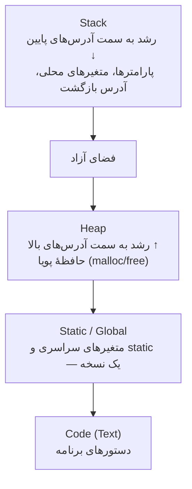

</div>

<div dir="ltr" style="direction: ltr; text-align: left;">

```c
#include <stdio.h>
#include <stdlib.h>

int global_counter = 42;            /* ناحیهٔ Static / Global */

void some_function(void) { }        /* ناحیهٔ Code */

int main(void)
{
    static int static_var = 7;      /* ناحیهٔ Static */
    int local_var = 1;              /* Stack */
    int *heap_var = malloc(sizeof(int));   /* Heap */

    printf("code  (function) : %p\n", (void *)some_function);
    printf("data  (global)   : %p\n", (void *)&global_counter);
    printf("data  (static)   : %p\n", (void *)&static_var);
    printf("heap  (malloc)   : %p\n", (void *)heap_var);
    printf("stack (local)    : %p\n", (void *)&local_var);

    free(heap_var);
    return 0;
}
```

</div>

<div dir="rtl" style="direction: rtl; text-align: right;">

خروجی:

</div>

<div dir="ltr" style="direction: ltr; text-align: left;">

```text
code  (function) : 0x563e1eec91a9
data  (global)   : 0x563e1eecc010
data  (static)   : 0x563e1eecc014
heap  (malloc)   : 0x563e40b382a0
stack (local)    : 0x7ffe4a3606bc
```

</div>

<div dir="rtl" style="direction: rtl; text-align: right;">

خروجی روی هر ماشین و هر بار اجرا **اعداد متفاوتی** دارد (سیستم‌عامل آدرس‌ها را عمداً تصادفی می‌کند)، اما معمولاً **ترتیب** نواحی همان است که در نمودار دیدیم: کد در پایین‌ترین آدرس، سپس داده‌های ایستا، سپس Heap و در بالاترین آدرس Stack.

#### تمرین درون فصل ۹.۱

**نوع تمرین: Classify**

برای هر متغیر مشخص کنید در کدام ناحیه (Stack، Heap یا Static) قرار می‌گیرد:

</div>

<div dir="ltr" style="direction: ltr; text-align: left;">

```c
int g = 10;

int f(int p) {
    int a = p + 1;
    static int s = 0;
    int *h = malloc(100);
    return a;
}
```

</div>

<div dir="rtl" style="direction: rtl; text-align: right;">

متغیرهای ⁦`g`⁩، ⁦`p`⁩، ⁦`a`⁩، ⁦`s`⁩ و بلوکی که ⁦`h`⁩ به آن اشاره می‌کند را بررسی کنید.

### آزمایش عمق پشته

#### نحو (Syntax)

برنامهٔ زیر تابعی بازگشتی برای ⁦$\sum_{i=1}^{N} i$⁩ دارد و مقدار ⁦$N$⁩ را هنگام کامپایل با گزینهٔ ⁦`-DN=...`⁩ تعیین می‌کنیم (این دقیقاً همان ⁦`#define`⁩ است که در ۱۰.۷ یاد می‌گیریم؛ فعلاً فقط یک «پارامتر زمان کامپایل» تصور کنید). از ⁦`-O0`⁩ استفاده می‌کنیم تا کامپایلر هیچ بهینه‌سازی روی بازگشت انجام ندهد.

#### فلوچارت: هزینهٔ بازگشت: حافظهٔ Stack و Stack Overflow

</div>

<div dir="ltr" style="direction: ltr; text-align: center;">

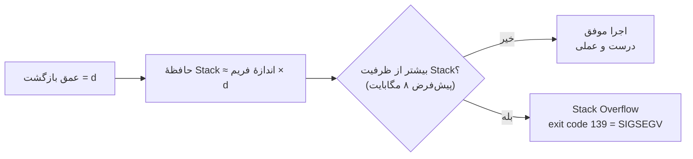

</div>

<div dir="ltr" style="direction: ltr; text-align: left;">

```c
#include <stdio.h>

#ifndef N
#define N 1000
#endif

unsigned long long sum_to(unsigned long long n)     /* sum_to(n) = 1 + 2 + ... + n */
{
    return (n == 0) ? 0 : n + sum_to(n - 1);
}

int main(void)
{
    printf("sum_to(%d) = %llu\n", N, sum_to(N));
    return 0;
}
```

</div>

<div dir="rtl" style="direction: rtl; text-align: right;">

خروجی:

</div>

<div dir="ltr" style="direction: ltr; text-align: left;">

```text
sum_to(1000) = 500500
```

</div>

<div dir="rtl" style="direction: rtl; text-align: right;">

خروجی:

</div>

<div dir="ltr" style="direction: ltr; text-align: left;">

```text
sum_to(100000) = 5000050000
```

</div>

<div dir="rtl" style="direction: rtl; text-align: right;">

خروجی:

</div>

<div dir="ltr" style="direction: ltr; text-align: left;">

```text
exit code: 139
```

</div>

<div dir="rtl" style="direction: rtl; text-align: right;">

در اجرای نمونه، ورودی‌های ۱۰۰۰ و ۱۰۰٬۰۰۰ موفق بودند و با ورودی ۱٬۰۰۰٬۰۰۰ برنامه دچار **Stack Overflow** شد (کد خروج ۱۳۹ یعنی ⁦`128 + 11`⁩، یعنی سیگنال ۱۱ = ⁦`SIGSEGV`⁩). با فریم‌های حدود ۴۸ بایتی که در ۹.۲ دیدیم، سقف تقریبی ۸ مگابایت برابر با حدود ۱۷۰ هزار فراخوانی است، که با این نتایج سازگار است.

> **نکتهٔ ظریف:** استاندارد C تضمین نمی‌کند که کامپایلر بازگشت را «حفظ» کند. اگر همین برنامه را با ⁦`-O2`⁩ کامپایل کنید، گاهی کامپایلر تابع را به یک **حلقه** تبدیل می‌کند و هیچ Stack Overflow رخ نمی‌دهد. انجام این بهینه‌سازی به کامپایلر و تنظیمات آن بستگی دارد.

### ۹.۶ ساختن حساب از صفر: توابع پئانو

#### معناشناسی (Semantics)

سؤالی که هر دانشجوی علوم کامپیوتر باید یک بار از خودش بپرسد: «واقعاً **چه چیزی** پشت ⁦`+`⁩ و ⁦`*`⁩ است؟» پاسخ ریاضی‌دانان در پایان قرن نوزدهم این بود که اعداد طبیعی را می‌توان فقط از **دو ایده** ساخت (جوزپه پئانو، ۱۸۸۹):

- یک عدد آغازین: ⁦$0$⁩؛
- یک تابع **پی‌آمد (Successor)** ⁦$S$⁩ که «یکی بعدی» را می‌دهد: ⁦$1 = S(0)$⁩، ⁦$2 = S(S(0))$⁩، ...

و سپس تمام عمل‌های حسابی را می‌توان با **تعریف بازگشتی** روی همین دو ایده ساخت. به این شیوه **بازگشت اولیه (Primitive Recursion)** می‌گویند (ددکیند ۱۸۸۸؛ اسکولم ۱۹۲۳): تابع ⁦$h$⁩ را برای ورودی ⁦$0$⁩ مستقیماً تعریف می‌کنیم و برای ⁦$S(y)$⁩ بر حسب ⁦$h(\cdot, y)$⁩:

</div>

<div dir="ltr" style="direction: ltr; text-align: center;">

$$
h(x, 0) = g(x), \qquad h(x, S(y)) = f\big(x, y, h(x, y)\big)
$$

</div>

<div dir="rtl" style="direction: rtl; text-align: right;">

در برنامهٔ ما، ⁦$S$⁩ و تابع **پیشین (Predecessor)** ⁦$P$⁩ با ⁦`inc`⁩ و ⁦`dec`⁩ نشان داده می‌شوند. تعریف‌ها به‌صورت زیر است:

| تابع | حالت پایه | گام بازگشتی |
| --- | --- | --- |
| $\text{add}(a, b)$ | $\text{add}(a, 0) = a$ | $\text{add}(a, b) = \text{add}(S(a), P(b))$ |
| $\text{sub}(a, b)$ | $\text{sub}(a, 0) = a$ | $\text{sub}(a, b) = \text{sub}(P(a), P(b))$ |
| $\text{mul}(a, b)$ | $\text{mul}(a, 0) = 0$ | $\text{mul}(a, b) = \text{add}(\text{mul}(a, P(b)),\ a)$ |
| $\text{mod}(a, b)$ | $a < b \Rightarrow a$ | $\text{mod}(a, b) = \text{mod}(\text{sub}(a, b),\ b)$ |
| $\text{div}(a, b)$ | $a < b \Rightarrow 0$ | $\text{div}(a, b) = S(\text{div}(\text{sub}(a, b),\ b))$ |

دو لایه در این تعریف‌ها دیده می‌شود. اول، هر تابع روی تابع **قبلی** ساخته شده است: ⁦`mul`⁩ روی ⁦`add`⁩ و ⁦`add`⁩ روی ⁦`inc`⁩. (این الگو ادامه دارد: توان را می‌توان روی ⁦`mul`⁩ ساخت و بعد روی آن... این «برج» دقیقاً همان است که در ۹.۷ به تابع آکرمان می‌رسد.) دوم، ⁦`mod`⁩ و ⁦`div`⁩ از نوع «تکرار تا کوچک‌شدن» هستند: تا وقتی ⁦$a \ge b$⁩ است، ⁦$b$⁩ را از ⁦$a$⁩ کم می‌کنند.

**تابع جزئی در عمل.** در ⁦`div`⁩ و ⁦`mod`⁩ اگر ⁦$b = 0$⁩ باشد، ⁦$\text{sub}(a, 0) = a$⁩ است و ⁦$a$⁩ هرگز **کوچک‌تر** نمی‌شود؛ پس شرط پایه (⁦$a < b$⁩، یعنی ⁦$a < 0$⁩) هرگز برقرار نمی‌شود. این دقیقاً همان ⁦$f(x)\uparrow$⁩ فصل ۸.۳ است: **تقسیم بر صفر تابعی جزئی می‌سازد.** در حافظهٔ متناهی، «تا ابد ادامه دادن» به شکل Stack Overflow ظاهر می‌شود.

**نتیجهٔ نوع متناهی.** در ۸.۲ دیدیم ⁦`unsigned int`⁩ در واقع حساب پیمانه‌ای است. اینجا ⁦`dec(0)`⁩ برابر ⁦$2^{32} - 1$⁩ می‌شود. پس ⁦`sub(a, b)`⁩ برای ⁦$b > a$⁩ هم «تعریف‌شده» است، اما نتیجه‌اش **تفریق ریاضی طبیعی** (که باید صفر یا تعریف‌نشده باشد) نیست. این را بعد از اجرای مثال بررسی می‌کنیم.

#### نحو (Syntax)

سه ابزار نحوی تازه در برنامهٔ زیر هست:

- **عملگر شرطی ⁦`? :`⁩**: عبارت ⁦`cond ? x : y`⁩ یک **عبارت** است (نه یک دستور) که اگر ⁦`cond`⁩ درست باشد مقدار ⁦`x`⁩ و در غیر این صورت مقدار ⁦`y`⁩ را دارد. تابع‌های بالا با آن در یک خط نوشته می‌شوند: ⁦`return`⁩ همان عبارت است.
- **⁦`++a`⁩ و ⁦`--a`⁩ (پیشوندی):** مقدار را یکی زیاد یا کم می‌کنند **و مقدار جدید را به‌عنوان نتیجه می‌دهند.** چون ⁦`a`⁩ پارامتر است (کپی)، فقط نسخهٔ محلی تغییر می‌کند (Call by Value، ۹.۲).
- **⁦`#define uint unsigned int`⁩:** فعلاً یعنی «هر جا ⁦`uint`⁩ نوشتم، همان ⁦`unsigned int`⁩ بخوان» (در ۱۰.۷ دقیقاً توضیح می‌دهیم چه اتفاقی می‌افتد، و می‌بینیم چرا راه بهتری هم هست).

برنامهٔ زیر هر پنج تابع را تعریف و با یک مقدار امتحان می‌کند.

#### فلوچارت: برج توابع پئانو — هر تابع روی تابع قبلی

</div>

<div dir="ltr" style="direction: ltr; text-align: center;">

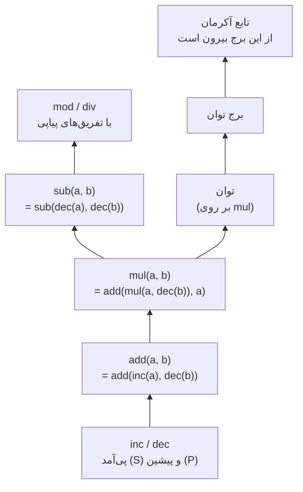

</div>

<div dir="ltr" style="direction: ltr; text-align: left;">

```c
#include <stdio.h>
#define uint    unsigned int

uint inc(uint a){ return ++a; }
uint dec(uint a){ return --a; }

uint add(uint a, uint b){ return b == 0 ? a : add(inc(a), dec(b)); }
uint sub(uint a, uint b){ return b == 0 ? a : sub(dec(a), dec(b)); }
uint mul(uint a, uint b){ return b == 0 ? 0 : add(mul(a, dec(b)), a); }
uint mod(uint a, uint b){ return a < b  ? a : mod(sub(a, b), b); }
uint div(uint a, uint b){ return a < b  ? 0 : inc(div(sub(a, b), b)); }

int main(void){
    printf("add(7, 5)   = %u\n", add(7, 5));
    printf("sub(7, 5)   = %u\n", sub(7, 5));
    printf("mul(7, 5)   = %u\n", mul(7, 5));
    printf("mod(23, 4)  = %u\n", mod(23, 4));
    printf("div(23, 4)  = %u\n", div(23, 4));
    return 0;
}
```

</div>

<div dir="rtl" style="direction: rtl; text-align: right;">

خروجی:

</div>

<div dir="ltr" style="direction: ltr; text-align: left;">

```text
add(7, 5)   = 12
sub(7, 5)   = 2
mul(7, 5)   = 35
mod(23, 4)  = 3
div(23, 4)  = 5
```

</div>

<div dir="rtl" style="direction: rtl; text-align: right;">

چند نکته در فهم این برنامه:

**۱) ⁦`add`⁩ یک زنجیر است.** در هر گام یک واحد از ⁦$b$⁩ به ⁦$a$⁩ منتقل می‌شود. نتیجه بدون هیچ کار اضافه‌ای مستقیماً بالا می‌رود:

</div>

<div dir="ltr" style="direction: ltr; text-align: left;">

```text
add(2, 3) → add(3, 2) → add(4, 1) → add(5, 0) = 5
```

</div>

<div dir="rtl" style="direction: rtl; text-align: right;">

**۲) ⁦`mul`⁩ یک درخت (در واقع زنجیر دوگانه) است.** ابتدا آرگومان ⁦`mul(a, dec(b))`⁩ ارزیابی می‌شود، سپس ⁦`add`⁩. برای ⁦`mul(2, 3)`⁩:

</div>

<div dir="ltr" style="direction: ltr; text-align: left;">

```text
mul(2, 3)
 ├─ mul(2, 2)
 │   ├─ mul(2, 1)
 │   │   ├─ mul(2, 0) = 0
 │   │   └─ add(0, 2) = 2
 │   └─ add(2, 2) = 4
 └─ add(4, 2) = 6
```

</div>

<div dir="rtl" style="direction: rtl; text-align: right;">

**۳) هزینه متناسب با «مقدار» است، نه «اندازه».** ⁦`add(a, b)`⁩ دقیقاً ⁦$b + 1$⁩ فراخوانی انجام می‌دهد. پردازنده‌های واقعی جمع را با یک دستور روی نمایش دودویی انجام می‌دهند؛ این برنامه عملاً به‌صورت **یکانی (Unary)** می‌شمارد. هدف این مثال **فهم ساختار** است، نه سرعت.

**۴) ⁦`mod`⁩ و ⁦`div`⁩ از ⁦`sub`⁩ استفاده می‌کنند**، و ⁦`sub`⁩ از ⁦`dec`⁩. پس تمام چیزهایی که می‌بینید فقط از ⁦`inc`⁩ و ⁦`dec`⁩ و شرط ساخته شده‌اند.

حالا دو پیامد نظری بالا را ببینیم: ابتدا نوع متناهی، سپس تقسیم بر صفر.

</div>

<div dir="ltr" style="direction: ltr; text-align: left;">

```c
#include <stdio.h>
#define uint    unsigned int

uint inc(uint a){ return ++a; }
uint dec(uint a){ return --a; }
uint sub(uint a, uint b){ return b == 0 ? a : sub(dec(a), dec(b)); }

/* تفریق طبیعی (Monus): هرگز از صفر پایین‌تر نمی‌رود */
uint monus(uint a, uint b){ return a < b ? 0 : sub(a, b); }

int main(void){
    printf("dec(0)             = %u\n", dec(0));
    printf("inc(4294967295)    = %u\n", inc(4294967295u));
    printf("sub(3, 5)          = %u   (3 - 5 mod 2^32)\n", sub(3, 5));
    printf("monus(3, 5)        = %u\n", monus(3, 5));
    return 0;
}
```

</div>

<div dir="rtl" style="direction: rtl; text-align: right;">

خروجی:

</div>

<div dir="ltr" style="direction: ltr; text-align: left;">

```text
dec(0)             = 4294967295
inc(4294967295)    = 0
sub(3, 5)          = 4294967294   (3 - 5 mod 2^32)
monus(3, 5)        = 0
```

</div>

<div dir="rtl" style="direction: rtl; text-align: right;">

⁦`sub(3, 5)`⁩ برابر ⁦`4294967294`⁩ شد، یعنی ⁦$-2 \bmod 2^{32}$⁩. در ریاضیات اعداد طبیعی چنین نتیجه‌ای ندارد؛ باید قرارداد کنیم که یا **تعریف‌نشده** باشد (تابع جزئی) یا **تفریق طبیعی (Monus)** که برابر صفر است. تابع ⁦`monus`⁩ همین قرارداد دوم را با یک شرط اضافه پیاده‌سازی می‌کند. پس **انتخاب یک مدل** (حساب پیمانه‌ای، تفریق طبیعی، یا تابع جزئی) بخشی از **طراحی تابع** است، نه یک جزئیات فنی.

حالا تقسیم بر صفر:

</div>

<div dir="ltr" style="direction: ltr; text-align: left;">

```c
#include <stdio.h>
#define uint    unsigned int

uint inc(uint a){ return ++a; }
uint dec(uint a){ return --a; }
uint sub(uint a, uint b){ return b == 0 ? a : sub(dec(a), dec(b)); }
uint div(uint a, uint b){ return a < b ? 0 : inc(div(sub(a, b), b)); }

int main(void){
    printf("div(23, 4) = %u\n", div(23, 4));
    printf("about to compute div(5, 0) ...\n");
    fflush(stdout);
    printf("div(5, 0)  = %u\n", div(5, 0));      /* هرگز به پایه نمی‌رسد */
    return 0;
}
```

</div>

<div dir="rtl" style="direction: rtl; text-align: right;">

خروجی:

</div>

<div dir="ltr" style="direction: ltr; text-align: left;">

```text
div(23, 4) = 5
about to compute div(5, 0) ...
exit code: 139
```

</div>

<div dir="rtl" style="direction: rtl; text-align: right;">

چاپ نتیجهٔ ⁦`div(5, 0)`⁩ هرگز اتفاق نمی‌افتد: فراخوانی‌ها بی‌پایان ادامه پیدا می‌کنند تا Stack پر شود. تابع ⁦$\text{div}$⁩ همان **تابع جزئی** است و ⁦$\text{div}(5, 0)\uparrow$⁩.

#### تمرین درون فصل ۹.۶

**نوع تمرین: Write a Function**

با استفاده از ⁦`mul`⁩ یک تابع بازگشتی ⁦`power(a, b)`⁩ بنویسید که ⁦$a^b$⁩ را حساب کند. حالت پایه و گام بازگشتی را مثل جدول بالا نخست روی کاغذ بنویسید. سپس بگویید ⁦`power(0, 0)`⁩ چه نتیجه‌ای می‌دهد و آیا از نظر ریاضی منطقی است.

### ۹.۷ تابع آکرمان

#### معناشناسی (Semantics)

در ۹.۶ دیدیم هر تابع روی تابع قبلی ساخته می‌شود: جمع روی «یکی بعدی»، ضرب روی جمع، و اگر ادامه دهیم، توان روی ضرب، و بعد «برج توان» روی توان، و ... هر مرحله یک «بازگشت اولیه» روی مرحلهٔ قبل است. یک پرسش طبیعی است:

> آیا می‌توان **همهٔ** توابع محاسبه‌پذیر و کامل را با ترکیب چنین بازگشت‌های اولیه ساخت؟

در سال ۱۹۲۸ ویلهلم آکرمان (شاگرد هیلبرت) و مستقل از او، گابریل سودان (۱۹۲۷)، نشان دادند که **پاسخ منفی است**. تابعی ساختند که **کامل** و **محاسبه‌پذیر** است، اما بازگشتیِ اولیه نیست. نسخهٔ دو‌متغیرهٔ مشهور امروزی، حاصل ساده‌سازی‌های رزا پیتر و رافائل رابینسون است:

</div>

<div dir="ltr" style="direction: ltr; text-align: center;">

$$
A(0, n) = n + 1
$$

</div>

<div dir="ltr" style="direction: ltr; text-align: center;">

$$
A(m + 1,\ 0) = A(m,\ 1)
$$

</div>

<div dir="ltr" style="direction: ltr; text-align: center;">

$$
A(m + 1,\ n + 1) = A\big(m,\ A(m + 1,\ n)\big)
$$

</div>

<div dir="rtl" style="direction: rtl; text-align: right;">

**چرا این تابع خاص است؟** دو ویژگی دارد:

1. **هر سطر، تکرار سطر قبلی است.** از قاعدهٔ دوم و سوم نتیجه می‌شود ⁦$A(m+1, n)$⁩ برابر است با اعمال ⁦$n + 1$⁩ بار تابع ⁦$A(m, \cdot)$⁩ روی عدد ۱. بنابراین:

| ⁦$m$⁩ | ⁦$A(m, n)$⁩ | عملیات متناظر |
| --- | --- | --- |
| ۰ | ⁦$n + 1$⁩ | پی‌آمد |
| ۱ | ⁦$n + 2$⁩ | جمع |
| ۲ | ⁦$2n + 3$⁩ | ضرب |
| ۳ | ⁦$2^{n+3} - 3$⁩ | **توان** |
| ۴ | ⁦$\underbrace{2^{2^{\cdot^{\cdot^{2}}}}}_{n+3} - 3$⁩ | برج توان (Tetration) |

2. **رشد آن از هر تابع بازگشتی اولیه سریع‌تر است.** برای هر تابع بازگشتیِ اولیهٔ تک‌متغیرهٔ ⁦$f$⁩ یک ⁦$k$⁩ دارد که برای ⁦$n$⁩ به‌اندازهٔ کافی بزرگ، ⁦$f(n) < A(k, n)$⁩. پس ⁦$A$⁩ نمی‌تواند خودش بازگشتی اولیه باشد. (به همین دلیل، مدل صوری LOOP، با شمارنده‌ای که هنگام ورود به هر حلقه ثابت می‌شود، نمی‌تواند آن را محاسبه کند.)

بعضی مقدارها: ⁦$A(4, 0) = 13$⁩ و ⁦$A(4, 1) = 65533$⁩ و ⁦$A(4, 2) = 2^{65536} - 3$⁩ که یک عدد با **۱۹٬۷۲۹ رقم** است. ⁦$A(4, 3) = 2^{2^{65536}} - 3$⁩ بیشتر از تعداد اتم‌های جهان رقم دارد. این تابع **محاسبه‌پذیر** است (الگوریتمش زیر را ببینید)، اما برای ورودی‌های نه‌چندان بزرگ **عملاً محاسبه‌ناپذیر** است. **محاسبه‌پذیری در تئوری** با **امکان‌پذیری در عمل** یکی نیست.

#### نحو (Syntax)

نکتهٔ نحوی کلیدی، **فراخوانی تو‌در‌تو** در آرگومان است: ⁦`ack(m - 1, ack(m, n - 1))`⁩. چون C آرگومان‌ها را **قبل از فراخوانی** حساب می‌کند (Call by Value)، فراخوانی داخلی اول تمام می‌شود و **نتیجه‌اش** آرگومان دوم فراخوانی بیرونی می‌شود. یعنی ما این‌جا یک «بازگشتی که ورودی‌اش خروجی یک بازگشت دیگر است» داریم؛ ساختاری که در ⁦`fib`⁩ و ⁦`fact`⁩ ندیده بودیم.

برای دیدن هزینهٔ واقعی، دو شمارنده می‌گذاریم: **تعداد کل فراخوانی‌ها** و **بیشینهٔ عمق** (حداکثر تعداد فریم‌های هم‌زمان روی Stack).

#### فلوچارت: سه قاعدهٔ تابع آکرمان

</div>

<div dir="ltr" style="direction: ltr; text-align: center;">

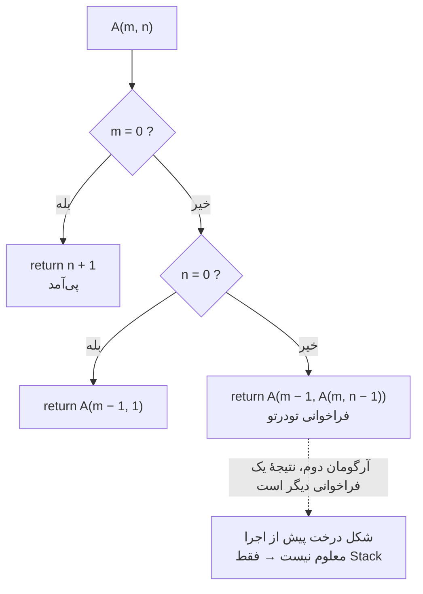

</div>

<div dir="ltr" style="direction: ltr; text-align: left;">

```c
#include <stdio.h>

static unsigned long calls, depth, max_depth;

unsigned long ack(unsigned long m, unsigned long n)
{
    unsigned long r;

    calls++;
    depth++;
    if (depth > max_depth) max_depth = depth;

    if (m == 0)       r = n + 1;
    else if (n == 0)  r = ack(m - 1, 1);
    else              r = ack(m - 1, ack(m, n - 1));

    depth--;
    return r;
}

void report(unsigned long m, unsigned long n)
{
    calls = depth = max_depth = 0;
    unsigned long v = ack(m, n);
    printf("A(%lu,%lu) = %-4lu calls = %-7lu max_depth = %lu\n",
           m, n, v, calls, max_depth);
}

int main(void)
{
    printf("Table of A(m, n):\n");
    printf("      n=0  n=1  n=2  n=3  n=4  n=5  n=6\n");
    for (unsigned long m = 0; m <= 3; m++) {
        printf("m=%lu ", m);
        for (unsigned long n = 0; n <= 6; n++) {
            printf("%5lu", ack(m, n));
        }
        printf("\n");
    }

    printf("\nCost:\n");
    report(2, 3);
    report(3, 3);
    report(3, 6);
    report(4, 0);
    return 0;
}
```

</div>

<div dir="rtl" style="direction: rtl; text-align: right;">

خروجی:

</div>

<div dir="ltr" style="direction: ltr; text-align: left;">

```text
Table of A(m, n):
      n=0  n=1  n=2  n=3  n=4  n=5  n=6
m=0     1    2    3    4    5    6    7
m=1     2    3    4    5    6    7    8
m=2     3    5    7    9   11   13   15
m=3     5   13   29   61  125  253  509

Cost:
A(2,3) = 9    calls = 44      max_depth = 10
A(3,3) = 61   calls = 2432    max_depth = 63
A(3,6) = 509  calls = 172233  max_depth = 511
A(4,0) = 13   calls = 107     max_depth = 16
```

</div>

<div dir="rtl" style="direction: rtl; text-align: right;">

سه مشاهدهٔ مهم:

1. سطرها دقیقاً همان جدول بالا هستند: سطر ⁦$m = 1$⁩ برابر ⁦$n + 2$⁩، سطر ⁦$m = 2$⁩ برابر ⁦$2n + 3$⁩ و سطر ⁦$m = 3$⁩ برابر ⁦$2^{n+3} - 3$⁩ (مثلاً ⁦$A(3, 6) = 2^9 - 3 = 509$⁩).
2. تعداد فراخوانی‌ها **انفجاری** است: با اضافه شدن هر واحد به ⁦$n$⁩ در ⁦$m = 3$⁩ تعداد فراخوانی‌ها حدود **چهار برابر** می‌شود.
3. **عمق** بازگشت برای ⁦$m = 3$⁩ تقریباً برابر خود **مقدار** تابع است (⁦$A(3,6) = 509$⁩ و عمق ۵۱۱). پس Stack هم باید به اندازهٔ نتیجه بزرگ باشد؛ ربط مستقیم به ۹.۴.

#### تمرین درون فصل ۹.۷

**نوع تمرین: Trace**

مقدار ⁦$A(1, 2)$⁩ را با دست و با استفاده از سه قاعدهٔ بالا حساب کنید. تمام فراخوانی‌ها را به‌ترتیب بنویسید و تعدادشان را بشمارید. نتیجه را با فرمول ⁦$A(1, n) = n + 2$⁩ وارسی کنید.

### ۹.۸ تعریف بازگشتی ضریب دوجمله‌ای ⁦$C(n, k)$⁩

#### معناشناسی (Semantics)

⁦$C(n, k)$⁩ (بخوانید «⁦$n$⁩ انتخاب ⁦$k$⁩») تعداد راه‌های انتخاب ⁦$k$⁩ عضو از یک مجموعهٔ ⁦$n$⁩ عضوی است. برای نوشتن آن به‌صورت بازگشتی، یک **استدلال ترکیبیاتی** کافی است:

یک عضو مشخص ⁦$x$⁩ از مجموعه را «شاهد» بگیرید. هر زیرمجموعهٔ ⁦$k$⁩ عضوی **دقیقاً یکی** از دو حالت دارد:

- شامل ⁦$x$⁩ است: بقیهٔ ⁦$k - 1$⁩ عضو را از ⁦$n - 1$⁩ عضو دیگر انتخاب می‌کنیم: ⁦$C(n - 1,\ k - 1)$⁩ راه؛
- شامل ⁦$x$⁩ نیست: همهٔ ⁦$k$⁩ عضو را از ⁦$n - 1$⁩ عضو دیگر انتخاب می‌کنیم: ⁦$C(n - 1,\ k)$⁩ راه.

چون این دو حالت جدا و فراگیرند:

</div>

<div dir="ltr" style="direction: ltr; text-align: center;">

$$
C(n, k) = C(n-1,\ k-1) + C(n-1,\ k), \qquad C(n, 0) = C(n, n) = 1
$$

</div>

<div dir="rtl" style="direction: rtl; text-align: right;">

این همان **قاعدهٔ پاسکال** و تولید‌کنندهٔ مثلث پاسکال است؛ که در ایران قرن‌ها پیش از پاسکال (توسط کرجی و خیام)، و در هند و چین هم شناخته بود.

**حالت پایه** دو تا است (⁦$k = 0$⁩ و ⁦$k = n$⁩) و **اندازهٔ کاهنده** ⁦$n$⁩ است (در هر گام یکی کم می‌شود)، پس بازگشت تمام می‌شود.

**هزینهٔ بازگشت.** اینجا یک ویژگی زیبا داریم. هر برگ درخت فراخوانی (فراخوانی‌ای که حالت پایه است) مقدار ⁦$1$⁩ برمی‌گرداند و هر گره‌ٔ داخلی مجموع دو فرزندش را. پس مقدار ریشه، یعنی ⁦$C(n, k)$⁩، **دقیقاً برابر تعداد برگ‌هاست.** یک درخت دودویی کامل با ⁦$L$⁩ برگ، ⁦$2L - 1$⁩ گره دارد؛ بنابراین:

</div>

<div dir="ltr" style="direction: ltr; text-align: center;">

$$
T(n,k) = 2\,C(n,k) - 1
$$

</div>

<div dir="rtl" style="direction: rtl; text-align: right;">

یعنی برای محاسبهٔ ⁦$C(20, 10) = 184756$⁩ باید **۳۶۹٬۵۱۱** فراخوانی انجام شود. دلیلش، همان تکرار زیرمسئله‌هاست که در فیبوناچی دیدیم.

#### نحو (Syntax)

برنامهٔ زیر سه کار می‌کند: با تابع بازگشتی، مثلث پاسکال را تا ردیف ۶ چاپ می‌کند؛ هزینهٔ بازگشت را اندازه می‌گیرد؛ و **الگوریتم دومی برای همان تابع** (بدون بازگشت) را کنار آن می‌گذارد تا یادآوری شود تابع و الگوریتم دو چیز متفاوت‌اند:

</div>

<div dir="ltr" style="direction: ltr; text-align: center;">

$$
C(n, k) = \prod_{i=0}^{k-1} \frac{n - i}{i + 1}
$$

</div>

<div dir="rtl" style="direction: rtl; text-align: right;">

در حلقهٔ زیر، تقسیم در هر مرحله دقیقاً بدون باقی‌مانده است، چون نتیجهٔ جزئی، خودش یک ضریب دوجمله‌ای (یعنی عدد صحیح) است.

#### فلوچارت: قاعدهٔ پاسکال و شمارش برگ‌ها

</div>

<div dir="ltr" style="direction: ltr; text-align: center;">

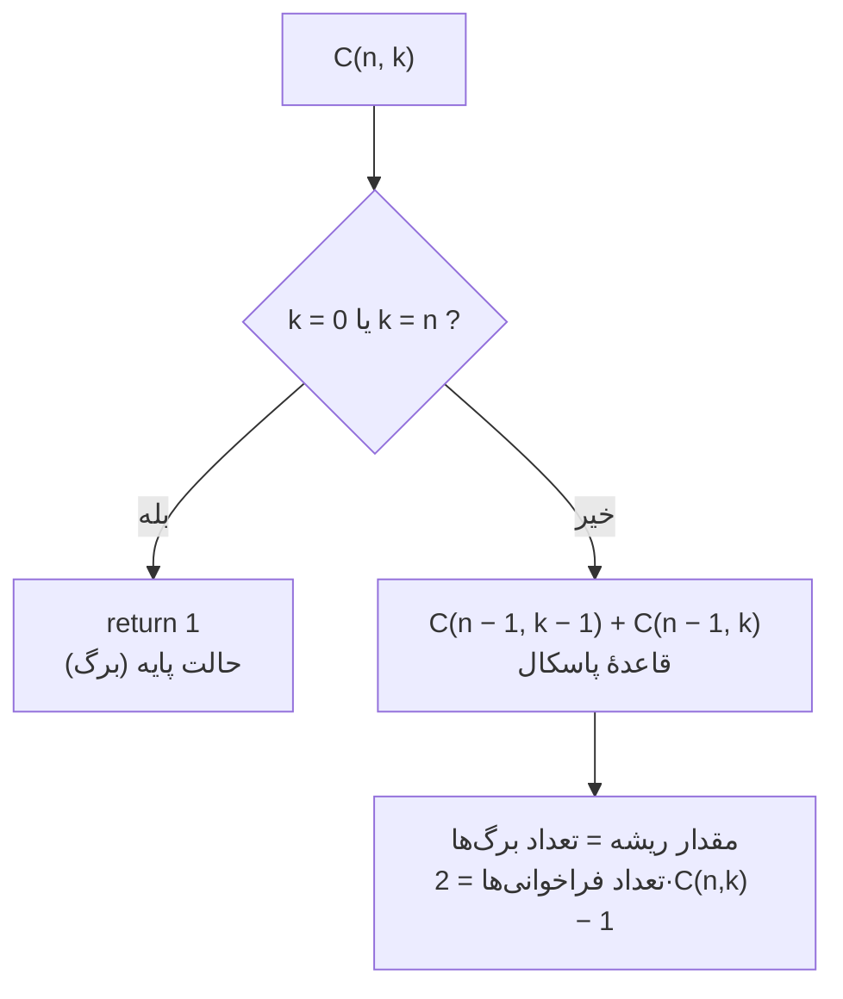

</div>

<div dir="ltr" style="direction: ltr; text-align: left;">

```c
#include <stdio.h>

static unsigned long calls;

/* الگوریتم ۱: بازگشتی، مستقیماً از قاعدهٔ پاسکال */
unsigned long long binom(int n, int k)
{
    calls++;
    return (k == 0 || k == n) ? 1ULL : binom(n - 1, k - 1) + binom(n - 1, k);
}

/* الگوریتم ۲: حلقه، همان تابع */
unsigned long long binom_loop(int n, int k)
{
    unsigned long long r = 1;
    for (int i = 0; i < k; i++) {
        r = r * (n - i) / (i + 1);
    }
    return r;
}

int main(void)
{
    printf("Pascal's triangle:\n");
    for (int n = 0; n <= 6; n++) {
        for (int k = 0; k <= n; k++) {
            printf("%llu ", binom(n, k));
        }
        printf("\n");
    }

    printf("\n  (n,k)     value     calls   loop-version\n");
    int tests[][2] = { {5, 2}, {10, 5}, {20, 10}, {25, 12} };
    for (int i = 0; i < 4; i++) {
        int n = tests[i][0], k = tests[i][1];
        calls = 0;
        unsigned long long v = binom(n, k);
        printf("(%2d,%2d)  %8llu  %8lu   %llu\n", n, k, v, calls, binom_loop(n, k));
    }
    return 0;
}
```

</div>

<div dir="rtl" style="direction: rtl; text-align: right;">

خروجی:

</div>

<div dir="ltr" style="direction: ltr; text-align: left;">

```text
Pascal's triangle:
1
1 1
1 2 1
1 3 3 1
1 4 6 4 1
1 5 10 10 5 1
1 6 15 20 15 6 1

  (n,k)     value     calls   loop-version
( 5, 2)        10        19   10
(10, 5)       252       503   252
(20,10)    184756    369511   184756
(25,12)   5200300  10400599   5200300
```

</div>

<div dir="rtl" style="direction: rtl; text-align: right;">

فرمول ⁦$\text{calls} = 2C(n, k) - 1$⁩ را وارسی کنید: برای ⁦$(10, 5)$⁩: ⁦$2 \cdot 252 - 1 = 503$⁩ ✓. هر دو الگوریتم همان **تابع** را محاسبه می‌کنند (ستون‌های ⁦`value`⁩ و ⁦`loop-version`⁩ برابرند) اما یکی ۱۰ میلیون فراخوانی و دیگری ۱۲ ضرب لازم دارد.

> **نگاه به آینده:** وقتی در بخش بعد با آرایه‌ها آشنا شدید، می‌توانید نتایج ⁦$C(n, k)$⁩ را در یک جدول ذخیره کنید و هر زیرمسئله را فقط **یک بار** حل کنید. این ایده با نام **Memoization** و **برنامه‌ریزی پویا (Dynamic Programming)** شناخته می‌شود و تعداد فراخوانی‌ها را از نمایی به ⁦$O(n \cdot k)$⁩ می‌رساند.

#### تمرین درون فصل ۹.۸

**نوع تمرین: Explain Why**

چرا برای محاسبهٔ ⁦`binom(25, 12)`⁩ و ⁦`binom(25, 13)`⁩ تعداد فراخوانی‌ها **یکسان** است؟ چه خاصیتی از ⁦$C(n, k)$⁩ در اینجا نقش دارد و چطور می‌توان از آن برای کاهش کار استفاده کرد؟

### توان محاسباتی بازگشت و حلقه

#### معناشناسی (Semantics)

دو ابزار تکرار داریم: **حلقه** و **بازگشت**. پرسش بنیادی: آیا یکی می‌تواند چیزی را حساب کند که دیگری نمی‌تواند؟ پاسخ در دو جهت است.

**حلقه ⇒ بازگشت.** هر حلقه را می‌توان به یک تابع بازگشتی تبدیل کرد: متغیرهای حلقه تبدیل به **پارامترها** می‌شوند، شرط ادامه به **شرط بازگشت** و «بدنه + رفتن به دور بعد» به **فراخوانی خود تابع با مقدارهای تازه**. به تابعی که فراخوانی بازگشتی‌اش **آخرین کار** آن است (و نتیجه را بدون تغییر برمی‌گرداند) **بازگشت دُم‌دار (Tail Recursion)** می‌گویند. چنین تابعی بعد از بازگشت هیچ کاری ندارد، پس فریم آن اضافی است و کامپایلر می‌تواند آن را به حلقه تبدیل کند (همان چیزی که در ۹.۴ با ⁦`-O2`⁩ دیدیم).

**بازگشت ⇒ حلقه.** هر تابع بازگشتی را می‌توان با یک **حلقه و یک Stack صریح** (که خودمان می‌سازیم) شبیه‌سازی کرد: به‌جای اینکه سیستم فریم‌ها را push و pop کند، ما این کار را انجام می‌دهیم. (در ۱۰.۵ این کار را عملاً انجام می‌دهیم.)

بنابراین **این دو، از نظر توان محاسباتی هم‌ارزند**: هر چه یکی بتواند، دیگری هم می‌تواند. این نتیجه با قضیهٔ **بوم–یاکوپینی (۱۹۶۶)** هم سازگار است: هر الگوریتم را می‌توان فقط با سه ساختار **ترتیب، انتخاب و تکرار** نوشت.

**یک ظرافت.** باید دقیق باشیم که منظورمان از «حلقه» چیست:

| مدل | توان | مثال |
| --- | --- | --- |
| دنباله + شرط (بدون تکرار) | فقط توابعی که تعداد گامشان ثابت است | ⁦$\max(a, b)$⁩ |
| حلقه‌ای که **تعداد تکرارش پیش از شروع مشخص است** (مدل LOOP؛ مایر و ریچی، ۱۹۶۷) | دقیقاً **بازگشتی‌های اولیه**: جمع، ضرب، توان، ... | ⁦`for (i=0; i<b; i++)`⁩ با ⁦`b`⁩ ثابت در طول حلقه |
| حلقهٔ **بدون سقف** (⁦`while`⁩ با شرط دلخواه) | **همهٔ** توابع (جزئی) محاسبه‌پذیر | الگوریتم کولاتس، تابع آکرمان |
| بازگشت عمومی | **همهٔ** توابع (جزئی) محاسبه‌پذیر | آکرمان، فیبوناچی |

پس **تابع آکرمان** (که بازگشتی اولیه نیست) را با «حلقه‌های کراندار» نمی‌توان نوشت، اما با ⁦`while`⁩ یا با بازگشت می‌توان. (جالب است که دنیس ریچی، نویسندهٔ همین مقاله، سازندهٔ زبان C هم هست.) در C، ⁦`for`⁩ و ⁦`while`⁩ هر دو شرط دلخواه می‌پذیرند، پس هر دو در دستهٔ سوم قرار می‌گیرند.

#### نحو (Syntax)

قواعد تبدیل یک تابع دُم‌دار به حلقه:

| در تابع بازگشتی | در حلقه |
| --- | --- |
| پارامترها | متغیرهای حلقه (با مقدار اولیه برابر آرگومان‌های اولیه) |
| شرط حالت پایه | منفیِ شرط ادامه (`while (!پایه)`) |
| نتیجهٔ حالت پایه | مقداری که بعد از حلقه برمی‌گردانیم |
| فراخوانی ⁦`f(e1, e2)`⁩ | **به‌روزرسانی هم‌زمان** پارامترها به ⁦`e1`⁩, ⁦`e2`⁩ و رفتن به دور بعد |

#### فلوچارت: هم‌ارزی بازگشت و حلقه (و مرز مدل LOOP)

</div>

<div dir="ltr" style="direction: ltr; text-align: center;">

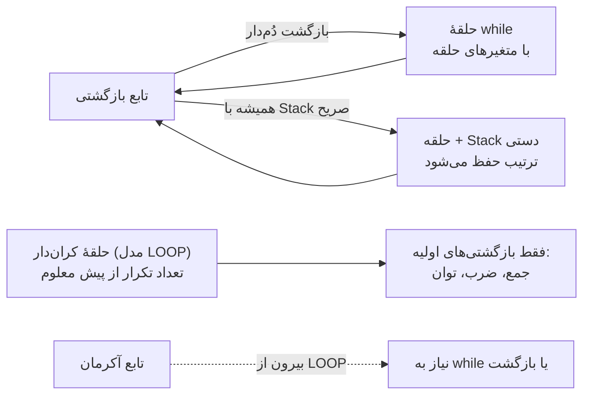

</div>

<div dir="rtl" style="direction: rtl; text-align: right;">

### ۱۰.۲ داده‌ساختار صف (Queue)

#### معناشناسی (Semantics)

پیش‌تر **Stack** را معرفی کردیم: مجموعه‌ای که عنصرها را از **یک سر** وارد و خارج می‌کند (LIFO). ابزار مکمل آن **صف** است.

**صف (Queue)** مجموعه‌ای مرتب از عنصرهاست که ورود عنصر تازه فقط از **انتها (Rear)** و خروج فقط از **ابتدا (Front)** ممکن است. پس **اولین واردشده، اولین خارج‌شونده** است: **FIFO (First In, First Out)**. مثال‌های روزمره: صف نانوایی، صف چاپگر.

مانند هر «نوع داده انتزاعی (Abstract Data Type)»، صف را **با قرارداد رفتارش** تعریف می‌کنیم، نه با نحوهٔ ذخیره‌سازی (دقیقاً همان فلسفهٔ جعبهٔ سیاه ۸.۱):

| عمل | معنی | پیش‌شرط |
| --- | --- | --- |
| ⁦`enqueue(x)`⁩ | ⁦$x$⁩ را به انتهای صف اضافه کن | — |
| ⁦`dequeue()`⁩ | عنصر ابتدای صف را **بردار و برگردان** | صف خالی نباشد |
| ⁦`is_empty()`⁩ | آیا صف خالی است؟ | — |

**اصل رفتاری:** عنصرها دقیقاً به همان ترتیبی خارج می‌شوند که وارد شده‌اند.

</div>

<div dir="ltr" style="direction: ltr; text-align: center;">

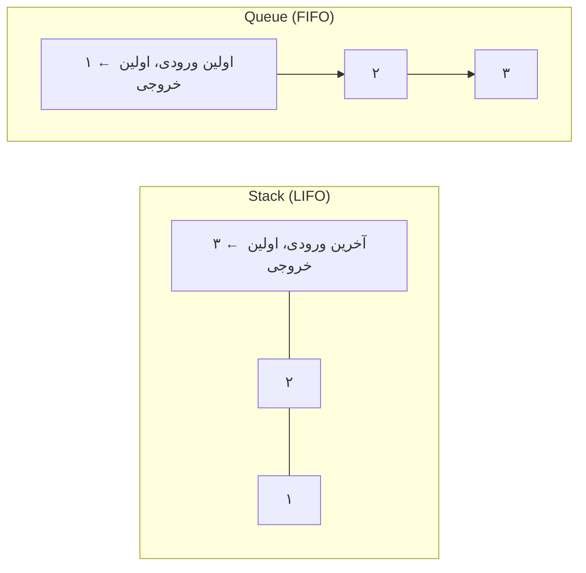

</div>

<div dir="rtl" style="direction: rtl; text-align: right;">

**تنها تفاوت** Stack و Queue این است که خروج از کدام سر انجام می‌شود. اما همین تفاوت کوچک، ترتیب پردازش عنصرها را **کاملاً** عوض می‌کند، و در ۱۰.۳ می‌بینیم این تفاوت دقیقاً همان تفاوت **DFS** و **BFS** است.

(نحوهٔ ذخیره‌سازی صف، مثلاً یک آرایهٔ حلقوی یا لیست پیوندی، یک **جزئیات پیاده‌سازی** است و بعداً می‌آموزید؛ ما فعلاً مثل استفاده‌کنندهٔ یک جعبهٔ سیاه فقط از «رابط» آن استفاده می‌کنیم.)

#### نحو (Syntax)

در ادامه از پرونده‌ای به نام ⁦`adt.h`⁩ استفاده می‌کنیم که یک **Stack** و یک **Queue** از اعداد صحیح را در اختیارمان می‌گذارد. اسم عمل‌ها این‌هاست:

| عمل | Stack | Queue |
| --- | --- | --- |
| افزودن | ⁦`s_push(x)`⁩ | ⁦`q_push(x)`⁩ |
| برداشتن | ⁦`s_pop()`⁩ | ⁦`q_pop()`⁩ |
| خالی بودن | ⁦`s_empty()`⁩ | ⁦`q_empty()`⁩ |

متن پرونده در سلول زیر آمده است. **نیازی نیست آن را بفهمید**؛ فقط رابط بالا مهم است. (سلول فقط پرونده را می‌نویسد؛ یک ⁦`#include "adt.h"`⁩ در برنامه‌های بعد کافی است.)

</div>

<div dir="ltr" style="direction: ltr; text-align: left;">

```c
/* adt.h - «جعبهٔ سیاه»: رابط Stack و Queue برای اعداد صحیح.
   فعلاً فقط «رابط» (نام و رفتار توابع) مهم است. درون آن آرایه به کار رفته که در بخش پنجم می‌آموزید. */
#ifndef ADT_H
#define ADT_H
#define ADT_CAP (1 << 22)

/* ---------- Stack (LIFO) ---------- */
static int s_data[ADT_CAP];
static int s_top = 0, s_max = 0;                 /* s_max: بیشینهٔ اندازه (برای اندازه‌گیری) */
static inline void s_push(int x) { s_data[s_top++] = x; if (s_top > s_max) s_max = s_top; }
static inline int  s_pop(void)   { return s_data[--s_top]; }
static inline int  s_empty(void) { return s_top == 0; }

/* ---------- Queue (FIFO)، حلقوی ---------- */
static int q_data[ADT_CAP];
static int q_head = 0, q_size = 0, q_max = 0;    /* q_max: بیشینهٔ اندازه (برای اندازه‌گیری) */
static inline void q_push(int x) { q_data[(q_head + q_size++) % ADT_CAP] = x; if (q_size > q_max) q_max = q_size; }
static inline int  q_pop(void)   { int x = q_data[q_head]; q_head = (q_head + 1) % ADT_CAP; q_size--; return x; }
static inline int  q_empty(void) { return q_size == 0; }
#endif
```

</div>

<div dir="rtl" style="direction: rtl; text-align: right;">

آزمایش ساده: سه عدد ۱، ۲ و ۳ را به هر دو ساختار می‌دهیم و بعد همه را برمی‌داریم.

</div>

<div dir="ltr" style="direction: ltr; text-align: left;">

```c
#include <stdio.h>
#include "adt.h"

int main(void)
{
    for (int x = 1; x <= 3; x++) {
        s_push(x);
        q_push(x);
    }

    printf("stack pops : ");
    while (!s_empty()) printf("%d ", s_pop());
    printf("\n");

    printf("queue pops : ");
    while (!q_empty()) printf("%d ", q_pop());
    printf("\n");
    return 0;
}
```

</div>

<div dir="rtl" style="direction: rtl; text-align: right;">

خروجی:

</div>

<div dir="ltr" style="direction: ltr; text-align: left;">

```text
stack pops : 3 2 1
queue pops : 1 2 3
```

</div>

<div dir="rtl" style="direction: rtl; text-align: right;">

#### تمرین درون فصل ۱۰.۲

**نوع تمرین: Predict the Output**

دنبالهٔ عمل‌های ⁦`push(1), push(2), pop(), push(3), pop(), pop()`⁩ را یک بار روی Stack و یک بار روی Queue اعمال کنید. خروجی هر ⁦`pop`⁩ را بنویسید.

### پیمایش سطح‌به‌سطح درخت فراخوانی

#### معناشناسی (Semantics)

در ۹.۵ و ۹.۸ دیدیم فراخوانی‌های یک تابع بازگشتی دوشاخه، ساختار **درخت** می‌سازند. این ساختار را دقیق کنیم.

**درخت بازگشت (Recursion Tree):**

- هر **فراخوانی** یک **گره** است (برچسب آن آرگومان‌هاست)؛
- ریشه، فراخوانی اولیه است؛
- اگر فراخوانی ⁦$u$⁩ در حین اجرا، فراخوانی ⁦$v$⁩ را بسازد، یک **یال** از ⁦$u$⁩ به ⁦$v$⁩ هست؛ ترتیب فرزندها همان ترتیب فراخوانی‌ها در کد است؛
- **برگ‌ها** فراخوانی‌هایی هستند که به حالت پایه رسیده‌اند؛
- **ارتفاع** درخت، بیشینهٔ عمق بازگشت است (که همان عمق Stack در ۹.۴ است).

درخت فراخوانی ⁦`fib(4)`⁩:

</div>

<div dir="ltr" style="direction: ltr; text-align: center;">

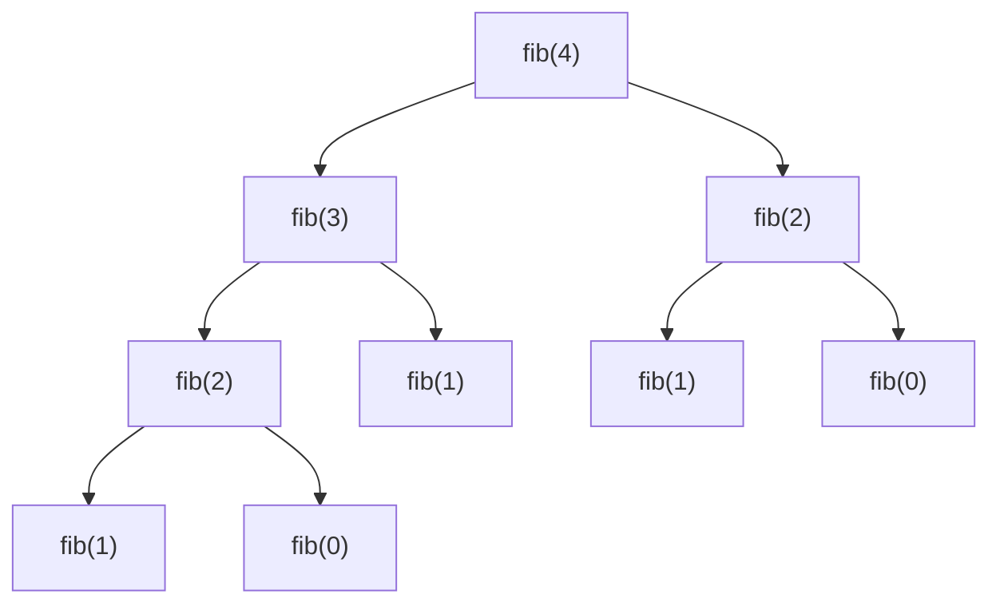

</div>

<div dir="rtl" style="direction: rtl; text-align: right;">

برای «پیمایش» یک درخت، یعنی دیدن هر گره دقیقاً یک بار، دو راهبرد اساسی داریم:

- **DFS (Depth-First Search، جست‌وجوی عمق‌اول):** تا جایی که ممکن است **عمیق** برو؛ وقتی به برگ رسیدی، به نزدیک‌ترین گرهٔ دارای فرزند ندیده **برگرد (Backtrack)**. گره‌های در انتظار در یک **Stack** هستند.
- **BFS (Breadth-First Search، جست‌وجوی سطحی یا عرض‌اول):** **سطح‌به‌سطح** برو: اول ریشه، بعد همهٔ فرزندان ریشه، بعد همهٔ نوه‌ها، و ... گره‌های در انتظار در یک **Queue** هستند.

ترتیب دیدن گره‌ها در درخت ⁦`fib(4)`⁩ بالا (فرزند چپ پیش از راست؛ فقط آرگومان را می‌نویسیم):

</div>

<div dir="ltr" style="direction: ltr; text-align: left;">

```text
DFS : 4, 3, 2, 1, 0, 1, 2, 1, 0
BFS : 4, 3, 2, 2, 1, 1, 0, 1, 0
        └ سطح ۱ ┘└──── سطح ۲ ────┘└ سطح ۳ ┘
```

</div>

<div dir="rtl" style="direction: rtl; text-align: right;">

در DFS ابتدا کل زیردرخت چپِ ⁦`fib(3)`⁩ را می‌پیماییم و بعد سراغ ⁦`fib(2)`⁩ سمت راست ریشه می‌رویم. در BFS هیچ‌گاه از سطح بعد نمی‌رویم، مگر آنکه کل سطح فعلی دیده شده باشد.

در DFS دو زمان برای هر گره داریم: **ورود (Pre-order)** هنگام اولین دیدن، و **خروج (Post-order)** پس از دیدن همهٔ فرزندان. این دو زمان در تابع بازگشتی دقیقاً «لحظهٔ فراخوانی» و «لحظهٔ بازگشت» هستند.

#### نحو (Syntax)

الگوریتم هر دو پیمایش **تقریباً یکسان** است؛ فقط **ظرف** گره‌های در انتظار فرق می‌کند:

</div>

<div dir="ltr" style="direction: ltr; text-align: left;">

```text
function TRAVERSE(root, container):
    container.add(root)
    while container is not empty:
        node ← container.remove()          // Stack: آخرین‌ورودی   |   Queue: اولین‌ورودی
        visit(node)
        for each child of node:
            container.add(child)

container = Stack  ⇒  DFS      (برای فرزند چپ‌اول، فرزندان را به ترتیب معکوس اضافه کنید)
container = Queue  ⇒  BFS
```

</div>

<div dir="rtl" style="direction: rtl; text-align: right;">

#### تمرین درون فصل ۱۰.۳

**نوع تمرین: Traverse**

درخت فراخوانی ⁦`binom(4, 2)`⁩ را رسم کنید و ترتیب DFS و BFS گره‌ها را بنویسید (فرزند ⁦$(n-1, k-1)$⁩ را چپ بگیرید).

### ۱۰.۵ حذف بازگشت: حلقه با Stack صریح و حلقه با Queue

#### معناشناسی (Semantics)

برای تبدیل یک تابع بازگشتی به حلقه (جهت «بازگشت ⇒ حلقه» در ۱۰.۱)، دو روش داریم که هر دو روی **درخت بازگشت** عمل می‌کنند:

**روش اول: Stack صریح (DFS).** سیستم Call Stack را خودمان شبیه‌سازی می‌کنیم: گره‌های در انتظار را در یک Stack می‌گذاریم. این روش **همیشه** ممکن است و **ترتیب اجرا را دقیقاً حفظ می‌کند** (چون خودش DFS است).

**روش دوم: Queue (BFS).** به‌جای Stack از Queue استفاده می‌کنیم، یعنی درخت را **سطح‌به‌سطح** باز می‌کنیم. اما این روش ترتیب اجرا را عوض می‌کند، پس **فقط وقتی معتبر است** که پاسخ نهایی به **ترتیب پردازش گره‌ها وابسته نباشد.** دو شرط لازم است:

1. پاسخ از **ترکیب جابه‌جاپذیر و شرکت‌پذیر** مقدار برگ‌ها (مثلاً جمع) ساخته شود؛
2. آرگومان‌های فرزندان فقط از آرگومان‌های **والد** ساخته شوند، نه از **نتیجهٔ** گره‌های دیگر.

**تابع ⁦$C(n, k)$⁩ هر دو شرط را دارد.** در ۹.۸ دیدیم مقدار آن برابر **تعداد برگ‌هاست**، پس کافی است درخت را به هر ترتیبی بپیماییم و **برگ‌ها را بشماریم**؛ همین.

**تابع آکرمان شرط دوم را ندارد.** در ⁦`ack(m-1, ack(m, n-1))`⁩ آرگومان دوم فراخوانی بیرونی، **نتیجهٔ** فراخوانی داخلی است. پس نمی‌توان درخت را پیش از محاسبه «باز کرد»، چون شکل درخت به مقدارهایی بستگی دارد که هنوز حساب نشده‌اند. اینجا فقط Stack صریح (DFS) کار می‌کند. به همین ترتیب در مسئله‌هایی مثل برج هانوی که **ترتیب خروجی** اهمیت دارد، BFS ترتیب غلط می‌دهد.

**هزینهٔ حافظه** تفاوت اساسی این دو روش است:

- DFS فقط **مسیر جاری** را نگه می‌دارد: حافظه ⁦$\sim$⁩ **ارتفاع** درخت؛
- BFS **یک سطح کامل** را نگه می‌دارد: حافظه ⁦$\sim$⁩ **عرض** درخت، که می‌تواند نمایی شود.

#### نحو (Syntax)

هر گره ⁦$(n, k)$⁩ را با **دو عدد** در Stack یا Queue ذخیره می‌کنیم. دقت کنید در DFS، چون Stack برعکس خارج می‌کند، فرزندها را به ترتیب معکوس اضافه می‌کنیم تا ترتیب مثل بازگشت شود. هر دو تابع ساختار یکسانی دارند و فقط ⁦`s_`⁩ یا ⁦`q_`⁩ در آن‌ها فرق می‌کند، دقیقاً همان‌طور که در شبه‌کد ۱۰.۳ دیدیم.

#### فلوچارت: حذف بازگشت: Stack صریح در برابر Queue

</div>

<div dir="ltr" style="direction: ltr; text-align: center;">

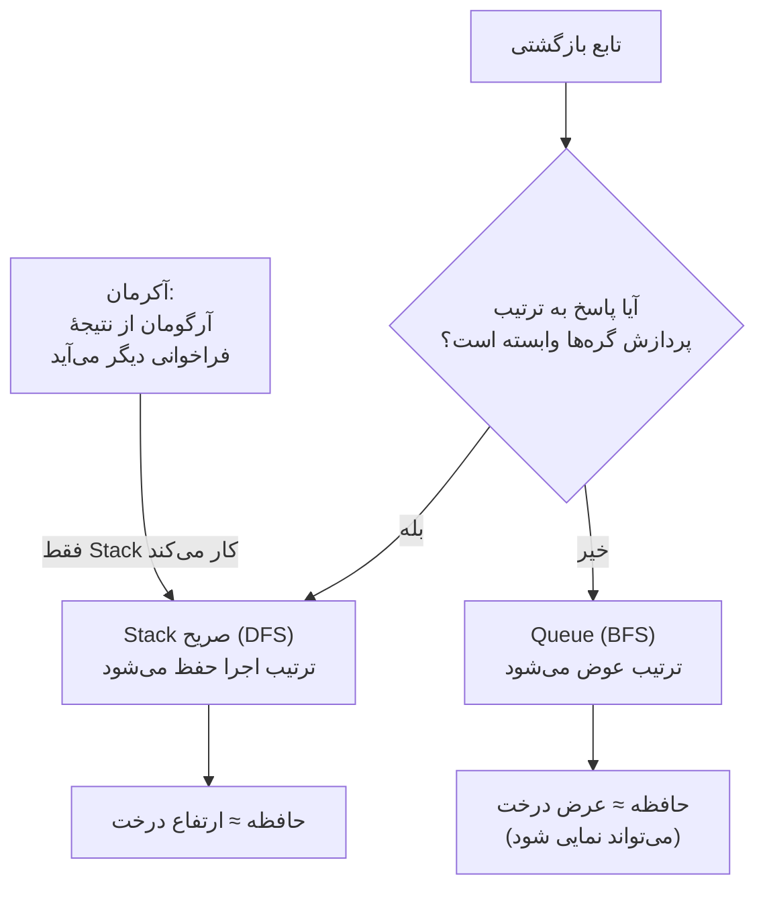

</div>

<div dir="ltr" style="direction: ltr; text-align: left;">

```c
#include <stdio.h>
#include "adt.h"

/* C(n,k) با حلقه + Stack صریح (DFS). nodes = تعداد گره‌های دیده‌شده */
unsigned long binom_dfs(int n, int k, unsigned long *nodes)
{
    unsigned long leaves = 0;
    *nodes = 0;
    s_push(n); s_push(k);
    while (!s_empty()) {
        int kk = s_pop(), nn = s_pop();
        (*nodes)++;
        if (kk == 0 || kk == nn) {
            leaves++;                                   /* برگ: مقدار ۱ */
        } else {
            s_push(nn - 1); s_push(kk);                 /* فرزند راست (n-1, k)   */
            s_push(nn - 1); s_push(kk - 1);             /* فرزند چپ  (n-1, k-1)  */
        }
    }
    return leaves;
}

/* C(n,k) با حلقه + Queue (BFS) */
unsigned long binom_bfs(int n, int k, unsigned long *nodes)
{
    unsigned long leaves = 0;
    *nodes = 0;
    q_push(n); q_push(k);
    while (!q_empty()) {
        int nn = q_pop(), kk = q_pop();
        (*nodes)++;
        if (kk == 0 || kk == nn) {
            leaves++;
        } else {
            q_push(nn - 1); q_push(kk - 1);             /* فرزند چپ  */
            q_push(nn - 1); q_push(kk);                 /* فرزند راست */
        }
    }
    return leaves;
}

int main(void)
{
    int cases[][2] = { {5, 2}, {10, 5}, {16, 8}, {20, 10} };

    printf("  (n,k)   result   nodes   max Stack size   max Queue size\n");
    for (int i = 0; i < 4; i++) {
        int n = cases[i][0], k = cases[i][1];
        unsigned long nodes_dfs, nodes_bfs;

        unsigned long by_dfs = binom_dfs(n, k, &nodes_dfs);
        unsigned long by_bfs = binom_bfs(n, k, &nodes_bfs);

        printf("(%2d,%2d)  %7lu  %6lu  %14d  %14d   %s\n",
               n, k, by_dfs, nodes_dfs, s_max / 2, q_max / 2,
               (by_dfs == by_bfs && nodes_dfs == nodes_bfs) ? "(same)" : "(DIFFERENT!)");

        s_top = s_max = 0;  q_head = q_size = q_max = 0;      /* بازنشانی برای آزمایش بعد */
    }
    return 0;
}
```

</div>

<div dir="rtl" style="direction: rtl; text-align: right;">

خروجی:

</div>

<div dir="ltr" style="direction: ltr; text-align: left;">

```text
  (n,k)   result   nodes   max Stack size   max Queue size
( 5, 2)       10      19               3               7   (same)
(10, 5)      252     503               6             141   (same)
(16, 8)    12870   25739               9            6865   (same)
(20,10)   184756  369511              11           97241   (same)
```

</div>

<div dir="rtl" style="direction: rtl; text-align: right;">

نتایج دو درس مهم می‌دهند:

1. هر دو روش **جواب و تعداد گره‌ها یکسان** دارند (تابع یکی است؛ تعداد گره‌ها ⁦$2C(n,k)-1$⁩ است). تفاوت‌شان فقط در **ترتیب دیدن** است.
2. تفاوت **حافظه** عظیم است. برای ⁦$C(20, 10)$⁩ پیمایش DFS فقط ۱۱ گره (جفت) هم‌زمان در Stack نگه می‌دارد (از مرتبهٔ ارتفاع درخت که ۲۰ فریم است)، اما BFS در بدترین لحظه **نزدیک ۱۰۰ هزار** گره در Queue دارد (حدود عرض درخت). حافظهٔ لازم DFS خطی در ارتفاع است و BFS در عرض، که با عمق به‌صورت نمایی رشد می‌کند.

حالا آکرمان: چون ورودی فراخوانی بیرونی به نتیجهٔ فراخوانی درونی بستگی دارد، **در این پیاده‌سازی، Stack** ترتیب لازم را حفظ می‌کند. ایدهٔ استاندارد: Stack فقط مقدارهای ⁦$m$⁩ در انتظار را نگه می‌دارد و مقدار جاری ⁦$n$⁩ را در یک متغیر ساده کنار آن. فرض کنید می‌خواهیم ⁦$A(m, n)$⁩ را حساب کنیم:

</div>

<div dir="ltr" style="direction: ltr; text-align: left;">

```text
Stack ← [m]
while Stack is not empty:
    m ← pop()
    if m = 0:           n ← n + 1                          // A(0, n) = n + 1
    else if n = 0:      push(m - 1);  n ← 1                // A(m, 0) = A(m-1, 1)
    else:               push(m - 1);  push(m);  n ← n - 1  // A(m, n) = A(m-1, A(m, n-1))
return n
```

</div>

<div dir="rtl" style="direction: rtl; text-align: right;">

در خط آخر: ابتدا باید ⁦$A(m, n-1)$⁩ را حساب کنیم (پس ⁦`m`⁩ را دوباره push می‌کنیم و ⁦`n`⁩ را کم می‌کنیم)، و سپس نتیجه‌اش را به ⁦$A(m-1, \cdot)$⁩ بدهیم (پس ⁦`m-1`⁩ را زیر آن push می‌کنیم). Stack دقیقاً همان «کارهای به تعویق افتاده» است.

</div>

<div dir="ltr" style="direction: ltr; text-align: left;">

```c
#include <stdio.h>
#include "adt.h"

/* نسخهٔ بازگشتی، برای مقایسه */
unsigned long ack_rec(unsigned long m, unsigned long n)
{
    return m == 0 ? n + 1 : n == 0 ? ack_rec(m - 1, 1) : ack_rec(m - 1, ack_rec(m, n - 1));
}

/* نسخهٔ حلقه + Stack صریح؛ steps = تعداد دفعات اجرای حلقه */
unsigned long ack_iter(unsigned long m, unsigned long n, unsigned long *steps)
{
    s_top = s_max = 0;
    *steps = 0;
    s_push((int)m);

    while (!s_empty()) {
        m = (unsigned long)s_pop();
        (*steps)++;
        if (m == 0) {
            n = n + 1;
        } else if (n == 0) {
            s_push((int)m - 1);
            n = 1;
        } else {
            s_push((int)m - 1);
            s_push((int)m);
            n = n - 1;
        }
    }
    return n;
}

int main(void)
{
    unsigned long steps, value;

    int same = 1, count = 0;
    for (unsigned long m = 0; m <= 3; m++) {
        for (unsigned long n = 0; n <= 5; n++) {
            count++;
            if (ack_iter(m, n, &steps) != ack_rec(m, n)) same = 0;
        }
    }
    printf("iterative == recursive on %d inputs?  %s\n\n", count, same ? "yes" : "NO");

    value = ack_iter(3, 3, &steps);
    printf("A(3,3) = %-4lu steps = %-7lu max Stack size = %d\n", value, steps, s_max);
    value = ack_iter(3, 6, &steps);
    printf("A(3,6) = %-4lu steps = %-7lu max Stack size = %d\n", value, steps, s_max);
    value = ack_iter(4, 0, &steps);
    printf("A(4,0) = %-4lu steps = %-7lu max Stack size = %d\n", value, steps, s_max);
    return 0;
}
```

</div>

<div dir="rtl" style="direction: rtl; text-align: right;">

خروجی:

</div>

<div dir="ltr" style="direction: ltr; text-align: left;">

```text
iterative == recursive on 24 inputs?  yes

A(3,3) = 61   steps = 2432    max Stack size = 60
A(3,6) = 509  steps = 172233  max Stack size = 508
A(4,0) = 13   steps = 107     max Stack size = 12
```

</div>

<div dir="rtl" style="direction: rtl; text-align: right;">

دو مشاهده:

- تعداد **گام‌های حلقه** (مثلاً ۱۷۲٬۲۳۳ برای ⁦$A(3,6)$⁩) **دقیقاً برابر** تعداد فراخوانی‌های نسخهٔ بازگشتی در ۹.۷ است؛ نسخهٔ حلقه همان کار را انجام می‌دهد، فقط Stack را خودمان مدیریت می‌کنیم.
- Stack صریح ما را از Stack **سیستم** رها می‌کند: ظرفیت آن را خودمان تعیین می‌کنیم (اینجا حدود چهار میلیون عنصر، بسیار بیشتر از Call Stack پیش‌فرض ۸ مگابایتی)، و پر شدن آن یک خطای قابل کنترل است نه کرش سیستم‌عامل. (اگر نسخهٔ حلقه را برای ⁦$A(4,1) = 65533$⁩ هم اجرا کنید، درست جواب می‌دهد اما چون حدود ۲٫۹ میلیارد گام لازم دارد، چند ده ثانیه طول می‌کشد.)

#### تمرین درون فصل ۱۰.۵

**نوع تمرین: Explain Why**

۱) چرا در ⁦`binom_dfs`⁩ فرزند راست را **پیش از** فرزند چپ push می‌کنیم؟ اگر ترتیب را عوض کنیم، «نتیجه» تغییر می‌کند یا فقط «ترتیب دیدن گره‌ها»؟ ۲) آیا می‌توان ⁦`fib`⁩ را هم با BFS و شمردن برگ‌ها حل کرد؟ (راهنمایی: مقدار هر برگ را بررسی کنید: ⁦`fib(1)`⁩ برابر ۱ و ⁦`fib(0)`⁩ برابر ۰ است.)

### ۱۰.۶ جمع‌بندی هم‌ارزی بازگشت و حلقه

| | تابع بازگشتی | حلقه + Stack صریح | حلقه + Queue |
| --- | --- | --- | --- |
| پیمایش درخت بازگشت | **DFS** | **DFS** | **BFS** |
| مدیریت حافظه | Call Stack سیستم (خودکار) | Stack برنامه (دستی) | Queue برنامه (دستی) |
| بیشینهٔ حافظه | ارتفاع درخت | ارتفاع درخت | **عرض** درخت |
| ترتیب اجرا | حفظ می‌شود | **حفظ می‌شود** | تغییر می‌کند |
| کاربرد | همهٔ توابع | همهٔ توابع | وقتی ترتیب مهم نیست (مثل شمارش برگ‌ها) |
| ریسک | Stack Overflow | پر شدن ظرفیت Stack | پر شدن ظرفیت Queue (سریع‌تر) |

نتیجه: **توان محاسباتی بازگشت و حلقه یکسان است**؛ تفاوت‌ها در **خوانایی**، **مدیریت حافظه** و **ترتیب پردازش** است.
- تعریف‌های بازگشتی معمولاً **خواناتر** و به ساختار ریاضی مسئله نزدیک‌ترند.
- حلقه و Stack صریح **کنترل بیشتری** بر حافظه می‌دهند و از محدودیت Call Stack رها می‌کنند.
- BFS زمانی مفید است که ترتیب مهم نباشد یا بخواهیم **کم‌عمق‌ترین** جواب را زودتر ببینیم.

---

### ۱۰.۷ مطلب تکمیلی: ⁦`#define`⁩ و ماکروها

#### معناشناسی (Semantics)

پیش از آنکه کامپایلر اصلی کار کند، یک مرحلهٔ مقدماتی به نام **پیش‌پردازنده (Preprocessor)** برنامه را به‌صورت **متن** پردازش می‌کند. خط‌هایی که با ⁦`#`⁩ شروع می‌شوند (⁦`#include`⁩، ⁦`#define`⁩، ⁦`#ifndef`⁩) دستور خود پیش‌پردازنده‌اند، نه C.

⁦`#define`⁩ یک **ماکرو (Macro)** می‌سازد: یک **جایگزینی متنی** از نام به یک تکه متن. پیش‌پردازنده هر جا آن نام را ببیند، همان تکه متن را **کپی** می‌کند و جلو می‌رود. نه نوعی وجود دارد، نه ارزیابی، نه Stack Frame؛ فقط **متن** است.

**چرا شکل تابعی ⁦`#define`⁩ شبیه رویه است؟** چون ماکرو دقیقاً همان «تصویر ساده» رویه در ۸.۴ است: *قطعه‌ای از متن که با یک نام صدا می‌زنیم و در محل فراخوانی «کپی» می‌شود.* رویه حتی در همان جا «کپی» نبود و فقط یک نسخه داشت؛ اما ماکرو به معنای واقعی کپی می‌کند. و همین کپی‌کردن متنی دلیل **تفاوت‌های خطرناک** با تابع واقعی است:

| | تابع واقعی | ماکرو |
| --- | --- | --- |
| مکانیزم | فراخوانی (فریم روی Stack) | جایگزینی **متنی** پیش از کامپایل |
| بررسی نوع | بله | **خیر** |
| ارزیابی آرگومان | **یک بار**، پیش از فراخوانی | هر بار که پارامتر در متن می‌آید (ممکن است **چند بار**) |
| حق تقدم عملگرها | محفوظ است (آرگومان یک مقدار است) | **ممکن است به‌هم بریزد** (آرگومان یک متن است) |
| بازگشت | ممکن | **ناممکن** (ماکرو درون بسط خودش دوباره بسط داده نمی‌شود) |
| کارایی | کمی سربار فراخوانی | بدون سربار فراخوانی |

نکتهٔ آخر، یک پیوند جالب با ۹.۳ دارد: **ماکرو ذاتاً بازگشت ندارد** چون «Stack» ندارد؛ دقیقاً مثل رویه.

#### نحو (Syntax)

**ماکرو بدون پارامتر (Object-like):**

</div>

<div dir="ltr" style="direction: ltr; text-align: left;">

```text
#define  NAME  متن_جایگزین
```

</div>

<div dir="rtl" style="direction: rtl; text-align: right;">

بدون ⁦`=`⁩ و بدون ⁦`;`⁩ در پایان. مثال: ⁦`#define MAX_N 100`⁩. اگر بنویسیم ⁦`#define N 10;`⁩ آنگاه ⁦`x = N + 1;`⁩ به ⁦`x = 10; + 1;`⁩ تبدیل می‌شود (خطا).

**ماکرو با پارامتر (Function-like):**

</div>

<div dir="ltr" style="direction: ltr; text-align: left;">

```text
#define  NAME(p1, p2)  متن_جایگزین
```

</div>

<div dir="rtl" style="direction: rtl; text-align: right;">

بین ⁦`NAME`⁩ و ⁦`(`⁩ **نباید فاصله** باشد.

**قاعدهٔ طلایی پرانتزگذاری.** چون ماکرو متن را کپی می‌کند، **هر پارامتر** و **کل بدنه** را در پرانتز بگذارید:

</div>

<div dir="ltr" style="direction: ltr; text-align: left;">

```text
#define SQUARE_BAD(x)  x * x             // خطرناک
#define SQUARE(x)      ((x) * (x))       // امن
```

</div>

<div dir="rtl" style="direction: rtl; text-align: right;">

**ماکروی شرطی** برای مقدار پیش‌فرض قابل تغییر (که در ۹.۴ دیدید):

</div>

<div dir="ltr" style="direction: ltr; text-align: left;">

```text
#ifndef N          // اگر N پیش‌تر تعریف نشده ...
#define N 1000     // ... مقدار پیش‌فرض را بده
#endif
```

</div>

<div dir="rtl" style="direction: rtl; text-align: right;">

و گزینهٔ ⁦`-DN=100000`⁩ در خط فرمان همان ⁦`#define N 100000`⁩ است.

برای دیدن اینکه پیش‌پردازنده دقیقاً چه کرده، از ⁦`gcc -E`⁩ استفاده می‌کنیم که **فقط پیش‌پردازش** می‌کند و متن حاصل را چاپ می‌کند (⁦`-P`⁩ خطوط اضافه را حذف می‌کند). برنامهٔ زیر فقط ماکروها را تعریف و استفاده می‌کند.

#### فلوچارت: مسیر متن از پیش‌پردازنده تا فایل اجرایی

</div>

<div dir="ltr" style="direction: ltr; text-align: center;">

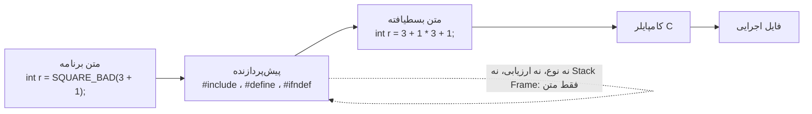

</div>

<div dir="ltr" style="direction: ltr; text-align: left;">

```c
#define SQUARE_BAD(x)  x * x
#define SQUARE(x)      ((x) * (x))
#define DOUBLE_BAD(x)  x + x
#define DOUBLE(x)      ((x) + (x))

int r1 = SQUARE_BAD(3 + 1);
int r2 = SQUARE(3 + 1);
int r3 = 3 * DOUBLE_BAD(2);
int r4 = 3 * DOUBLE(2);
```

</div>

<div dir="rtl" style="direction: rtl; text-align: right;">

خروجی:

</div>

<div dir="ltr" style="direction: ltr; text-align: left;">

```text
int r1 = 3 + 1 * 3 + 1;
int r2 = ((3 + 1) * (3 + 1));
int r3 = 3 * 2 + 2;
int r4 = 3 * ((2) + (2));
```

</div>

<div dir="rtl" style="direction: rtl; text-align: right;">

خروجی ⁦`gcc -E`⁩ سرنخ همه چیز است:

- ⁦`SQUARE_BAD(3 + 1)`⁩ شد ⁦`3 + 1 * 3 + 1`⁩، که طبق اولویت عملگرها برابر ⁦$3 + 3 + 1 = 7$⁩ است نه ⁦$16$⁩.
- ⁦`3 * DOUBLE_BAD(2)`⁩ شد ⁦`3 * 2 + 2`⁩، یعنی ⁦$8$⁩ نه ⁦$12$⁩.

مشکل دوم، **ارزیابی چندباره** است: چون ماکرو آرگومان را کپی می‌کند، اگر آرگومان **اثر جانبی** داشته باشد (مثلاً یک فراخوانی که چاپ می‌کند)، چند بار اجرا می‌شود.

</div>

<div dir="ltr" style="direction: ltr; text-align: left;">

```c
#include <stdio.h>

#define SQUARE_BAD(x)  x * x
#define SQUARE(x)      ((x) * (x))
#define DOUBLE_BAD(x)  x + x
#define DOUBLE(x)      ((x) + (x))
#define MAX(a, b)      ((a) > (b) ? (a) : (b))

static int counter = 0;

int next(void)                         /* هر بار صدا زده شود، شمارنده را زیاد می‌کند */
{
    counter++;
    printf("   next() called -> %d\n", counter);
    return counter;
}

int max_fn(int a, int b) { return a > b ? a : b; }     /* نسخهٔ تابع واقعی */

int main(void)
{
    printf("SQUARE_BAD(3 + 1)  = %d\n", SQUARE_BAD(3 + 1));
    printf("SQUARE(3 + 1)      = %d\n", SQUARE(3 + 1));
    printf("3 * DOUBLE_BAD(2)  = %d\n", 3 * DOUBLE_BAD(2));
    printf("3 * DOUBLE(2)      = %d\n", 3 * DOUBLE(2));

    printf("\nMAX macro: MAX(next(), 0)\n");
    int m1 = MAX(next(), 0);
    printf("   result = %d\n", m1);

    counter = 0;
    printf("max_fn function: max_fn(next(), 0)\n");
    int m2 = max_fn(next(), 0);
    printf("   result = %d\n", m2);
    return 0;
}
```

</div>

<div dir="rtl" style="direction: rtl; text-align: right;">

خروجی:

</div>

<div dir="ltr" style="direction: ltr; text-align: left;">

```text
SQUARE_BAD(3 + 1)  = 7
SQUARE(3 + 1)      = 16
3 * DOUBLE_BAD(2)  = 8
3 * DOUBLE(2)      = 12

MAX macro: MAX(next(), 0)
   next() called -> 1
   next() called -> 2
   result = 2
max_fn function: max_fn(next(), 0)
   next() called -> 1
   result = 1
```

</div>

<div dir="rtl" style="direction: rtl; text-align: right;">

با ماکروی ⁦`MAX`⁩، ⁦`next()`⁩ **دو بار** صدا زده شد (یک بار در مقایسه و یک بار برای نتیجه)، و نتیجه ۲ شد نه ۱. با تابع واقعی، آرگومان **یک بار** حساب می‌شود (Call by Value) و نتیجه ۱ است. پس ماکرو «یک تابع سریع‌تر» نیست؛ یک **جایگزینی متنی** است، با تمام پیامدهایش.

**نکتهٔ پایانی دربارهٔ ⁦`#define uint unsigned int`⁩.** این استفاده در برنامهٔ ۹.۶ کار می‌کند، اما ⁦`#define`⁩ برای نام‌گذاری **نوع** بهترین انتخاب نیست؛ چون هیچ درکی از نوع ندارد و فقط متن را عوض می‌کند. راه استاندارد‌تر ⁦`typedef unsigned int uint;`⁩ است که نام مستعار واقعی برای یک نوع می‌سازد و پیش‌پردازنده درگیر آن نیست. هر دو برای ⁦`uint a, b;`⁩ یکسان کار می‌کنند؛ تفاوت وقتی ظاهر می‌شود که نوع پیچیده‌تر شود (مثلاً اشاره‌گر).

**راهنمای عملی انتخاب:**

- ثابت‌ها: ⁦`#define`⁩ (یا ⁦`const`⁩) مناسب است؛ مقدارها را یک‌جا نگه می‌دارد.
- «تابع‌های کوچک»: ترجیحاً **تابع واقعی** (و در صورت لزوم ⁦`static inline`⁩)؛ ماکرو فقط وقتی که واقعاً لازم است و با پرانتزگذاری کامل.
- هرگز آرگومانی با **اثر جانبی** (⁦`i++`⁩، فراخوانی تابع) به ماکرو ندهید.

#### تمرین درون فصل ۱۰.۷

**نوع تمرین: Fix the Macro**

ماکروی ⁦`#define CUBE(x) x * x * x`⁩ را برای ⁦`CUBE(1 + 2)`⁩ بسط دهید و نتیجه را حساب کنید. سپس نسخهٔ امن آن را بنویسید. نشان دهید با ⁦`CUBE(i++)`⁩ حتی نسخهٔ امن هم مشکل دارد.

</div>

---

<div dir="rtl" style="direction: rtl; text-align: right;">

## نگاهی به یک دانشمند تأثیرگذار در این حوزه

خب، حالا که با بازگشت، تابع آکرمان و درخت فراخوانی آشنا شدیم، بد نیست کمی هم دربارهٔ کسی بدانیم که **بازگشت را به یک شاخهٔ مستقل از ریاضیات تبدیل کرد**.

**رزا پیتر (Rózsa Péter)**، ریاضی‌دان مجار (۱۹۰۵ تا ۱۹۷۷)، در دههٔ ۱۹۳۰ به مطالعهٔ توابع بازگشتی پرداخت؛ زمانی که این مفهوم بیشتر یک «ابزار تعریف در منطق» بود. او دریافت که می‌توان **خودِ بازگشت** را موضوع مطالعه قرار داد: چه توابعی با چه نوع بازگشتی ساخته می‌شوند و چه توابعی از آن‌ها فراتر می‌روند. همین پرسش او را به بررسی تابع آکرمان کشاند و ساده‌سازی‌هایی که در آن انجام داد، سبب شد نسخهٔ دو‌متغیرهٔ آن (همان که در ۹.۷ نوشتیم) در کتاب‌ها رایج شود.

کتاب او با عنوان **«توابع بازگشتی» (Rekursive Funktionen, 1951)** از نخستین کتاب‌هایی است که این نظریه را به‌صورت منسجم ارائه کرد و او را از بنیان‌گذاران **نظریهٔ توابع بازگشتی** می‌شناسند. پیتر همچنین به‌خاطر کتاب مشهور **«بازی با بی‌نهایت» (Playing with Infinity)** شناخته می‌شود، که در آن بدون فرمول‌های سنگین، ایده‌های ریاضی را برای عموم توضیح می‌دهد؛ کاری که نشان می‌دهد ریاضیات عمیق و بیان ساده با هم قابل جمع‌اند.

جالب است که مسیر فکری او شبیه کاری است که در این بخش کردیم: **یک تعریف ساده (بازگشت اولیه) ← پرسش از حدود آن ← پیدا کردن تابعی که از حدود بیرون می‌زند (آکرمان) ← ساختن نظریه‌ای برای فهم این حدود.**

> **شاید یکی از نکات جالب این داستان این باشد که بازگشت، از یک «ترفند تعریف» شروع شد و به یکی از ستون‌های تعریف «محاسبه» تبدیل شد.** امروز هر بار که یک تابع بازگشتی می‌نویسید، از نتیجهٔ همین نظریه استفاده می‌کنید.

---
</div>

<div dir="rtl" style="direction: rtl; text-align: right;">

## تیم تهیه و تدوین

### اعضای تیم

- طاها گرجی
- امیرحسین عبداللهی
- مهدی جعفری

</div>
